Несжатое изображение содержит **1024 × 1024 пикселя**. Каждый пиксель занимает ровно 4 байта. Заголовка и служебных данных нет. Сколько байт занимает изображение?

*Рисунок 1 — Схема хранения пикселей*

### Формат ответа

Введите одно целое неотрицательное число без пробелов.
