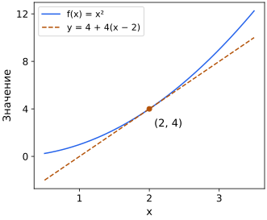

## Чему научимся

Вычислять производные простых выражений и объяснять множители правила цепочки.

## Производная: от средней скорости к мгновенной

Средняя скорость изменения на шаге $h\ne0$ равна $(f(x+h)-f(x))/h$. Уменьшая шаг, получаем производную — мгновенную скорость изменения. Штрих в $f'(x)$ обозначает производную:

$$f'(x)=\lim_{h\to0}\frac{f(x+h)-f(x)}h.$$

У $f(x)=x^2$ числитель равен $(x+h)^2-x^2=2xh+h^2$. После деления на $h$ остаётся $2x+h$, а его предел при $h\to0$ равен $2x$. Поэтому $f'(x)=2x$. Число $2x$ задаёт локальную скорость изменения; ниже проверим, как по ней приближённо вычислить изменение на маленьком шаге.

Производная константы равна 0; $(x^k)'=kx^{k-1}$ для положительного целого $k$; производная суммы — сумма производных; постоянный множитель выносится. Если $u$ и $v$ — функции одной переменной, для их произведения $(uv)'=u'v+uv'$. Из часто используемых функций: $(e^x)'=e^x$ и $(\ln x)'=1/x$ при $x>0$.

Ещё одно полезное правило: $(1/x)^{\prime}=-1/x^2$ при $x\ne0$. Правила для экспоненты, логарифма и обратной величины здесь принимаем без вывода из предела. Правило для вложенных функций сейчас разберём подробнее.

## Разобранный пример: правило цепочки

Композиция $f(g(x))$ означает, что сначала вычисляется $g$, затем $f$. Её производная равна $f'(g(x))g'(x)$: нужно учесть оба изменения.

Например, у $e^{2x}$ производная $2e^{2x}$: к производной экспоненты добавляется внутренняя скорость 2. У $\ln(3x)$ при $x>0$ производная $(1/(3x))\cdot3=1/x$.

Для $L(w)=(2w-6)^2$ внутренняя функция — $g(w)=2w-6$, внешняя — квадрат. Получаем $L'(w)=2(2w-6)\cdot2=8w-24$. При $w=2$ производная −8: небольшое увеличение $w$ уменьшает ошибку. При $w=3$ ошибка и производная равны нулю.

Минимум — значение не больше значений функции в рассматриваемой области; локальный минимум сравнивается только с достаточно близкими точками. Положительная производная на интервале означает возрастание, отрицательная — убывание. Точки нулевой производной — кандидаты на минимум, но не гарантия: у $x^3$ производная в нуле равна 0, а минимума нет. При поиске на отрезке проверяйте также границы. В точке излома, например у $|x|$ в нуле, производная может не существовать.

## Разобранный пример: маленькое изменение

У $f(x)=x^2$ при x = 3 производная 6. Шаг h = 0.01 даёт приближённое изменение 0.06, точное — $3.01^2-3^2=0.0601$. Ошибка приближения равна $h^2$. При уменьшении h в десять раз она уменьшается в сто раз.

Это локальное приближение. Для шага h = 2 линейное изменение равно 12, а точное 16. Большой шаг требует осторожности даже для простой функции. При поиске минимума проверяйте также границы допустимой области и места, где производная не существует.

## Разобранный пример: наклон касательной

У f(x)=x² в точке x=2 значение 4 и производная 4. Линейное приближение задаёт прямую y=4+4(x−2). Для x=2.1 она даёт 4.4, настоящий квадрат 4.41. Для x=3 прямая даёт 8, функция 9: ошибка выросла, потому что приближение локальное.

Касательная описывает первую скорость изменения около точки, а не заменяет весь график. При отрицательной производной маленькое увеличение входа уменьшает значение, при положительной — увеличивает. Нулевая производная требует анализа соседних значений, границ и области определения, прежде чем делать вывод о минимуме.

## Типичные ошибки

Не забывайте внутренний множитель правила цепочки. Касательная даёт локальное приближение, а нулевая производная сама по себе не доказывает минимум.

Точка (2,4) принадлежит и параболе, и пунктирной касательной. Их наклоны в этой точке совпадают, но значения вдали от неё уже различаются.

## Задачи

### 1. Базовая

Найдите производную 3x² + 2x − 7.

Подсказка

Примените правила суммы и степени.

Решение

Производные слагаемых: 6x, 2 и 0. Их сумма 6x+2.

### 2. Базовая

Чему равна производная константы?

Подсказка

Значение не меняется при изменении входа.

Решение

Ноль: при любом изменении входа константа не меняется, поэтому все разностные отношения равны нулю.

### 3. Прикладная

Найдите производную (3x+1)² при x=1.

Подсказка

Учтите внутреннюю производную 3.

Решение

Внешний квадрат даёт 2(3x+1), внутренняя функция — множитель 3. Получаем 6(3x+1), при x=1 — 24.

### 4. Прикладная

Приблизьте изменение x² при x=2 и шаге 0.01.

Подсказка

Умножьте производную на шаг.

Решение

4 · 0.01 = 0.04; точное изменение 0.0401.

### 5. Олимпиадная

Почему f′(0)=0 не доказывает минимум?

Подсказка

Рассмотрите x³.

Решение

У x³ производная в 0 равна нулю, но рядом есть как меньшие, так и большие значения.

### 6. Олимпиадная
Существует ли производная $f(x)=|x|$ в точке 0? Используйте определение производной и отдельно рассмотрите положительные и отрицательные h.

Подсказка

Найдите $(f(h)-f(0))/h$ с каждой стороны от нуля.

Решение

При h>0 отношение $|h|/h=1$. При h<0 имеем $|h|=-h$, поэтому отношение равно −1. Односторонние пределы различаются, общего предела нет. Следовательно, f′(0) не существует, хотя сама функция в нуле определена и непрерывна.

## Итоги

Производная описывает изменение на малом шаге. Для вложенного выражения правило цепочки учитывает внутренний множитель; нулевая производная требует дальнейшей проверки, прежде чем объявлять минимум.

## Самопроверка

Вычислите касательную и два приближения. Почему нулевой наклон и минимум — не одно утверждение?

Для перехода дальше достаточно базовых и прикладных задач; олимпиадные можно отложить.
