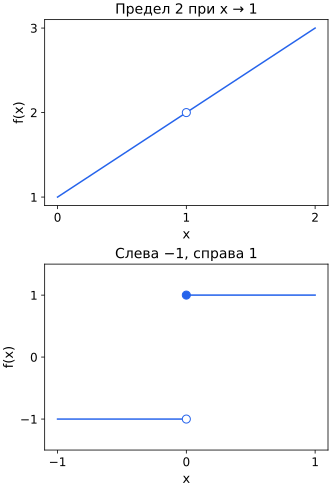

## Чему научимся

Различать значение функции, предел и непрерывность в точке.

## Предел и непрерывность

Запись $\lim_{x\to a}f(x)=L$ означает: значения функции можно сделать сколь угодно близкими к $L$, взяв $x$ достаточно близко к $a$, при $x\ne a$. Стрелка $x\to a$ читается «$x$ стремится к $a$». Проверяются приближения с обеих сторон, если они входят в область определения.

Для $f(x)=(x^2-1)/(x-1)$ точка $x=1$ исключена. При остальных $x$ числитель раскладывается как $(x-1)(x+1)$; сокращение общего множителя даёт $x+1$. Например, для $x=0.9,0.99,1.01,1.1$ значения равны $1.9,1.99,2.01,2.1$. При приближении к 1 с обеих сторон они стремятся к 2. Самого значения $f(1)$ нет. Функция непрерывна в точке, если определена там, предел существует и совпадает со значением. Чтобы продолжить этот пример непрерывно, можно определить $f(1)=2$.

Односторонний предел учитывает приближение только слева или только справа. Если оба направления допустимы, для общего предела их результаты должны совпасть. Ниже сравним устранимый разрыв и скачок: это разные причины нарушения непрерывности.

## Разобранный пример: значение и предел

Рассмотрим функцию, равную $x+1$ при $x\ne1$, но имеющую значение 10 при x = 1. В точках 0.99 и 1.01 она принимает 1.99 и 2.01. Предел равен 2, а значение в самой точке — 10. Значит, функция не непрерывна в 1.

Непрерывность связывает три условия: значение существует, предел существует, и они совпадают. Отсутствие любого из них нарушает непрерывность.

## Приближение с разных сторон

Слева от точки рассматривают входы меньше неё, справа — больше. Например, к нулю слева приближаются −0.1, −0.01, −0.001, а справа — 0.1, 0.01, 0.001. Важно сравнить поведение на обоих направлениях, а не только получить близкие ответы с одной стороны.

## Разобранный пример: два направления приближения

Функция равна −1 при x<0 и 1 при x≥0. При приближении к нулю слева значения остаются −1, справа — 1. Одного общего предела нет, даже если мы отдельно определим f(0)=0 или любое другое число. Менять значение в самой точке недостаточно, чтобы согласовать поведение вокруг неё.

Для (x²−1)/(x−1) при x≠1 сокращение даёт x+1. Предел при x→1 равен 2, но исходная дробь при x=1 не определена. Если доопределить значение 2, разрыв устраняется. Это другой случай: оба направления уже согласованы.

Таблица близких чисел помогает выдвинуть гипотезу, но не доказывает её для всех сколь угодно близких точек.

## Типичные ошибки

Не заменяйте предел значением в самой точке. Для общего предела нужно согласование приближений с обеих допустимых сторон; конечная таблица не является доказательством.

Сверху пустой кружок (1,2) показывает исключённое значение исходной дроби. Снизу изображён последний пример: −1 при x<0 и 1 при x≥0. Пустой кружок не входит в график, закрашенный входит. Поэтому значение в нуле равно 1, хотя предел слева равен −1.

## Задачи

### 1. Базовая

Найдите $\lim_{x\to2}(3x+1)$.

Подсказка

Линейная функция непрерывна.

Решение

Линейное правило непрерывно: при x→2 значение 3x+1 стремится к 3·2+1=7.

### 2. Базовая

Обязательно ли предел равен значению функции?

Подсказка

В самой точке может быть другое значение.

Решение

Нет. У (x²−1)/(x−1) предел при x→1 равен 2, хотя исходная функция в точке 1 не определена.

### 3. Прикладная

Найдите предел $(x^2-4)/(x-2)$ при x → 2.

Подсказка

Разложите числитель.

Решение

После сокращения остаётся x + 2; предел 4.

### 4. Прикладная

Как продолжить (x²−1)/(x−1) непрерывно в точке 1?

Подсказка

Поставьте значение предела.

Решение

При x≠1 сокращаем дробь до x+1. Её предел при x→1 равен 2; нужно определить значение в точке 1 как 2.

### 5. Олимпиадная

Можно ли убрать скачок от 0 слева к 1 справа одним значением в точке?

Подсказка

Сравните односторонние пределы.

Решение

Нет: они различаются независимо от значения в точке.

### 6. Олимпиадная

Доказывают ли сто близких численных проверок существование предела?

Подсказка

Не проверены все приближения.

Решение

Нет. Они дают свидетельство, но обоснование должно описывать поведение всех достаточно близких допустимых входов.

## Итоги

Предел описывает поведение рядом с точкой, а значение функции — в самой точке. Для непрерывности нужны оба и их совпадение; скачок нельзя устранить заменой одного значения.

## Самопроверка

Сравните скачок и устранимый разрыв. Какие сведения дают односторонние приближения и чего не доказывает конечная таблица?

Для перехода дальше достаточно базовых и прикладных задач; олимпиадные можно отложить.
