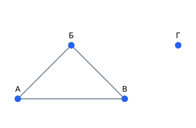

## Чему научимся

Описывать связи графом и выбирать между списком рёбер, списками соседей и матрицей.

## От карты к объектам и связям

Пусть кабинеты А, Б, В, Г соединены проходами А—Б, Б—В, А—В. Кабинеты называют **вершинами**, прямые связи — **рёбрами**. Граф состоит из множества вершин и множества рёбер. Кабинет Г остаётся вершиной, хотя ни с кем не соединён: он изолирован. Нельзя восстанавливать все вершины только по списку рёбер.

Если проход разрешён в обе стороны, граф неориентированный. Если стрелка показывает направление, граф ориентированный: наличие А→Б не означает Б→А. Ребро с числом, например временем перехода, называется взвешенным. В этом уроке используем простые графы без петель и повторяющихся рёбер.

## Разобранный пример: три записи одной карты

Список рёбер: `(А,Б), (Б,В), (А,В)`. Списки соседей: А: Б,В; Б: А,В; В: А,Б; Г: пусто. В неориентированном графе каждое ребро присутствует в двух списках соседей. Степень вершины — число её соседей. У А, Б и В степень 2, у Г — 0. Сумма степеней 6 равна удвоенному числу рёбер 3.

Матрица смежности задаёт таблицу нулей и единиц: в строке вершины стоит 1 в столбцах её соседей. Для четырёх вершин нужна таблица 4×4 даже при трёх рёбрах. Список соседей обычно экономнее для редкой сети, матрица удобна для проверки конкретной связи. Порядок вершин нужно записать отдельно.

## Что утверждает модель связей

Ребро говорит только о выбранном отношении. Связь двух пользователей может означать дружбу, переписку или совместную покупку; это разные графы. Отсутствие ребра может означать отсутствие наблюдения, а не отсутствие отношения. До алгоритма нужно определить смысл вершины, ребра и направления.

Для школьной карты один кабинет — один объект. Если две вершины обозначают один и тот же реальный кабинет под разными именами, ошибки данных не исправит ни один обход.

## Типичные ошибки

Не путайте вершины с рёбрами. Для направленных связей степени входа и выхода различаются. Изолированные объекты тоже входят в данные.

Три отрезка — рёбра А—Б, Б—В, А—В; у Г отрезков нет. Положение вершин выбрано только для удобства рисунка: длины нарисованных отрезков не задают время перехода или вес ребра.

## Задачи

### 1. Базовая

Сколько вершин на карте из объяснения?

Подсказка

Не забудьте изолированный кабинет.

Решение

Четыре, включая Г.

### 2. Базовая

Обязательно ли Б→А при наличии А→Б?

Подсказка

Уточните тип графа.

Решение

В ориентированном графе нет; в неориентированном связь симметрична.

### 3. Прикладная

Найдите степени графа с рёбрами А—Б, Б—В.

Подсказка

Сосчитайте соседей каждой вершины.

Решение

Степени А,Б,В равны 1,2,1; сумма 4 равна 2·2.

### 4. Прикладная

Как записать изолированную вершину списками соседей?

Подсказка

У вершины нет соседей, но она существует.

Решение

Добавить ключ вершины с пустым списком. Если её опустить, число вершин изменится.

### 5. Олимпиадная

Почему сумма степеней неориентированного графа чётна?

Подсказка

Каждое ребро имеет два конца.

Решение

Каждое ребро добавляет по единице двум степеням, поэтому сумма равна 2|E|.

### 6. Олимпиадная

Почему для дороги с односторонним движением нельзя заменить ориентированный граф неориентированным?

Подсказка

Появятся запрещённые маршруты.

Решение

Замена разрешит движение против стрелки. Это другая задача достижимости, а не просто другое хранение тех же данных.

## Итоги и самопроверка

Опишите три представления карты и выберите одно для большой редкой сети. Объясните, почему смысл отсутствующего ребра нужно знать до анализа.

Для перехода дальше достаточно базовых и прикладных задач. Олимпиадные задачи можно отложить.
