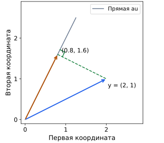

## Чему научимся

Находить простое приближение по сумме квадратов и проверять ортогональность остатка.

## Проекция и приближение

Если точного решения нет, можно выбрать веса с наименьшим $\|Xw-y\|_2^2$ — суммой квадратов ошибок по объектам. Это и означает минимизировать ошибку. Все векторы $Xw$ образуют пространство линейных комбинаций столбцов. Ближайший к $y$ вектор в этом пространстве называют его ортогональной проекцией. «Ортогональный» означает «перпендикулярный»: остаток, то есть разность ответа и предсказания, имеет нулевое скалярное произведение с каждым столбцом $X$.

Например, при одном столбце $u=(1,1)$ и $y=(2,4)$ допустимые предсказания имеют вид $(a,a)$. Раскроем скобки: ошибка $(a-2)^2+(a-4)^2=2a^2-12a+20=2(a-3)^2+2$. Квадрат неотрицателен и обращается в ноль при $a=3$, поэтому это значение даёт минимум. Проекция — $(3,3)$, остаток $y-(3,3)=(-1,1)$; его скалярное произведение с $u$ равно 0. Проекция может быть единственной даже при нескольких наборах весов для зависимых столбцов.

## Разобранный пример: постоянный ответ

Для ответов 1 и 5 разрешены только одинаковые предсказания (a, a). Сумма квадратов ошибок равна $(a-1)^2+(a-5)^2=2(a-3)^2+8$. Минимум достигается при a = 3: квадрат неотрицателен и обращается в ноль именно там.

Ответ (3, 3) — ближайший допустимый вектор к (1, 5). Остаток (−2, 2) перпендикулярен (1, 1), потому что скалярное произведение равно −2 + 2 = 0. Геометрическая формулировка и вычисление ошибки описывают одну задачу.

## Ответы и веса

Проекция определяет лучший вектор предсказаний. Если столбцы таблицы зависимы, одни и те же предсказания могут получаться разными весами. Поэтому нужно различать единственность ближайшего ответа и единственность параметров модели.

Для проверки найдите допустимый ответ, вычислите остаток и проверьте скалярные произведения с направлениями пространства. Здесь используем евклидову длину: при другой мере ошибки правило лучшего приближения может измениться.

## Разобранный пример: проекция на одно направление

Пусть допустимые ответы имеют вид au для ненулевого u. Сумма квадратов ||au−y||² раскрывается в a²(u·u)−2a(u·y)+y·y. Дополняя квадрат, находим минимум при a=(u·y)/(u·u). Здесь не нужны производные: коэффициент квадрата u·u положителен.

Для u=(1,2),y=(2,1) получаем u·y=4,u·u=5,a=4/5. Проекция (0.8,1.6), остаток (1.2,−0.6). Их скалярная проверка с направлением: 1.2−1.2=0. Остаток перпендикулярен разрешённому движению, поэтому сдвиг приближения вдоль u не улучшит квадрат ошибки.

Если u=0, формула запрещена делением на ноль: допустим только нулевой ответ. Проверка условий важна до сокращения выражений.

## Типичные ошибки

Не путайте единственный лучший ответ с единственными весами. Формула коэффициента на направление требует ненулевого вектора и квадратичной евклидовой ошибки.

Стрелка из начала координат к (0.8,1.6) — допустимое приближение au. Пунктир от неё к y=(2,1) показывает остаток; значок прямого угла отмечает перпендикулярность. Масштабы по обеим осям одинаковы, поэтому геометрический прямой угол действительно виден как прямой.

## Задачи

### 1. Базовая

Что минимизируется в задаче урока?

Подсказка

Используется евклидов квадрат длины остатка.

Решение

Сумма квадратов разностей между разрешённым предсказанием и ответом, то есть квадрат евклидовой длины остатка.

### 2. Базовая

Что означает ортогональность остатка столбцу?

Подсказка

Проверьте скалярное произведение.

Решение

Скалярное произведение остатка с этим столбцом равно нулю. Это выражает перпендикулярность в выбранной евклидовой геометрии.

### 3. Прикладная

Найдите лучший ответ (a, a) для (2, 6).

Подсказка

Разложите сумму квадратов около среднего.

Решение

(a−2)²+(a−6)²=2(a−4)²+8. Минимум при a=4, поэтому лучший ответ (4,4).

### 4. Прикладная

Проверьте ортогональность остатка для предыдущей задачи вектору (1, 1).

Подсказка

Вычтите найденное предсказание из правильного ответа и вычислите скалярное произведение.

Решение

−2 · 1 + 2 · 1 = 0.

### 5. Олимпиадная

Может ли лучший вектор предсказаний быть единственным при неоднозначных весах?

Подсказка

Зависимые столбцы допускают разные представления одного вектора.

Решение

Да. Проекция одна, но наборы коэффициентов могут различаться.

### 6. Олимпиадная
Минимизируйте по всем вещественным a выражение $(a-2)^2+3(a-6)^2$ без производных. Почему среднее чисел 2 и 6 здесь не даёт минимум?

Подсказка

Раскройте скобки и выделите полный квадрат; учитывайте множитель 3.

Решение

Раскрываем: $a^2-4a+4+3a^2-36a+108=4a^2-40a+112=4(a-5)^2+12$. Квадрат неотрицателен, поэтому единственная точка минимума — a=5, значение 12. Обычное среднее 4 не учитывает больший вес второй ошибки: при a=4 цель равна $4+3\cdot4=16$, что хуже 12.

## Итоги

Проекция выбирает ближайший разрешённый вектор прогнозов по сумме квадратов. Остаток перпендикулярен разрешённым направлениям, но один вектор прогнозов иногда получается при разных весах.

## Самопроверка

Выведите коэффициент проекции через выделение квадрата. Какие две проверки подтверждают найденное приближение?

Для перехода дальше достаточно базовых и прикладных задач; олимпиадные можно отложить.
