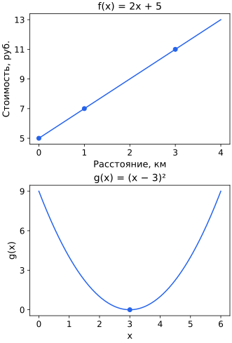

## Чему научимся

Читать функцию как правило, определять допустимые входы и вычислять композицию.

## Функции и графики

Функция сопоставляет каждому допустимому входу ровно один выход. Запись $f(x)=2x+1$ задаёт правило, а $f(3)=7$ — его применение. Область определения — допустимые входы. У $f(x)=1/x$ исключён ноль; у $\ln x$ допустимы только положительные числа.

Если вы уже знакомы с [функциями Python](../../../python/functions-files/functions-arguments/), запись f(3) похожа на вызов программы с аргументом 3. В математике рассматриваем именно соответствие входа и выхода. Печать на экран и изменение списка, которые может выполнять программа, не являются значением математической функции. Для чтения этого урока запускать код не нужно.

График состоит из точек $(x,f(x))$. У линейной функции $ax+b$ числа $a$ и $b$ фиксированы. При увеличении $x$ на 1 значение меняется на $a$: это наклон графика. Число $b$ — значение при $x=0$. При $a>0$ функция возрастает, при $a<0$ убывает. Для $x^2$ значения при $x$ и $-x$ совпадают: рост зависит от выбранного участка оси.

Модуль $|x|$ — расстояние числа от нуля. Например, $|-3|=3$. Неравенство $|x-2|\le1$ означает, что $x$ отстоит от 2 не более чем на 1, то есть $1\le x\le3$.

## Разобранный пример: стоимость поездки

Пусть $x$ — число километров, стоимость в рублях $f(x)=2x+5$. Число 5 задаёт начальную плату, 2 — плату за километр. Для $x=0,1,3$ получаем 5, 7, 11. Это три точки одного графика; одинаковое правило действует для всех допустимых расстояний $x\ge0$.

Отрицательное расстояние не подходит по смыслу задачи, хотя формула позволяет подставить его. Область определения задаётся не только арифметикой, но и смыслом входа.

## Квадрат и изменение направления

У $g(x)=(x-3)^2$ наименьшее значение равно 0 при $x=3$. При движении от 0 к 3 значения убывают: 9, 4, 1, 0. После 3 они растут. Поэтому утверждение «квадрат возрастает» нужно уточнять интервалом.

## Композиция функций

Запись $f(g(x))$ означает: сначала вычислите $g(x)$, затем примените к результату $f$. Например, $g(x)=x+1$, $f(t)=t^2$: при x = 2 получаем сначала 3, затем 9. Порядок действий важен: $g(f(2))=5$. Эта запись понадобится при изучении производных сложных выражений.

## Разобранный пример: вход композиции

Пусть g(x)=x−2, f(t)=1/t. В композиции f(g(x))=1/(x−2) запрещён вход x=2, потому что промежуточный результат стал бы нулём. В композиции g(f(x))=1/x−2 запрещён x=0. Проверять только область последней внешней формулы до подстановки недостаточно: нужно проследить весь путь.

| x | g(x) | f(g(x)) |
| --- | --- | --- |
| 1 | −1 | −1 |
| 2 | 0 | не определено |
| 3 | 1 | 1 |

На графике отсутствие значения нельзя молча заменить точкой на нуле. Оси подписывают величинами и единицами; одинаковое изображение кривой при разных масштабах осей может создавать разное зрительное впечатление наклона.

## Типичные ошибки

Не подставляйте недопустимый промежуточный результат в композицию. Три нанесённые точки не определяют произвольную функцию без заданного правила.

Сверху отмечены три рассчитанные стоимости: (0,5), (1,7), (3,11). Снизу отмечен минимум (3,0). Это разные функции, поэтому у графиков свои подписи и масштабы осей.

## Задачи

### 1. Базовая

Найдите $f(3)$ для $f(x)=2x+1$.

Подсказка

Подставьте число вместо x.

Решение

Подставляем x=3 в правило: 2·3+1=7.

### 2. Базовая

Входит ли 0 в область определения $1/x$?

Подсказка

Деление на ноль запрещено.

Решение

Нет. Подстановка нуля требует деления на ноль, которое не определено.

### 3. Прикладная

Вычислите $g(1)$ и $g(4)$ для $g(x)=(x-3)^2$.

Подсказка

Сначала разность, затем квадрат.

Решение

g(1)=(1−3)²=4, g(4)=(4−3)²=1. Сначала вычисляем разность, затем квадрат.

### 4. Прикладная

Решите $|x-2|\le1$.

Подсказка

Это расстояние от 2 не больше 1.

Решение

Расстояние от x до 2 не больше 1. Левая граница 2−1=1, правая 2+1=3; ответ — отрезок [1,3].

### 5. Олимпиадная
Для $f(t)=t^2$ и $g(x)=x+1$ найдите все вещественные x, при которых $f(g(x))=g(f(x))$. Объясните, почему одного совпадения недостаточно, чтобы считать композиции одинаковыми функциями.

Подсказка

Запишите обе композиции как выражения от x и раскройте квадрат суммы.

Решение

$f(g(x))=(x+1)^2=x^2+2x+1$, а $g(f(x))=x^2+1$. Равенство означает $2x=0$, поэтому единственный вход — x=0. В этой точке обе функции дают 1, но, например, при x=2 получаются 9 и 5. Равенство функций требует совпадения на всех входах общей области определения.

### 6. Олимпиадная

Может ли одна и та же формула иметь разные допустимые входы в разных задачах?

Подсказка

Рассмотрите длину и произвольное число.

Решение

Да. В задаче о длине вход неотрицателен, а алгебраическая функция может допускать отрицательные числа.

## Итоги

Функция задаёт один выход для каждого допустимого входа. График показывает пары «вход, выход», а композиция связывает два правила через промежуточный результат, который тоже должен быть допустим.

## Самопроверка

Сравните области определения двух композиций. Как по таблице построить три точки графика и показать запрещённый вход?

Для перехода дальше достаточно базовых и прикладных задач; олимпиадные можно отложить.
