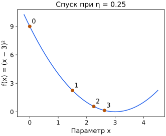

## Чему научимся

Выполнять шаг градиентного спуска и объяснять влияние размера шага.

## В какую сторону двигаться

Производная показывает локальную скорость изменения. Чтобы уменьшать функцию, делают маленький шаг против её знака: $x_{t+1}=x_t-\eta f'(x_t)$. Индекс t — номер шага, η>0 — размер шага, или темп обучения. В нескольких переменных производную заменяет градиент: все компоненты обновляются по одному старому набору параметров.

Это локальное правило: для достаточно малого шага ненулевой градиент указывает направление уменьшения дифференцируемой функции. Для произвольного большого шага такого обещания нет. Шаг не задают словами «всегда 0.01»: масштаб функции меняет разумные значения.

В формуле спуска x обозначает переменную, которую мы выбираем. При обучении модели такой переменной становится вес w, а обучающие признаки и ответы остаются фиксированными. Поэтому «изменить x» в этом математическом примере соответствует «обновить вес» в цикле обучения, а не изменить измерение объекта.

## Разобранный пример: чаша

Для f(x)=(x−3)² производная 2(x−3). Начнём с x₀=0, возьмём η=0.25. Градиент −6, новое x₁=0−0.25·(−6)=1.5. Ошибка уменьшилась с 9 до 2.25. На следующем шаге градиент −3, x₂=2.25, ошибка 0.5625.

Обозначим отклонение eₜ=xₜ−3. Правило превращается в eₜ₊₁=(1−2η)eₜ. Если 0<η<1, модуль множителя меньше 1 и отклонение сокращается. При η=1 оно меняет знак без уменьшения; при η>1 растёт. Эти границы относятся к конкретной функции, а не всем задачам.

## Когда остановиться

В учебном расчёте можно остановиться при малой норме градиента, малом изменении функции или после ограниченного числа шагов. Выберите условие остановки заранее. Нулевая производная не гарантирует глобального минимума невыпуклой задачи; малая разность функций может объясняться слишком маленьким шагом.

Для двух параметров не обновляйте первый, а затем не вычисляйте второй градиент по уже изменённому первому, если намеревались сделать обычный одновременный шаг. Сначала вычисляются все компоненты градиента в старой точке, затем весь новый вектор.

## Типичные ошибки

Большой градиент не требует большого шага. Проверяйте знак обновления и считайте компоненты из одной старой точки.

Цифры около точек — номера шагов, начиная с 0. По горизонтали отложен параметр x, по вертикали — значение цели. Третий шаг даёт x₃=2.25−0.25·2(2.25−3)=2.625.

| Номер шага t | Параметр xₜ | Значение (xₜ−3)² |
| --- | --- | --- |
| 0 | 0 | 9 |
| 1 | 1.5 | 2.25 |
| 2 | 2.25 | 0.5625 |
| 3 | 2.625 | 0.140625 |

## Задачи

### 1. Базовая

Какой знак перед градиентом в спуске?

Подсказка

Движемся против роста.

Решение

Минус при положительном размере шага.

### 2. Базовая

Что означает индекс t?

Подсказка

Это не степень.

Решение

Номер итерации алгоритма.

### 3. Прикладная

Для f=x², x=2, η=0.1 найдите следующий x.

Подсказка

Производная 2x.

Решение

2−0.1·4=1.6; значение функции уменьшилось с 4 до 2.56.

### 4. Прикладная

Для примера (x−3)² начните в 1 и возьмите η=0.5.

Подсказка

Сначала градиент −4.

Решение

x₁=1−0.5·(−4)=3, минимум достигнут за шаг.

### 5. Олимпиадная

Почему η=1 даёт колебания у примера?

Подсказка

Множитель отклонения равен −1.

Решение

Модуль ошибки сохраняется, знак меняется: точки отражаются относительно минимума.

### 6. Олимпиадная

Доказывает ли почти неизменная цель сходимость к минимуму?

Подсказка

Шаг может быть почти нулевым.

Решение

Нет. Нужно проверить градиент, масштаб шага, допустимость точки и другие условия задачи.

## Итоги и самопроверка

Выпишите три шага для двух разных η и сравните цель. Объясните, почему граница шага зависит от кривизны чаши.

Для перехода дальше достаточно базовых и прикладных задач. Олимпиадные задачи можно отложить.
