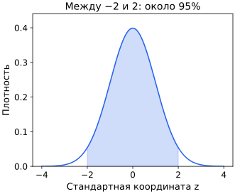

## Чему научимся

Находить вероятности как площади под плотностью и интерпретировать параметры нормальной модели.

## Когда отдельных значений слишком много

Время ожидания моделируют любым числом на промежутке от 0 до 10 минут. Для равномерной модели плотность f(x)=0.1 внутри этого промежутка и 0 вне его. При a≤b вероятность интервала от a до b — площадь: $P(a\le X\le b)=\int_a^b f(x)\,dx$. Так, ожидание от 2 до 5 минут имеет вероятность 3·0.1=0.3.

Плотность неотрицательна, её полная площадь равна 1. Значение плотности само по себе не вероятность. Если время равномерно на [0,0.2], плотность равна 5: это допустимо, поскольку площадь 5·0.2=1. Для непрерывной модели вероятность ровно одной точки равна 0; измеренная запись времени округлена и соответствует маленькому интервалу.

## Разобранный пример: нормальная модель

Нормальное распределение имеет колоколообразную плотность, центр μ и стандартное отклонение σ>0. Его формула $f(x)=\frac1{\sigma\sqrt{2\pi}}\exp(-\frac{(x-\mu)^2}{2\sigma^2})$. exp(t) означает e в степени t; π — знакомая постоянная окружности. Здесь формулу читаем по смыслу: дальше от центра квадрат отклонения больше, плотность меньше; больший σ растягивает колокол.

Если μ=100, σ=10, значение 120 расположено на два стандартных отклонения выше центра: z=(120−100)/10=2. Преобразование Z=(X−μ)/σ называется стандартизацией; у нормальной модели оно даёт центр 0 и стандартное отклонение 1.

Около 68% вероятности нормальной модели приходится на значения между μ−σ и μ+σ, около 95% — между μ−2σ и μ+2σ. Это приближённые свойства именно нормального распределения, а не любого набора данных.

## Когда колокол не подходит

Нормальная модель допускает любые вещественные значения, в том числе отрицательные. Для времени ожидания с большим разбросом или числа кликов она может быть плохим описанием. Гистограмма помогает увидеть форму, но не доказывает выбранное распределение. У среднего набора и у отдельных наблюдений также могут быть разные распределения.

## Типичные ошибки

Не подставляйте плотность вместо вероятности интервала. Нормальность нельзя выводить только из среднего и стандартного отклонения.

Заштрихована вероятность P(−2≤Z≤2)≈0.9545, то есть около 95.45%. Высота кривой в центре около 0.399 — это плотность, а не вероятность 39.9%. Границы −2 и 2 относятся к стандартной координате z, а не к исходным единицам измерения.

## Задачи

### 1. Базовая

Вероятность или плотность может превышать 1?

Подсказка

Площадь должна быть 1.

Решение

Плотность может; вероятность события не может.

### 2. Базовая

Какова полная площадь под плотностью?

Подсказка

Событие включает все исходы.

Решение

Ровно 1.

### 3. Прикладная

Для равномерного X на [0,8] найдите P(2≤X≤6).

Подсказка

Длина интервала делится на общую длину.

Решение

4/8=1/2.

### 4. Прикладная

Найдите z для x=70, μ=50, σ=10.

Подсказка

Вычтите центр и разделите на масштаб.

Решение

z=2.

### 5. Олимпиадная

Значит ли вероятность точки 0, что непрерывное измерение невозможно?

Подсказка

Прибор записывает округлённый интервал.

Решение

Нет. Модель распределяет вероятность по интервалам; каждое измерение попадает в один из них. Нулевая вероятность отдельной точки не делает весь опыт невозможным.

### 6. Олимпиадная

У набора среднее 10 и σ=2. Обязательно ли 95% значений в [6,14]?

Подсказка

Предположена ли нормальность?

Решение

Нет. Например, возьмём 18 значений: шестнадцать раз 10, один раз 4 и один раз 16. Среднее равно 10, средний квадрат отклонений — $(36+36)/18=4$, поэтому σ=2. В [6,14] находятся только шестнадцать значений из восемнадцати, примерно 88.9%. Правило о 95% относится к нормальной модели; среднего и стандартного отклонения недостаточно, чтобы её обосновать.

## Итоги и самопроверка

Нарисуйте прямоугольную плотность на [0,4] и заштрихуйте вероятность [1,3]. Объясните, почему высота и площадь отвечают на разные вопросы.

Для перехода дальше достаточно базовых и прикладных задач. Олимпиадные задачи можно отложить.
