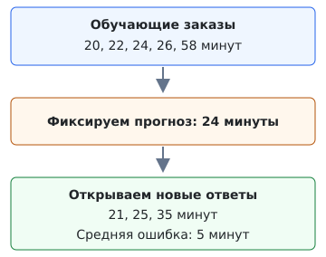

## Чему научимся

- Отличать признаки объекта от ответа, который нужно предсказать.
- Строить простое начальное решение только по обучающим данным.
- Измерять ошибку числового прогноза и долю верных ответов.

## План занятия

1. Превратим задачу кружка в задачу машинного обучения.
2. Сделаем первый прогноз и проверим его на новых заказах.
3. Изменим вид ответа и способ проверки.

## Что будем предсказывать

В школьном кружке один 3D-принтер. Перед печатью новой фигурки нужно оценить, сколько минут она займёт. От этого зависит, успеет ли следующий участник напечатать свою работу.

О прошлых заказах сохранилась таблица. **Все числа придуманы для занятия**: они помогают разобрать эксперимент, но не описывают работу настоящего принтера.

| Заказ | Высота фигурки, см | Время печати, мин | Часть данных |
| --- | --- | --- | --- |
| p01 | 3 | 20 | обучение |
| p02 | 4 | 22 | обучение |
| p03 | 5 | 24 | обучение |
| p04 | 6 | 26 | обучение |
| p05 | 10 | 58 | обучение |
| p06 | 4 | 21 | проверка |
| p07 | 5 | 25 | проверка |
| p08 | 7 | 35 | проверка |

**Объект** — один заказ. **Признак** — известное до печати свойство фигурки, например высота. **Целевая переменная**, или ответ, — время печати. **Модель** получает признаки и выдаёт прогноз.

Мы предсказываем число, поэтому это задача **регрессии**. Если спрашивать «успеет ли фигурка напечататься за 30 минут?», ответами станут «да» и «нет». Это уже **классификация**. Вид задачи определяется ответом, а не тем, что в таблице есть числа.

Фактическое время окончания печати нельзя брать в признаки: до запуска его ещё нет. Использование сведений, раскрывающих ответ, называется **утечкой данных**. Номер заказа нужен для различения строк, но сам по себе не объясняет длительность печати.

## Как устроить проверку

Первые пять заказов составляют **обучающую часть**, или train. По ним подбираем модель. Последние три — **тестовая часть**, или test. Представим, что их ответы пока спрятаны: открываем их после того, как правило предсказания выбрано.



Обучающие и тестовые заказы в этом примере различны. Если скопировать один заказ в обе части, проверка станет легче: модель встретит уже знакомый пример. Для настоящего эксперимента нужны отдельные новые наблюдения.

## Разобранный пример простого решения

Начнём с модели, которая всем заказам предсказывает одно время. Она пока не использует высоту фигурки. Такое простое начальное решение называют **baseline**. Следующие модели должны показать, чем они полезнее этого отправного результата.

Возьмём медиану обучающих времён. Для нечётного числа значений **медиана** — число посередине после сортировки. В ряду 20, 22, 24, 26, 58 это 24. Среднее равно 30: один долгий заказ заметно сдвинул его вверх.

Чтобы оценить числовой прогноз, посчитаем **средний модуль ошибки**, или MAE. Для каждого заказа берём разницу между прогнозом и ответом без знака, складываем разницы и делим на число заказов:

$$\operatorname{MAE}=\frac{1}{n}\sum_{i=1}^{n}|\widehat y_i-y_i|.$$

Здесь $n$ — число заказов, $y_i$ — настоящее время, $\widehat y_i$ — прогноз. Ошибка измеряется в минутах, как и время печати.

На обучающих данных у прогноза 24 ошибки равны 4, 2, 0, 2 и 34. Средняя ошибка — $\frac{42}{5}=8{,}4$ минуты. У прогноза 30 она равна 11,2 минуты. Среди постоянных прогнозов медиана даёт наименьшую MAE; среднее подходит для другой цели — уменьшения суммы квадратов ошибок. К ней вернёмся в линейной регрессии.

Теперь фиксируем прогноз **24 минуты** и открываем тестовые ответы:

| Настоящее время | Прогноз | Модуль ошибки |
| --- | --- | --- |
| 21 | 24 | 3 |
| 25 | 24 | 1 |
| 35 | 24 | 11 |

MAE на новых заказах равна $\frac{3+1+11}{3}=5$ минут. Это средняя ошибка на трёх придуманных примерах. Она не обещает ошибку ровно 5 минут для следующего заказа.

## Повторим эксперимент на Python

Понадобится только стандартная библиотека Python. Разделение данных уже задано; новые значения для проверки не участвуют в выборе прогноза.

```python
from statistics import mean, median

train_minutes = [20, 22, 24, 26, 58]
test_minutes = [21, 25, 35]

prediction = median(train_minutes)
assert prediction == 24
assert mean(train_minutes) == 30
```

Функция принимает два списка одинаковой длины: правильные ответы и прогнозы. Проверка длины нужна, чтобы не потерять заказы при попарном обходе.

```python
def mae(answers, predictions):
    if not answers or len(answers) != len(predictions):
        raise ValueError("Нужны непустые списки одинаковой длины")
    errors = [abs(p - y) for y, p in zip(answers, predictions)]
    return sum(errors) / len(errors)

train_predictions = [prediction] * len(train_minutes)
test_predictions = [prediction] * len(test_minutes)

assert mae(train_minutes, train_predictions) == 8.4
assert mae(test_minutes, test_predictions) == 5.0
print("Прогноз:", prediction, "минут")
print("MAE на новых заказах:", mae(test_minutes, test_predictions))
```

## Если нужен ответ да или нет

Вернёмся к вопросу «успеет ли заказ за 30 минут?». Из пяти обучающих заказов четыре успели. Простейшее правило для этой задачи — всегда отвечать «да»: это самый частый класс в обучении.

Теперь подходит **accuracy** — доля верных ответов. На тесте ответы равны «да», «да», «нет». Наше правило угадывает два из трёх: accuracy равна $\frac{2}{3}$, или примерно 67 %. MAE и accuracy отвечают на разные вопросы: насколько промахнулись в минутах и как часто правильно выбрали класс.

```python
from collections import Counter

train_labels = [minutes <= 30 for minutes in train_minutes]
test_labels = [minutes <= 30 for minutes in test_minutes]
label = Counter(train_labels).most_common(1)[0][0]
correct = sum(answer == label for answer in test_labels)
accuracy = correct / len(test_labels)

assert label is True
assert accuracy == 2 / 3
print("Доля верных ответов:", round(accuracy, 2))
```

У этой модели нет сложного алгоритма, но есть обучение: мы определили ответ по прошлым данным. Для числовой задачи это была медиана, для классификации — самый частый класс.

## Практика

1. Для другой мастерской обучающие времена равны `[12, 14, 16, 18, 40]`, а проверочные — `[15, 21]`. Найдите медиану по обучающей части, сделайте два одинаковых прогноза и вычислите MAE. Самопроверка: прогноз 16, ошибка 3 минуты.
2. Правильные классы четырёх новых заказов: `да, нет, да, нет`. Модель всем отвечает `да`. Вычислите accuracy. Самопроверка: 0,5.

## Типичные ошибки

- Вычислять медиану по обучению и тесту вместе: тогда тестовые ответы уже повлияли на модель.
- Менять правило после просмотра тестовых ошибок и сообщать результат как независимую проверку.
- Путать минуты с процентом верных ответов или делать выводы о настоящем принтере по придуманным числам.

## Самопроверка

### 1. Что является объектом в нашей задаче?

A. Вся таблица заказов.<br>
B. Один заказ на печать.<br>
C. Один столбец таблицы.<br>
D. Только напечатанная фигурка без записи о ней.

<details>
<summary>Подсказка</summary>

Посмотрите, что описывает одна строка.

</details>

<details>
<summary>Решение</summary>

**B.** Одна строка соответствует одному заказу. Столбцы описывают его свойства и результат.

</details>

### 2. Какой признак доступен до начала печати?

A. Фактическое время окончания.<br>
B. Высота фигурки из её проекта.<br>
C. Сколько минут печать уже заняла к завершению.<br>
D. Правильный ответ тестового заказа.

<details>
<summary>Подсказка</summary>

Представьте момент перед нажатием кнопки запуска.

</details>

<details>
<summary>Решение</summary>

**B.** Размер известен из проекта до печати. Остальные варианты появляются позже или раскрывают ответ.

</details>

### 3. Нужно предсказать точное время печати. Какой это вид задачи?

A. Регрессия.<br>
B. Классификация.<br>
C. Сортировка строк.<br>
D. Поиск одинаковых заказов.

<details>
<summary>Подсказка</summary>

Какого вида ответ: число или название класса?

</details>

<details>
<summary>Решение</summary>

**A.** Время в минутах — числовой ответ. Для вопроса «успеет или нет» нужна классификация.

</details>

### 4. Чему равна медиана времён 20, 22, 24, 26, 58?

A. 20.<br>
B. 30.<br>
C. 24.<br>
D. 58.

<details>
<summary>Подсказка</summary>

В упорядоченном списке из пяти чисел найдите третье.

</details>

<details>
<summary>Решение</summary>

**C.** Посередине стоит 24. Число 30 — среднее этих времён.

</details>

### 5. Ответы равны 10 и 20, оба прогноза — 15. Какова MAE?

A. 0 минут.<br>
B. 10 минут.<br>
C. 15 минут.<br>
D. 5 минут.

<details>
<summary>Подсказка</summary>

Сначала найдите два модуля ошибки, затем среднее.

</details>

<details>
<summary>Решение</summary>

**D.** Ошибки равны 5 и 5, их среднее — 5. Ошибки с разными знаками не сокращаются.

</details>

### 6. Почему медиану нельзя вычислять по всей таблице до разделения?

A. Медиана существует только для пяти чисел.<br>
B. Тестовые ответы повлияют на модель.<br>
C. Python не умеет считать медиану восьми чисел.<br>
D. Вся таблица обязательно содержит одинаковые заказы.

<details>
<summary>Подсказка</summary>

Какую роль должны играть новые заказы?

</details>

<details>
<summary>Решение</summary>

**B.** Тест нужен для проверки уже выбранного правила. Использование его ответов при обучении нарушает эту проверку.

</details>

### 7. Модель верно ответила на три заказа из четырёх. Чему равна accuracy?

A. 0,75.<br>
B. 0,25.<br>
C. 3 минуты.<br>
D. 4.

<details>
<summary>Подсказка</summary>

Разделите число верных ответов на число всех заказов.

</details>

<details>
<summary>Решение</summary>

**A.** Три из четырёх — 0,75, или 75 %. У доли нет единиц времени.

</details>

### 8. Почему модель с постоянным ответом полезна?

A. Она всегда лучше нейросети.<br>
B. Она доказывает, что признаки не нужны.<br>
C. Она даёт отправной результат для сравнения.<br>
D. Она никогда не ошибается на новых данных.

<details>
<summary>Подсказка</summary>

Что должна показать следующая, более сложная модель?

</details>

<details>
<summary>Решение</summary>

**C.** Новая модель должна показать пользу по сравнению с простым решением. Сложность сама по себе не гарантирует улучшения.

</details>

### 9. Мы увидели тестовые ошибки и подобрали по ним новый прогноз. Что произошло?

A. Тест стал больше.<br>
B. Все данные стали обучающими автоматически.<br>
C. Модель обязательно стала лучше на будущих заказах.<br>
D. Тест начал участвовать в выборе модели.

<details>
<summary>Подсказка</summary>

Какие ответы помогли принять новое решение?

</details>

<details>
<summary>Решение</summary>

**D.** Проверка уже повлияла на модель. Для независимой оценки нового правила понадобятся другие данные.

</details>

### 10. MAE равна 5 минутам на трёх придуманных заказах. Что можно заключить?

A. Любой следующий заказ даст ошибку ровно 5 минут.<br>
B. Средний модуль ошибки на этих трёх заказах равен 5 минутам.<br>
C. Для настоящего принтера ошибка не превысит 5 минут.<br>
D. Правильно распознаны 5 % заказов.

<details>
<summary>Подсказка</summary>

Отделите результат конкретной проверки от обещания на будущее.

</details>

<details>
<summary>Решение</summary>

**B.** Мы проверили конкретный набор. Для вывода о настоящей работе нужны реальные независимые наблюдения.

</details>
