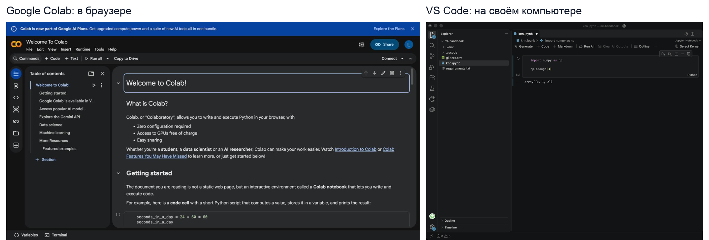
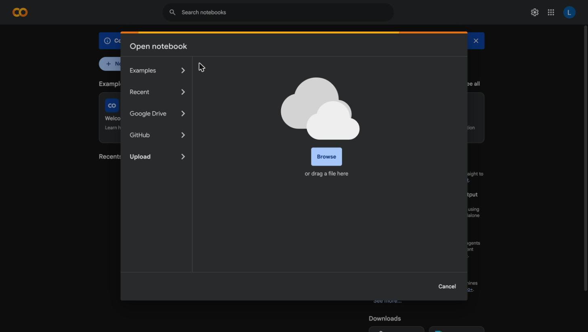
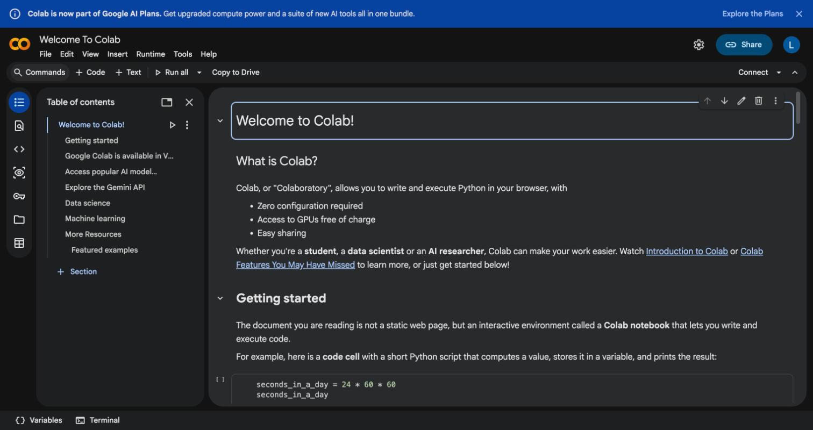
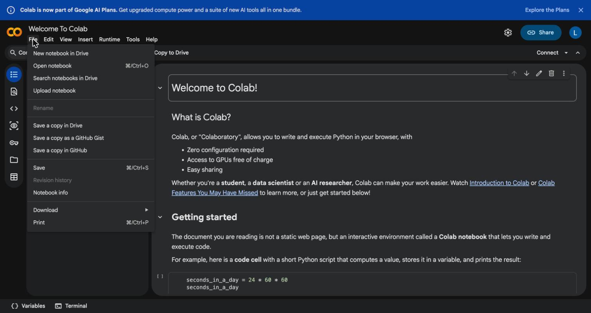
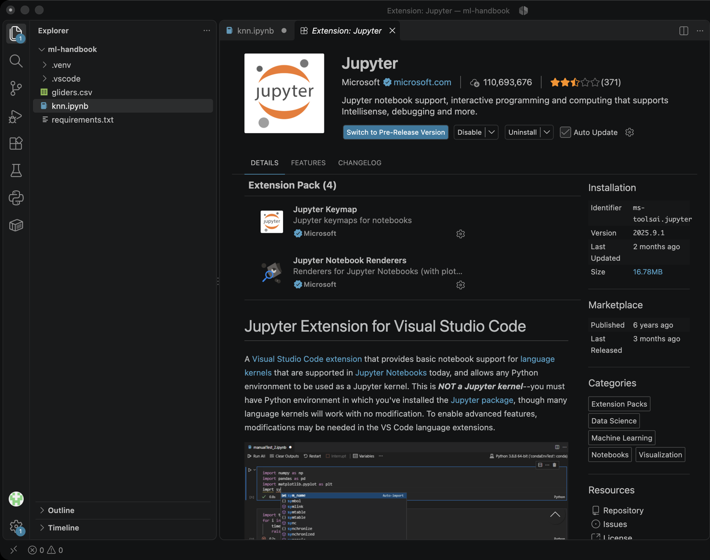
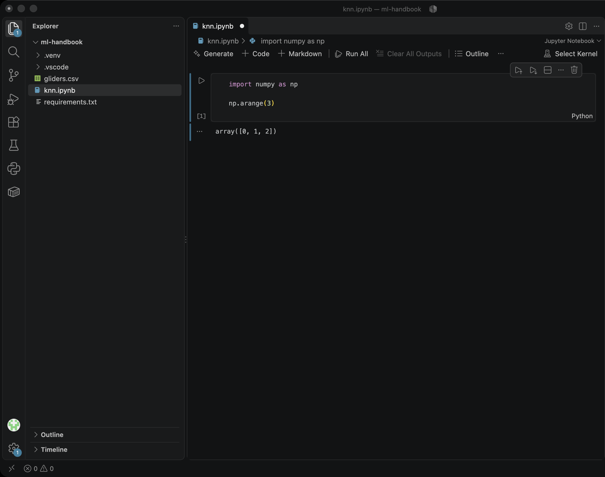

## Настройка окружения

Для того, чтобы наконец заняться обучением моделей, для начала нужно настроить окружение на вашем компьютере.

**Окружение** - набор установленных библиотек, их версий и настроек, в котором запускается код

На этом курсе мы будем работать с ноутбуками .ipynb. Это специальные файлы, в которых код выполняется не весь целиком, а по ячейкам

Обычный файл `.py` выполняется целиком: вы запускаете программу, и все строки идут подряд. Ноутбук `.ipynb` делится на **ячейки**. Каждую ячейку запускают отдельно (Shift+Enter), результат появляется сразу под ней, а переменные остаются в памяти для следующих ячеек. Поэтому в ноутбуках удобно пробовать идеи по шагам и смотреть промежуточные результаты.


После этого урока вы сможете открыть любой ноутбук `.ipynb` из учебника, выполнить в нём ячейки и установить нужные библиотеки. Для того, чтобы выполнять код ноутбуков, вам стоит выбрать способ работы с ними. Всего мы предлагаем 2 варианта:



*Рис. 2. Colab не требует установки. На своём компьютере нужны Python, виртуальная среда и VS Code.*

| Способ | Когда выбрать |
| --- | --- |
| Google Colab | Нужно начать за пять минут; компьютер слабый или нельзя ничего устанавливать. |
| VS Code на своём компьютере | Хочется работать без интернета, хранить файлы у себя и привыкнуть к инструментам разработчика. |

Инструмент выбирайте на свое усмотрение, но мы считаем, что Google Colab будет проще и даст быстрее погрузиться в мир машинного обучения

## Вариант 1. Google Colab

Нужен аккаунт Google и браузер.

1. Скачайте ноутбук урока (`.ipynb`).
2. Откройте [colab.research.google.com](https://colab.research.google.com/) и войдите в аккаунт Google. Нажмите **Upload notebook** («Загрузить блокнот») или выберите **File → Upload notebook**.
3. В окне **Open notebook** на вкладке **Upload** нажмите **Browse** и укажите файл либо перетащите его в окно.



*Рис. 3. Загрузка ноутбука: вкладка Upload, кнопка Browse.*

4. Нажмите **Connect** справа вверху. Colab выдаст временную виртуальную машину с Python и основными библиотеками.
5. Если нужен файл с данными (например, `gliders.csv`), откройте файловую панель слева (значок папки) и перетащите файл в неё. Панель покажет файлы, когда сеанс подключится.
6. Выполняйте ячейки сверху вниз: Shift+Enter.



*Рис. 4. Окно ноутбука: меню File и Runtime, кнопка Connect справа вверху, значок файловой панели (папка) слева.*

Интерфейс Colab англоязычный или русскоязычный в зависимости от настроек аккаунта; названия пунктов совпадают по смыслу. Сохранить результат можно через **File → Download**:



*Рис. 5. Меню File. Пункт Download сохраняет ноутбук как `.ipynb`.*

Что важно знать:

- Файлы и установленные библиотеки пропадают, когда сеанс заканчивается. Сохраните результат: **Файл → Скачать → .ipynb**.
- Colab уже содержит NumPy, pandas, matplotlib, scikit-learn и PyTorch. Если версия нужна точно как в учебнике, загрузите [requirements.txt](../../start/requirements.txt) в файловую панель и выполните в отдельной ячейке:

```python
%pip install -r requirements.txt
```

- После установки при запросе выберите **Среда выполнения → Перезапустить сеанс**.

## Вариант 2. VS Code на своём компьютере

### Как устроена среда

Нам нужны три вещи:

1. **Python 3.14** — интерпретатор, который выполняет код.
2. **Виртуальная среда `.venv`** — папка внутри проекта с собственным Python и библиотеками. Она не затрагивает системный Python, а разные проекты не мешают друг другу.
3. **VS Code** с расширениями **Python** и **Jupyter** — редактор, в котором открываются ноутбуки.


Шаги 1–2 зависят от системы, шаги 3–6 одинаковы везде. Сначала выполните шаги для своей системы.

### macOS

1. Откройте Терминал (Cmd+Пробел, «Terminal») и проверьте Python:

   ```bash
   python3 --version
   ```

   Нужна версия 3.14. Если версия ниже или команды нет, установите Python с [python.org/downloads](https://www.python.org/downloads/) (файл `.pkg`) или через Homebrew:

   ```bash
   brew install python@3.14
   ```

2. Установите VS Code с [code.visualstudio.com](https://code.visualstudio.com/): скачайте архив, распакуйте и перетащите приложение в «Программы».

Дальше переходите к [общим шагам](#общие-шаги-для-vs-code).

### Linux

Команды даны для Ubuntu/Debian; в других дистрибутивах названия пакетов отличаются.

1. Проверьте Python и установите модуль для виртуальных сред:

   ```bash
   python3 --version
   sudo apt update
   sudo apt install python3 python3-venv python3-pip
   ```

   Если в вашем дистрибутиве версия ниже 3.14, установите Python через [uv](https://docs.astral.sh/uv/): `uv python install 3.14`. Среду тогда создавайте командой `uv venv --python 3.14`.

2. Установите VS Code: скачайте пакет `.deb` с [code.visualstudio.com](https://code.visualstudio.com/) и выполните

   ```bash
   sudo apt install ./имя-файла.deb
   ```

   Либо установите через Snap: `sudo snap install code --classic`.

Дальше переходите к [общим шагам](#общие-шаги-для-vs-code).

### Windows

1. Скачайте установщик Python с [python.org/downloads](https://www.python.org/downloads/windows/). На первом экране установщика **поставьте галочку «Add python.exe to PATH»**, затем нажмите «Install Now».
2. Установите VS Code с [code.visualstudio.com](https://code.visualstudio.com/) (`VSCodeUserSetup`). Все параметры можно оставить по умолчанию.
3. Откройте PowerShell и проверьте Python:

   ```powershell
   python --version
   ```

   Если видите ошибку или открывается Microsoft Store, перезапустите PowerShell. Если не помогло, переустановите Python с галочкой PATH.

В Windows используйте `python` вместо `python3`, а активацию среды выполняйте командой `.venv\Scripts\Activate.ps1`. Если PowerShell запрещает запуск скрипта, выполните один раз:

```powershell
Set-ExecutionPolicy -Scope CurrentUser RemoteSigned
```

Дальше переходите к [общим шагам](#общие-шаги-для-vs-code).

### Общие шаги для VS Code

**Шаг 3. Создайте папку проекта и откройте её.** Создайте папку, например `ml-handbook`, положите в неё ноутбук, `gliders.csv` и [requirements.txt](../../start/requirements.txt). В VS Code выберите **File → Open Folder** и укажите эту папку.

**Шаг 4. Установите расширения.** Нажмите значок расширений слева (или Ctrl+Shift+X / Cmd+Shift+X), найдите и установите **Python** и **Jupyter** (оба от Microsoft).



*Рис. 6. Страница расширения Jupyter. Если расширение ещё не установлено, вместо Disable и Uninstall будет кнопка **Install**. Так же устанавливается расширение **Python**.*

**Шаг 5. Создайте виртуальную среду и установите библиотеки.** Откройте терминал в VS Code: **Terminal → New Terminal** (Ctrl+\`). Выполните команды для вашей системы.

macOS и Linux:

```bash
python3 -m venv .venv
source .venv/bin/activate
python -m pip install --upgrade pip
python -m pip install jupyter ipykernel -r requirements.txt
```

Windows (PowerShell):

```powershell
python -m venv .venv
.venv\Scripts\Activate.ps1
python -m pip install --upgrade pip
python -m pip install jupyter ipykernel -r requirements.txt
```

В начале строки терминала появится `(.venv)` — среда активна. Установка занимает несколько минут: PyTorch весит больше гигабайта.

**Шаг 6. Откройте ноутбук и выберите ядро.** Дважды щёлкните по `.ipynb` в проводнике. Справа вверху нажмите **Select Kernel → Python Environments** и выберите `.venv`. Если среды нет в списке, нажмите Ctrl+Shift+P (Cmd+Shift+P), выполните **Python: Select Interpreter** и укажите `.venv`.



*Рис. 7. Ноутбук в VS Code (macOS). Кнопка **Select Kernel** справа вверху открывает список сред; в проводнике слева видна папка `.venv`.*

Выполняйте ячейки значком ▶ слева от ячейки или Shift+Enter. Ячейки идут сверху вниз; для чистой проверки используйте **Restart → Run All**.

## Проверка

Создайте в ноутбуке ячейку и выполните её:

```python
import sys

import matplotlib
import numpy as np
import pandas as pd
import sklearn
import torch

print(sys.version.split()[0])
print(np.__version__, pd.__version__, matplotlib.__version__)
print(sklearn.__version__, torch.__version__)
```

Среда настроена, если нет ошибок, а версии близки к указанным в `requirements.txt`. В Colab версии могут отличаться: для уроков учебника это допустимо.

## Если не получилось

Нажмите на строку «Подробный разбор», чтобы увидеть решение.

| Проблема | Что сделать |
| --- | --- |
| `python: command not found` (macOS, Linux) | Используйте `python3`. После активации среды работает `python`. |
| Windows: `python` открывает Microsoft Store | Python не найден в PATH. Подробный разбор ниже. |
| `Activate.ps1 cannot be loaded` | PowerShell запретил запуск скриптов. Подробный разбор ниже. |
| `ModuleNotFoundError: No module named 'numpy'` | Ядро выбрано не из `.venv`: выберите его заново (шаг 6) или установите библиотеки в активированной среде. |
| `externally-managed-environment` (Linux) | Вы ставите библиотеки в системный Python. Сначала создайте и активируйте `.venv`. |
| Нет `venv` в Linux | `sudo apt install python3-venv`. |
| Ядра `.venv` нет в списке | Перезапустите VS Code; убедитесь, что установлен `ipykernel`. |
| Нет места или долгая установка PyTorch | Используйте Colab. |

**Windows: команда `python` открывает Microsoft Store**

Windows не нашёл установленный Python и предлагает скачать его из магазина. Либо Python не установлен, либо при установке не поставили галочку «Add python.exe to PATH».

<details>
<summary>Подробный разбор</summary>

1. Закройте все окна PowerShell и VS Code.
2. Нажмите Win, начните вводить «Параметры» и откройте **Параметры → Приложения → Установленные приложения**. Найдите в списке **Python 3.14**. Если его нет, переходите к шагу 5.
3. Нажмите «⋯» рядом с Python и выберите **Изменить → Modify**. Затем **Next**. В окне **Advanced Options** поставьте галочку **Add Python to environment variables** и нажмите **Install**. Если такого окна нет, выберите **Repair** и после него вернитесь к этому шагу.
4. Откройте PowerShell заново и выполните `python --version`. Должно вывести `Python 3.14.x`.
5. Если Python не установлен: скачайте установщик с [python.org/downloads/windows](https://www.python.org/downloads/windows/), запустите его и на **первом экране** поставьте галочку **Add python.exe to PATH**. Только после этого нажмите **Install Now**.
6. Если `python --version` всё равно открывает Store: **Параметры → Приложения → Дополнительные параметры → Псевдонимы выполнения приложений** (App execution aliases). Выключите переключатели у **python.exe** и **python3.exe** (App Installer). Перезапустите PowerShell.

</details>

**`Activate.ps1 cannot be loaded because running scripts is disabled`**

Команда `.venv\Scripts\Activate.ps1` запускает скрипт, а PowerShell по умолчанию запрещает запуск скриптов. Нужно один раз разрешить скрипты для вашего пользователя.

<details>
<summary>Подробный разбор</summary>

1. В PowerShell выполните команду:

   ```powershell
   Set-ExecutionPolicy -Scope CurrentUser RemoteSigned
   ```

2. PowerShell спросит подтверждение. Введите `Y` и нажмите Enter. Права администратора не нужны: изменение касается только вашего пользователя.
3. Закройте терминал в VS Code и откройте новый: **Terminal → New Terminal**.
4. Снова выполните `.venv\Scripts\Activate.ps1`. В начале строки должно появиться `(.venv)`.
5. Если сообщение осталось, проверьте политику командой `Get-ExecutionPolicy -List`. В строке `CurrentUser` должно быть `RemoteSigned`.
6. Запасной вариант без изменения политики: в терминале VS Code выберите профиль **Command Prompt** (стрелка рядом с «+» → Command Prompt) и активируйте среду командой `.venv\Scripts\activate.bat`.

</details>

## Самопроверка

- Вы можете запустить ячейку и увидеть вывод.
- Проверочная ячейка выводит версии библиотек без ошибок.
- Вы знаете, где лежит ноутбук и как его сохранить (в Colab — скачать `.ipynb`).
- Вы отличаете системный Python от Python внутри `.venv`.

Теперь можно переходить к следующим урокам. Если среда не заработала, вернитесь к таблице проблем или запустите ноутбук в Colab.
