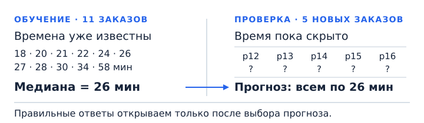

## Чему научимся

- Отличать признаки объекта от ответа, который нужно предсказать.
- Строить простое начальное решение только по обучающим данным.
- Измерять ошибку числового прогноза и долю верных ответов.

**Время и подготовка:** ориентир 6–7 часов с практикой. Нужны списки и функции Python, среднее значение и доли; перед работой с большими CSV познакомимся с двумя командами `pandas`.

## План занятия

1. Превратим задачу кружка в задачу машинного обучения.
2. Сделаем первый прогноз и проверим его на новых заказах.
3. Изменим вид ответа и способ проверки.

## Что будем предсказывать

В школьном кружке один 3D-принтер, и на него выстраивается очередь заказов. Перед печатью новой фигурки нужно оценить, на сколько минут она займёт принтер: так можно спланировать его загрузку и сказать следующему участнику, когда он сможет начать. До запуска известны высота фигурки и число разных цветов пластика в её проекте. Принтер печатает слоями одинаковой толщины, поэтому число слоёв пропорционально высоте.

В таблице есть одиннадцать уже выполненных заказов и пять новых, для которых время печати пока неизвестно. Знак «?» означает ответ, который нам предстоит предсказать. **Все числа придуманы для занятия**: они помогают разобрать эксперимент, но не описывают работу настоящего принтера.

| Заказ | Высота фигурки, см | Число цветов | Время печати, мин | Часть данных |
| --- | --- | --- | --- | --- |
| p01 | 3 | 1 | 20 | обучение |
| p02 | 4 | 2 | 22 | обучение |
| p03 | 5 | 1 | 24 | обучение |
| p04 | 6 | 3 | 26 | обучение |
| p05 | 10 | 2 | 58 | обучение |
| p06 | 3 | 2 | 18 | обучение |
| p07 | 4 | 2 | 21 | обучение |
| p08 | 6 | 1 | 27 | обучение |
| p09 | 7 | 2 | 28 | обучение |
| p10 | 8 | 3 | 30 | обучение |
| p11 | 9 | 2 | 34 | обучение |
| p12 | 3 | 1 | ? | проверка |
| p13 | 5 | 3 | ? | проверка |
| p14 | 6 | 2 | ? | проверка |
| p15 | 7 | 2 | ? | проверка |
| p16 | 9 | 3 | ? | проверка |

**Объект** — один заказ. **Признаки** — известные до печати свойства фигурки: высота и число цветов. **Целевая переменная**, или ответ, — время печати. **Модель** получает признаки и выдаёт прогноз.

Задача предсказания числа называется **регрессией**. Если спрашивать «успеет ли фигурка напечататься за 30 минут?», ответами станут «да» и «нет». Задача выбора одного из таких ответов называется **классификацией**. Вид задачи определяется ответом, а не тем, что в таблице есть числа.

Использование сведений, раскрывающих ответ (фактическое время окончания печати), называется **утечкой данных**. Номер заказа нужен для различения строк, но сам по себе не объясняет длительность печати. Одного числа цветов тоже недостаточно, чтобы узнать, сколько раз принтеру придётся переключаться между ними.

## Как устроить проверку

Первые одиннадцать заказов составляют **обучающую часть**, или train. По ним подбираем модель. Последние пять — **тестовая часть**, или test. Правильные времена для них есть в подготовленном учебном наборе, но при выборе модели мы их скрываем. Откроем ответы только после того, как зафиксируем правило прогноза.

Обучающие и тестовые заказы — разные наблюдения, хотя пары их доступных признаков иногда совпадают: например, у p01 и p12 одна высота и одно число цветов. Совпадающие признаки не гарантируют одинаковое время печати, потому что на него влияют и недоступные нам параметры. Если же скопировать целый заказ вместе с ответом в обе части, проверка станет легче: модель встретит уже знакомый пример.

## Разобранный пример простого решения

Начнём с модели, которая всем заказам предсказывает одно время. Она пока не использует ни высоту, ни число цветов. Такое простое начальное решение называют **baseline**. Следующие модели должны показать, чем они полезнее этого отправного результата.

Возьмём медиану обучающих времён. Для нечётного числа значений **медиана** — число посередине после сортировки (для чётного числа элементов обычно берут среднее значение центральных элементов). Упорядоченные времена равны 18, 20, 21, 22, 24, **26**, 27, 28, 30, 34, 58 минутам. Шестое из одиннадцати значений — 26; среднее равно 28. Долгий заказ на 58 минут сдвинул среднее вверх.



Чтобы оценить числовой прогноз, посчитаем **средний модуль ошибки**, или MAE (mean absolute error). Для каждого заказа берём разницу между прогнозом и ответом без знака, складываем разницы и делим на число заказов:

$$\operatorname{MAE}=\frac{1}{n}\sum_{i=1}^{n}|\widehat y_i-y_i|.$$

Здесь $n$ — число заказов, $y_i$ — настоящее время, $\widehat y_i$ — прогноз. Ошибка измеряется в минутах, как и время печати.

На обучающих данных сумма модулей ошибок прогноза 26 равна 72 минутам, а MAE — $\frac{72}{11}\approx6{,}55$ минуты. Для прогноза 28, равного среднему, сумма модулей ошибок составляет 76 минут, MAE — около 6,91 минуты. Среди постоянных прогнозов медиана даёт наименьшую MAE (вы можете доказать это утверждение в качестве упражнения); среднее подходит для другой цели — уменьшения суммы квадратов ошибок (это утверждение мы докажем в одной из следующих тем).

Теперь прогноз **26 минут** зафиксирован. Для учебной проверки мы знаем правильные времена новых заказов; до этого шага они были скрыты. Открываем их и сравниваем с прогнозом:

| Заказ | Настоящее время | Прогноз | Модуль ошибки |
| --- | --- | --- | --- |
| p12 | 19 | 26 | 7 |
| p13 | 25 | 26 | 1 |
| p14 | 29 | 26 | 3 |
| p15 | 35 | 26 | 9 |
| p16 | 40 | 26 | 14 |

MAE на новых заказах равна $\frac{7+1+3+9+14}{5}=6{,}8$ минуты. Это средняя ошибка на пяти придуманных примерах. Она не обещает ошибку ровно 6,8 минуты для следующего заказа.

## Повторим эксперимент на Python

Понадобится только стандартная библиотека Python. Разделение данных уже задано; новые значения для проверки не участвуют в выборе прогноза.

```python
from statistics import mean, median

train_features = [
    (3, 1), (4, 2), (5, 1), (6, 3), (10, 2), (3, 2),
    (4, 2), (6, 1), (7, 2), (8, 3), (9, 2),
]
train_minutes = [20, 22, 24, 26, 58, 18, 21, 27, 28, 30, 34]
test_features = [(3, 1), (5, 3), (6, 2), (7, 2), (9, 3)]

# Пары признаков нужны для будущих моделей; baseline пока их не использует.
prediction = median(train_minutes)
assert prediction == 26
assert mean(train_minutes) == 28
```

Теперь, когда прогноз выбран, открываем правильные времена тестовых заказов. Функция принимает два списка одинаковой длины: ответы и прогнозы. Проверка длины нужна, чтобы не потерять заказы при попарном обходе.

```python
test_minutes = [19, 25, 29, 35, 40]

def mae(answers, predictions):
    if not answers or len(answers) != len(predictions):
        raise ValueError("Нужны непустые списки одинаковой длины")
    errors = [abs(p - y) for y, p in zip(answers, predictions)]
    return sum(errors) / len(errors)

train_predictions = [prediction] * len(train_minutes)
test_predictions = [prediction] * len(test_minutes)

assert round(mae(train_minutes, train_predictions), 2) == 6.55
assert mae(test_minutes, test_predictions) == 6.8
print("Прогноз:", prediction, "минут")
print("MAE на новых заказах:", mae(test_minutes, test_predictions))
```

## Если нужен ответ да или нет

Вернёмся к вопросу «успеет ли заказ за 30 минут?». Из одиннадцати обучающих заказов девять успели. Простейшее правило для этой задачи — всегда отвечать «да»: это самый частый класс в обучении.

Теперь подходит **accuracy** (точность) — доля верных ответов. На тесте ответы равны «да», «да», «да», «нет», «нет». Наше правило угадывает три из пяти: accuracy равна $\frac{3}{5}$, или 60 %. MAE и accuracy отвечают на разные вопросы: насколько промахнулись в минутах и как часто правильно выбрали класс.

```python
from collections import Counter

train_labels = [minutes <= 30 for minutes in train_minutes]
test_labels = [minutes <= 30 for minutes in test_minutes]
label = Counter(train_labels).most_common(1)[0][0]
correct = sum(answer == label for answer in test_labels)
accuracy = correct / len(test_labels)

assert label is True
assert accuracy == 3 / 5
print("Доля верных ответов:", round(accuracy, 2))
```

У этой модели нет сложного алгоритма, но есть обучение: мы определили ответ по прошлым данным. Для числовой задачи это была медиана, для классификации — самый частый класс.

### От маленькой таблицы к CSV

В статье мы проследили все 16 заказов глазами. Для практики таких строк уже по тысяче в обучающем и проверочном файлах: выписывать их в список вручную неудобно. Библиотека `pandas` читает CSV как таблицу, в которой можно выбрать столбец по имени. Запускайте следующий код из папки занятия, сохраняя рядом каталог `data`:

```python
import pandas as pd

train_table = pd.read_csv("data/train.csv")
test_table = pd.read_csv("data/test.csv")
print(train_table[["height_cm", "colors", "minutes"]].head(3))
print(len(train_table), len(test_table))
```

`read_csv` открывает файл, `head(3)` показывает первые три строки, `len` — число заказов. Чтобы найти медиану только по обучению, используйте `train_table["minutes"].median()`. В проверочном файле вместо ответа стоит `?`: этот столбец не участвует в выборе прогноза. В ноутбуке вы продолжите работу с теми же таблицами и откроете отдельный файл ответов после фиксации правила.

## Практика

Для самостоятельной работы возьмите синтетические файлы [train.csv](data/train.csv) и [test.csv](data/test.csv): в каждом по 1000 заказов. Столбцы `height_cm` и `colors` доступны до печати, `minutes` — время в минутах. В тестовом файле вместо времени стоит `?`. Номера `order_id` служат для сопоставления строк. Откройте [ноутбук](notebook.ipynb) рядом с папкой `data` и используйте pandas. В нём оставлены места для вашего кода.

1. Загрузите оба CSV. Проверьте число строк и столбцы. Только по `train.csv` найдите медиану времени, сделайте постоянный прогноз для обучающих заказов и вычислите MAE. Сколько минут предсказывает модель?
2. Зафиксируйте числовой прогноз для всех тестовых заказов. Затем поставьте вопрос «успеет ли заказ за 30 минут?»: найдите самый частый ответ только в обучающей части и зафиксируйте его для всех тестовых заказов.
3. Теперь откройте [test_answers.csv](data/test_answers.csv), сопоставьте ответы с тестовыми строками по `order_id` и вычислите тестовую MAE и accuracy. Не меняйте ни одно из правил после просмотра ответов.

**Самопроверка.** Обучающих и тестовых заказов по 1000; медиана обучения — 28 минут, MAE на обучении — 6,59 минуты. На тесте MAE — 6,362 минуты. Самый частый обучающий класс — «да», его accuracy на тесте — 0,588. Эти результаты относятся только к сгенерированным данным; они не описывают настоящий принтер.

## Типичные ошибки

- Вычислять медиану по обучению и тесту вместе: тогда тестовые ответы уже повлияли на модель.
- Менять правило после просмотра тестовых ошибок и сообщать результат как независимую проверку.
- Путать минуты с процентом верных ответов или делать выводы о настоящем принтере по придуманным числам.

## Откуда взялись учебные времена

Для таблицы мы придумали упрощённое скрытое правило. Представим слои толщиной 1 мм: при высоте $h$ сантиметров получается $L=10h$ слоёв. Пусть $A_{\ell,c}$ — площадь сечения цвета $c$ в слое $\ell$ в квадратных сантиметрах; если цвета в слое нет, площадь равна нулю. Время печати этим цветом обозначим $a_c$:

$$a_c=0{,}1\sum_{\ell=1}^{L} A_{\ell,c}\quad\text{минут}.$$

Кроме печати фигурки, принтер тратит 8 минут на подготовку и по 3 минуты на каждое переключение цвета. Если переключений $S$, учебное время равно

$$T=8+\sum_{c=1}^{C}a_c+3S\quad\text{минут}.$$

Мы выбрали такие скрытые площади и переключения. В столбце $L$ видно, что число слоёв растёт вместе с высотой: например, для фигурок высотой 3 и 9 см это 30 и 90 слоёв.

| Заказ | Слоёв $L$ | Сумма площадей по слоям для каждого цвета, см² | Переключения $S$ | Время $T$, мин |
| --- | --- | --- | --- | --- |
| p01 | 30 | 120 | 0 | 20 |
| p02 | 40 | 50, 60 | 1 | 22 |
| p03 | 50 | 160 | 0 | 24 |
| p04 | 60 | 30, 40, 50 | 2 | 26 |
| p05 | 100 | 200, 270 | 1 | 58 |
| p06 | 30 | 30, 40 | 1 | 18 |
| p07 | 40 | 40, 60 | 1 | 21 |
| p08 | 60 | 190 | 0 | 27 |
| p09 | 70 | 70, 100 | 1 | 28 |
| p10 | 80 | 40, 50, 70 | 2 | 30 |
| p11 | 90 | 100, 130 | 1 | 34 |
| p12 | 30 | 110 | 0 | 19 |
| p13 | 50 | 20, 40, 50 | 2 | 25 |
| p14 | 60 | 80, 100 | 1 | 29 |
| p15 | 70 | 100, 140 | 1 | 35 |
| p16 | 90 | 80, 90, 90 | 2 | 40 |

Например, для p02 печать занимает $0{,}1(50+60)=11$ минут, подготовка — 8 минут, одно переключение — 3 минуты; всего $8+11+3=22$ минуты. Эта формула создана только для учебной таблицы и не описывает настоящий 3D-принтер.

**При решении задачи** у нас были только высота, число цветов и прошлые времена печати. Высота задавала число слоёв, но площади сечений по слоям, порядок смены цветов, число переключений и коэффициенты скрытого правила не были известны. Например, p02 и p07 совпадают по двум доступным признакам, но печатаются 22 и 21 минуту из-за различия скрытых площадей. Поэтому мы не могли просто подставить признаки в формулу: построили прогноз по доступным данным и проверили его на новых заказах.

## Итоги

Мы превратили очередь заказов в задачу регрессии, построили постоянный прогноз по обучающим ответам и измерили MAE на новых заказах. Когда ответ стал «да» или «нет», задача стала классификацией и мы посчитали долю верных ответов. Перед опросом спросите себя: какие столбцы известны **до** печати? Почему медиану нельзя подбирать по проверочным ответам? Что означает MAE в минутах? Подсказки и разборы есть ниже.

## Самопроверка

### 1. Что является объектом в нашей задаче?

A. Вся таблица заказов.<br>
B. Один заказ на печать.<br>
C. Один столбец таблицы.<br>
D. Только напечатанная фигурка без записи о ней.

<details>
<summary>Подсказка</summary>

Посмотрите, что описывает одна строка.

</details>

<details>
<summary>Решение</summary>

**B.** Одна строка соответствует одному заказу. Столбцы описывают его свойства и результат.

</details>

### 2. Какие признаки доступны до начала печати?

A. Фактическое время окончания.<br>
B. Высота фигурки и число цветов из её проекта.<br>
C. Сколько минут печать уже заняла к завершению.<br>
D. Правильный ответ тестового заказа.

<details>
<summary>Подсказка</summary>

Представьте момент перед нажатием кнопки запуска.

</details>

<details>
<summary>Решение</summary>

**B.** Высота и число цветов известны из проекта до печати. Остальные варианты появляются позже или раскрывают ответ.

</details>

### 3. Нужно предсказать точное время печати. Какой это вид задачи?

A. Регрессия.<br>
B. Классификация.<br>
C. Сортировка строк.<br>
D. Поиск одинаковых заказов.

<details>
<summary>Подсказка</summary>

Какого вида ответ: число или название класса?

</details>

<details>
<summary>Решение</summary>

**A.** Время в минутах — числовой ответ. Для вопроса «успеет или нет» нужна классификация.

</details>

### 4. Чему равна медиана одиннадцати обучающих времён?

A. 24 минуты.<br>
B. 28 минут.<br>
C. 26 минут.<br>
D. 58 минут.

<details>
<summary>Подсказка</summary>

В упорядоченном списке из одиннадцати чисел найдите шестое.

</details>

<details>
<summary>Решение</summary>

**C.** Посередине стоит 26. Число 28 — среднее этих времён.

</details>

### 5. Ответы равны 10 и 20, оба прогноза — 15. Какова MAE?

A. 0 минут.<br>
B. 10 минут.<br>
C. 15 минут.<br>
D. 5 минут.

<details>
<summary>Подсказка</summary>

Сначала найдите два модуля ошибки, затем среднее.

</details>

<details>
<summary>Решение</summary>

**D.** Ошибки равны 5 и 5, их среднее — 5. Ошибки с разными знаками не сокращаются.

</details>

### 6. Почему медиану нельзя вычислять по всей таблице до разделения?

A. Медиана существует только для одиннадцати чисел.<br>
B. Тестовые ответы повлияют на модель.<br>
C. Python не умеет считать медиану восьми чисел.<br>
D. Вся таблица обязательно содержит одинаковые заказы.

<details>
<summary>Подсказка</summary>

Какую роль должны играть новые заказы?

</details>

<details>
<summary>Решение</summary>

**B.** Тест нужен для проверки уже выбранного правила. Использование его ответов при обучении нарушает эту проверку.

</details>

### 7. Модель верно ответила на три заказа из четырёх. Чему равна accuracy?

A. 0,75.<br>
B. 0,25.<br>
C. 3 минуты.<br>
D. 4.

<details>
<summary>Подсказка</summary>

Разделите число верных ответов на число всех заказов.

</details>

<details>
<summary>Решение</summary>

**A.** Три из четырёх — 0,75, или 75 %. У доли нет единиц времени.

</details>

### 8. Почему модель с постоянным ответом полезна?

A. Она всегда лучше нейросети.<br>
B. Она доказывает, что признаки не нужны.<br>
C. Она даёт отправной результат для сравнения.<br>
D. Она никогда не ошибается на новых данных.

<details>
<summary>Подсказка</summary>

Что должна показать следующая, более сложная модель?

</details>

<details>
<summary>Решение</summary>

**C.** Новая модель должна показать пользу по сравнению с простым решением. Сложность сама по себе не гарантирует улучшения.

</details>

### 9. Мы увидели тестовые ошибки и подобрали по ним новый прогноз. Что произошло?

A. Тест стал больше.<br>
B. Все данные стали обучающими автоматически.<br>
C. Модель обязательно стала лучше на будущих заказах.<br>
D. Тест начал участвовать в выборе модели.

<details>
<summary>Подсказка</summary>

Какие ответы помогли принять новое решение?

</details>

<details>
<summary>Решение</summary>

**D.** Проверка уже повлияла на модель. Для независимой оценки нового правила понадобятся другие данные.

</details>

### 10. MAE равна 6,8 минуты на пяти придуманных заказах. Что можно заключить?

A. Любой следующий заказ даст ошибку ровно 6,8 минуты.<br>
B. Средний модуль ошибки на этих пяти заказах равен 6,8 минуты.<br>
C. Для настоящего принтера ошибка не превысит 6,8 минуты.<br>
D. Правильно распознаны 6,8 % заказов.

<details>
<summary>Подсказка</summary>

Отделите результат конкретной проверки от обещания на будущее.

</details>

<details>
<summary>Решение</summary>

**B.** Мы проверили конкретный набор. Для вывода о настоящей работе нужны реальные независимые наблюдения.

</details>
