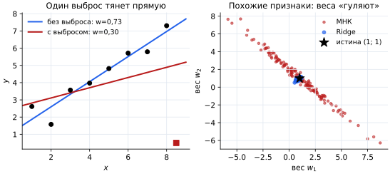
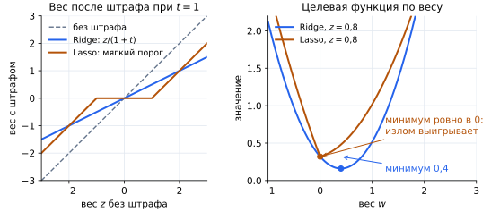
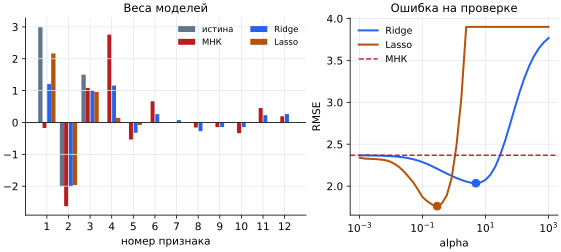

## Чему научимся

Представьте, что у вас есть два завода, $A$ и $B$, и вы хотите узнать, сколько стульев они произвели вместе, если завод $A$ работал $x_1$ часов, а завод $B$ — $x_2$ часов. Такие задачи вы часто решали в школе, и решение у них очень простое: если мы знаем, что завод $A$ производит 2 стула в час, а завод $B$ — 5 стульев в час, вы легко определите, что вместе они сделали

$$S = 2x_1 + 5x_2.$$

Сейчас мы увидели очень упрощённый принцип работы линейной модели. Нам повезло, что кто-то уже сказал, какие коэффициенты стоит использовать. А что, если коэффициенты неизвестны? Как подобрать их так, чтобы предсказания были точными, и где вам поможет линейная модель? Именно об этом мы поговорим в этой главе.

После занятия вы сможете:

- Вычислять прогноз линейной модели, остатки и MSE и находить прямую по нескольким точкам.
- Объяснять, как Ridge и Lasso изменяют веса и почему только Lasso обнуляет их.
- Выбирать силу штрафа по проверочной части, масштабируя признаки внутри конвейера.

План: линейная комбинация → функция потерь MSE → метод наименьших квадратов → где модель ломается → Ridge и Lasso → выбор силы штрафа → код.

Все данные занятия — **учебные синтетические**: мы придумали их или сгенерировали случайным образом. Выводы о реальном мире по ним делать нельзя.

## Регрессия и классификация

В [занятии 1.2](../02-nearest-neighbors/README.md) мы угадывали класс героя: «воин» или «маг». Ответ выбирался из короткого списка — это задача **классификации**. Число стульев, цена квартиры или балл за тест — числа, и между любыми двумя ответами есть промежуточные. Предсказание числа называют задачей **регрессии**. Линейная регрессия решает именно её; к классификации линейные модели вернутся в занятии 1.6.

## Линейная комбинация

Линейные модели лучше всего использовать тогда, когда целевая переменная $y$ — это линейная комбинация каких-то признаков. Другими словами, $y$ можно записать как

$$y = a_1x_1 + a_2x_2 + \dots + a_nx_n + b_0,$$

где $a_1, a_2, \dots, a_n, b_0$ — коэффициенты линейной модели, а $x_1, x_2, \dots, x_n$ — независимые переменные (признаки).

В нашем игрушечном примере нам уже выдали правильные коэффициенты: мы просто подставляли признаки в уравнение и получали ответ.

Но в реальной жизни подобрать правильные коэффициенты — отдельная задача. **Обучение линейной модели** — это процесс подбора таких коэффициентов, чтобы модель как можно точнее предсказывала целевое значение.

Дальше будем называть коэффициенты при признаках **весами** и обозначать $w_1, \dots, w_n$, а свободный член — **сдвигом** $b$. Прогноз модели пишут с «крышкой», чтобы отличать его от настоящего ответа $y$:

$$\hat y = w_1x_1 + \dots + w_nx_n + b.$$

Начнём с одного признака. Школьник готовился к пробным тестам и записал, сколько часов занимался ($x$) и сколько баллов получил ($y$): $(1;3)$, $(2;5)$, $(3;4)$, $(4;8)$. Модель $\hat y = wx + b$ — это прямая: вес $w$ показывает, на сколько баллов растёт прогноз за каждый час подготовки, а сдвиг $b$ — прогноз при $x=0$. Ни одна прямая не пройдёт через все четыре точки. Какую же выбрать?

## Почему предсказать значение точно невозможно

Мы хотим определять значение как можно точнее, но почему же нельзя предсказать его абсолютно точно? В реальном мире огромную роль играют погрешности: неточность датчиков, ошибки людей при разметке данных, а также всё, что влияет на ответ, но не попало в признаки. Балл за тест зависит не только от часов подготовки, но и от сна, настроения и вопросов в варианте. Чем больше данных мы собираем, тем точнее можно оценить коэффициенты, но случайный разброс отдельного ответа никуда не исчезнет.

Как же оценить, насколько хорошо модель справляется с задачей? Для этого существуют **функции потерь** (loss-функции), которые показывают, насколько сильно модель ошиблась в своих предсказаниях. Обучая линейную модель, мы подбираем коэффициенты так, чтобы функция потерь стала минимальной.

## Функция потерь MSE

Ошибку на одном объекте называют **остатком**: $e_i = y_i - \hat y_i$. Положительный остаток означает, что модель недооценила ответ, отрицательный — что переоценила.

Сложить остатки нельзя: $+3$ и $-3$ дадут ноль, хотя модель ошибалась оба раза. Поэтому каждую ошибку возводят в квадрат и усредняют. Получается **средняя квадратичная ошибка** (mean squared error):

$$\mathrm{MSE}=\frac1n\sum_{i=1}^{n}(y_i-\hat y_i)^2.$$

Квадрат делает две вещи. Во-первых, все слагаемые становятся неотрицательными. Во-вторых, он наказывает за большие проступки гораздо сильнее, чем за маленькие. Представьте учителя, который за опоздание на 1 минуту даёт 1 штрафное очко, на 2 минуты — 4 очка, а на 5 минут — уже 25. Пять опозданий по минуте обойдутся в 5 очков, а одно на пять минут — в 25. Так и MSE: модели выгоднее немного ошибиться на многих объектах, чем сильно — на одном.


Слева — лучшая прямая $\hat y = 1{,}4x + 1{,}5$ и её остатки (оранжевые отрезки). Пунктиром показан ответ «всем среднее» $\bar y = 5$ из занятия 1.1: его MSE равна $3{,}5$, а у прямой — $1{,}05$. Признак действительно помогает. Справа сравнены три прямые: та, что лучше проходит через облако точек, имеет меньшую MSE.

## Метод наименьших квадратов

На уроках физики в лабораторных работах вы наносили измерения на график и проводили прямую «на глаз» так, чтобы точки лежали как можно ближе к ней. **Метод наименьших квадратов** (МНК) делает то же самое строго: ищет $w$ и $b$, при которых MSE минимальна.

Для одного признака ответ даёт готовая формула. Через $\bar x$ и $\bar y$ обозначим средние значения:

$$w=\frac{\sum (x_i-\bar x)(y_i-\bar y)}{\sum (x_i-\bar x)^2},\qquad b=\bar y-w\bar x.$$

Посчитаем для наших точек: $\bar x=2{,}5$, $\bar y=5$.

| $x$ | $y$ | $x-\bar x$ | $y-\bar y$ | произведение | $(x-\bar x)^2$ |
| --- | --- | --- | --- | --- | --- |
| 1 | 3 | −1,5 | −2 | 3 | 2,25 |
| 2 | 5 | −0,5 | 0 | 0 | 0,25 |
| 3 | 4 | 0,5 | −1 | −0,5 | 0,25 |
| 4 | 8 | 1,5 | 3 | 4,5 | 2,25 |

Сумма произведений $S_{xy}=7$, сумма квадратов $S_{xx}=5$. Значит, $w=7/5=1{,}4$ и $b=5-1{,}4\cdot2{,}5=1{,}5$. Прогнозы равны $2{,}9;\ 4{,}3;\ 5{,}7;\ 7{,}1$, остатки — $+0{,}1;\ +0{,}7;\ -1{,}7;\ +0{,}9$. Их сумма равна нулю: у МНК со сдвигом так бывает всегда. Наконец, $\mathrm{MSE}=(0{,}01+0{,}49+2{,}89+0{,}81)/4=1{,}05$.

Для многих признаков веса находят из системы $X^{\top}Xw=X^{\top}y$ (**нормальное уравнение**); её решает библиотека. Есть и более общий путь — **градиентный спуск**: начинаем с любых весов и понемногу сдвигаем их в сторону, где MSE уменьшается, то есть против производной. Обозначим $d_i=\hat y_i-y_i$. Тогда

$$\frac{\partial\,\mathrm{MSE}}{\partial w}=\frac2n\sum d_ix_i,\qquad \frac{\partial\,\mathrm{MSE}}{\partial b}=\frac2n\sum d_i.$$

Сделаем один шаг из $w=b=0$. Все прогнозы нулевые, поэтому $d_i$ равны $-3,-5,-4,-8$, а производные — $\frac24(-3-10-12-32)=-28{,}5$ и $\frac24(-20)=-10$. Обе отрицательны: увеличивая $w$ и $b$, мы уменьшаем MSE. С шагом $0{,}05$ получаем $w=0-0{,}05\cdot(-28{,}5)=1{,}425$ и $b=0-0{,}05\cdot(-10)=0{,}5$, а MSE падает с $28{,}5$ до примерно $1{,}93$. Повторяя такие шаги, спуск приходит к тем же $w=1{,}4$ и $b=1{,}5$, что дала формула.

Соберём всё вместе. Обучение линейной модели — это круг из четырёх шагов: прогноз, остаток, потери, поправка весов. На схеме он показан для точки $(3;4)$.


Градиентный спуск проходит этот круг много раз, понемногу меняя $w$ и $b$. МНК решает ту же задачу сразу: формула выдаёт веса, на которых круг бы и остановился.

## Где линейная регрессия ломается

**Выбросы.** Вспомните штраф за опоздание: одна большая ошибка весит как много маленьких. Поэтому одна странная точка заметно поворачивает прямую. На рисунке ниже слева наклон падает с $0{,}73$ до $0{,}30$ из-за единственного выброса.

**Почти одинаковые признаки (мультиколлинеарность).** Пусть $x_2\approx x_1$, например рост в сантиметрах и рост, измеренный другим прибором. Прогноз зависит почти только от суммы $w_1+w_2$, поэтому модель может отдать вес любому из двух признаков. От выборки к выборке отдельные веса «гуляют» (справа ниже), а читать их как вклад признака бессмысленно.



## Зачем нужны Ridge и Lasso

Обе проблемы связаны с весами: выброс тянет их в свою сторону, а при похожих признаках веса неустойчивы и могут вырасти до больших значений разных знаков. Идея **регуляризации** — добавить к ошибке плату за большие веса. Тогда модель увеличит вес, только если это действительно заметно уменьшает ошибку.

### Ridge: штраф на квадраты весов

**Ridge-регрессия** (штраф $L_2$) минимизирует

$$\sum_{i=1}^{n}(y_i-\hat y_i)^2+\lambda\sum_{j=1}^{p}w_j^2.$$

Число $\lambda\ge0$ задаёт силу штрафа: при $\lambda=0$ получаем обычный МНК, при большом $\lambda$ веса прижимаются к нулю. Сдвиг $b$ не штрафуют: он лишь поднимает или опускает прямую.

Для нашего примера с одним признаком получается простая формула $w=S_{xy}/(S_{xx}+\lambda)$. При $\lambda=5$ вес равен $7/10=0{,}7$ — вдвое меньше, чем $1{,}4$; при $\lambda=15$ — уже $0{,}35$. Вес уменьшается, но в ноль не обращается. При похожих признаках Ridge делит вес между ними поровну, поэтому синее облако на рисунке выше компактное и лежит возле истинной точки.

### Lasso: штраф на модули весов

**Lasso** (штраф $L_1$) заменяет квадраты модулями:

$$\sum_{i=1}^{n}(y_i-\hat y_i)^2+\lambda\sum_{j=1}^{p}|w_j|.$$

Для нашего примера $w=(S_{xy}-\lambda/2)/S_{xx}$, пока числитель положителен. При $\lambda=4$ получаем $w=(7-2)/5=1$. При $\lambda\ge14$ числитель становится неположительным, и $w$ равен **ровно нулю**. Операция «вычесть порог, но не переходить через ноль» называется **мягким порогом**.



Слева по горизонтали отложен вес $z$, который получился бы без штрафа, а по вертикали — вес со штрафом. Ridge уменьшает любой вес в одно и то же число раз. Lasso обнуляет малые веса, а из больших вычитает порог. Справа видно почему: у $|w|$ в нуле излом, и минимум может оказаться ровно там. У $w^2$ гладкая чаша: минимум сдвигается к нулю, но не попадает в него.

Сведём три способа подбора весов в одну шпаргалку. Столбики на ней схематичные: они показывают характер изменений, а не веса из наших данных.


## Как применять Lasso и выбирать силу штрафа

Сравним модели на учебных данных с известной истиной: 12 признаков, ответ $y=5+3x_1-2x_2+1{,}5x_3+\text{шум}$, остальные истинные веса равны нулю, а $x_4\approx x_1$ — почти копия первого признака. Всего 90 объектов: 30 на обучение (train), 30 на проверку (validation) и 30 на итоговый тест.


**Пути коэффициентов** показывают, как веса меняются при росте силы штрафа (в scikit-learn она называется `alpha`). У Ridge все линии плавно стремятся к нулю. У Lasso лишние признаки исчезают раньше полезных, а последними остаются $x_1$, $x_2$ и $x_3$.

В этом и состоит главное применение Lasso — **отбор признаков**. Нулевой вес означает, что признак не участвует в прогнозе. Его можно не собирать и не хранить, а модель становится короче и понятнее. Ненулевые веса при стандартизованных признаках можно сравнивать по модулю: чем больше модуль, тем сильнее признак влияет на прогноз. Но при почти одинаковых признаках Lasso часто оставляет только один из них, и какой именно — зависит от выборки. Поэтому нулевой вес не доказывает, что признак бесполезен сам по себе.

Силу штрафа подбирают по **проверочной части**: пробуют сетку значений и выбирают то, при котором ошибка на validation минимальна. Тест используют один раз, в самом конце. Учтите, что в scikit-learn `alpha` определён у двух моделей по-разному: для Ridge $\alpha=\lambda$, а Lasso делит ошибку на $2n$, поэтому $\lambda=2n\alpha$. Сравнивать числа `alpha` у Ridge и Lasso нельзя.

**Масштаб.** Штраф одинаково давит на все веса, а вес зависит от единиц измерения: признак в граммах вместо килограммов получит вес в 1000 раз меньше и почти не будет оштрафован. Поэтому числовые признаки стандартизуют по формуле $\frac{x-\mu}{\sigma}$, где среднее $\mu$ и разброс $\sigma$ считают **только по train**. Масштабирование и модель объединяют в **конвейер** (`make_pipeline`): при обучении он находит $\mu$ и $\sigma$ по train, а для validation и test применяет уже найденные значения — как с min–max нормализацией в занятии 1.2. Так сведения из проверочных данных не попадают в обучение.



МНК почти весь вес $x_1$ отдал его копии $x_4$ и раздал заметные веса шумовым признакам. Ridge сжал веса, но оставил все ненулевыми. Lasso обнулил 7 весов из 12. Точки на кривых справа — выбранные значения `alpha`; у обеих моделей со штрафом ошибка на проверке ниже, чем у МНК.

## Повторим на Python

Начнём с ручного примера из четырёх точек: формулы МНК, один шаг градиентного спуска и формулы Ridge и Lasso для одного признака.

```python
import numpy as np

x = np.array([1., 2., 3., 4.])
y = np.array([3., 5., 4., 8.])
xc, yc = x - x.mean(), y - y.mean()
sxy, sxx = (xc * yc).sum(), (xc ** 2).sum()

w = sxy / sxx
b = y.mean() - w * x.mean()
e = y - (w * x + b)
print("w, b:", w, b)
print("остатки:", e.round(2), "сумма:", e.sum().round(10))
print("MSE прямой:", (e ** 2).mean(), " MSE среднего:", ((y - y.mean()) ** 2).mean())

# один шаг градиентного спуска из w = b = 0
d = 0 * x + 0 - y
w1 = 0 - 0.05 * 2 * np.mean(d * x)
b1 = 0 - 0.05 * 2 * np.mean(d)
print("после шага:", w1, b1)

# один признак: Ridge и Lasso по формулам этого занятия
print("Ridge, λ = 5:", sxy / (sxx + 5))
for lam in (4, 14):
    print("Lasso, λ =", lam, ":", np.sign(sxy) * max(abs(sxy) - lam / 2, 0) / sxx)
```

Получим $w=1{,}4$, $b=1{,}5$, MSE $1{,}05$ против $3{,}5$, после шага $1{,}425$ и $0{,}5$, Ridge $0{,}7$, Lasso $1{,}0$ и $0{,}0$.

Теперь учебный набор с 12 признаками. Генератор случайных чисел зафиксирован числом 7, поэтому результаты повторяются. Делим строки на train, validation и test по порядку.

```python
from sklearn.linear_model import LinearRegression, Ridge, Lasso
from sklearn.pipeline import make_pipeline
from sklearn.preprocessing import StandardScaler
from sklearn.metrics import mean_squared_error

rng = np.random.default_rng(7)
X = rng.normal(size=(90, 12))
X[:, 3] = X[:, 0] + 0.2 * rng.normal(size=90)      # почти копия первого признака
true_w = np.array([3, -2, 1.5, 0, 0, 0, 0, 0, 0, 0, 0, 0.0])
y = 5 + X @ true_w + 2.0 * rng.normal(size=90)

X_train, X_val, X_test = X[:30], X[30:60], X[60:]
y_train, y_val, y_test = y[:30], y[30:60], y[60:]

def rmse(y_true, y_pred):
    return mean_squared_error(y_true, y_pred) ** 0.5
```

Для каждой модели строим конвейер «масштаб → модель». Для Ridge и Lasso перебираем значения `alpha` и оставляем то, при котором ошибка на validation минимальна. Тест в выборе не участвует.

```python
alphas = np.logspace(-3, 3, 40)
best = {"МНК": make_pipeline(StandardScaler(), LinearRegression()).fit(X_train, y_train)}
for name, model_class in (("Ridge", Ridge), ("Lasso", Lasso)):
    scores = []
    for alpha in alphas:
        model = make_pipeline(StandardScaler(), model_class(alpha=alpha))
        model.fit(X_train, y_train)
        scores.append(rmse(y_val, model.predict(X_val)))
    best_alpha = alphas[int(np.argmin(scores))]
    best[name] = make_pipeline(StandardScaler(), model_class(alpha=best_alpha)).fit(X_train, y_train)
    print(name, "alpha =", round(best_alpha, 3), " validation RMSE =", round(min(scores), 2))

for name, model in best.items():
    print(name, "test RMSE =", round(rmse(y_test, model.predict(X_test)), 2))
```

После выбора считаем ошибку на тесте один раз. В этом учебном наборе получим примерно $3{,}29$ у МНК, $2{,}67$ у Ridge и $2{,}35$ у Lasso. Это один синтетический набор: числа показывают порядок, а не закон. Посмотрим на веса и посчитаем нули.

```python
for name, model in best.items():
    coef = model[-1].coef_
    print(f"{name:6}", coef.round(2), " нулей:", int((coef == 0).sum()))
print("истина", true_w)
```

У Lasso 7 нулей из 12: ненулевыми остались $x_1$, $x_2$, $x_3$ и, слабо, $x_4$ и $x_5$. Три настоящих признака найдены, хотя вес $x_1$ занижен (около $2{,}2$ вместо 3). У МНК и Ridge нулей нет. Наконец проверим влияние единиц: умножим третий столбец на 100, будто его измерили в других единицах.

```python
X_big = X_train.copy()
X_big[:, 2] *= 100
X_val_big = X_val.copy()
X_val_big[:, 2] *= 100

plain = Ridge(alpha=5).fit(X_train, y_train)
plain_big = Ridge(alpha=5).fit(X_big, y_train)
print("без масштаба, разница прогнозов:", np.abs(plain.predict(X_val) - plain_big.predict(X_val_big)).max().round(2))

scaled = make_pipeline(StandardScaler(), Ridge(alpha=5)).fit(X_train, y_train)
scaled_big = make_pipeline(StandardScaler(), Ridge(alpha=5)).fit(X_big, y_train)
print("с масштабом, разница прогнозов:", np.abs(scaled.predict(X_val) - scaled_big.predict(X_val_big)).max().round(2))
```

Без стандартизации смена единиц меняет прогнозы Ridge примерно на $0{,}47$ балла: штраф по-разному давит на вес. С конвейером разница равна нулю.

## Попробуйте сами

1. В ручном примере замените $\lambda$ на $10$ и вычислите по формулам вес Ridge. Затем найдите наименьшее $\lambda$, при котором Lasso даёт $w=0$. Проверьте кодом. Для самопроверки: $0{,}467$ и $14$.
2. В листинге с 12 признаками обучите конвейер со `StandardScaler` и `Lasso(alpha=3)` и посчитайте ненулевые веса. Затем уменьшите `alpha` до `0.01`. Объясните, как меняется число нулей. Для самопроверки: ненулевых весов 0 и 12.
3. Постройте свой путь коэффициентов: пройдите по `alphas`, обучите Ridge и сохраните `coef_` в список; затем нарисуйте линии через `matplotlib`. Сравните с рисунком выше. Объясните, почему тест нельзя использовать для выбора `alpha`.

## Что стоит унести с собой

Линейная модель — взвешенная сумма признаков, а обучение — подбор весов. МНК выбирает веса с наименьшей MSE; квадрат сильно наказывает большие ошибки. Поэтому модель чувствительна к выбросам, а при похожих признаках её веса неустойчивы. Ridge добавляет штраф на квадраты весов и сжимает их; Lasso штрафует модули и обнуляет часть весов, отбирая признаки. Силу штрафа выбирают по validation, а признаки масштабируют внутри конвейера.

## Самопроверка

### 1. Для точки $(3;4)$ прямая $\hat y=1{,}4x+1{,}5$ даёт прогноз $5{,}7$. Чему равен остаток $e=y-\hat y$?

A. $+1{,}7$.<br>
B. $-1{,}7$.<br>
C. $5{,}7$.<br>
D. $1{,}7^2$.

<details>
<summary>Подсказка</summary>

От настоящего ответа отнимаем прогноз.

</details>

<details>
<summary>Решение</summary>

**B.** $4-5{,}7=-1{,}7$: модель завысила прогноз. Квадрат остатка $2{,}89$ входит в MSE, но сам остаток — число со знаком.

</details>

### 2. Почему МНК минимизирует сумму квадратов остатков, а не сумму остатков?

A. Квадраты считаются быстрее.<br>
B. Остатки всегда положительны.<br>
C. Положительные и отрицательные остатки гасят друг друга, и плохая прямая может иметь сумму ноль.<br>
D. Без квадрата нельзя использовать признаки.

<details>
<summary>Подсказка</summary>

Сложите остатки $+3$ и $-3$.

</details>

<details>
<summary>Решение</summary>

**C.** Сумма остатков не отличает точную прямую от прямой с большими ошибками разных знаков. Квадрат делает каждую ошибку неотрицательной и сильнее наказывает большие.

</details>

### 3. Прямая $\hat y=2x$ на точках $(1;3),(2;5),(3;4),(4;8)$. Чему равна MSE?

A. $1{,}5$.<br>
B. $1{,}05$.<br>
C. $6$.<br>
D. $0$.

<details>
<summary>Подсказка</summary>

Прогнозы $2,4,6,8$; найдите остатки и средний квадрат.

</details>

<details>
<summary>Решение</summary>

**A.** Остатки $1,1,-2,0$; квадраты $1,1,4,0$; среднее $6/4=1{,}5$. Это больше $1{,}05$ у лучшей прямой, как и должно быть.

</details>

### 4. При $w=b=0$ производная MSE по $w$ равна $-28{,}5$. Что делает шаг градиентного спуска?

A. Уменьшает $w$.<br>
B. Не меняет $w$.<br>
C. Меняет знак $y$.<br>
D. Увеличивает $w$.

<details>
<summary>Подсказка</summary>

Идём против производной.

</details>

<details>
<summary>Решение</summary>

**D.** Новое $w=0-0{,}05\cdot(-28{,}5)=1{,}425>0$: производная отрицательна, поэтому увеличение $w$ уменьшает MSE.

</details>

### 5. Почему один выброс заметно поворачивает прямую МНК?

A. Выброс всегда лежит правее остальных точек.<br>
B. Большая ошибка в квадрате становится очень большим слагаемым, и прямая смещается, чтобы его уменьшить.<br>
C. Выброс увеличивает число признаков.<br>
D. МНК игнорирует остальные точки.

<details>
<summary>Подсказка</summary>

Сравните вклад ошибки $1$ и ошибки $5$ в сумму квадратов.

</details>

<details>
<summary>Решение</summary>

**B.** Ошибка $5$ даёт $25$, а ошибка $1$ — только $1$. Поэтому МНК уменьшает ошибку на выбросе за счёт остальных точек.

</details>

### 6. Признаки $x_1$ и $x_2$ почти одинаковы, а настоящая зависимость $y=x_1+x_2+\text{шум}$. Что на рисунке с облаком весов остаётся устойчивым?

A. Только $w_1$.<br>
B. Только $w_2$.<br>
C. Каждый вес по отдельности.<br>
D. Сумма $w_1+w_2$, около $2$.

<details>
<summary>Подсказка</summary>

Какая комбинация весов влияет на прогноз, когда $x_1\approx x_2$?

</details>

<details>
<summary>Решение</summary>

**D.** Облако весов вытянуто вдоль линии $w_1+w_2\approx2$: прогнозы почти одинаковы, а вес можно перекладывать между признаками. Ridge выбирает более равномерный вариант.

</details>

### 7. В ручном примере $S_{xy}=7$, $S_{xx}=5$. Каков вес Ridge при $\lambda=10$?

A. $0{,}7$.<br>
B. $1{,}4$.<br>
C. $0{,}47$.<br>
D. $0$.

<details>
<summary>Подсказка</summary>

Формула $w=S_{xy}/(S_{xx}+\lambda)$.

</details>

<details>
<summary>Решение</summary>

**C.** $7/15\approx0{,}47$. Ответ $0{,}7$ получается при $\lambda=5$, а ноль Ridge при конечном $\lambda$ не даёт.

</details>

### 8. В том же примере берём Lasso с $\lambda=20$. Каков вес?

A. $0$.<br>
B. $-0{,}6$.<br>
C. $0{,}4$.<br>
D. $1{,}4$.

<details>
<summary>Подсказка</summary>

Сравните $\lambda/2$ с $S_{xy}=7$.

</details>

<details>
<summary>Решение</summary>

**A.** Порог $\lambda/2=10>7$, поэтому $S_{xy}-\lambda/2<0$ и вес равен нулю. Мягкий порог не переходит через ноль и не меняет знак веса; ответ $-0{,}6$ получился бы без этого правила.

</details>

### 9. Lasso обнулил вес признака. Что из этого следует?

A. Признак можно не подавать модели: на её прогноз он не влияет.<br>
B. Признак никак не связан с ответом.<br>
C. Ridge на этих данных тоже обнулит этот вес.<br>
D. Ошибка модели на тесте станет нулевой.

<details>
<summary>Подсказка</summary>

Вспомните, как Lasso поступает с почти одинаковыми признаками.

</details>

<details>
<summary>Решение</summary>

**A.** Нулевой вес исключает признак из прогноза. Но связь с ответом у признака может быть: из двух почти одинаковых признаков Lasso часто оставляет один, а второй обнуляет, хотя он так же связан с ответом. Ridge веса до нуля не доводит.

</details>

### 10. Как правильно подобрать `alpha` и учесть масштаб?

A. Выбрать `alpha` с лучшей ошибкой на тесте и стандартизовать весь набор сразу.<br>
B. Не масштабировать, чтобы сохранить единицы.<br>
C. Стандартизовать по train внутри конвейера, выбрать `alpha` по validation, на тесте измерить один раз.<br>
D. Взять самый большой `alpha`.

<details>
<summary>Подсказка</summary>

Какие части данных можно использовать для настройки?

</details>

<details>
<summary>Решение</summary>

**C.** Подбор по тесту делает итоговую оценку оптимистичной, а масштаб, найденный на всём наборе, переносит сведения из validation и test в обучение. Слишком большой `alpha` обнуляет почти все веса.

</details>
