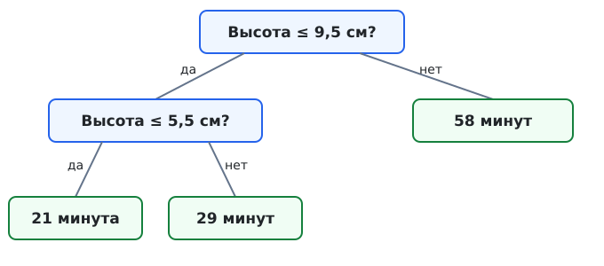
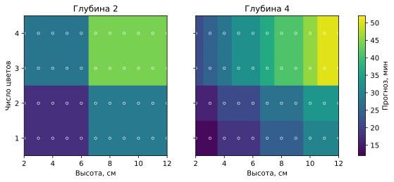

## Чему научимся

- Читать путь по дереву, вычислять прогноз в листе и объяснять, почему при квадратичной ошибке это среднее.
- Читать цветную карту областей более глубокого дерева по двум признакам.
- Сравнивать деревья разной глубины с постоянным прогнозом на новых заказах.
- Объяснять, почему запоминание обучения не гарантирует меньшую ошибку на новых данных.

## План занятия

1. Вернёмся к заказам школьного кружка и построим дерево вручную.
2. Сравним деревья на исходных и более многочисленных заказах; увидим разбиение плоскости признаков.
3. Разберём расхождения прогнозов и оптимальное решение задачи CodeRun о решающем пне.

## Снова очередь к 3D-принтеру

В занятии 1.1 мы оценивали время печати одним числом: медианой обучающих ответов, **26 минутами**. Теперь хотим учитывать свойства заказа. До запуска известны **высота фигурки** и **число цветов**; фактическое время станет известно после печати. Прогнозируем число минут, поэтому задача называется **регрессией**. Все данные придуманы для занятия и не описывают настоящий принтер.

Используем те же 16 заказов и то же разделение, что в 1.1. Первые 11 строк обучающие; последние пять откладываем для проверки. Правильные ответы проверочных строк не показываем дереву.

*Таблица 1 — Учебные заказы для построения дерева*

| Заказ | Высота, см | Цветов | Время, мин | Часть |
| --- | ---: | ---: | ---: | --- |
| p01 | 3 | 1 | 20 | обучение |
| p02 | 4 | 2 | 22 | обучение |
| p03 | 5 | 1 | 24 | обучение |
| p04 | 6 | 3 | 26 | обучение |
| p05 | 10 | 2 | 58 | обучение |
| p06 | 3 | 2 | 18 | обучение |
| p07 | 4 | 2 | 21 | обучение |
| p08 | 6 | 1 | 27 | обучение |
| p09 | 7 | 2 | 28 | обучение |
| p10 | 8 | 3 | 30 | обучение |
| p11 | 9 | 2 | 34 | обучение |
| p12 | 3 | 1 | ? | проверка |
| p13 | 5 | 3 | ? | проверка |
| p14 | 6 | 2 | ? | проверка |
| p15 | 7 | 2 | ? | проверка |
| p16 | 9 | 3 | ? | проверка |

У коротких фигурок время обычно меньше, но одинаковые признаки не всегда означают одинаковый ответ: p02 и p07 имеют высоту 4 см и два цвета, а печатались 22 и 21 минуту. В 1.1 мы раскрыли учебную формулу времени через скрытые площади сечений и переключения цвета. Эти сведения не доступны модели. Она учится прогнозировать по двум известным признакам и прошлым ответам.

## Дерево из вопросов

Построим вручную дерево глубины 2. Сначала спросим, выше ли фигурка 9,5 см. Для нашего набора это отделит p05 с временем 58 минут. Оставшиеся десять обучающих заказов разделим по высоте 5,5 см. В **листе** дадим среднее время попавших туда обучающих строк:

- До 5,5 см: p01, p02, p03, p06, p07; среднее $(20+22+24+18+21)/5=21$ минута.
- От 5,5 до 9,5 см: p04, p08, p09, p10, p11; среднее $(26+27+28+30+34)/5=29$ минут.
- Выше 9,5 см: один p05; прогноз 58 минут.



*Рисунок 1 — Дерево прогноза времени печати по высоте фигурки*

Первый вопрос в **корне** ведёт по одной из **ветвей**. Вопрос внутри ветви называется **узлом**; **лист** завершает путь и выдаёт прогноз. Для p14 (6 см, два цвета) путь проходит через «не выше 9,5» и «выше 5,5»: прогноз **29 минут**. Для p12 (3 см, один цвет) прогноз **21 минута**. Самый длинный путь содержит два вопроса, поэтому глубина дерева равна 2.

Порог 5,5 см не означает, что настоящий принтер меняет скорость именно на этой высоте: он отделяет наблюдавшиеся 5 см от 6 см. Пока оба вопроса используют высоту. Число цветов тоже разрешено использовать, но в этом небольшом наборе первые два разделения по высоте лучше уменьшают разброс времени внутри групп.

## Деревья разной глубины

**Решающий пень** имеет глубину 1 и задаёт один вопрос. Библиотека `scikit-learn` сама выбирает признак и порог, чтобы уменьшить разброс ответов внутри листьев. Для деревьев регрессии по умолчанию она уменьшает сумму квадратов отклонений от среднего в каждом листе. Вопрос может повторно использовать тот же признак. Попробуйте самостоятельно решить [задачу CodeRun №345 «Решающий пень»](https://coderun.yandex.ru/problem/stump): по парам $(x_i,y_i)$ нужно выбрать порог и два прогноза так, чтобы сумма квадратов ошибок была минимальной. Разбор и оптимальный алгоритм — после практики.

Сравним пень, дерево глубины 2, дерево глубины 3 и дерево без ограничения. Данные и порядок строк точно повторяют 1.1. Теперь, после выбора способа сравнения, откроем известные нам правильные времена пяти проверочных заказов: **19, 25, 29, 35 и 40 минут**. Проверочные ответы не передаём методу `fit`.

```python
from sklearn.metrics import mean_absolute_error
from sklearn.tree import DecisionTreeRegressor

train_features = [
    (3, 1), (4, 2), (5, 1), (6, 3), (10, 2), (3, 2),
    (4, 2), (6, 1), (7, 2), (8, 3), (9, 2),
]
train_minutes = [20, 22, 24, 26, 58, 18, 21, 27, 28, 30, 34]
check_features = [(3, 1), (5, 3), (6, 2), (7, 2), (9, 3)]
check_minutes = [19, 25, 29, 35, 40]

for limit in (1, 2, 3, None):
    tree = DecisionTreeRegressor(max_depth=limit, random_state=0)
    tree.fit(train_features, train_minutes)
    train_error = mean_absolute_error(train_minutes, tree.predict(train_features))
    check_predictions = tree.predict(check_features)
    check_error = mean_absolute_error(check_minutes, check_predictions)
    print(limit, tree.get_depth(), round(train_error, 2),
          round(check_error, 2), check_predictions.tolist())
```

**MAE** — среднее абсолютных ошибок в минутах, знакомое по 1.1. Для дерева глубины 2 проверочные прогнозы равны 21, 21, 29, 29 и 29 минутам. Ошибки: 2, 4, 0, 6 и 11 минут; $\mathrm{MAE}=(2+4+0+6+11)/5=4{,}6$ минуты.

*Таблица 2 — Ошибки деревьев при ограничении глубины*

| Ограничение | Получилась глубина | MAE на обучении, мин | MAE на проверке, мин |
| --- | ---: | ---: | ---: |
| 1 | 1 | 3,64 | 7,00 |
| 2 | 2 | 1,82 | 4,60 |
| 3 | 3 | 0,94 | 3,43 |
| без ограничения | 6 | 0,09 | 3,90 |

Постоянный прогноз 26 минут из 1.1 давал на тех же пяти заказах MAE **6,8 минуты**. Дерево глубины 3 улучшило результат в этом учебном наборе; пень с ошибкой 7,00 минуты не помог. Большой обучающий ответ p05 (58 минут) заставляет пень сначала отделить самую высокую фигурку: для остальных он отвечает 25 минутами и теряет различие между короткими и средними заказами.

У неограниченного дерева почти нулевая ошибка на обучении, но на проверке оно уступает дереву глубины 3. Например, оно отвечает p15 (7 см, два цвета) **28 минут**, как обучающему p09 с теми же признаками; действительное время p15 — **35 минут**. Для p02 и p07 признаки совпадают, поэтому никакое дерево по этим двум признакам не сможет точно восстановить оба обучающих времени: в их листе остаётся среднее **21,5 минуты**. Глубина помогает подстроиться под известные строки, но не раскрывает скрытую геометрию фигурки.


### Когда пригодится число цветов

У дерева глубины 3 заказам p01 и p06 высотой 3 см соответствует один лист: среднее $(20+18)/2=19$ минут. Если добавить ещё один вопрос «цветов не больше одного?», они разойдутся по двум листьям: p01 получит прогноз 20 минут, p06 — 18 минут. Но для нового p12 (3 см, один цвет) это уже прогноз 20 минут, а фактическое время — 19 минут. Усложнение уменьшило ошибку на двух обучающих строках, однако не сделало прогноз для p12 точным. Для p02 и p07 дополнительный вопрос о цвете не поможет: оба заказа имеют два цвета. Так можно увидеть и пользу второго признака, и пределы дерева.

Пять придуманных заказов не доказывают, что глубина 3 всегда лучшая. Для подбора глубины нужна проверочная часть, для окончательной оценки — отдельный тест. Повторный подбор по одним проверочным ответам делает оценку зависимой.

## Больше заказов: как дерево делит плоскость

Первые 16 заказов помогли проследить пути по дереву. Теперь создадим **отдельный** набор: 132 обучающих заказа и 40 новых. Для каждой целой высоты от 2 до 12 см и числа цветов от 1 до 4 придуманы три формы. Новые заказы имеют высоты 2,5; 3,5; …; 11,5 см и четвёртую форму. Модель получает только $(h,c)$. Таблица и проверочные ответы 1.1 при этом не меняются.

Чтобы происхождение чисел было проверяемым, для этого **нового** набора зададим скрытую суммарную площадь сечений $A=20h+10h[c\ge3]+10r$ и число переключений $S=c-1$: в этом упрощённом сценарии каждый цвет печатается одним блоком. Здесь $h$ — численное значение высоты в сантиметрах, $c$ — число цветов, $[c\ge3]$ равно 1 при трёх или четырёх цветах и 0 иначе, а $r$ описывает не указанную в признаках форму. Площадь $A$ измеряется в см² и положительна для всех наших заказов. Как и в 1.1, время в минутах равно $T=8+0{,}1A+3S$. Для обучения берём $r=-2,0,2$; для новых фигурок — $r=1$. Эти коэффициенты и $r$ используются **только для создания учебных ответов**: дереву они неизвестны. Проверочные ответы не участвуют в обучении.

```python
def make_minutes(h, c, shape):
    area = 20 * h + 10 * h * (c >= 3) + 10 * shape
    switches = c - 1
    return 8 + 0.1 * area + 3 * switches

large_train = [(h, c, shape)
               for h in range(2, 13)
               for c in range(1, 5)
               for shape in (-2, 0, 2)]
large_check = [(h + 0.5, c, 1)
               for h in range(2, 12)
               for c in range(1, 5)]
large_train_features = [(h, c) for h, c, _ in large_train]
large_train_minutes = [make_minutes(h, c, shape)
                       for h, c, shape in large_train]
large_check_features = [(h, c) for h, c, _ in large_check]
large_check_minutes = [make_minutes(h, c, shape)
                       for h, c, shape in large_check]

large_models = {}
for depth in (2, 4, None):
    model = DecisionTreeRegressor(max_depth=depth, random_state=0)
    model.fit(large_train_features, large_train_minutes)
    large_models[depth] = model
    print(depth, model.get_depth(), model.get_n_leaves(),
          round(mean_absolute_error(
              large_train_minutes, model.predict(large_train_features)), 2),
          round(mean_absolute_error(
              large_check_minutes, model.predict(large_check_features)), 2))
```

*Таблица 3 — Глубина, число листьев и ошибки деревьев на расширенном наборе данных*

| Ограничение глубины | Получилась глубина | Листьев | MAE на обучении, мин | MAE на новых заказах, мин |
| --- | ---: | ---: | ---: | ---: |
| 2 | 2 | 4 | 3,80 | 3,52 |
| 4 | 4 | 16 | 1,89 | 2,15 |
| без ограничения | 6 | 44 | 1,33 | 2,25 |

> **Переобучение.** По сравнению с деревом глубины 4 дерево без ограничения уменьшило MAE на обучении с 1,89 до 1,33 минуты, но на новых заказах ошибка выросла с 2,15 до 2,25 минуты. Дерево лучше подстроилось под обучающие заказы и стало хуже предсказывать новые. Это эффект переобучения; мы ещё не раз встретим его в следующих занятиях.

Нарисуем, какой прогноз дерево выдаст в каждой точке плоскости признаков. По горизонтали идёт высота, по вертикали — **целое** число цветов. Одинаковый цвет заливки означает одинаковый прогноз в минутах; шкала справа переводит цвет в время. Белые окружности обозначают пары признаков обучающих заказов. По три фигурки с одинаковыми $(h,c)$ накладываются друг на друга, поэтому видна одна окружность.



*Рисунок 2 — Области прогноза деревьев разной глубины*

[Код построения карты](plot_regions.py) обучает два дерева на том же наборе и сохраняет SVG. Запустите его, чтобы воспроизвести рисунок.


Границы областей горизонтальны или вертикальны, потому что каждый вопрос дерева проверяет **один** признак и один порог. На левой карте четыре широких прямоугольных области: дерево глубины 2 задаёт мало вопросов. Справа области мельче: при высоте 8 см дерево глубины 4 прогнозирует **24 минуты** для одного цвета и **41 минуту** для четырёх. В частности, разделение между двумя и тремя цветами отражает дополнительные площади сечений в нашем учебном правиле. Цвет обозначает **прогноз**, а не реальное время новой фигурки: скрытая форма всё ещё может изменить ответ. В этом наборе глубина 4 уменьшила MAE на новых заказах с 3,52 до 2,15 минуты; неограниченное дерево запомнило обучение лучше, но получило 2,25 минуты на проверке. Эти цифры относятся только к придуманным данным.

> **Важно.** Мы всё ещё исследуем искусственный пример: по этим числам нельзя судить о настоящем 3D-принтере. Но основные свойства дерева решений уже можно увидеть и проверить: каждый узел задаёт один вопрос, листья дают постоянные прогнозы, вопросы делят плоскость признаков на области, а увеличение глубины по-разному влияет на обучение и новые заказы.

## Практика

1. По схеме найдите прогнозы для p13 (5 см, три цвета) и p16 (9 см, три цвета). Вычислите их абсолютные ошибки по таблице. Самопроверка: 21 и 29 минут; ошибки 4 и 11 минут.
2. Запустите код. Найдите глубину с наименьшей MAE на пяти проверочных заказах и сравните её с постоянным прогнозом 26 минут из 1.1. Самопроверка: глубина 3; 3,43 против 6,8 минуты.
3. На правой цветной карте найдите прогнозы для высоты 8 см с одним и с четырьмя цветами. Объясните, почему два заказа одинаковой высоты попали в разные области. Самопроверка: 24 и 41 минута; дерево задаёт вопрос о числе цветов.
4. Дополнительно: реализуйте вручную пень с вопросом «высота больше 9,5 см?». В каждом листе вычислите среднее обучающее время и найдите прогноз для p14. Самопроверка: слева 25 минут, справа 58 минут; для p14 — 25 минут.
5. Дополнительно: решите [задачу CodeRun №345](https://coderun.yandex.ru/problem/stump). Сначала проверьте свой алгоритм на примере из условия: $(0,1),(1,1),(2,0),(3,0)$. Подойдёт порог $1{,}5$ с прогнозами 1 слева и 0 справа. Затем сравните своё решение с разбором ниже.

## Разбор задачи CodeRun: оптимальный пень

В задаче CodeRun один числовой признак $x$, а пень задаётся тремя числами: $f(x)=a$ при $x<c$ и $f(x)=b$ при $x\ge c$. Нужно минимизировать $Q=\sum_{i=1}^{n}(f(x_i)-y_i)^2$. Здесь используется **квадратичная ошибка**. В основном эксперименте выше мы сообщали **MAE** на новых заказах; это другая метрика. Медиана лучше для суммы модулей, а среднее — для суммы квадратов.

Сначала найдём лучший *постоянный* прогноз $t$ для группы из $m$ ответов $y_1,\ldots,y_m$. Раскроем скобки и обозначим $S=\sum y_i$, $R=\sum y_i^2$:

$$Q(t)=\sum_{i=1}^{m}(t-y_i)^2=mt^2-2St+R
=m\left(t-\frac{S}{m}\right)^2+R-\frac{S^2}{m}.$$

Это парабола с ветвями вверх. Её вершина находится при $t=S/m$: оптимальный прогноз равен **среднему ответов группы**, а минимальная сумма квадратов — $R-S^2/m$. Например, для p01 и p06 среднее $(20+18)/2=19$ минут; сумма квадратов ошибок равна $(19-20)^2+(19-18)^2=2$.

Теперь отсортируем пары по $x$. Порог имеет смысл ставить только **между различными соседними значениями**: пороги внутри одного промежутка дают то же разбиение. Одинаковые $x$ нельзя разделить, поэтому границы между ними пропускаем. Для каждой допустимой границы считаем число и сумму ответов слева $(m_L,S_L)$ и справа $(m_R,S_R)$. Сумма $R$ по всем ответам постоянна, поэтому лучший порог **максимизирует**

$$\frac{S_L^2}{m_L}+\frac{S_R^2}{m_R}.$$

После сортировки поддерживаем $S_L$ и $m_L$ при движении слева направо; правые значения получаем из общих суммы и количества. Каждую границу проверяем за $O(1)$, затем ставим $c$ посередине между соседними различными $x$ и выводим $a=S_L/m_L$, $b=S_R/m_R$. Если все $x$ одинаковы, один вопрос не разделит данные: выбираем $c=x_1$, $b=\sum y_i/n$, а $a$ не используется.

Полная [реализация на Python](stump_solution.py) сортирует пары, пропускает границы между одинаковыми $x$ и обновляет суммы за один проход. Она отдельно обрабатывает случай, когда все $x$ равны. После своей попытки сравните с ней выбор порога и значения $a$, $b$.


Сортировка занимает $O(n\log n)$ времени, один проход — $O(n)$; для хранения пар нужно $O(n)$ памяти. При $n\le100000$ перебор всех возможных вещественных порогов или пересчёт обеих групп с нуля для каждого порога не нужен. Код печатает десять знаков после точки, как требуется для точности ответа. В примере CodeRun он выдаёт $a=1$, $b=0$, $c=1{,}5$ и нулевую ошибку.

## Итоги

Дерево превращает признаки в прогноз через последовательность вопросов. В дереве регрессии лист отвечает средним обучающих значений своей группы. Глубина позволяет делать группы точнее. На плоскости двух признаков листья образуют прямоугольные области с постоянным прогнозом; сравнивать глубины нужно по новым данным, а не по одной только ошибке на обучении.

## Самопроверка

Сначала ответьте самостоятельно. Затем раскройте подсказку и сравните ответ с разбором.

### 1. Какие сведения получает дерево перед печатью нового заказа?

A. Высоту и число цветов.<br>
B. Фактическое время и номер заказа.<br>
C. Площади всех сечений и будущие переключения.<br>
D. Правильный ответ проверочной строки.

<details><summary>Подсказка</summary>

Вспомните признаки из 1.1.

</details>
<details><summary>Решение</summary>

**A.** Эти два признака известны до запуска. Время и скрытая геометрия не подаются модели.

</details>

### 2. Какой прогноз нарисованное дерево даст для фигурки высотой 6 см?

A. 21 минута.<br>
B. 26 минут.<br>
C. 29 минут.<br>
D. 58 минут.

<details><summary>Подсказка</summary>

Пройдите оба вопроса схемы сверху вниз.

</details>
<details><summary>Решение</summary>

**C.** 6 см не выше 9,5 см, но выше 5,5 см; лист отвечает 29 минутами.

</details>

### 3. Откуда взялся прогноз 21 минута в левом листе?

A. Это время первого заказа.<br>
B. Это среднее пяти обучающих времён в листе.<br>
C. Это медиана всех шестнадцати времён.<br>
D. Это число слоёв фигурки.

<details><summary>Подсказка</summary>

Выпишите обучающие заказы высотой не выше 5,5 см.

</details>
<details><summary>Решение</summary>

**B.** Для p01, p02, p03, p06 и p07 среднее равно $(20+22+24+18+21)/5=21$. При квадратичной ошибке это вершина параболы суммы квадратов.

</details>

### 4. Какова глубина нарисованного дерева?

A. 1, потому что корень один.<br>
B. 2, потому что самый длинный путь содержит два вопроса.<br>
C. 3, потому что листьев три.<br>
D. 16, потому что заказов шестнадцать.

<details><summary>Подсказка</summary>

Считайте вопросы на самом длинном пути.

</details>
<details><summary>Решение</summary>

**B.** Путь через два вопроса даёт глубину 2. Число листьев не равно глубине.

</details>

### 5. Что умеет решающий пень?

A. Задать один вопрос и выдать прогноз в одном из двух листьев.<br>
B. Запомнить любые шестнадцать разных времён.<br>
C. Использовать только число цветов.<br>
D. Вычислить скрытые площади сечений.

<details><summary>Подсказка</summary>

Пень — дерево глубины 1.

</details>
<details><summary>Решение</summary>

**A.** Один вопрос делит заказы на две группы. В каждом листе получается свой прогноз.

</details>

### 6. Почему p02 и p07 нельзя точно различить по доступным признакам?

A. Они оба проверочные.<br>
B. У них совпадают высота и число цветов.<br>
C. Их время одинаково.<br>
D. Дерево не умеет работать с числом цветов.

<details><summary>Подсказка</summary>

Сравните две строки таблицы целиком.

</details>
<details><summary>Решение</summary>

**B.** Оба заказа имеют признаки (4 см, 2 цвета), но разное время; дерево направит их в один лист.

</details>

### 7. Какова MAE для прогнозов 21 и 29 минут при ответах 25 и 40 минут?

A. 7,5 минуты.<br>
B. 15 минут.<br>
C. 4 минуты.<br>
D. 0 минут.

<details><summary>Подсказка</summary>

Найдите два модуля ошибки и их среднее.

</details>
<details><summary>Решение</summary>

**A.** Ошибки равны 4 и 11 минутам; $(4+11)/2=7{,}5$ минуты.

</details>

### 8. Что показывает сравнение глубин в нашей таблице?

A. На обучении глубокое дерево точнее, но на проверке глубина 3 лучше неограниченной.<br>
B. Неограниченное дерево всегда лучше на любых новых заказах.<br>
C. Пень даёт меньшую ошибку, чем постоянный прогноз.<br>
D. Глубина никак не влияет на результаты.

<details><summary>Подсказка</summary>

Сравните обе колонки MAE для глубины 3 и без ограничения.

</details>
<details><summary>Решение</summary>

**A.** На обучении 0,09 меньше 0,94, зато на проверке 3,90 больше 3,43 минуты. Здесь видно переобучение; вывод относится к этому набору.

</details>

### 9. Почему нельзя многократно выбирать глубину по одним проверочным ответам?

A. Тогда ответы участвуют в выборе модели.<br>
B. Тогда дерево теряет корень.<br>
C. Тогда MAE превращается в accuracy.<br>
D. Тогда исчезают обучающие признаки.

<details><summary>Подсказка</summary>

Вспомните, какие сведения влияют на выбор глубины.

</details>
<details><summary>Решение</summary>

**A.** Проверочные ответы начинают влиять на модель. Для итоговой независимой оценки понадобятся новые данные.

</details>

### 10. Что показывает разный цвет областей при высоте 8 см и одном или четырёх цветах?

A. Разные прогнозы: 24 и 41 минута, потому что дерево использовало число цветов.<br>
B. Одинаковое точное время печати всех фигурок высотой 8 см.<br>
C. Скрытую форму фигурки, переданную дереву как третий признак.<br>
D. Долю верных ответов на этих заказах.

<details><summary>Подсказка</summary>

Сравните две точки на правой карте.

</details>
<details><summary>Решение</summary>

**A.** Число цветов различается, поэтому прогнозы равны 24 и 41 минуте. Цвет показывает прогноз.

</details>
