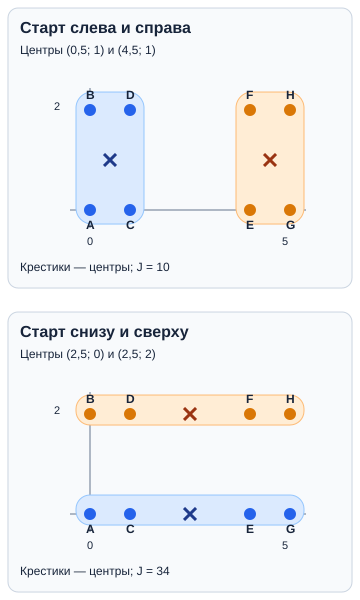

## Чему научимся

- Отличать группировку без правильных ответов от задачи, в которой ответы уже известны.
- Выполнять два шага K-means: относить точки к ближайшим центрам и пересчитывать центры.
- Сравнивать результаты при разных начальных центрах и объяснять, что показывает мера компактности.

**Время и подготовка:** ориентир 6–8 часов с практикой. Понадобятся координаты, среднее арифметическое, квадраты чисел и основы Python. Ручные два шага — обязательный маршрут; сравнение с видами ирисов и индекс Рэнда расширяют его.

## План занятия

1. Разделим восемь точек на две группы без готовых меток.
2. Дважды выполним шаг K-means вручную.
3. Изменим начальные центры, сравним результаты и посмотрим на классический набор «Ирисы».

## Группы без правильных ответов

Кружок робототехники отмечает восемь мест выдачи деталей на плане. Он хочет разделить места на две компактные группы. Координаты придуманы для занятия; по ним нельзя судить о настоящем помещении.

*Таблица 1 — Координаты мест выдачи деталей*

| Место | Координаты $(x,y)$ |
| --- | --- |
| A | $(0,0)$ |
| B | $(0,2)$ |
| C | $(1,0)$ |
| D | $(1,2)$ |
| E | $(4,0)$ |
| F | $(4,2)$ |
| G | $(5,0)$ |
| H | $(5,2)$ |

У мест нет заранее известных названий групп. Мы сами ищем группировку по координатам — это **кластеризация**. Число групп $K=2$ задано задачей: кружок собирается обслуживать их из двух центров. Если бы для каждого места уже была известна правильная группа и мы учили модель повторять эти ответы, задача была бы классификацией.

## Как работает K-means

Каждая группа имеет **центр** — точку, координаты которой равны средним координатам членов группы. K-means повторяет два действия:

1. **Распределение:** каждый объект относим к ближайшему центру.
2. **Обновление:** для каждой группы считаем новый центр как среднее её точек.

Для двух точек $(x,y)$ и $(a,b)$ удобно сравнивать квадраты расстояний: $d^2=(x-a)^2+(y-b)^2$. Корень не нужен: ближайший центр будет тем же. Если расстояния равны, нужно заранее договориться, какой центр выбрать; в нашем примере равенств нет.

## Первый запуск: центры слева и справа

Возьмём начальные центры $c_1=(0,0)$ и $c_2=(4,0)$. На первом шаге получаем:

*Таблица 2 — Распределение точек по группам на первом шаге K-means*

| Место | $d^2$ до $c_1$ | $d^2$ до $c_2$ | Группа |
| --- | ---: | ---: | --- |
| A | 0 | 16 | 1 |
| B | 4 | 20 | 1 |
| C | 1 | 9 | 1 |
| D | 5 | 13 | 1 |
| E | 16 | 0 | 2 |
| F | 20 | 4 | 2 |
| G | 25 | 1 | 2 |
| H | 29 | 5 | 2 |

Группа 1 содержит A–D, поэтому её новый центр — $((0+0+1+1)/4,(0+2+0+2)/4)=(0{,}5;1)$. Для E–H аналогично получаем $(4{,}5;1)$.

**Второй шаг:** проверяем расстояния до обновлённых центров. Например, для D квадраты расстояний равны $1{,}25$ и $13{,}25$, а для G — $21{,}25$ и $1{,}25$. Все A–D остаются слева, E–H — справа. Средние не изменились, поэтому алгоритм остановился.



*Рисунок 1 — Влияние начальных центров на результат K-means*

## Второй запуск: центры снизу и сверху

Оставим точки и $K=2$ прежними, но начнём с $c_1=(0,0)$ и $c_2=(0,2)$. На первом шаге A, C, E, G попадут в нижнюю группу, B, D, F, H — в верхнюю. Средние координаты дадут новые центры $(2{,}5;0)$ и $(2{,}5;2)$. На втором шаге распределение не изменится: у каждой нижней точки квадрат расстояния до верхнего центра на 4 больше, чем до нижнего; для верхних точек — наоборот.

Оба запуска остановились, но получили **разные группы**. Начальные центры повлияли на итог. Названия «группа 1» и «группа 2» условны: их перестановка не меняет разбиение.

## Как сравнить две группировки

Для уже полученных групп K-means складывает **квадраты расстояний от точек до центров**. Обозначим эту сумму $J$:

$$J=\sum_{i=1}^{n} d^2(x_i,c_{g(i)}),$$

где $g(i)$ — группа точки $i$. В первом запуске у каждой точки квадрат расстояния до своего центра равен $0{,}5^2+1^2=1{,}25$, поэтому $J=8\cdot1{,}25=10$. Во втором запуске для каждой строки суммы равны $2{,}5^2+1{,}5^2+1{,}5^2+2{,}5^2=17$; две строки дают $J=34$. На **этих же точках, при том же $K$ и масштабе координат** первый результат компактнее. Это не доказывает, что найденные группы имеют какой-то «правильный» смысл: правильных меток у нас нет. Если изменить единицы одной координаты или число групп, сравнение изменится.

## Классический пример: ирисы Фишера

Набор **«Ирисы»** — классический учебный пример машинного обучения. В нём **150 цветков трёх видов**; для каждого измерены длина и ширина чашелистика и лепестка в сантиметрах. На классической диаграмме ниже каждый цветок — точка: по горизонтали длина лепестка, по вертикали ширина. Показаны все 150 записей, а не несколько выбранных цветков.


*Рисунок 2 — Известные виды ирисов и группы K-means*

На левой диаграмме цвет показывает **известный вид**. Для правой диаграммы мы скрыли виды от K-means, задали $K=3$ и взяли три цветка разных областей диаграммы как начальные центры. Алгоритм видел только две координаты. Нижняя левая группа хорошо отделилась, а две остальные частично смешались. Цвета правой диаграммы сопоставлены с цветами левой для чтения рисунка; сами номера групп не означают названия видов.

Например, цветок с лепестком $(5{,}0;1{,}7)$ см имеет вид *versicolor*, но на этом запуске оказался в третьей группе: после обновлений квадраты расстояний до второго и третьего центров составили примерно $0{,}62$ и $0{,}51$. K-means нашёл ближайший центр, а не биологический вид. Известные виды можно использовать **после** группировки, чтобы оценить её, но не как входной признак.

## Проверим шаги на Python

Код повторяет именно ручной расчёт. В каждой паре координат порядок один и тот же: сначала $x$, затем $y$.

```python
points = [(0, 0), (0, 2), (1, 0), (1, 2),
          (4, 0), (4, 2), (5, 0), (5, 2)]

def distance_squared(point, center):
    return sum((value - origin) ** 2 for value, origin in zip(point, center))

def step(points, centers):
    groups = [[] for _ in centers]
    for point in points:
        nearest = min(range(len(centers)), key=lambda i: distance_squared(point, centers[i]))
        groups[nearest].append(point)
    if any(not group for group in groups):
        raise ValueError("Одна из групп пуста; нужны другие начальные центры")
    new_centers = [tuple(sum(point[j] for point in group) / len(group) for j in range(2))
                   for group in groups]
    return groups, new_centers

centers = [(0, 0), (4, 0)]
for _ in range(2):
    groups, centers = step(points, centers)

assert groups == [points[:4], points[4:]]
assert centers == [(0.5, 1.0), (4.5, 1.0)]
print("Группы:", groups)
print("Центры:", centers)
```

Программа останавливает пример, если какая-то группа оказалась пустой: для неё нельзя вычислить среднее. В полной реализации K-means нужно заранее выбрать способ обработки такой ситуации и повторять шаги до стабилизации либо до заданного предела итераций.

Для всех ирисов те же действия удобно выполнить библиотекой. `petals` содержит только две колонки измерений; известные виды `iris.target` в `fit_predict` не передаются. Начальные центры выбраны явно, поэтому результат повторяется:

```python
from sklearn.cluster import KMeans
from sklearn.datasets import load_iris

iris = load_iris()
petals = iris.data[:, 2:4]
model = KMeans(n_clusters=3, init=petals[[0, 50, 100]], n_init=1)
groups = model.fit_predict(petals)
print(model.cluster_centers_.round(2))
```

Для работы с таблицами удобно дать двум размерам имена столбцов и добавить найденную группу. `pandas` позволяет затем посмотреть средние размеры внутри каждой группы; названия видов мы по-прежнему **не** передаём модели:

```python
import pandas as pd

flowers = pd.DataFrame(petals, columns=["length_cm", "width_cm"])
flowers["cluster"] = groups
print(flowers.groupby("cluster")[["length_cm", "width_cm"]].mean().round(2))
```

Число группы условно. Таблица средних помогает описать найденные группы, но не доказывает, что они совпали с ботаническими видами. В ноутбуке можно изменить начальные центры и увидеть, как меняются группы и их положение на диаграмме.

## Практика

1. Повторите **два шага** для начальных центров $(0,0)$ и $(4,0)$: выпишите группы, пересчитайте центры и проверьте распределение после обновления. Самопроверка: группы A–D и E–H, центры $(0{,}5;1)$ и $(4{,}5;1)$; второй шаг их не меняет.
2. Для тех же точек начните с $(0,0)$ и $(0,2)$. Выполните два шага и найдите $J$. Самопроверка: нижняя группа A, C, E, G и верхняя B, D, F, H; центры $(2{,}5;0)$ и $(2{,}5;2)$, $J=34$.
3. На диаграмме ирисов найдите область, где виды *versicolor* и *virginica* перекрываются. Объясните, почему цветок $(5{,}0;1{,}7)$ см может попасть не в группу своего вида. Самопроверка: K-means сравнивает расстояния до центров по двум выбранным признакам и не знает названия вида.

**Дополнительно.** Допишите к функции `step` цикл до неизменных центров и запустите его с обоими наборами начальных центров. Для сравнения двух разбиений можно использовать **индекс Рэнда**: он считает долю пар точек, для которых оба разбиения согласны — пара вместе в обоих или порознь в обоих. У восьми точек 28 пар; вертикальное и горизонтальное разбиения согласны для 12 пар, поэтому индекс равен $12/28=3/7$. Индекс сравнивает разбиения, но без эталонных меток не говорит, какое из них «верное».

## Типичные ошибки

- При пересчёте центра брать среднее всех точек, а не точек одной группы.
- Считать, что любой остановившийся запуск даёт лучший результат среди всех начальных центров.
- Принимать номера групп за правильные ответы или сравнивать группировки по совпадению этих номеров.

## Итоги

K-means чередует распределение точек по ближайшим центрам и пересчёт центров. Начало влияет на результат, а малая сумма квадратов расстояний говорит о компактности, не о «правильном» смысле групп. Проверьте себя: почему здесь нет обучающих ответов? Что меняется после первого обновления центров? Можно ли назвать найденную группу видом ириса только по номеру? Подсказки и решения — ниже.

## Самопроверка

### 1. Что известно до запуска кластеризации в нашем примере?

A. Правильная группа каждого места.<br>
B. Координаты мест и выбранное число групп $K=2$.<br>
C. Только готовые центры групп.<br>
D. Эталонный индекс Рэнда.

<details>
<summary>Подсказка</summary>

Правильных меток у мест нет.

</details>

<details>
<summary>Решение</summary>

**B.** Координаты заданы, а две группы нужны по условию задачи. Группы и их центры ещё предстоит найти.

</details>

### 2. Что означает $K=2$ в K-means?

A. У каждой точки две координаты.<br>
B. Алгоритм всегда делает ровно два шага.<br>
C. Мы ищем две группы.<br>
D. В каждой группе должно быть по две точки.

<details>
<summary>Подсказка</summary>

Не путайте число координат и число групп.

</details>

<details>
<summary>Решение</summary>

**C.** $K$ задаёт число групп. Число шагов и размеры групп могут быть другими.

</details>

### 3. Какой квадрат расстояния от B $(0,2)$ до центра $(4,0)$?

A. 4.<br>
B. 8.<br>
C. 16.<br>
D. 20.

<details>
<summary>Подсказка</summary>

Возведите в квадрат разности обеих координат и сложите.

</details>

<details>
<summary>Решение</summary>

**D.** $(0-4)^2+(2-0)^2=16+4=20$. Число 16 учитывает только одну координату.

</details>

### 4. При центрах $(0,0)$ и $(4,0)$ в какую группу попадёт B $(0,2)$?

A. К первому центру: квадраты расстояний 4 и 20.<br>
B. Ко второму центру: он правее.<br>
C. Сразу в обе группы.<br>
D. Ни в одну: координата $y$ не равна нулю.

<details>
<summary>Подсказка</summary>

Сравните два числа из таблицы первого шага.

</details>

<details>
<summary>Решение</summary>

**A.** B ближе к первому центру, поскольку $4<20$. Одна точка получает одну группу.

</details>

### 5. Каким станет центр группы A–D после первого распределения?

A. $(0,1)$.<br>
B. $(0{,}5;1)$.<br>
C. $(1,1)$.<br>
D. $(0{,}5;2)$.

<details>
<summary>Подсказка</summary>

Найдите среднее отдельно для $x$ и для $y$.

</details>

<details>
<summary>Решение</summary>

**B.** Среднее $x$ равно $(0+0+1+1)/4=0{,}5$, среднее $y$ равно 1. Центр — $(0{,}5;1)$.

</details>

### 6. Что произойдёт на втором шаге первого запуска?

A. Все точки сменят группу.<br>
B. Группы не изменятся, центры останутся $(0{,}5;1)$ и $(4{,}5;1)$.<br>
C. Число групп увеличится до восьми.<br>
D. Центры вернутся в начальные положения.

<details>
<summary>Подсказка</summary>

Сравните расстояния до уже обновлённых центров.

</details>

<details>
<summary>Решение</summary>

**B.** A–D по-прежнему ближе к левому центру, E–H — к правому. Повторное среднее даёт те же центры.

</details>

### 7. Куда сдвинутся центры при начале с $(0,0)$ и $(0,2)$?

A. К $(2{,}5;0)$ и $(2{,}5;2)$.<br>
B. К $(0{,}5;1)$ и $(4{,}5;1)$.<br>
C. Оба к $(2{,}5;1)$.<br>
D. Они не сдвинутся.

<details>
<summary>Подсказка</summary>

Первый центр получает нижние точки A, C, E, G; второй — верхние B, D, F, H.

</details>

<details>
<summary>Решение</summary>

**A.** Среднее нижних точек — $(2{,}5;0)$, верхних — $(2{,}5;2)$. Это другой результат на тех же данных.

</details>

### 8. Какова сумма квадратов расстояний $J$ для вертикальных групп?

A. 8.<br>
B. 10.<br>
C. 17.<br>
D. 34.

<details>
<summary>Подсказка</summary>

У каждой точки квадрат расстояния до своего центра равен $1{,}25$.

</details>

<details>
<summary>Решение</summary>

**B.** Восемь точек дают $8\cdot1{,}25=10$. Это компактнее второго полученного разбиения с $J=34$.

</details>

### 9. Оба запуска остановились. Какой вывод верен?

A. Они обязательно дали одинаковые группы.<br>
B. Начальные центры могут изменить итоговую группировку.<br>
C. Нижние группы всегда лучше левых.<br>
D. Номера групп стали правильными ответами.

<details>
<summary>Подсказка</summary>

Сравните вертикальное и горизонтальное разбиения.

</details>

<details>
<summary>Решение</summary>

**B.** Здесь получились разные устойчивые группировки. Остановка означает, что этот запуск больше не меняется, а не что все запуски дадут одно и то же.

</details>

### 10. Когда при кластеризации ирисов можно использовать известные названия видов?

A. Добавить вид как ещё один признак перед запуском K-means.<br>
B. Подменить видом номер ближайшего центра при распределении цветков.<br>
C. Сравнить виды с полученными группами после запуска.<br>
D. Назвать группы видами только по их номерам.

<details>
<summary>Подсказка</summary>

На каком шаге нашего примера мы открыли названия видов?

</details>

<details>
<summary>Решение</summary>

**C.** K-means получал только измерения цветков. Известные виды можно открыть после группировки и сравнить с ней; если передать их алгоритму как признак, это уже не будет группировкой без правильных ответов.

</details>
