## Чему научимся

Почтовая программа должна решить, отправить ли новое письмо в спам. Одно почти наверняка рекламное, другое лишь немного подозрительное. Сначала получим **вероятность спама**, а потом выберем действие.

После занятия вы сможете:

- Посчитать вероятность по признакам с помощью логистической регрессии.
- Выбрать порог и объяснить, какие ошибки станут чаще или реже.
- Сравнить логистическую регрессию и дерево на одинаковых данных.

Сначала разберём одно письмо вручную, затем изменим порог для шести писем и повторим опыт на изображениях цифр.

## Сначала сложим признаки

Обозначим спам числом $y=1$, обычное письмо — числом $y=0$. Это два класса.

Возьмём два признака, известных при получении письма:

- $x_1$ — число ссылок в тексте;
- $x_2$ — знаком ли отправитель: 1, если он есть в контактах, и 0 иначе.

Модель начинает с **линейной оценки** — умножает признаки на коэффициенты и складывает:

$$z=b+w_1x_1+w_2x_2.$$

Коэффициенты $w_1,w_2$ называют **весами**, а $b$ — свободным членом. Допустим, после обучения получили $b=-2$, $w_1=1{,}2$, $w_2=-1{,}5$. Тогда:

$$z=-2+1{,}2x_1-1{,}5x_2.$$

Каждая дополнительная ссылка увеличивает оценку на 1,2. Знакомый отправитель уменьшает её на 1,5 при том же числе ссылок.

В новом письме три ссылки, отправитель незнакомый: $x_1=3$, $x_2=0$. Подставим:

$$z=-2+1{,}2\cdot3-1{,}5\cdot0=-2+3{,}6=1{,}6.$$

Оценка 1,6 ещё не вероятность: вероятность лежит от 0 до 1, а линейная сумма может быть любым числом.

## Сигмоида превращает оценку в вероятность

Пропустим $z$ через **сигмоиду** — плавную S-образную функцию:

$$p=\sigma(z)=\frac{1}{1+e^{-z}}.$$

Здесь $e\approx2{,}718$ — математическая константа. Степень $e^{-z}$ положительна, поэтому знаменатель больше 1, а результат находится между 0 и 1. Чем больше оценка $z$, тем ближе вероятность к 1.

Для нашего письма:

$$e^{-1{,}6}\approx0{,}202,\qquad
p=\frac{1}{1+0{,}202}=\frac{1}{1{,}202}\approx0{,}832.$$

Модель оценила вероятность спама примерно в **83%**. Вероятность обычного письма равна $1-p\approx0{,}168$, то есть 17%.




При $z=0$ получаем $e^0=1$ и $p=1/(1+1)=0{,}5$. Отрицательная оценка даёт $p<0{,}5$, положительная — $p>0{,}5$.

Связку «линейная сумма → сигмоида → вероятность класса 1» называют **логистической регрессией**. Несмотря на слово «регрессия» в названии, здесь модель решает задачу классификации.

## Откуда берутся веса

Модель подбирает веса по письмам с известными ответами, уменьшая среднюю **логарифмическую ошибку** на обучающих примерах.

Для спама ошибка равна $-\ln p$, для обычного письма — $-\ln(1-p)$. Здесь $\ln$ — натуральный логарифм, обратная функция к степени $e^x$.

Настоящему спаму назначили вероятность 0,9? Ошибка $-\ln0{,}9\approx0{,}105$ мала. Назначили 0,1? Ошибка $-\ln0{,}1\approx2{,}303$ велика: модель уверенно ошиблась. Для обычного письма с $p=0{,}1$ получим малую ошибку $-\ln(1-0{,}1)\approx0{,}105$. Подбор весов выполнит метод `fit`.

## Вероятность и решение — два шага

Введём **порог** $t$. Будем отправлять письмо в спам, если $p\ge t$. При $t=0{,}5$ наше письмо с $p=0{,}832$ попадёт в спам; при $t=0{,}9$ — останется во входящих. Вероятность та же, изменилось правило действия.

Ошибки бывают двух видов:

- **Ложное срабатывание (FP):** обычное письмо отправили в спам.
- **Пропуск (FN):** спам оставили во входящих.

Посмотрим на шесть писем с уже вычисленными вероятностями. «Спам» в последнем столбце — известный ответ для проверки.

| Письмо | $p$ | Настоящий класс |
| --- | --- | --- |
| А | 0,10 | обычное |
| Б | 0,35 | спам |
| В | 0,45 | обычное |
| Г | 0,60 | спам |
| Д | 0,75 | обычное |
| Е | 0,90 | спам |

При $t=0{,}5$ сработают Г, Д и Е. Письмо Д — ложное срабатывание, Б — пропуск: **FP = 1, FN = 1**. Остальные четыре решения верны.

Снизим порог до 0,3: добавятся Б и В. Поймаем пропущенный спам Б, но ошибочно уберём обычное письмо В. Получим **FP = 2, FN = 0**. При пороге 0,8 сработает только Е: **FP = 0, FN = 2**.


При снижении порога число пропусков FN может уменьшиться или остаться прежним, а число ложных срабатываний FP — увеличиться или остаться прежним. При повышении порога — наоборот. Потерять важное письмо и увидеть лишнюю рекламу — разные неприятности.

Проверим таблицу кодом. Условие `>=` сразу задаёт и случай точного равенства порогу.

```python
from math import exp

def sigmoid(z):
    return 1 / (1 + exp(-z))

print(round(sigmoid(-2 + 1.2 * 3 - 1.5 * 0), 3))  # 0.832
assert sigmoid(0) == 0.5

def errors(y_true, probabilities, threshold):
    predictions = [int(p >= threshold) for p in probabilities]
    fp = sum(y == 0 and pred == 1 for y, pred in zip(y_true, predictions))
    fn = sum(y == 1 and pred == 0 for y, pred in zip(y_true, predictions))
    return fp, fn

mail_y = [0, 1, 0, 1, 0, 1]
mail_p = [0.10, 0.35, 0.45, 0.60, 0.75, 0.90]
for threshold in [0.3, 0.5, 0.8]:
    print(threshold, errors(mail_y, mail_p, threshold))

assert errors([1], [0.5], 0.5) == (0, 0)
```

## Практика: ищем тройки

Сравним две модели на наборе **digits** — изображениях рукописных цифр 8 × 8. Цель: по пикселям определить, изображена ли **цифра 3**. Это класс 1; все остальные цифры — класс 0. Каждый объект содержит 64 яркости пикселей от 0 до 16. Делим их на 16, чтобы получить значения от 0 до 1.

**Дерево решений** последовательно задаёт вопросы вроде «яркость этого пикселя больше 0,4?». По ответам объект попадает в лист дерева с прогнозом. Вероятность класса в листе определяется долей этого класса среди попавших туда обучающих объектов. Ограничим дерево пятью уровнями вопросов с помощью `max_depth=5`.

Разделим данные один раз на три части: 60% для обучения, 20% для выбора порога и 20% для итоговой проверки. `stratify=y` сохраняет примерно одинаковую долю троек. Обе модели получат одинаковые части; `random_state=42` позволит повторить разбиение. Настоящие цифры тестовой части сохраняем в `digit_test`, чтобы потом разобрать ошибки.

```python
import numpy as np
from sklearn.datasets import load_digits
from sklearn.linear_model import LogisticRegression
from sklearn.model_selection import train_test_split
from sklearn.tree import DecisionTreeClassifier

digits = load_digits()
X = digits.data / 16.0
y = (digits.target == 3).astype(int)

X_rest, X_test, y_rest, y_test, digit_rest, digit_test = train_test_split(
    X, y, digits.target, test_size=0.2, random_state=42, stratify=y
)
X_train, X_valid, y_train, y_valid = train_test_split(
    X_rest, y_rest, test_size=0.25, random_state=42, stratify=y_rest
)

models = {
    "Логистическая регрессия": LogisticRegression(max_iter=1000),
    "Дерево": DecisionTreeClassifier(max_depth=5, random_state=42),
}
for model in models.values():
    model.fit(X_train, y_train)

def positive_probability(model, features):
    column = list(model.classes_).index(1)
    return model.predict_proba(features)[:, column]
```

Метод `predict_proba` возвращает вероятности обоих классов. Мы находим столбец класса 1 через `classes_`. Получаем вероятность тройки для каждого изображения.

### Выбираем порог на проверочной части

Пусть в нашей задаче **пропустить тройку в четыре раза дороже**, чем ошибочно принять другую цифру за тройку. Тогда цена ошибок $C=4\mathrm{FN}+\mathrm{FP}$. Например, при FP = 3 и FN = 2 цена равна $4\cdot2+3=11$.

Для каждой модели сравним три заранее выбранных порога: 0,2; 0,5; 0,8. Выберем тот, у которого меньше цена на проверочной части. При равной цене оставим первый из списка.

```python
thresholds = [0.2, 0.5, 0.8]
chosen = {}
for name, model in models.items():
    probabilities = positive_probability(model, X_valid)
    candidates = []
    for threshold in thresholds:
        fp, fn = errors(y_valid, probabilities, threshold)
        cost = 4 * fn + fp
        candidates.append((cost, threshold))
        print(name, threshold, "FP:", fp, "FN:", fn, "цена:", cost)
    chosen[name] = min(candidates, key=lambda row: row[0])[1]
```

Убедитесь, что для каждой модели с ростом порога FP не увеличивается, а FN не уменьшается. Выпишите выбранный порог и цену для каждой модели.

### Итоговая проверка

Теперь применим выбранные пороги к тестовой части. Считаем оба вида ошибок и долю верных ответов — `accuracy`.

```python
for name, model in models.items():
    probabilities = positive_probability(model, X_test)
    threshold = chosen[name]
    fp, fn = errors(y_test, probabilities, threshold)
    accuracy = 1 - (fp + fn) / len(y_test)
    print(name, "порог:", threshold, "FP:", fp, "FN:", fn,
          "accuracy:", round(accuracy, 3), "цена:", 4 * fn + fp)

print("Всегда не тройка, accuracy:", round(np.mean(y_test == 0), 3))
```

При таком разбиении получается:

| Модель | Порог | FP | FN | accuracy | Цена $4\mathrm{FN}+\mathrm{FP}$ |
| --- | --- | --- | --- | --- | --- |
| Логистическая регрессия | 0,2 | 8 | 2 | 0,972 | $4\cdot2+8=16$ |
| Дерево | 0,2 | 9 | 7 | 0,956 | $4\cdot7+9=37$ |
| Всегда «не тройка» | — | 0 | 37 | 0,897 | $4\cdot37=148$ |

Доли верных ответов отличаются всего на 1,6 процентного пункта, а цена ошибок — больше чем вдвое: дерево пропускает 7 троек вместо 2. Троек около десятой части набора, поэтому правило «всегда не тройка» даёт почти 90% верных ответов и при этом пропускает каждую тройку.

Обратите внимание на проверочную часть: у дерева цена почти не зависит от порога. В листе дерева вероятность — доля троек среди попавших туда обучающих картинок, и разных значений получается немного. Логистическая регрессия выдаёт плавную вероятность для каждой картинки, поэтому порог меняет её решения тоньше.

Самостоятельно найдите в тесте **один пропуск и одно ложное срабатывание**, если они есть. Для каждого выпишите настоящую цифру, вероятность и выбранный порог. Изображение доступно как `X_test[index].reshape(8, 8)`. Объясните решение через сравнение вероятности с порогом. Тестовую часть используем для итогового сравнения; новые настройки проверяем в новом эксперименте на проверочной части.

<details>
<summary>Решение</summary>

Возьмём логистическую регрессию и её выбранный порог. Пропуск — тройка с вероятностью ниже порога, ложное срабатывание — другая цифра с вероятностью не ниже порога.

```python
name = "Логистическая регрессия"
model, threshold = models[name], chosen[name]
probabilities = positive_probability(model, X_test)
predictions = (probabilities >= threshold).astype(int)

misses = np.where((y_test == 1) & (predictions == 0))[0]
false_alarms = np.where((y_test == 0) & (predictions == 1))[0]
for kind, indices in [("FN", misses), ("FP", false_alarms)]:
    for index in indices[:1]:
        print(kind, "цифра:", digit_test[index], "p =", round(probabilities[index], 3), "порог:", threshold)
        print(X_test[index].reshape(8, 8).round(1))
```

У пропуска $p<t$, поэтому модель ответила «не тройка». У ложного срабатывания $p\ge t$, поэтому другая цифра получила ответ «тройка». Если какого-то вида ошибок нет, список индексов пуст.

</details>

## Самопроверка

### 1. Зачем нужна сигмоида после линейной суммы?

A. Увеличить число признаков.<br>
B. Получить число между 0 и 1.<br>
C. Сразу выбрать порог.<br>
D. Заменить обучающие ответы.

<details>
<summary>Подсказка</summary>

Линейная сумма может равняться и −5, и 12.

</details>

<details>
<summary>Решение</summary>

**B.** Сигмоида превращает оценку в вероятность класса 1. Порог применяют следующим шагом.

</details>

### 2. Чему равна вероятность при $z=0$?

A. 0.<br>
B. 1.<br>
C. 0,5.<br>
D. Зависит от порога.

<details>
<summary>Подсказка</summary>

Подставьте $e^0=1$ в формулу.

</details>

<details>
<summary>Решение</summary>

**C.** $p=1/(1+1)=0{,}5$. Порог не участвует в вычислении вероятности.

</details>

### 3. Какова оценка письма с одной ссылкой от знакомого отправителя?

A. −2,3.<br>
B. 0,7.<br>
C. 1,6.<br>
D. 4,7.

<details>
<summary>Подсказка</summary>

В формуле $z=-2+1{,}2x_1-1{,}5x_2$ оба признака равны 1.

</details>

<details>
<summary>Решение</summary>

**A.** $-2+1{,}2-1{,}5=-2{,}3$. Соответствующая вероятность примерно 0,091, меньше 0,5.

</details>

### 4. Модель дала $p=0{,}4$, порог равен 0,3. Какой класс получим?

A. Класс 0, потому что $p<0{,}5$.<br>
B. Класс 1, потому что $p\ge0{,}3$.<br>
C. Оба класса.<br>
D. Нужны настоящие ответы.

<details>
<summary>Подсказка</summary>

Используйте заданный порог.

</details>

<details>
<summary>Решение</summary>

**B.** Сравниваем с 0,3: $0{,}4\ge0{,}3$. Настоящий ответ нужен для оценки ошибки, а не для прогноза.

</details>

### 5. Обычное письмо Д из таблицы попало в спам. Какая это ошибка?

A. Пропуск FN.<br>
B. Ложное срабатывание FP.<br>
C. Верный ответ.<br>
D. Ошибка разбиения данных.

<details>
<summary>Подсказка</summary>

Модель сработала на объекте, где класса 1 на самом деле нет.

</details>

<details>
<summary>Решение</summary>

**B.** Предсказан класс 1 при настоящем классе 0. Пропуск — обратный случай: настоящий спам оставили во входящих.

</details>

### 6. Что произойдёт с FP и FN при повышении порога на тех же прогнозах?

A. FP не увеличится, FN не уменьшится.<br>
B. FP не уменьшится, FN не увеличится.<br>
C. Обе ошибки обязательно уменьшатся.<br>
D. Вероятности изменятся.

<details>
<summary>Подсказка</summary>

При более высоком пороге меньше объектов получают класс 1.

</details>

<details>
<summary>Решение</summary>

**A.** Срабатываний становится меньше или столько же. Часть ложных срабатываний может исчезнуть, часть настоящих положительных ответов — превратиться в пропуски.

</details>

### 7. Настоящему спаму назначили $p=0{,}1$ вместо 0,9. Что станет с логарифмической ошибкой?

A. Уменьшится.<br>
B. Не изменится.<br>
C. Увеличится.<br>
D. Всегда будет нулевой.

<details>
<summary>Подсказка</summary>

Для настоящего спама используем $-\ln p$.

</details>

<details>
<summary>Решение</summary>

**C.** Ошибка вырастет примерно с 0,105 до 2,303. Модель уверенно назначила малую вероятность настоящему классу.

</details>

### 8. Где в практике выбираем порог с наименьшей ценой?

A. На обучающей части.<br>
B. На проверочной части.<br>
C. На тестовой части.<br>
D. На всех данных сразу.

<details>
<summary>Подсказка</summary>

Одна часть обучает веса, другая выбирает настройку, третья проверяет готовое решение.

</details>

<details>
<summary>Решение</summary>

**B.** Порог — настройка решения. Тестовая часть остаётся для итоговой оценки после выбора.

</details>

### 9. У модели FP = 3 и FN = 2. Чему равна цена $4\mathrm{FN}+\mathrm{FP}$?

A. 5.<br>
B. 14.<br>
C. 20.<br>
D. 11.

<details>
<summary>Подсказка</summary>

Четыре единицы цены приходятся на каждый пропуск.

</details>

<details>
<summary>Решение</summary>

**D.** $4\cdot2+3=11$. Число ошибок равно пяти, но их суммарная цена другая.

</details>

### 10. Почему 90% верных ответов может быть мало для поиска троек?

A. Вероятности обязаны быть равны 0 или 1.<br>
B. Дерево всегда лучше логистической регрессии.<br>
C. Можно получить такую долю, пропуская все тройки.<br>
D. В тесте запрещены изображения цифр.

<details>
<summary>Подсказка</summary>

Вспомните долю троек и правило «всегда не тройка».

</details>

<details>
<summary>Решение</summary>

**C.** Большинство изображений относятся к классу 0. Поэтому вместе с долей верных ответов считаем пропуски и ложные срабатывания.

</details>
