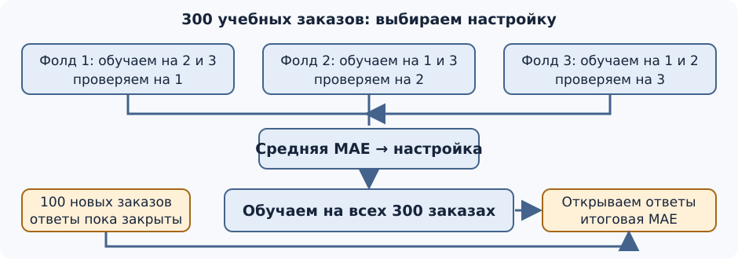

## Чему научимся

- Выбирать меру ошибки по последствиям ошибки в задаче и объяснять, что метрика лишь приближает цель.
- Сравнивать настройки на нескольких проверочных частях и один раз оценивать выбранную модель на отложенных данных.
- Находить утечку, если связанные объекты попали в разные части данных.

**Время и подготовка:** ориентир 7–9 часов с практикой. Нужны MAE и работа с таблицей из прежних занятий; знакомство с `KFold` начнём с картинки и трёх частей, а не с готовой команды.

## План занятия

1. Посчитаем две меры ошибки на маленькой таблице заказов и обсудим пример ранжирования.
2. Выберем настройку дерева по трём разбиениям обучающей таблицы и откроем итоговые ответы.
3. Разберём, почему фотографии одного листа нельзя делить между обучением и проверкой.

## Можно ли доверять прежней проверке?

В [занятии 1.7](../07-features-regularization/content.md) мы сравнивали деревья на 100 новых заказах 3D-печати. Затем по этим же ответам выбрали число заказов в листе. Ошибка выбранного варианта на этой сотне помогает принять решение, но уже **не служит независимой итоговой оценкой**: ответы повлияли на выбор.

Сохраним 300 учебных заказов из [train.csv](../07-features-regularization/data/train.csv). У каждого есть три признака, доступных до запуска принтера: высота, число цветов и оценка объёма пластика. Цель — предсказать время печати в минутах. Все заказы синтетические; [генератор итоговой сотни](data/generate.py) использует тот же учебный механизм, но новое начальное значение случайных чисел. В [final.csv](data/final.csv) вместо времени стоят `?`, а [final_answers.csv](data/final_answers.csv) откроем только после выбора настройки. Выводы относятся к этим искусственным данным, а не к настоящему принтеру.



*Рисунок 1 — Перекрёстная проверка и независимая итоговая оценка*

В сетке слева каждая из трёх частей учебной таблицы по очереди служит для проверки, а две остальные — для обучения. После выбора настройки модель обучается на всех 300 строках. Ответы для отдельной сотни открываются только на последнем шаге. Если после просмотра итоговой ошибки изменить модель, эти ответы тоже станут частью подбора; понадобится ещё один независимый набор для новой итоговой оценки.

## Какие ошибки измеряем

Пусть правильные времена четырёх заказов равны 20, 30, 40 и 50 минутам, а прогнозы — 22, 27, 39 и 65. Модули ошибок: **2, 3, 1 и 15 минут**. Средняя абсолютная ошибка:

$$
\operatorname{MAE}=\frac{2+3+1+15}{4}=5{,}25\text{ минуты}.
$$

Если особенно опасны большие промахи, можно смотреть корень из средней квадратичной ошибки:

$$
\operatorname{RMSE}=\sqrt{\frac{2^2+3^2+1^2+15^2}{4}}\approx7{,}73\text{ минуты}.
$$

В RMSE ошибка в 15 минут сильнее влияет на результат из-за возведения в квадрат. Обе меры выражены в минутах и не говорят, в какую сторону ошиблась модель. Если опоздание заказа дороже преждевременного прогноза, нужно отдельно посчитать опоздания или задать соответствующую стоимость ошибок. Выбор меры делают **до сравнения моделей**, исходя из задачи.

```python
from sklearn.metrics import mean_absolute_error, root_mean_squared_error

real = [20, 30, 40, 50]
predicted = [22, 27, 39, 65]
print(mean_absolute_error(real, predicted))       # 5.25
print(round(root_mean_squared_error(real, predicted), 2))  # 7.73
```

Для времени печати дальше используем знакомую MAE. В задаче распознавания болезни листа ошибка другого рода: **пропустить больной лист** может быть важнее, чем ошибочно отправить здоровый на проверку. Одной доли верных ответов тогда недостаточно: следует отдельно считать пропущенные больные листья и ложные тревоги — как в [занятии 1.6](../06-logistic-regression/content.md) мы считали recall и precision. Необязательный ROC-AUC сравнивает ранжирование ответов по разным порогам, но не заменяет выбор цены ошибок.

### Когда метрика лишь приближает цель

Это короткий перенос идеи в **другую задачу**. Основной эксперимент главы остаётся прогнозом времени печати; поиск поможет увидеть, почему даже правильно посчитанная метрика не всегда полностью выражает пользу для человека.

Представим поиск инструкций по запросу «как настроить 3D-принтер». Наша настоящая цель — чтобы человек **быстро нашёл подходящий способ и смог настроить принтер**. В таблице нет простого столбца с таким ответом для каждого возможного порядка ссылок. Пока у нас есть только оценки, какие страницы относятся к запросу.

Два варианта первых трёх результатов содержат одни и те же страницы:

*Таблица 1 — Два варианта порядка поисковой выдачи*

| Место | Список А | Список Б |
| --- | --- | --- |
| 1 | подходящая инструкция | страница не по теме |
| 2 | страница не по теме | подходящая инструкция |
| 3 | подходящее обсуждение | подходящее обсуждение |

Простая мера **P@3** — доля подходящих страниц среди первых трёх — равна **2/3** для обоих списков. Она не замечает, что в списке Б человек сначала увидит бесполезную страницу. Можно дополнительно измерить качество первого места или использовать метрику, которая сильнее учитывает верх списка. Но и такая метрика опирается на приближённые оценки страниц: подходящее обсуждение может не помочь владельцу конкретной модели принтера. Прямого измерения «человек решил свою задачу» у нас сейчас нет, поэтому пользуемся доступным приближением и называем его ограничение. По одному числу P@3 нельзя утверждать, что оба порядка одинаково полезны.

## Выбираем настройку без итоговых ответов

Возьмём четыре заранее заданных варианта дерева: глубина 2, глубина 4, минимум пять заказов в листе и дерево без этих ограничений. Разделим 300 строк на три части по 100. Каждый вариант три раза обучим на двух частях и проверим на оставшейся. Так каждая строка побывает в проверке ровно один раз, а при её прогнозе модель эту строку не видела. Перемешивание фиксируем через `random_state=42`, чтобы опыт можно было повторить.

```python
from pathlib import Path
import pandas as pd
from sklearn.model_selection import KFold
from sklearn.tree import DecisionTreeRegressor

here = Path.cwd()  # запускайте ноутбук из папки занятия 1.8
train = pd.read_csv(here / "../07-features-regularization/data/train.csv")
features = ["height_cm", "colors", "plastic_cm3"]
settings = {
    "глубина 2": {"max_depth": 2},
    "глубина 4": {"max_depth": 4},
    "от 5 в листе": {"min_samples_leaf": 5},
    "без ограничения": {},
}
folds = KFold(n_splits=3, shuffle=True, random_state=42)
scores = {}
for name, params in settings.items():
    errors = []
    for fit_idx, valid_idx in folds.split(train):
        fit_rows, valid_rows = train.iloc[fit_idx], train.iloc[valid_idx]
        model = DecisionTreeRegressor(random_state=0, **params)
        model.fit(fit_rows[features], fit_rows["minutes"])
        errors.append(mean_absolute_error(
            valid_rows["minutes"], model.predict(valid_rows[features])
        ))
    scores[name] = errors
    print(name, [round(error, 2) for error in errors],
          round(sum(errors) / len(errors), 2))
```

*Таблица 2 — Ошибки моделей при перекрёстной проверке*

| Настройка | Проверка 1 | Проверка 2 | Проверка 3 | Средняя MAE, мин |
| --- | ---: | ---: | ---: | ---: |
| Глубина 2 | 5,21 | 3,65 | 3,96 | 4,27 |
| Глубина 4 | 3,23 | 2,80 | 3,11 | 3,05 |
| От 5 в листе | 3,00 | 2,82 | 2,94 | 2,92 |
| Без ограничения | 3,02 | 2,97 | 2,69 | **2,89** |

Средняя показывает результат выбранной процедуры сравнения, а разброс трёх столбцов показывает зависимость от разбиения. Разница **2,89 против 2,92** мала; по этим трём проверкам нельзя уверенно объявить один вариант всегда лучшим. Но наше заранее принятое правило — выбрать минимальную среднюю MAE — отдаёт дерево без ограничения. В [занятии 1.7](../07-features-regularization/content.md) на другой проверочной сотне вариант с пятью заказами в листе выглядел лучше. Это не противоречие: разные проверки могут дать разный порядок близких вариантов.

Проверки также не должны влиять на обучение внутри своего фолда. Если подобрать признаки, масштабирование или другие преобразования **по всей таблице до разделения**, сведения из проверочной части попадут в обучение. Такие действия нужно повторять внутри каждого шага проверки, используя только две обучающие части.

## Открываем отложенные ответы

Теперь настройка зафиксирована. Обучаем выбранное дерево на всех 300 строках и **один раз** измеряем MAE на отдельных 100 заказах. Их ответы не передавались в `fit` и не участвовали в выборе настройки.

```python
winner = min(settings, key=lambda name: sum(scores[name]) / len(scores[name]))
model = DecisionTreeRegressor(random_state=0, **settings[winner])
model.fit(train[features], train["minutes"])

final = pd.read_csv(here / "data/final.csv")
answers = pd.read_csv(here / "data/final_answers.csv")
checked = final.merge(answers, on="order_id", validate="one_to_one",
                      suffixes=("_hidden", ""))
assert len(checked) == 100
assert checked["minutes_hidden"].eq("?").all()
print(winner)
print(round(mean_absolute_error(
    checked["minutes"], model.predict(checked[features])
), 2))
```

Получаем **«без ограничения»** и итоговую MAE **3,34 минуты**. Это оценка для зафиксированной процедуры на отдельной синтетической сотне, а не обещание такой же ошибки в настоящей мастерской. Для надёжного вывода важны также размер выборки и сходство будущих заказов с учебными.

## Утечка через фотографии одного листа

Ещё один перенос уже знакомого правила честной проверки: разделять данные нужно так, чтобы новый объект действительно был новым в том смысле, в каком модель встретит его после обучения.

Представим другую задачу: по фотографии определить, болен ли лист растения. Один лист сняли несколько раз, под разным углом и при другом свете. Если фото №1 листа `L1` попадёт в обучение, а фото №2 того же `L1` — в тест, модель может узнать особенности **конкретного листа**. Высокая оценка тогда не отвечает на вопрос, как она справится с **новым листом**.

*Таблица 3 — Попадание фотографий одного листа в обучение и тест*

| Фото | Лист | Ответ | При случайном разделении |
| --- | --- | --- | --- |
| `a.jpg` | `L1` | болен | обучение |
| `b.jpg` | `L1` | болен | тест ← утечка |
| `c.jpg` | `L2` | здоров | обучение |
| `d.jpg` | `L3` | здоров | тест |

Разделять нужно по `leaf_id`: **все снимки одного листа остаются в одной части**. Для повторной проверки подходит `GroupKFold`, которому передают идентификатор листа как `groups`. Если задача — узнавать растения из *новой теплицы*, группой должна стать теплица: единицу разделения выбирают по тому, что действительно будет новым при применении модели. Это пример утечки из-за связности объектов, даже когда правильный ответ не добавляли в признаки явно.

```python
from sklearn.model_selection import GroupKFold

photos = pd.DataFrame({
    "file": ["a.jpg", "b.jpg", "c.jpg", "d.jpg", "e.jpg", "f.jpg"],
    "leaf_id": ["L1", "L1", "L2", "L2", "L3", "L3"],
    "sick": [1, 1, 0, 0, 1, 1],
})
for fit_idx, valid_idx in GroupKFold(n_splits=3).split(
    photos, photos["sick"], groups=photos["leaf_id"]
):
    fit_leaves = set(photos.iloc[fit_idx]["leaf_id"])
    valid_leaves = set(photos.iloc[valid_idx]["leaf_id"])
    assert fit_leaves.isdisjoint(valid_leaves)
```

## Практика

1. Пересчитайте вручную MAE и RMSE для четырёх заказов. Объясните, почему второе число больше и какую ошибку оно выделяет.
2. Для двух списков поиска посчитайте P@3 и долю подходящих страниц на первом месте. Какая из двух мер обнаружила различие? Назовите то, чего не сообщает ни одна из них.
3. Запустите [ноутбук](notebook.ipynb) сверху вниз из папки занятия. Воспроизведите четыре строки таблицы, выбранную настройку и итоговые **3,34 минуты**. Найдите строку, после которой `final_answers.csv` впервые читается: какое решение уже принято к этому моменту?
4. Измените **только правило выбора**: среди настроек со средней MAE не дальше чем на 0,05 минуты от минимума возьмите вариант с пятью заказами в листе, если он подходит. Какую настройку выберете? Обучите её на 300 строках и посчитайте ошибку на итоговой сотне **для упражнения**. Почему полученное число уже нельзя выдавать за новую независимую итоговую оценку?
5. Для фотографий предложите идентификаторы листьев для `a.jpg`–`f.jpg` и два набора листьев для обучения и проверки. Проверьте, что ни один лист не встречается в обоих наборах.

**Самопроверка.** В задаче 2 P@3 равна 2/3 для обоих списков, а первый результат подходит только в списке А; ни одна мера не сообщает, удалось ли человеку настроить его принтер. Для задачи 4 подойдут оба близких варианта: 2,92 отличается от 2,89 на **0,03 минуты**. После повторного выбора по уже открытым итоговым ответам они перестают быть независимой проверкой нового правила. Для задачи 5, например, `L1` и `L2` можно оставить в обучении, `L3` — в проверке; обе фотографии каждого листа должны остаться вместе.

## Итоги

Метрику выбирают по тому, какая ошибка важна для задачи. Настройку можно выбирать по нескольким проверочным частям, но итоговые ответы открывают один раз после фиксации процедуры. Связанные фотографии одного листа должны оставаться вместе. Проверьте себя: чем различаются MAE и RMSE? Почему ошибка после подбора по тем же ответам не является независимой? Какой объект должен целиком попадать в одну часть при проверке фотографий? Подсказки и ответы — ниже.

## Самопроверка

::::: {.self-check}

:::: {.question #q-1 correct="B"}

Почему 100 заказов из занятия 1.7 больше не подходят для независимой итоговой оценки?

::: {.choices}

A. В них нет высоты.
B. Их ответы уже использовали при выборе настройки.
C. MAE нельзя считать на 100 строках.
D. Они синтетические, поэтому их нельзя сравнивать вообще.

:::

::: {.hint}

Вспомните, по каким ответам выбирали число заказов в листе.

:::

::: {.solution}

**B.** Проверочные ответы повлияли на выбор; прежняя ошибка не является независимой оценкой выбранной процедуры. Синтетичность ограничивает перенос вывода в реальный мир, но сама по себе не запрещает учебную проверку.

:::

::::

:::: {.question #q-2 correct="B"}

Какова MAE для модулей ошибок 2, 3, 1 и 15 минут?

::: {.choices}

A. 3,00 минуты.
B. 5,25 минуты.
C. 7,73 минуты.
D. 21 минута.

:::

::: {.hint}

Сложите четыре числа и разделите на четыре.

:::

::: {.solution}

**B.** Сумма модулей равна 21, среднее — 5,25 минуты. 7,73 — RMSE.

:::

::::

:::: {.question #q-3 correct="B"}

Какая мера из двух сильнее выделяет один большой промах в 15 минут?

::: {.choices}

A. MAE.
B. RMSE.
C. Обе всегда одинаковы.
D. Ни одна не использует этот заказ.

:::

::: {.hint}

В одной из мер ошибки возводят в квадрат до усреднения.

:::

::: {.solution}

**B.** В RMSE квадрат 15² заметно влияет на среднее. Выбор меры зависит от цены больших промахов в задаче.

:::

::::

:::: {.question #q-4 correct="C"}

На каком этапе допустимо открыть `final_answers.csv`?

::: {.choices}

A. До сравнения настроек, чтобы выбрать признаки.
B. Во время обучения каждого фолда.
C. После выбора настройки и обучения модели на всех 300 строках.
D. В любой момент, если не передавать файл прямо в `fit`.

:::

::: {.hint}

Ответы могут повлиять на решение и без вызова `fit`.

:::

::: {.solution}

**C.** Итоговые ответы открывают после фиксации всей процедуры. Даже ручной подбор по ним лишает оценку независимости.

:::

::::

:::: {.question #q-5 correct="B"}

Сколько раз каждая строка из 300 заказов оказывается в проверочной части трёхфолдовой схемы?

::: {.choices}

A. Ни разу.
B. Один раз.
C. Два раза.
D. Три раза.

:::

::: {.hint}

Каждая из трёх частей по очереди становится проверочной.

:::

::: {.solution}

**B.** Каждая строка принадлежит ровно одному фолду и один раз используется для проверки, пока модель обучается на двух остальных.

:::

::::

:::: {.question #q-6 correct="A"}

Почему нельзя уверенно считать разницу 2,89 и 2,92 минуты универсальным преимуществом?

::: {.choices}

A. Разница мала и получена на конкретных разбиениях синтетических данных.
B. У обеих моделей обязательно одинаковые прогнозы.
C. MAE никогда не различает деревья.
D. Нужно сравнивать только обучающую ошибку.

:::

::: {.hint}

Посмотрите на разброс ошибок между тремя проверками.

:::

::: {.solution}

**A.** Порядок близких вариантов может измениться на других данных или разбиениях. Эти три проверки не доказывают постоянного превосходства.

:::

::::

:::: {.question #q-7 correct="B"}

Что произошло бы, если после итоговой MAE 3,34 минуты снова изменить модель по этому результату?

::: {.choices}

A. Оценка стала бы точнее без новых данных.
B. Итоговая сотня вошла бы в процесс выбора, и для нового итога понадобился бы другой набор.
C. Три фолда исчезли бы.
D. Признаки перестали бы существовать.

:::

::: {.hint}

Вспомните стрелку от итоговых ответов на схеме.

:::

::: {.solution}

**B.** Повторное решение по итоговым ответам делает их частью подбора. Для независимой оценки изменённой модели нужны новые данные.

:::

::::

:::: {.question #q-8 correct="A"}

Почему `a.jpg` и `b.jpg` одного листа `L1` должны оставаться в одной части данных?

::: {.choices}

A. Иначе модель может узнать тот же лист на проверке вместо обобщения на новый лист.
B. Иначе не получится прочитать JPEG.
C. Потому что все больные листья должны быть в обучении.
D. Потому что две фотографии обязаны иметь одинаковое имя.

:::

::: {.hint}

Что нового в тестовом фото того же физического листа?

:::

::: {.solution}

**A.** Связанные снимки раскрывают проверочной части особенности объекта, который модель уже видела. Разделение по `leaf_id` устраняет именно эту утечку.

:::

::::

:::: {.question #q-9 correct="C"}

Если модель будут применять в новой теплице, по чему лучше разделить снимки?

::: {.choices}

A. По номеру файла.
B. По цвету фона.
C. По теплице.
D. Случайно по отдельным пикселям.

:::

::: {.hint}

Какая единица целиком станет новой при применении модели?

:::

::: {.solution}

**C.** Все снимки одной теплицы должны остаться в одной части, иначе модель может использовать её особенности. Разделение только по листьям проверяло бы более лёгкую задачу.

:::

::::

:::: {.question #q-10 correct="A"}

Почему одинаковая P@3 не доказывает, что два списка одинаково полезны?

::: {.choices}

A. P@3 не учитывает порядок первых трёх страниц и не измеряет, решил ли человек задачу.
B. Потому что P@3 можно считать только для прогноза времени.
C. Потому что в списках разное число страниц.
D. Потому что любая метрика обязана быть равна нулю.

:::

::: {.hint}

Вспомните, какая страница стоит на первом месте и что мы знаем о результате для человека.

:::

::: {.solution}

**A.** У обоих списков две подходящие страницы из трёх, но в списке Б первая страница бесполезна. Даже метрика с учётом позиции остаётся приближением к цели «человек решил задачу».

:::

::::

:::::
