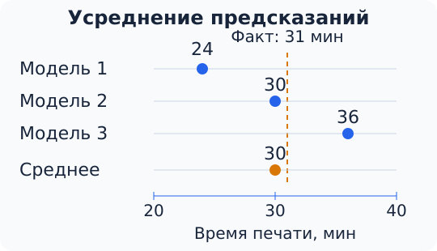
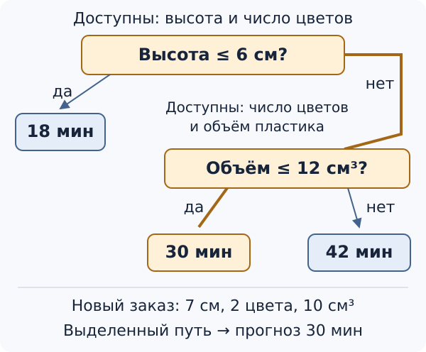

Одна модель не всегда позволяет добиться хорошего качества. Можно усложнить её, добавить признаки или собрать больше данных. Но есть и другой подход: обучить несколько моделей и объединить их предсказания. Такое объединение называют **ансамблем**, а входящие в него модели — **базовыми моделями**.

Ансамбли используют и для классификации, и для регрессии. В этой статье разберём, почему объединение моделей может быть полезно, познакомимся с бэггингом и на его основе построим случайный лес.

## Как объединять предсказания

В задаче регрессии каждая модель предсказывает число. Самый простой способ объединить несколько ответов — взять их среднее. Например, три модели оценили время печати одной фигурки в 24, 30 и 36 минут. Предсказание ансамбля составит

$$
\frac{24+30+36}{3}=30\text{ минут}.
$$

Почему усреднение может быть полезно? Вернёмся к примеру с печатью. Допустим, настоящее время равно 31 минуте. Первая модель занизила его на 7 минут, а третья завысила на 5 минут. При усреднении эти ошибки частично компенсировались: ансамбль ошибся всего на минуту.

Однако само по себе большое число моделей ничего не гарантирует. Если все они предсказывают 24 минуты, среднее тоже будет равно 24. Поэтому важно, чтобы базовые модели **ошибались по-разному**. Тогда общий ответ может оказаться надёжнее отдельных предсказаний. При этом ансамбль не обязан превосходить каждую свою модель на каждом объекте.

В задаче классификации можно устроить голосование. Если три модели считают письмо спамом, а две — обычным письмом, ансамбль выберет класс «спам».

Если модели возвращают вероятности классов, можно усреднить их. Например, три модели оценили вероятность спама для одного письма в 80 %, 60 % и 40 %. Средняя оценка — 60 %, а для обычного письма — оставшиеся 40 %. Ансамбль выберет класс «спам», поскольку у него средняя вероятность выше.

Усреднение вероятностей учитывает не только выбранный каждой моделью класс, но и её оценку вероятности. Поэтому результат не всегда совпадает с простым голосованием.

## Бэггинг

Предположим, мы решили объединить несколько деревьев решений. Если обучать их одинаковым способом на одной и той же таблице, можно получить одинаковые или очень похожие деревья. Чтобы добиться разнообразия, каждому дереву дадим немного другой набор обучающих примеров.

Для этого воспользуемся **бутстрапом**. Из исходной выборки случайно выбирают объекты **с возвращением**: после выбора объект остаётся доступным и может попасть в новую выборку ещё раз. Обычно набирают столько же объектов, сколько было в исходной выборке.

Пусть у нас всего пять заказов: А, Б, В, Г и Д. Все они имеют одинаковые шансы быть выбранными. Сначала выпал заказ А. Мы записали его в новую таблицу, но из исходной ничего не удалили. Затем два раза подряд выпал В, потом Д и снова А. Получилась выборка А, В, В, Д, А.

В новой таблице по-прежнему пять строк, но только три различных заказа. При выборе копируется вся строка: и признаки заказа, и правильное время печати. Заказы А и В теперь встречаются чаще и сильнее влияют на обучение дерева.

Для следующего дерева повторим процедуру, снова выбирая из всех пяти исходных заказов. Например, получим Б, Г, А, Г, Д. Таким образом, разные деревья обучаются на разных наборах, хотя новых данных мы не собирали.

Остаётся обучить модели и объединить их предсказания. Этот подход называется **бэггингом** — от английского *bootstrap aggregation*, то есть объединения моделей, обученных на бутстрап-выборках. Он применим к разным алгоритмам, но особенно полезен для деревьев решений.

Дело в том, что дерево может быть чувствительно к небольшим изменениям обучающей выборки. Замена нескольких строк способна изменить первый выбранный вопрос, а вслед за ним — и дальнейшее устройство дерева. У глубоких деревьев это особенно заметно. Усреднение ответов нескольких таких моделей обычно уменьшает зависимость итогового прогноза от случайных особенностей данных.

Все модели в бэггинге можно обучать независимо друг от друга. Второму дереву не нужны предсказания первого, третьему — результаты второго. Поэтому обучение удобно выполнять параллельно.

## Случайный лес

Бэггинг позволяет получить разные деревья, но они всё ещё могут быть слишком похожи. Представим, что время печати фигурки хорошо объясняется объёмом пластика. Во многих бутстрап-выборках дерево начнёт именно с этого признака. Из-за этого деревья могут давать похожие предсказания и совершать одни и те же ошибки.

В **случайном лесе** к выбору случайных строк добавляют ещё один приём: при построении каждой вершины дерева рассматривают только случайно выбранную часть признаков.

Допустим, у заказа есть три признака: высота фигурки, число цветов и объём пластика. При поиске первого вопроса дереву могут достаться высота и число цветов. Среди них алгоритм выбирает признак и порог, которые лучше всего разделяют обучающие примеры. Пусть выбран вопрос: «Высота не больше 6 см?»

В следующей вершине случайный выбор может дать другой набор: число цветов и объём пластика. Тогда дерево уже не сможет задать вопрос о высоте, зато сможет спросить: «Объём не больше 12 см³?» На рисунке показано небольшое условное дерево, построенное таким способом.

Проследим путь нового заказа: высота фигурки — 7 см, число цветов — два, объём пластика — 10 см³. На первый вопрос ответ — «нет»: 7 больше 6. На второй — «да»: 10 не больше 12. Мы попали в лист с предсказанием **30 минут**. Как и у обычного дерева регрессии, это среднее время печати обучающих заказов, попавших в данный лист. Другое дерево леса может задать иные вопросы и получить другой прогноз.

Здесь важно различать две вещи. Случайно выбирается набор доступных признаков, а признак и порог для самого вопроса дерево подбирает по обучающим данным. Кроме того, признаки выбирают заново **в каждой вершине**, а не один раз для всего дерева. Поэтому в разных частях одного дерева могут использоваться все доступные признаки.

Получается следующий алгоритм:

1. Для каждого дерева создаём свою бутстрап-выборку из обучающих данных.
2. Строим дерево, при каждом разбиении выбирая случайную часть признаков.
3. Для нового объекта получаем ответы всех деревьев и объединяем их.

Это и есть **случайный лес** (*random forest*): ансамбль деревьев, в котором разнообразие создаётся и выбором объектов, и выбором признаков.

На схеме показан лес из трёх деревьев. На практике их часто бывают десятки или сотни. При прогнозировании один и тот же объект проходит через все деревья; повторно выбирать обучающие строки или перестраивать вопросы уже не нужно.

## Параметры случайного леса

У случайного леса есть несколько настроек. Рассмотрим, как они влияют на обучение и предсказания.

### Глубина деревьев

Для одного дерева большая глубина часто приводит к переобучению: оно слишком подробно запоминает обучающие примеры. Может показаться, что в лес нужно включать только небольшие деревья.

Но небольшое дерево способно пропустить важные зависимости. Если все деревья слишком просты, усреднение их ответов не обязательно исправит этот недостаток. Поэтому в случайном лесе часто используют глубокие деревья: каждое из них улавливает подробности, а объединение уменьшает влияние части случайных ошибок.

Например, если все слишком простые деревья предсказывают 30 минут и для маленькой, и для большой фигурки, среднее ничего не изменит. Чтобы различать такие заказы, деревьям нужны подходящие вопросы и достаточная глубина.

Это не означает, что лес защищён от переобучения. Глубину деревьев и минимальное число объектов в листе всё равно стоит выбирать по качеству на проверочных данных.

### Число признаков при разбиении

Чем больше признаков разрешено рассматривать в каждой вершине, тем легче отдельному дереву найти удачный вопрос. Однако деревья при этом могут стать более похожими друг на друга.

Если признаков мало, деревья получаются разнообразнее, но иногда им приходится строить разбиение без наиболее полезного признака. Нужно найти подходящий баланс. Например, для трёх признаков можно сравнить варианты, в которых при каждом вопросе доступны один, два или все три.

### Число деревьев

Чем больше деревьев в лесу, тем устойчивее обычно становится среднее предсказание. Но эффект постепенно ослабевает: переход от десяти деревьев к ста может быть полезен, а от тысячи к двум тысячам — почти ничего не изменить.

При этом каждое дерево требует памяти и времени на обучение и предсказание. Поэтому число деревьев выбирают с учётом и качества, и скорости работы. Ошибка на конкретной проверочной выборке не обязана уменьшаться при каждом добавлении дерева.

## Сравнение дерева и леса

В [ноутбуке](notebook.ipynb) сравниваются дерево и случайный лес на 300 искусственно составленных учебных заказах из [статьи о признаках и регуляризации](../07-features-regularization/content.md). По высоте, числу цветов и объёму пластика модели предсказывают время печати. Для проверки разделим заказы на три части. Трижды обучим каждую модель: каждый раз две части используем для обучения, а оставшуюся — для проверки. Так каждый заказ один раз окажется в проверочной части. Дерево и лес будем обучать и проверять на одних и тех же частях, чтобы сравнение было справедливым.

Сравним одно дерево с лесом из ста деревьев. Получились такие значения MAE — средней абсолютной ошибки:

| Проверка | Дерево, мин | Лес, мин |
| --- | --- | --- |
| Первая | 3,02 | 2,76 |
| Вторая | 2,97 | 2,48 |
| Третья | 2,69 | 2,55 |
| **Среднее** | **2,89** | **2,60** |

Например, если заказ напечатан за 31 минуту, а модель предсказала 28 минут, абсолютная ошибка равна 3 минутам. MAE усредняет такие ошибки по всем проверочным заказам. Значение 2,60 минуты не означает, что модель ошибается ровно настолько каждый раз: у отдельных заказов ошибки могут быть и меньше, и больше.

В этом опыте объединение помогло. Но лес не является универсальным победителем: его преимущество нужно проверять на данных конкретной задачи. Все выборки для деревьев строят только из обучающей части; данные, на которых сравнивают качество, в обучение попадать не должны.

У случайного леса есть и практическое ограничение: объяснить решение сотни деревьев труднее, чем пройти по нескольким вопросам одного небольшого дерева. Поэтому при выборе модели учитывают не только ошибку, но и требования к скорости и понятности её ответов.
