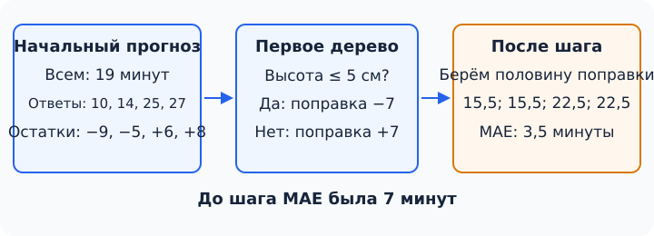

## Чему научимся

- Проследить, как новое дерево исправляет ошибки уже построенного прогноза.
- Объяснить роль числа деревьев, глубины и скорости обучения в бустинге.
- Сравнить линейную модель, лес и бустинг на одинаковых проверках и один раз оценить выбранную модель на новых заказах.

## План занятия

1. Вручную построим первый шаг бустинга на четырёх заказах.
2. Сравним три знакомых подхода на таблице заказов 3D-печати.
3. Зафиксируем выбор и откроем отдельные итоговые ответы.

## Деревья работают по очереди

В [занятии 1.9](../09-random-forest/content.md) мы собирали **случайный лес**: деревья обучались независимо на разных выборках, а затем их ответы усреднялись. Можно устроить сотрудничество иначе. Сначала сделать простой прогноз, посмотреть, где он ошибся, и обучить следующее дерево **исправлять ошибки предыдущего прогноза**. Затем повторить. Такое последовательное построение ансамбля называют **градиентным бустингом**.

Начнём с регрессии: предсказываем время печати в минутах. На этом занятии нам достаточно варианта бустинга с **квадратичной ошибкой** при обучении. Для неё дерево подбирают по остаткам: *настоящее время минус текущий прогноз*. На новых заказах качество по-прежнему измеряем знакомой MAE — средним модулем ошибки. Обучающая функция потерь и метрика проверки могут различаться; это нужно назвать явно.

## Один шаг вручную

Возьмём четыре придуманных выполненных заказа. Пока известна только высота фигурки:

| Высота, см | 2 | 3 | 7 | 8 |
| --- | ---: | ---: | ---: | ---: |
| Время печати, мин | 10 | 14 | 25 | 27 |

Первый прогноз — **среднее** обучающих времён: $(10+14+25+27)/4=19$ минут для каждой фигурки. Для квадратичной ошибки именно среднее даёт лучший постоянный ответ. Остатки равны $10-19=-9$, $14-19=-5$, $25-19=6$, $27-19=8$ минутам. Отрицательный остаток означает, что прогноз завышен; положительный — занижен.

Обучим маленькое дерево с одним вопросом: «Высота не больше 5 см?». Оно предсказывает **поправку**, а не полное время. Для двух низких фигурок средний остаток $(-9-5)/2=-7$ минут; для двух высоких — $(6+8)/2=7$ минут. Такой одновопросный алгоритм называют **пнём**. Он учился на остатках, поэтому знает, в какую сторону сдвинуть прежний прогноз.

Не будем сразу прибавлять всю поправку. Возьмём её половину: **скорость обучения** $\eta=0{,}5$. Обновление для любого заказа записывается так:

$$F_{1}(x)=F_{0}(x)+\eta h_{1}(x),$$

где $F_0$ — начальный прогноз 19 минут, а $h_1$ — ответ первого дерева: $-7$ или $+7$ минут. Например, для фигурки высотой 2 см новый прогноз равен $19+0{,}5\cdot(-7)=15{,}5$ минуты; для высоты 8 см — $19+0{,}5\cdot7=22{,}5$ минуты.



До шага обучающая MAE равнялась $(9+5+6+8)/4=7$ минутам. После него модули ошибок равны $5{,}5;\ 1{,}5;\ 2{,}5;\ 4{,}5$, а MAE — **3,5 минуты**. Это улучшение **на тех же четырёх заказах**. Оно ничего не доказывает о новых фигурках: проверять их нужно отдельно.

Следующее дерево получит уже **новые остатки**. Поэтому деревья в бустинге строят по очереди, а не независимо, как в лесу. После $m$ шагов прогноз имеет вид

$$F_m(x)=F_0(x)+\eta h_1(x)+\eta h_2(x)+\dots+\eta h_m(x).$$

Название «градиентный» связано с тем, что для разных функций потерь поправки находят по направлению уменьшения ошибки. При квадратичной ошибке это приводит к знакомым остаткам. Выводить производные для выполнения практики не требуется.

```python
from sklearn.ensemble import GradientBoostingRegressor

heights = [[2], [3], [7], [8]]
minutes = [10, 14, 25, 27]
first_step = GradientBoostingRegressor(
    loss="squared_error", n_estimators=1,
    learning_rate=0.5, max_depth=1, random_state=0
)
first_step.fit(heights, minutes)
print(first_step.predict(heights))
```

Получим $15{,}5;\ 15{,}5;\ 22{,}5;\ 22{,}5$ минуты — те же числа, что и вручную. Это проверяет **первый** шаг библиотечной модели, но не заменяет проверку на новых данных.

## Сколько деревьев добавлять

У бустинга три понятные настройки. `n_estimators` задаёт число последовательных деревьев. `learning_rate` определяет, какую долю поправки брать на каждом шаге: при меньшей доле часто нужно больше шагов. `max_depth` ограничивает сложность каждого дерева; глубокое дерево способно подстроиться под множество деталей обучения. Эти настройки взаимодействуют, поэтому универсального «лучшего числа деревьев» нет.

Много шагов может уменьшать обучающую ошибку и одновременно ухудшать результат на новых объектах. В библиотеке существуют и другие ограничения, например `min_samples_leaf` — минимальное число обучающих объектов в листе. Их выбирают по проверочным данным, **не по итоговому тесту**.

## Табличная задача целиком

Вернёмся к учебной мастерской. Из [занятия 1.7](../07-features-regularization/content.md) берём **300 выполненных заказов**: время печати известно, а до запуска принтера доступны высота, число цветов и оценка объёма пластика. Данные синтетические. Объём — оценка из проекта, не фактический расход после печати. `order_id` нужен для сопоставления строк и не является признаком.

Для этой итоговой задачи создана **новая сотня заказов** с тем же учебным правилом и другим начальным состоянием генератора. В [final.csv](data/final.csv) время заменено знаком `?`; [ответы](data/final_answers.csv) лежат отдельно. Предыдущие проверочные и итоговые ответы из занятий 1.7 и 1.8 здесь не используем. Происхождение новой сотни видно в [генераторе](data/generate.py). Это учебное разделение не подтверждает качество модели на настоящих принтерах.

Заранее фиксируем четыре варианта: линейную Ridge-модель из 1.3, лес из 1.9 и бустинг с 20 либо 100 деревьями. У леса 100 деревьев и два случайных признака при разбиении; у бустинга деревья глубины 2, скорость обучения 0,1 и минимум пять заказов в листе. Другие настройки, а также три одинаковых разбиения для проверки указаны в коде. Все варианты получают **те же три признака** и оцениваются одной метрикой — MAE в минутах. Масштабирование линейной модели выполняется внутри `Pipeline`, только по обучению каждого шага проверки.

```python
from pathlib import Path
import pandas as pd
from sklearn.ensemble import GradientBoostingRegressor, RandomForestRegressor
from sklearn.linear_model import Ridge
from sklearn.model_selection import KFold, cross_val_score
from sklearn.pipeline import make_pipeline
from sklearn.preprocessing import StandardScaler

here = Path.cwd()  # запустите ноутбук из папки занятия 1.10
train = pd.read_csv(here / "../07-features-regularization/data/train.csv")
features = ["height_cm", "colors", "plastic_cm3"]
X, y = train[features], train["minutes"]
models = {
    "Линейная модель (Ridge)": make_pipeline(StandardScaler(), Ridge(alpha=1)),
    "Случайный лес": RandomForestRegressor(
        n_estimators=100, max_features=2, random_state=42
    ),
    "Бустинг, 20 деревьев": GradientBoostingRegressor(
        n_estimators=20, learning_rate=0.1, max_depth=2,
        min_samples_leaf=5, random_state=42
    ),
    "Бустинг, 100 деревьев": GradientBoostingRegressor(
        n_estimators=100, learning_rate=0.1, max_depth=2,
        min_samples_leaf=5, random_state=42
    ),
}
folds = KFold(n_splits=3, shuffle=True, random_state=42)
scores = {}
for name, model in models.items():
    errors = -cross_val_score(
        model, X, y, cv=folds, scoring="neg_mean_absolute_error"
    )
    scores[name] = errors.mean()
    print(name, [round(value, 2) for value in errors], round(scores[name], 2))
```

Как в [занятии 1.8](../08-honest-evaluation/content.md), каждый раз обучаемся на двух частях из трёх и проверяемся на оставшейся. Так каждый заказ один раз оказывается в проверке, а модели сравниваются на одинаковых строках.

| Модель | Проверка 1 | Проверка 2 | Проверка 3 | Средняя MAE, мин |
| --- | ---: | ---: | ---: | ---: |
| Линейная модель (Ridge) | 2,51 | 1,97 | 2,24 | **2,24** |
| Случайный лес | 2,72 | 2,50 | 2,56 | 2,59 |
| Бустинг, 20 деревьев | 3,48 | 3,11 | 2,93 | 3,17 |
| Бустинг, 100 деревьев | 2,58 | 2,45 | 2,43 | 2,49 |

В этом опыте 100 деревьев бустинга лучше 20, но **линейная модель** получила меньшую среднюю ошибку, чем оба варианта бустинга и лес. У учебного правила времени есть сильная почти линейная часть, поэтому такой исход не удивителен. Это не доказательство, что Ridge всегда лучше бустинга. Мы выбрали модель по среднему трёх проверок, а не по сложности или привлекательности названия.

## Один раз открываем итоговые ответы

Зафиксируем победителя, обучим его на всех 300 выполненных заказах и получим прогнозы для новой сотни. Только после этого откроем ответы и посчитаем итоговую MAE.

```python
from sklearn.metrics import mean_absolute_error

winner = min(scores, key=scores.get)
model = models[winner].fit(X, y)
final = pd.read_csv(here / "data/final.csv")
assert final["minutes"].eq("?").all()
predictions = model.predict(final[features])

answers = pd.read_csv(here / "data/final_answers.csv")
checked = final[["order_id"]].merge(answers, on="order_id", validate="one_to_one")
assert len(checked) == len(final) == 100
print(winner, round(mean_absolute_error(checked["minutes"], predictions), 2))
```

Получим **«Линейная модель (Ridge)»** и итоговую MAE **2,34 минуты**. На отдельных заказах ошибки могут быть больше. Поскольку мы уже увидели эту сотню ответов, изменять по ним настройки и снова называть результат независимой итоговой оценкой нельзя. Для нового окончательного сравнения понадобятся новые данные.

## Практика

1. Повторите первый шаг вручную для четырёх заказов. Найдите остатки и два ответа пня. Затем поставьте $\eta=1$ вместо $0{,}5$. Новые прогнозы будут **12, 12, 26, 26 минут**, а обучающая MAE — **1,5 минуты**. Почему по этому числу нельзя выбирать скорость обучения?
2. Запустите [ноутбук](notebook.ipynb) сверху вниз из папки занятия. Воспроизведите четыре строки сравнения. Найдите строку, после которой впервые читается `final_answers.csv`: что к этому моменту уже зафиксировано?
3. Добавьте в словарь ещё один вариант бустинга: `n_estimators=200` при остальных прежних настройках. Сравните его с вариантом на 100 деревьев только по трём проверочным частям, не обращаясь к итоговым ответам. Если измените выбор модели, не выдавайте уже открытую сотню за новую независимую проверку.

**Самопроверка.** В задаче 1 остатки равны $-9,-5,6,8$, ответы пня — $-7$ и $7$; обучающая ошибка не показывает, как модель предскажет новые заказы. В задаче 2 ответы открываются **после** выбора модели и вычисления прогнозов. В задаче 3 сравнивают среднюю MAE на одних и тех же трёх разбиениях, а итоговая сотня уже израсходована для первоначального выбора.

## Типичные ошибки

- Обучить каждое дерево бустинга независимо и усреднить ответы: так теряется последовательное исправление ошибок.
- Передать `minutes` или `order_id` в признаки либо масштабировать всю таблицу до разделения на проверочные части.
- Сообщить ошибку на тех же данных, по которым выбрали число деревьев, как независимую итоговую оценку.
- Считать, что более сложная модель обязана победить на любой таблице.

## Самопроверка

### 1. Что получает второе дерево бустинга с квадратичной ошибкой?

A. Исходные ответы без учёта первого шага.<br>
B. Остатки после обновлённого прогноза.<br>
C. Только ответы первого дерева без признаков.<br>
D. Только новые итоговые заказы.

<details><summary>Подсказка</summary>

После каждого шага прогноз меняется.

</details><details><summary>Решение</summary>

**B.** Для квадратичной ошибки следующее дерево подгоняют к новым остаткам. Поэтому порядок деревьев важен.

</details>

### 2. Чему равен первый постоянный прогноз для времён 10, 14, 25 и 27 минут?

A. 14.<br>
B. 19.<br>
C. 21.<br>
D. 27.

<details><summary>Подсказка</summary>

Сложите четыре времени и разделите на четыре.

</details><details><summary>Решение</summary>

**B.** Среднее равно $76/4=19$ минут; оно минимизирует сумму квадратов ошибок постоянного прогноза.

</details>

### 3. Какой остаток у заказа с настоящим временем 10 минут при прогнозе 19 минут?

A. $-9$ минут.<br>
B. $+9$ минут.<br>
C. $10$ минут.<br>
D. $19$ минут.

<details><summary>Подсказка</summary>

Вычтите прогноз из настоящего времени.

</details><details><summary>Решение</summary>

**A.** $10-19=-9$: прогноз слишком высок, поэтому поправка должна идти вниз.

</details>

### 4. Первый пень дал поправку $+7$ минут, скорость обучения равна $0{,}5$. Каким станет прогноз 19 минут?

A. $7$ минут.<br>
B. $19$ минут.<br>
C. $22{,}5$ минуты.<br>
D. $26$ минут.

<details><summary>Подсказка</summary>

К прежнему прогнозу прибавляют лишь половину поправки.

</details><details><summary>Решение</summary>

**C.** $19+0{,}5\cdot7=22{,}5$ минуты. Вариант D прибавляет поправку целиком.

</details>

### 5. Чем бустинг в этом занятии отличается от случайного леса?

A. Его деревья строятся последовательно и исправляют текущий прогноз.<br>
B. Он совсем не использует деревья.<br>
C. Он обязательно выдаёт класс, а не число.<br>
D. Он обучается только на итоговом тесте.

<details><summary>Подсказка</summary>

Вспомните, зависит ли новое дерево от уже сделанных прогнозов.

</details><details><summary>Решение</summary>

**A.** В лесу деревья обучают независимо и объединяют их ответы; в бустинге новое дерево зависит от ошибок текущего ансамбля.

</details>

### 6. Что задаёт `learning_rate` в формуле обновления прогноза?

A. Единицы измерения высоты.<br>
B. Долю поправки, добавляемую на каждом шаге.<br>
C. Число признаков в таблице.<br>
D. Настоящее время печати.

<details><summary>Подсказка</summary>

Посмотрите на множитель перед ответом дерева в формуле обновления.

</details><details><summary>Решение</summary>

**B.** Скорость обучения умножает поправку дерева. Меньший шаг часто требует большего числа деревьев.

</details>

### 7. На каких строках выбирают между бустингом с 20 и 100 деревьями?

A. На итоговой сотне после чтения её ответов.<br>
B. На обучающих строках, по которым модель уже подстроилась.<br>
C. На одинаковых проверочных частях трёхфолдовой схемы.<br>
D. По первым десяти строкам файла без ответов.

<details><summary>Подсказка</summary>

Итоговые ответы оставляют для одной проверки после выбора.

</details><details><summary>Решение</summary>

**C.** Настройки сравнивают по трём проверкам внутри 300 заказов. Итоговую сотню не используют для подбора.

</details>

### 8. Какая модель получила меньшую среднюю MAE на трёх проверках занятия?

A. Бустинг с 20 деревьями.<br>
B. Бустинг со 100 деревьями.<br>
C. Случайный лес.<br>
D. Линейная модель Ridge.

<details><summary>Подсказка</summary>

Сравните последний столбец таблицы ошибок; меньше — лучше.

</details><details><summary>Решение</summary>

**D.** У Ridge средняя MAE 2,24 минуты — ниже остальных в этом конкретном опыте. Это не универсальный порядок моделей.

</details>

### 9. Когда допустимо открыть `final_answers.csv` для итоговой оценки?

A. До выбора модели, чтобы увидеть самый удобный результат.<br>
B. После выбора модели, обучения на 300 строках и получения прогнозов для итоговой сотни.<br>
C. На каждом шаге подбора числа деревьев.<br>
D. Вместе с обучающими ответами при вызове `fit`.

<details><summary>Подсказка</summary>

Ответы не должны повлиять на выбор или прогнозы.

</details><details><summary>Решение</summary>

**B.** В коде сначала фиксируют модель и прогнозы, затем читают ответы и считают MAE. Остальные варианты нарушают независимость проверки.

</details>

### 10. Что можно заключить из итоговой MAE 2,34 минуты?

A. На каждом новом заказе ошибка будет ровно 2,34 минуты.<br>
B. Бустинг никогда не нужен для табличных данных.<br>
C. На этой отдельной синтетической сотне выбранная Ridge-модель имела средний модуль ошибки 2,34 минуты.<br>
D. Настройки можно без последствий подбирать по той же сотне снова.

<details><summary>Подсказка</summary>

Назовите модель, меру ошибки и данные, на которых она получена.

</details><details><summary>Решение</summary>

**C.** Число относится к выбранной модели и этой учебной сотне. Оно не описывает отдельный заказ или настоящий принтер.

</details>
