## Чему научимся

В этом параграфе разберём, как из линейной модели получается нейронная сеть. Вы сможете:

- объяснить, зачем нейрону нелинейная функция активации;
- выполнить прямой проход маленькой сети вручную и в Python;
- проверить формы входа, весов, скрытого слоя и выхода;
- показать на примере, почему один скрытый слой решает задачу, недоступную прямой.

## Когда одной прямой мало

Начнём с учебной задачи о двух признаках. Ответ равен 1, если ровно один из признаков равен 1, и равен 0 во всех остальных случаях. Такую операцию называют исключающим ИЛИ, или XOR.

*Таблица 1 — Учебные примеры для операции XOR*

| $x_1$ | $x_2$ | Класс $y$ |
| ---: | ---: | ---: |
| 0 | 0 | 0 |
| 0 | 1 | 1 |
| 1 | 0 | 1 |
| 1 | 1 | 0 |

Посмотрим на четыре точки на плоскости (рисунок 1). Точки класса 1 стоят в противоположных углах квадрата, а точки класса 0 — в двух других углах. Отрезок между точками $(0,1)$ и $(1,0)$ пересекает отрезок между $(0,0)$ и $(1,1)$. Поэтому нельзя провести прямую, которая оставит точки одного класса по одну сторону, а точки другого — по другую.



*Рисунок 1 — Точки XOR и отрезки между точками одного класса*

Линейная модель из занятия 1.3 и логистическая регрессия из занятия 1.6 проводят именно прямую границу. На этих четырёх примерах любая такая граница верно ответит не более чем на три вопроса, то есть даст accuracy не выше $0{,}75$. Для решения XOR нужен новый признак, который зависит от $x_1$ и $x_2$ нелинейно. Его и создаёт скрытый слой сети.

## Нейрон: взвешенная сумма и активация

Нейрон получает несколько чисел, умножает каждое на свой вес, складывает результаты и прибавляет смещение:

$$
z = w_1x_1 + w_2x_2 + \dots + w_nx_n + b = \mathbf w^\top \mathbf x + b.
$$

Полученное число $z$ ещё не является ответом нейрона. К нему применяют функцию активации $f$:

$$
a = f(z).
$$

Без функции активации нейрон остаётся линейной моделью: он умеет только взвешивать входы и сдвигать результат. Две такие операции подряд снова дают линейное преобразование, поэтому глубокая сеть без нелинейности не стала бы выразительнее одного слоя.

В скрытых слоях часто используют ReLU:

$$
\operatorname{ReLU}(z) = \max(0, z).
$$

Она пропускает положительные значения без изменений, а отрицательные заменяет нулём. На выходе для вероятности класса применяют сигмоиду:

$$
\sigma(z) = \frac{1}{1 + e^{-z}}.
$$

Сигмоида принимает любое число и возвращает значение от 0 до 1. Если вероятность не меньше $0{,}5$, относим объект к классу 1, иначе — к классу 0.

## Слой и формы данных

Нейроны объединяют в полносвязный слой: каждый его нейрон получает все входы предыдущего слоя. Если на вход подать вектор $\mathbf x$, слой вычисляет вектор

$$
\mathbf h = f(\mathbf W\mathbf x + \mathbf b).
$$

Матрица $\mathbf W$ хранит веса всех нейронов: её строка соответствует одному нейрону, а столбец — одному входному признаку. Вектор $\mathbf b$ содержит смещения. Для сети с двумя входами, двумя скрытыми нейронами и одним выходом формы удобно свести в таблицу.

*Таблица 2 — Формы данных в сети 2–2–1*

| Величина | Форма | Что означает |
| :--- | :--- | :--- |
| $X$ | $n \times 2$ | пакет из $n$ объектов, у каждого два признака |
| $W_1$ | $2 \times 2$ | веса двух скрытых нейронов |
| $b_1$ | $2$ | смещения двух скрытых нейронов |
| $H$ | $n \times 2$ | выходы скрытого слоя для всех объектов |
| $W_2$ | $1 \times 2$ | веса выходного нейрона |
| $b_2$ | $1$ | смещение выходного нейрона |
| $z$, $p$ | $n \times 1$ | взвешенная сумма и вероятность для каждого объекта |



*Рисунок 2 — Сеть 2–2–1: два входа, два скрытых нейрона и один выход*

На рисунке 2 данные идут слева направо: каждый вход связан с обоими скрытыми нейронами, а их выходы собираются в один ответ. Прямой проход — это последовательное применение таких слоёв. Веса при этом не меняются: мы только вычисляем ответ. Число нейронов в слое называют его шириной, а число слоёв — глубиной. Сеть из таблицы имеет один скрытый слой и часто называется многослойным перцептроном, или MLP.

## Разбираем сеть для XOR

Зададим конкретные веса. Пока это не результат обучения, а специально подобранный пример, на котором удобно считать вручную:

$$
W_1 = \begin{pmatrix}1 & 1\\ 1 & 1\end{pmatrix},\qquad
b_1 = \begin{pmatrix}-0{,}5\\ -1{,}5\end{pmatrix},\qquad
W_2 = \begin{pmatrix}1 & -3\end{pmatrix},\qquad
b_2 = -0{,}25.
$$

Скрытые нейроны вычисляют

$$
h_1 = \operatorname{ReLU}(x_1 + x_2 - 0{,}5),\qquad
h_2 = \operatorname{ReLU}(x_1 + x_2 - 1{,}5).
$$

Первый нейрон становится активным, когда среди входов есть хотя бы одна единица. Второй — только когда обе единицы присутствуют одновременно. Выход собирает эти два признака:

$$
z = h_1 - 3h_2 - 0{,}25,\qquad p = \sigma(z).
$$

Проверим два случая. Для входа $(0,1)$ получаем $h_1 = 0{,}5$, $h_2 = 0$, затем $z = 0{,}25$ и $p \approx 0{,}56$. Это больше $0{,}5$, поэтому сеть отвечает 1. Для входа $(1,1)$ получаем $h_1 = 1{,}5$, $h_2 = 0{,}5$, затем $z = -0{,}25$ и $p \approx 0{,}44$. Теперь ответ 0.

*Таблица 3 — Прямой проход сети 2–2–1 на примерах XOR*

| $x_1$ | $x_2$ | $h_1$ | $h_2$ | $z$ | $p$ | Ответ |
| ---: | ---: | ---: | ---: | ---: | ---: | ---: |
| 0 | 0 | 0 | 0 | −0,25 | 0,44 | 0 |
| 0 | 1 | 0,5 | 0 | 0,25 | 0,56 | 1 |
| 1 | 0 | 0,5 | 0 | 0,25 | 0,56 | 1 |
| 1 | 1 | 1,5 | 0,5 | −0,25 | 0,44 | 0 |

Сеть решила задачу не потому, что стала «умнее» прямой, а потому, что скрытый слой построил новые признаки: «есть хотя бы одна единица» и «есть обе единицы». Выходной нейрон сравнивает их и даёт высокий ответ только в двух средних строках. Вероятности здесь близки к $0{,}5$, поскольку веса выбраны для простых вычислений. При обучении в следующем параграфе они подстроятся так, чтобы ответы стали увереннее.

## Тот же расчёт в Python

Повторим вычисления без внешних библиотек. Функции `relu` и `sigmoid` принимают одно число, а `forward` выполняет весь прямой проход.

```python
import math


def relu(z):
    return max(0.0, z)


def sigmoid(z):
    return 1 / (1 + math.exp(-z))


def forward(x1, x2):
    h1 = relu(x1 + x2 - 0.5)
    h2 = relu(x1 + x2 - 1.5)
    z = h1 - 3 * h2 - 0.25
    return h1, h2, z, sigmoid(z)


for x1, x2 in [(0, 0), (0, 1), (1, 0), (1, 1)]:
    h1, h2, z, p = forward(x1, x2)
    answer = int(p >= 0.5)
    print(f"{x1} {x2} | {h1:.1f} {h2:.1f} | {z:+.2f} | {p:.3f} | {answer}")
```

Программа напечатает:

```text
0 0 | 0.0 0.0 | -0.25 | 0.438 | 0
0 1 | 0.5 0.0 | +0.25 | 0.562 | 1
1 0 | 0.5 0.0 | +0.25 | 0.562 | 1
1 1 | 1.5 0.5 | -0.25 | 0.438 | 0
```

Результат совпадает с таблицей. В библиотеках для нейросетей те же действия выполняются сразу для пакета объектов: вход получает форму `(n, 2)`, после первого слоя — `(n, 2)`, после выходного — `(n, 1)`. Если форма не совпала, чаще всего перепутаны число признаков и число объектов.

## Попробуйте сами

1. Вычислите вручную прямой проход для входа $(1,0)$: найдите $h_1$, $h_2$, $z$, вероятность и ответ. Затем проверьте себя программой. Для самопроверки: $h_1=0{,}5$, $h_2=0$, $z=0{,}25$, $p\approx0{,}56$, ответ 1.

2. Замените в программе смещение $b_2$ на $0{,}25$. Пересчитайте все четыре строки и объясните, почему сеть перестала решать XOR. Для самопроверки: все вероятности окажутся больше $0{,}5$, поэтому сеть ответит 1 всем объектам и угадает только два ответа из четырёх.

3. Для сети, которая получает пять объектов с четырьмя признаками и имеет скрытый слой из трёх нейронов, выпишите формы $X$, $W_1$, $b_1$, $H$, $W_2$ и $b_2$. Проверьте, что число столбцов каждой матрицы совпадает с размером входа следующей операции.

4. Уберите ReLU из сети и оставьте только линейные преобразования. Покажите, что два слоя можно заменить одним линейным преобразованием. Объясните, почему после этого задача XOR снова становится нерешаемой.

## Что стоит унести с собой

Нейрон вычисляет взвешенную сумму входов и применяет к ней функцию активации. Слой объединяет несколько таких нейронов, а прямой проход последовательно передаёт данные от входа к выходу. Нелинейная активация нужна, чтобы сеть могла строить границы сложнее прямой. На примере XOR мы увидели, как скрытый слой создаёт новые признаки, а выходной слой принимает по ним решение.

В следующем параграфе мы не будем задавать веса вручную: покажем, как сеть измеряет ошибку и постепенно подстраивает параметры на учебных примерах.

## Самопроверка

### 1. Зачем в нейрон добавляют функцию активации?

A. Чтобы увеличить число входов.<br>
B. Чтобы сеть могла выражать нелинейные зависимости.<br>
C. Чтобы хранить правильные ответы.<br>
D. Чтобы заменить матричное умножение.

<details>
<summary>Подсказка</summary>

Что произойдёт, если оставить только взвешенные суммы и смещения?

</details>

<details>
<summary>Решение</summary>

**B.** Без нелинейной активации несколько слоёв сводятся к одному линейному преобразованию, поэтому граница остаётся прямой.

</details>

### 2. Какую форму имеет матрица весов слоя из трёх нейронов для четырёх входных признаков?

A. $3 \times 4$.<br>
B. $4 \times 3$.<br>
C. $3 \times 1$.<br>
D. $4 \times 4$.

<details>
<summary>Подсказка</summary>

Строка матрицы соответствует одному нейрону, столбец — одному входу.

</details>

<details>
<summary>Решение</summary>

**A.** Три нейрона дают три строки, четыре признака — четыре столбца. Смещений при этом три, а не четыре.

</details>

### 3. Чему равно $\operatorname{ReLU}(-2) + \operatorname{ReLU}(3)$?

A. 1.<br>
B. 3.<br>
C. 5.<br>
D. −2.

<details>
<summary>Подсказка</summary>

ReLU заменяет отрицательное значение нулём, а положительное оставляет как есть.

</details>

<details>
<summary>Решение</summary>

**B.** $\operatorname{ReLU}(-2)=0$, $\operatorname{ReLU}(3)=3$, поэтому сумма равна 3.

</details>

### 4. Почему одна прямая не решает задачу XOR?

A. У задачи слишком мало примеров.<br>
B. Классы нельзя разделить прямой: отрезки между точками разных классов пересекаются.<br>
C. Признаки записаны целыми числами.<br>
D. В задаче нет правильных ответов.

<details>
<summary>Подсказка</summary>

Нарисуйте четыре точки квадрата и соедините точки класса 1.

</details>

<details>
<summary>Решение</summary>

**B.** Точки классов расположены через одну, и отрезки, соединяющие пары, пересекаются. Прямая не может развести концы пересекающихся отрезков по разные стороны.

</details>

### 5. Почему при входе $(0,1)$ второй скрытый нейрон не активен?

A. Потому что $x_1+x_2-1{,}5=-0{,}5$, а ReLU заменяет это значение нулём.<br>
B. Потому что вероятность оказалась меньше $0{,}5$.<br>
C. Потому что $W_2$ содержит отрицательный вес.<br>
D. Потому что сеть ещё не обучена.

<details>
<summary>Подсказка</summary>

Сначала вычислите взвешенную сумму второго нейрона, затем примените ReLU.

</details>

<details>
<summary>Решение</summary>

**A.** $1-1{,}5=-0{,}5$, поэтому $\operatorname{ReLU}(-0{,}5)=0$. Выход второго нейрона равен нулю.

</details>

### 6. Что произойдёт, если убрать ReLU и оставить только линейные слои?

A. Сеть станет глубже.<br>
B. Сеть будет эквивалентна одному линейному преобразованию.<br>
C. Сеть сможет решать XOR без скрытого слоя.<br>
D. Число параметров станет нулевым.

<details>
<summary>Подсказка</summary>

Подставьте выход первого слоя во второй и раскройте скобки.

</details>

<details>
<summary>Решение</summary>

**B.** Если $H=W_1X+b_1$, а $Z=W_2H+b_2$, то $Z=(W_2W_1)X+(W_2b_1+b_2)$. Это снова линейное преобразование, поэтому XOR остаётся неразрешимым.

</details>
