## Чему научимся

В прошлом параграфе мы вручную вычислили ответ сети: умножили входы на веса, сложили результаты и применили функцию активации. Сами веса мы выбрали заранее — это были числа, при которых сеть решает задачу XOR. Как находят веса в реальных задачах?

Веса находит обучение. Сначала сеть получает случайные веса, затем сравнивает свои ответы с правильными и постепенно корректирует параметры. Разберём этот процесс на задаче распознавания рукописных цифр: по картинке определить, какая цифра на ней написана.

После занятия вы сможете:

- Обучить небольшую сеть на размеченных картинках и измерить её точность.
- Объяснить, что происходит внутри `fit`: откуда берётся ошибка и как меняются веса.
- Отличить результат на обучающих примерах от честной оценки на новых.

Сначала рассмотрим данные и представим каждую картинку 64 числами. Обучим сеть различать цифры 3 и 8, затем разберём, что происходит при вызове `fit`: как оценивается ошибка и меняются веса. После этого обучим сеть различать все десять цифр и сравним её с моделями из первой главы.

Понадобятся умение вычислять ответ сети по весам из [прошлого параграфа](../01-from-linear-model-to-neural-network/content.md) и знание, зачем модель проверяют на примерах, которых она не видела. Мы будем обучать `MLPClassifier` из scikit-learn тем же вызовом `fit`, что и модели первой главы. На чтение, эксперименты и самопроверку заложите примерно 5–8 часов.

## Задача: 3 или 8

Возьмём набор рукописных цифр, включённый в scikit-learn: 1797 изображений размером 8 × 8 пикселей. Значение пикселя лежит от 0 до 16: 0 соответствует пустому месту, 16 — самому тёмному штриху.

```python
from sklearn.datasets import load_digits

digits = load_digits()
print(digits.images.shape)  # (картинок, строк, столбцов)
print(digits.target[3])     # какая цифра на картинке с номером 3
print(digits.images[3])     # сама картинка: 8 строк по 8 чисел
```

Вывод:

```text
(1797, 8, 8)
3
[[ 0.  0.  7. 15. 13.  1.  0.  0.]
 [ 0.  8. 13.  6. 15.  4.  0.  0.]
 [ 0.  2.  1. 13. 13.  0.  0.  0.]
 [ 0.  0.  2. 15. 11.  1.  0.  0.]
 [ 0.  0.  0.  1. 12. 12.  1.  0.]
 [ 0.  0.  0.  0.  1. 10.  8.  0.]
 [ 0.  0.  8.  4.  5. 14.  9.  0.]
 [ 0.  0.  7. 13. 13.  9.  0.  0.]]
```

В таблице по краям стоят нули: цифра не касается рамки. Крупные значения образуют штрихи тройки, а в двух средних строках заметен сдвиг вправо. Человек распознаёт форму, а сеть получает только эти 64 числа.

Сеть принимает вектор чисел, поэтому значения пикселей записывают подряд: сначала первую строку изображения, затем вторую и так далее. Так изображение размера 8 × 8 превращают в вектор длины 64. Эту операцию называют **развёрткой**. В `digits.data` изображения уже представлены такими векторами. Порядок пикселей одинаков для всех изображений, поэтому каждая координата вектора соответствует определённому пикселю.



*Рисунок 1 — От картинки к ответу сети*

Начнём с двух классов: будем отличать тройку от восьмёрки. Оставим только эти цифры и разделим все числа на 16, чтобы признаки лежали в отрезке от 0 до 1.

```python
import numpy as np

mask = (digits.target == 3) | (digits.target == 8)
X = digits.data[mask] / 16                   # 64 числа от 0 до 1 на картинку
y = (digits.target[mask] == 8).astype(int)   # 1 — восьмёрка, 0 — тройка
print(X.shape, y.shape)
print(np.bincount(y))                        # сколько троек и восьмёрок
```

Вывод:

```text
(357, 64) (357,)
[183 174]
```

Классы почти равны по размеру: 183 тройки и 174 восьмёрки. Отложим часть примеров для проверки — модель не увидит их при обучении.

```python
from sklearn.model_selection import train_test_split

X_train, X_test, y_train, y_test = train_test_split(
    X, y, test_size=0.3, random_state=0, stratify=y)
print(X_train.shape, X_test.shape)
print(np.bincount(y_test))
```

Вывод:

```text
(249, 64) (108, 64)
[55 53]
```

На обучение ушло 249 картинок, на проверку — 108. Параметр `stratify=y` сохранил соотношение классов в обеих частях: 55 троек и 53 восьмёрки.

Перед обучением определим результат простейшей модели: она всегда называет один и тот же класс. Это **отправная точка**, с которой сравнивают остальные модели.

```python
from sklearn.dummy import DummyClassifier

constant = DummyClassifier(strategy="most_frequent").fit(X_train, y_train)
print(round(constant.score(X_test, y_test), 3))
```

Вывод:

```text
0.509
```

Постоянный ответ верен примерно в половине случаев, поскольку классы почти равны по размеру. Чтобы показать, что использует признаки изображений, обученная модель должна превысить эту точность — 0,509.

## Обучаем сеть тремя строками

`MLPClassifier` — это та самая сеть из прошлого параграфа: входы, скрытый слой и выход. Создадим её и обучим.

```python
from sklearn.neural_network import MLPClassifier

net = MLPClassifier(
    hidden_layer_sizes=(16,),  # один скрытый слой из 16 нейронов
    max_iter=200,              # 200 проходов по обучающим картинкам
    random_state=0,            # чтобы результат повторялся
)
net.fit(X_train, y_train)
print(round(net.score(X_train, y_train), 3))
print(round(net.score(X_test, y_test), 3))
```

Вывод:

```text
0.996
0.981
```

Модель задаётся несколькими параметрами, а обучается одним вызовом `fit`. На обучающих изображениях сеть верно распознала 99,6 % примеров, на отложенных — 98,1 %: из 108 изображений она ошиблась на двух. `MLPClassifier` автоматически определил число входов и выходов: 64 признака на входе и один выход для двух классов. Мы задали только скрытый слой.

::: {.callout type="note"}

Вместе с ответом scikit-learn напечатает `ConvergenceWarning`: 200 эпох закончились раньше, чем ошибка перестала уменьшаться. Это не ошибка в коде — сеть просто не доучилась до конца. В задании 1 видно, что при `max_iter=500` обучение останавливается само.

:::

Посмотрим, сколько в такой сети весов.

```python
print([c.shape for c in net.coefs_])       # таблицы весов между слоями
print([b.shape for b in net.intercepts_])  # смещения нейронов
```

Вывод:

```text
[(64, 16), (16, 1)]
[(16,), (1,)]
```

Между входом и скрытым слоем лежит таблица $64\times16$, между скрытым слоем и выходом — $16\times1$; к ним добавляются 16 и 1 смещение. Всего $64\cdot16+16+16\cdot1+1=1057$ чисел. Все они были случайными до `fit` и подобраны после него.

Как и логистическая регрессия, сеть отвечает вероятностью. Метод `predict_proba` возвращает по столбцу на класс; второй столбец — вероятность восьмёрки.

```python
proba = net.predict_proba(X_test)[:, 1]  # вероятность восьмёрки
for i in range(5):
    print(y_test[i], round(float(proba[i]), 3))
```

Вывод:

```text
0 0.003
0 0.388
0 0.009
1 0.997
1 0.989
```

В каждой строке сначала указана истинная метка класса, затем вероятность того, что изображена восьмёрка. В четырёх случаях сеть уверена: вероятности 0,003, 0,009, 0,997 и 0,989. Вторая картинка — тройка, но вероятность восьмёрки у неё 0,388. Класс определяется по порогу 0,5, поэтому ответ верный, но уверенности мало: эта тройка чем-то похожа на восьмёрку.

Посмотрим на две картинки, где сеть всё-таки ошиблась.

```python
wrong = np.where(net.predict(X_test) != y_test)[0]
print(len(wrong))
for i in wrong:
    print(y_test[i], round(float(proba[i]), 3))
```

Вывод:

```text
2
0 0.817
0 0.512
```

Обе ошибки одного вида: сеть приняла тройку за восьмёрку. В первом случае вероятность восьмёрки составила 0,817, во втором — 0,512, чуть выше порога. Посмотрим на сами картинки.



*Рисунок 2 — Две картинки, на которых сеть ошиблась*

Обе тройки написаны так, что верх получился широким и закруглённым: на сетке 8 на 8 этого хватает, чтобы цифра стала похожа на восьмёрку. Остальные 106 картинок из 108 сеть разобрала верно.

## Что делает `fit`

Вызов `fit` занимает одну строку, но внутри выполняется цикл из трёх действий:

1. **Прогноз.** Сеть считает ответ для обучающих картинок — умножает входы на веса, складывает, применяет активацию.
2. **Ошибка.** Ответы сравниваются с правильными, и получается одно число: насколько сеть неправа.
3. **Поправка.** Каждый вес немного меняется в ту сторону, где ошибка меньше.



*Рисунок 3 — Цикл обучения внутри `fit`*

Коэффициенты простых моделей из первой главы тоже подбирают так, чтобы уменьшить ошибку. В нейросети тот же принцип применяют к большему числу параметров: здесь их 1057.

### Ошибка

Ошибка зависит от вероятности правильного ответа. Для картинки-восьмёрки, если сеть присвоила восьмёрке вероятность $p$, штраф равен $-\ln p$: чем меньше эта вероятность, тем больше штраф. Например, при $p=0{,}9$ штраф равен $-\ln0{,}9\approx0{,}105$, при $p=0{,}5$ — около $0{,}693$, а при $p=0{,}1$ — $2{,}303$. Для тройки правильный класс имеет вероятность $1-p$, поэтому её штраф равен $-\ln(1-p)$. Средний штраф по всем обучающим картинкам обозначим $L$: обучение стремится уменьшить это значение.

### Поправка весов

Направление поправки подсказывает производная. Обозначим через $L'(w)$ производную ошибки по весу $w$: она показывает, как изменится ошибка, если чуть увеличить этот вес. Если производная положительна, вес надо уменьшить; если отрицательна — увеличить. Поэтому от веса отнимают производную, умноженную на небольшое число $\eta$ — **скорость обучения**:

$$w \leftarrow w - \eta\,L'(w).$$

Пройдём один такой шаг до конца. Возьмём вес, который идёт от одного нейрона скрытого слоя к выходу. Пусть этот нейрон выдал $a=0{,}8$, на картинке восьмёрка ($y=1$), а сеть дала ей вероятность $p=0{,}3$. Для такого веса производная считается просто: разность между ответом сети и правильным ответом, умноженная на вход:

$$L'(w)=(p-y)\,a=(0{,}3-1)\cdot0{,}8=-0{,}56.$$

Производная отрицательна, значит ошибка уменьшится, если вес увеличить. Со скоростью обучения $\eta=0{,}1$ получаем

$$w \leftarrow w-0{,}1\cdot(-0{,}56)=w+0{,}056.$$

Проверим, что стало лучше. После такой поправки вероятность восьмёрки на этой картинке поднимается с $0{,}300$ до примерно $0{,}309$, а штраф падает с $1{,}204$ до $1{,}173$. Выигрыш крошечный — но шагов будет много, и правятся сразу все 1057 весов, каждый по своей производной.



*Рисунок 4 — Шаг против производной*

Размер шага приходится выбирать. Слишком маленький $\eta$ — и за отведённое число проходов сеть почти не успеет обучиться; слишком большой — и поправка перелетит через самое низкое место, а ошибка начнёт скакать. В `MLPClassifier` скорость обучения задаёт `learning_rate_init`, по умолчанию 0,001.

::: {.callout type="note"}

Для весов скрытого слоя производную считать сложнее: такой вес влияет на ответ не напрямую, а через следующий слой. Библиотека делает это сама, а способ называется **обратным распространением ошибки**; его разбор ждёт в главе о математике ИИ. Сейчас достаточно знать, что производная есть у каждого веса.

:::

### Эпохи

Один полный проход по всем обучающим картинкам называют **эпохой**. Параметр `max_iter=200` задал 200 эпох. После каждой из них `MLPClassifier` запоминает среднюю ошибку в списке `loss_curve_`, и по этому списку видно, училась ли сеть.

```python
curve = net.loss_curve_  # ошибка после каждой эпохи
print(len(curve))
print([round(float(curve[i]), 3) for i in (0, 9, 49, 99, 199)])
```

Вывод:

```text
200
[0.742, 0.615, 0.33, 0.144, 0.052]
```

Ошибка уменьшилась с 0,742 до 0,052: сначала быстро, потом всё медленнее. Так и должно быть — пока веса случайны, поправлять есть что; ближе к концу сеть ошибается редко, и шаги становятся мелкими.



*Рисунок 5 — Ошибка по эпохам*

Убывающая кривая показывает, что уменьшается ошибка на обучающих данных. Если она почти не меняется, возможно, скорость обучения слишком мала или сеть уже сошлась. Если ошибка заметно колеблется или растёт, возможно, шаг слишком велик. Сама по себе эта кривая не показывает, насколько хорошо сеть работает на новых данных.

## А если цифр десять

Теперь вернём все цифры. Для двух классов достаточно одного выхода: вероятность второго класса равна $1-p$. Для десяти классов на последнем слое сначала получают **десять оценок** $z_i$, по одной на класс. Эти оценки могут быть отрицательными и не обязаны складываться в 1, поэтому сами по себе они не являются вероятностями.

Чтобы превратить оценки в вероятности, применяют преобразование **softmax**: каждую оценку $z_i$ возводят в экспоненту, а результат делят на сумму экспонент всех оценок:

$$p_i=\frac{e^{z_i}}{e^{z_0}+e^{z_1}+\ldots+e^{z_9}}.$$

У всех дробей один знаменатель, поэтому их сумма равна 1. Посчитаем преобразование на трёх числах, чтобы проследить все вычисления. Пусть сеть выдала 2, 1 и 0. Тогда $e^2\approx7{,}389$, $e^1\approx2{,}718$ и $e^0=1$, их сумма равна $11{,}107$, а вероятности получаются $0{,}665$, $0{,}245$ и $0{,}090$ — в сумме единица. Порядок при этом не меняется: у наибольшего числа остаётся наибольшая вероятность, его цифру сеть и называет ответом. В `MLPClassifier` softmax применяется автоматически: метод `predict_proba` сразу возвращает вероятности классов.

Для обучения сети на десяти классах по-прежнему используем `MLPClassifier` и вызов `fit`. Возьмём более широкий скрытый слой; число его нейронов — один из параметров модели.

```python
X_all = digits.data / 16
y_all = digits.target
Xa_train, Xa_test, ya_train, ya_test = train_test_split(
    X_all, y_all, test_size=0.3, random_state=0, stratify=y_all)

net10 = MLPClassifier(hidden_layer_sizes=(32,), max_iter=200, random_state=0)
net10.fit(Xa_train, ya_train)
print(round(net10.score(Xa_train, ya_train), 3))
print(round(net10.score(Xa_test, ya_test), 3))
```

Вывод:

```text
0.995
0.976
```

На 1257 обучающих изображениях точность составляет 99,5 %, на 540 отложенных — 97,6 %. Число параметров сети $64\cdot32+32+32\cdot10+10=2410$.

Прочитаем ответ целиком — все десять вероятностей для первой проверочной картинки.

```python
proba10 = net10.predict_proba(Xa_test)
print(proba10[0].round(3))
print(round(float(proba10[0].sum()), 3))
print(net10.predict(Xa_test)[0], ya_test[0])
```

Вывод:

```text
[0.    0.91  0.    0.001 0.001 0.    0.    0.    0.087 0.   ]
1.0
1 1
```

Сумма вероятностей равна 1. Наибольшая вероятность — 0,91 — соответствует цифре 1, и сеть выбрала этот класс; истинная метка тоже равна 1. Следующая по величине вероятность — 0,087 — соответствует восьмёрке. По распределению вероятностей видно, какие классы сеть считает наиболее похожими.



*Рисунок 6 — Десять вероятностей для одной картинки*

Посмотрим, где сеть ошибается.

```python
pred10 = net10.predict(Xa_test)
wrong10 = np.where(pred10 != ya_test)[0]
print(len(wrong10))
for i in wrong10[:5]:
    print(ya_test[i], "→", pred10[i], round(float(proba10[i].max()), 2))
```

Вывод:

```text
13
8 → 1 0.79
1 → 8 0.67
2 → 1 0.89
9 → 5 0.78
9 → 3 0.42
```

Сеть ошиблась на 13 из 540 изображений. В каждом примере сначала указана истинная цифра, затем ответ сети и максимальная вероятность её прогноза. Среди этих ошибок сеть путает единицу и восьмёрку, а девятку — с пятёркой или тройкой. Изображения имеют низкое разрешение, поэтому некоторые цифры действительно выглядят похоже.



*Рисунок 7 — Картинки, на которых сеть ошиблась*

## Честная проверка

Точность 0,976 нужно сопоставить с результатами других моделей. Сравним сеть с постоянным ответом и логистической регрессией — простой моделью из первой главы — на одном и том же разбиении данных.

```python
from sklearn.linear_model import LogisticRegression

constant10 = DummyClassifier(strategy="most_frequent").fit(Xa_train, ya_train)
logreg10 = LogisticRegression(max_iter=2000).fit(Xa_train, ya_train)
print(round(constant10.score(Xa_test, ya_test), 3))
print(round(logreg10.score(Xa_test, ya_test), 3))
```

Вывод:

```text
0.102
0.97
```

*Таблица 1 — Доля верных ответов на 540 отложенных картинках*

| Модель | Точность на тесте | Число ошибок |
| :--- | ---: | ---: |
| Постоянный ответ | 0,102 | 485 |
| Логистическая регрессия | 0,970 | 16 |
| Сеть 64–32–10 | 0,976 | 13 |

Сеть обошла линейную модель всего на три изображения. На этом наборе цифр с разрешением 8 × 8 линейная модель уже показывает высокую точность, поэтому преимущество нейросети невелико. На более сложных данных — например, на больших изображениях и текстах — нейросети могут быть полезнее; эти задачи рассмотрим в следующих главах. Для простых табличных данных модели из первой главы остаются хорошим выбором.

Теперь посмотрим, как меняется результат, если уменьшить обучающую выборку. Обучим ту же сеть на 100 примерах из обучающей части вместо 1257.

```python
small = MLPClassifier(hidden_layer_sizes=(32,), max_iter=2000, random_state=0)
small.fit(Xa_train[:100], ya_train[:100])
print(round(small.score(Xa_train[:100], ya_train[:100]), 3))
print(round(small.score(Xa_test, ya_test), 3))
```

Вывод:

```text
1.0
0.893
```

На обучающих изображениях сеть не ошиблась ни разу, а на отложенных точность составила 0,893. Такой разрыв между результатами на обучающих и новых данных — признак **переобучения**. У сети 2410 параметров, поэтому она может запомнить 100 примеров, но это не гарантирует, что она правильно распознает новые изображения. Точность на обучающей части сама по себе не показывает качество модели на новых данных.

::: {.callout type="important"}

Оценивайте сеть только на данных, которые не участвовали в обучении. Размер скрытого слоя и число эпох тоже нельзя подбирать по тестовой части: для этого отделяют ещё одну, проверочную часть, а тест оставляют на один раз в самом конце.

:::

## Попробуйте сами

Задания 1–4 сравнивают разные настройки сети, поэтому точность в них измеряют на **проверочной** части: тестовую оставляют для одного финального сравнения. Проверочную часть отделяют от обучающей.

```python
X_fit, X_val, y_fit, y_val = train_test_split(
    X_train, y_train, test_size=0.4, random_state=0, stratify=y_train)
Xa_fit, Xa_val, ya_fit, ya_val = train_test_split(
    Xa_train, ya_train, test_size=0.4, random_state=0, stratify=ya_train)
print(X_fit.shape, X_val.shape)
print(Xa_fit.shape, Xa_val.shape)
```

Вывод:

```text
(149, 64) (100, 64)
(754, 64) (503, 64)
```

1. Обучите сеть на тройках и восьмёрках (`X_fit`, `y_fit`) с `max_iter=50`, затем с `max_iter=500`. Сравните точность на `X_val` и объясните разницу. Для самопроверки: 0,88 и 0,99; при 500 обучение остановилось само на 487-й эпохе, потому что ошибка перестала уменьшаться.
2. Задайте той же сети `learning_rate_init=0.0001` при `max_iter=200` и посмотрите на `loss_curve_`. Для самопроверки: точность на `X_val` падает до 0,72 против 0,98 при шаге по умолчанию 0,001, а ошибка к концу остаётся около 0,6 — шаг слишком мал, и 200 эпох не хватило.
3. Поставьте `hidden_layer_sizes=(1,)` на той же задаче и сравните результат с логистической регрессией, обученной на `X_fit`. Для самопроверки: 0,92 у сети против 0,98 у логистической регрессии и у сети с 16 нейронами. Один нейрон скрытого слоя считает одну взвешенную сумму входов, поэтому такая сеть не сильнее линейной модели.
4. На десяти цифрах обучите на `Xa_fit` сети со скрытым слоем из 4 и из 128 нейронов. Для самопроверки: 0,73 и 0,96 на `Xa_val`; четырём нейронам не хватает, чтобы различить десять цифр.
5. Вернитесь к задаче XOR из прошлого параграфа: обучите `MLPClassifier(hidden_layer_sizes=(4,), max_iter=5000, random_state=0)` на четырёх точках и проверьте предсказания. Повторите с `random_state=2`. Для самопроверки: при `random_state=0` все четыре ответа верны, при `random_state=2` — три из четырёх. Обучение начинается со случайных весов, и иногда спуск застревает; это ещё одна причина фиксировать `random_state` и проверять результат.

Выбрав настройку по проверочной части, измерьте точность на тестовой один раз — это и будет честная оценка выбранной модели.

## Что стоит унести с собой

Картинку сеть получает как строку чисел: 8 на 8 точек превращаются в 64 признака. Обучение — это цикл: прогноз, ошибка, поправка всех весов против производной со шагом $\eta$; один проход по всем примерам называют эпохой, а падающая `loss_curve_` показывает, что цикл работает. Для двух классов у сети один выход с вероятностью, для десяти — десять выходов, сумма которых равна единице. Точность на обучающей части говорит лишь о том, что обучение шло: судить о модели можно только по отложенным данным и только в сравнении с отправной точкой и более простой моделью.

## Самопроверка

::::: {.self-check}

:::: {.question #inputs-count correct="C"}

Сколько входов у сети, которая получает картинку 8 на 8 точек?

::: {.choices}

A. 8, по одному на строку картинки.
B. 16, по числу нейронов скрытого слоя.
C. 64, по одному на каждую точку.
D. 1797, по числу картинок в наборе.

:::

::: {.hint}

Картинку вытягивают в один вектор. Сколько в нём чисел?

:::

::: {.solution}

**C.** Все строки картинки выписывают подряд, поэтому на входе $8\cdot8=64$ числа — по одному на точку. Число картинок в наборе и размер скрытого слоя к числу входов не относятся.

:::

::::

:::: {.question #probability-threshold correct="B"}

Сеть отличает тройку от восьмёрки: классов два, выход один. Для проверочной картинки она выдала вероятность восьмёрки 0,388. Какой ответ она даст и насколько в нём уверена?

::: {.choices}

A. Восьмёрка: вероятность больше нуля.
B. Тройка, но уверенности мало: до порога 0,5 совсем близко.
C. Тройка, и сеть полностью уверена.
D. Ответ не определён, нужно обучать дальше.

:::

::: {.hint}

С двумя классами класс выбирают по порогу 0,5. Насколько 0,388 от него далеко?

:::

::: {.solution}

**B.** 0,388 меньше 0,5, поэтому сеть отвечает «тройка», и этот ответ верный. Но до порога остаётся чуть больше одной десятой: картинка чем-то похожа на восьмёрку, а у уверенных ответов вероятности совсем другие — 0,003 или 0,997. Порог 0,5 работает только при двух классах; когда цифр десять, сеть называет ту, у которой вероятность наибольшая.

:::

::::

:::: {.question #loss-value correct="C"}

На картинке восьмёрка, а сеть дала ей вероятность 0,1. Чему равен штраф $-\ln p$ и как он изменится, если вероятность вырастет до 0,9?

::: {.choices}

A. Около 0,105; при 0,9 вырастет примерно до 2,303.
B. Около 2,303; при 0,9 останется таким же.
C. Около 2,303; при 0,9 упадёт примерно до 0,105.
D. Ровно 0,1; при 0,9 станет ровно 0,9.

:::

::: {.hint}

Штраф тем больше, чем меньше вероятность у правильного ответа.

:::

::: {.solution}

**C.** $-\ln0{,}1\approx2{,}303$, а $-\ln0{,}9\approx0{,}105$. Уверенная ошибка обходится примерно в двадцать раз дороже уверенного верного ответа.

:::

::::

:::: {.question #gradient-direction correct="A"}

Производная ошибки по весу $w$ отрицательна. Что сделает шаг обучения?

::: {.choices}

A. Увеличит $w$, потому что от веса отнимают производную со множителем $\eta$.
B. Уменьшит $w$, потому что производная показывает направление роста.
C. Оставит $w$ без изменений до следующей эпохи.
D. Обнулит $w$ и начнёт подбор заново.

:::

::: {.hint}

Запишите $w \leftarrow w - \eta\,\partial L/\partial w$ и подставьте отрицательное число.

:::

::: {.solution}

**A.** Вычитание отрицательной производной увеличивает вес. Отрицательная производная и означает, что при увеличении веса ошибка уменьшается.

:::

::::

:::: {.question #epoch-meaning correct="B"}

Что такое эпоха обучения?

::: {.choices}

A. Один обработанный пример из обучающей части.
B. Один полный проход по всем обучающим примерам.
C. Одно изменение одного веса сети.
D. Одна проверка точности на отложенных данных.

:::

::: {.hint}

Чем задаётся длина списка `loss_curve_`?

:::

::: {.solution}

**B.** Эпоха — проход по всем обучающим примерам; `max_iter=200` задаёт 200 таких проходов, и в `loss_curve_` оказывается 200 значений средней ошибки.

:::

::::

:::: {.question #ten-outputs correct="D"}

Сеть различает десять цифр. Что верно про её десять выходов?

::: {.choices}

A. Каждый выход равен 0 или 1, и единица стоит ровно одна.
B. Выходы независимы, и каждый может быть равен 1 одновременно с другими.
C. Сумма выходов равна 10, по единице на класс.
D. Выходы — вероятности, их сумма равна 1, а ответ — наибольшая из них.

:::

::: {.hint}

Посмотрите на вывод `predict_proba` для одной картинки и сложите числа.

:::

::: {.solution}

**D.** Softmax приводит десять чисел к сумме 1, поэтому их читают как вероятности классов; ответом считают цифру с наибольшей вероятностью.

:::

::::

:::: {.question #baseline-need correct="B"}

Зачем сравнивать точность сети с постоянным ответом, который дал 0,102?

::: {.choices}

A. Постоянный ответ может оказаться лучшей моделью для задачи.
B. Чтобы понять, сколько сеть заработала сама, а не получила из состава данных.
C. Чтобы выбрать размер скрытого слоя по результату на тесте.
D. Чтобы заменить проверку на отложенных данных.

:::

::: {.hint}

Что получилось бы, если бы в наборе 90 % картинок были одной цифрой?

:::

::: {.solution}

**B.** Отправная точка показывает, какую точность даёт сам состав данных. На десяти примерно равных классах это около 0,1, поэтому 0,976 — результат модели; при перекошенных классах постоянный ответ может дать и 0,9.

:::

::::

:::: {.question #overfitting-gap correct="C"}

На 100 обучающих картинках сеть дала точность 1,0, а на отложенных — 0,893. Как это называется и о чём говорит?

::: {.choices}

A. Хорошее обучение: на обучающей части ошибок нет.
B. Ошибка в разделении данных: такого разрыва быть не может.
C. Переобучение: 2410 весов запомнили 100 примеров, но запомненное не переносится на новые.
D. Слишком маленькая скорость обучения.

:::

::: {.hint}

Сравните число весов сети с числом обучающих примеров.

:::

::: {.solution}

**C.** Весов намного больше, чем примеров, поэтому сеть запоминает обучающую часть наизусть. Разрыв между точностью на обучении и на новых данных — обычный признак переобучения.

:::

::::

:::: {.question #flat-loss correct="B"}

Ошибка в `loss_curve_` почти не уменьшается от эпохи к эпохе. Что проверить в первую очередь?

::: {.choices}

A. Размер тестовой части: он влияет на обучение.
B. Скорость обучения: при слишком маленьком шаге поправки почти не меняют веса.
C. Число классов в задаче.
D. Порядок столбцов в обучающей таблице.

:::

::: {.hint}

Отчего шаг может оказаться слишком мелким для заметного изменения весов?

:::

::: {.solution}

**B.** При маленькой скорости обучения веса за эпоху меняются едва заметно, и кривая стоит на месте — это видно в задании 2. Размер тестовой части в обучении не участвует, число классов учиться не мешает, а порядок столбцов для сети безразличен, если он одинаков у всех примеров.

:::

::::

:::: {.question #random-start correct="C"}

Зачем `MLPClassifier` задают `random_state`?

::: {.choices}

A. Он задаёт число эпох обучения.
B. Он перемешивает классы, чтобы они стали равными по размеру.
C. Обучение начинается со случайных весов, и `random_state` делает запуск повторяемым.
D. Он отключает случайность, и результат перестаёт зависеть от данных.

:::

::: {.hint}

Какими были 1057 весов до вызова `fit`?

:::

::: {.solution}

**C.** Начальные веса случайны, поэтому два запуска без `random_state` дают разные результаты, а иногда спуск застревает, как в задании 5. Фиксированное значение делает запуск повторяемым, но не отменяет саму случайность начала.

:::

::::

:::::
