Представим две рукописные семёрки. Одну написали в центре листа, другую — немного правее. Мы узнаём обе цифры по знакомым штрихам. Как научить нейросеть обнаруживать такие детали независимо от того, в какой части изображения они находятся?

Для обработки изображений часто используют **свёрточные нейронные сети**, или **CNN** — от английского *convolutional neural network*. Они выделяют небольшие детали изображения, а затем объединяют сведения о них, чтобы распознать изображённый объект.

## Как представить изображение числами

Цифровое изображение состоит из **пикселей**. Каждому пикселю соответствует цвет. Изображение в оттенках серого можно представить таблицей яркостей: в наших примерах 0 означает чёрный цвет, 1 — белый, а промежуточные значения задают серые оттенки.

Цветное изображение обычно описывают тремя таблицами — для красной, зелёной и синей составляющих. Их называют **каналами**. Такую запись цвета обозначают RGB: *red*, *green*, *blue*. Каждому пикселю RGB-изображения соответствуют три числа.

Рассмотрим стену домика на рисунке 1. В красном канале её пикселям соответствует значение 1, в зелёном — 0,5, в синем — 0. Вместе эти составляющие дают оранжевый цвет. Чтобы узнать цвет любого другого пикселя, нужно взять значения из той же позиции во всех трёх таблицах.


*Рисунок 1 — Изображение и его цветовые каналы*

В полносвязную сеть можно передать все яркости в виде одного длинного списка. Для изображения размером $28\times28$ это $28\cdot28=784$ числа. Но в изображении важны не только сами яркости, но и расположение пикселей. Если перемешать клетки, набор чисел останется прежним, а знакомые штрихи могут исчезнуть. В полносвязном слое соседние пиксели не выделены среди остальных: связи между ними сеть должна обнаружить при обучении.

## Зачем нужен свёрточный слой

При распознавании цифр полезно замечать небольшие детали: штрихи, границы, изгибы. **Свёрточный слой** обрабатывает изображение по участкам. Вычисление повторяется в каждом положении небольшого окна, которое последовательно перемещают по изображению.

Правило вычисления задаёт **фильтр**, или **ядро свёртки**, — таблица весов. Значение яркости в каждой клетке окна умножают на вес в соответствующей клетке фильтра. Затем произведения складывают. Полученная сумма — **отклик** фильтра в этом положении.

Один фильтр применяется во всех допустимых положениях окна. Поэтому знакомую деталь можно искать и слева, и справа, как на рисунке 2. Веса остаются прежними, меняется только участок изображения. Такое повторное использование весов обычно позволяет обойтись меньшим их количеством, чем в полносвязном слое.


*Рисунок 2 — Поиск одной детали в разных частях изображения*

## Вычислим небольшую свёртку

Возьмём учебное изображение размером $4\times4$: его левая половина чёрная, правая — белая. Пусть окно и фильтр имеют размер $2\times2$. В левой колонке фильтра расположим веса $-1$, в правой — $1$.

Сначала поместим окно в левый верхний угол изображения. Под ним только нули, поэтому сумма произведений равна 0. Передвинем окно на одну клетку вправо: теперь в его левой колонке нули, а в правой — единицы. Фильтр оказался на границе между двумя областями.


*Рисунок 3 — Три положения одного фильтра*

В этом положении каждую яркость умножаем на вес в той же позиции: $0\cdot(-1)$, $1\cdot1$, $0\cdot(-1)$ и $1\cdot1$. Сумма произведений равна 2. Вычисление показано на рисунке 4.


*Рисунок 4 — Вычисление отклика фильтра*

Ещё один шаг вправо — и под окном только единицы. Теперь получим $-1+1-1+1=0$. Таким образом, в верхней строке карты стоят числа $0,2,0$. Опустим окно на одну строку и повторим вычисления. Все строки исходного изображения одинаковы, поэтому полная карта будет такой:


*Рисунок 5 — Карта откликов на вертикальную границу*

Таблицу откликов называют **картой признаков**. В нашем примере положительные значения отмечают вертикальную границу: слева от неё тёмная область, справа — светлая. На однородных участках положительные и отрицательные слагаемые компенсируются, и отклик равен нулю. Если поменять чёрное и белое местами, на границе получится $-2$.

Такое преобразование изображения в нейросетях называют **свёрткой**.

## Почему фильтров несколько

До сих пор мы использовали один фильтр: он сравнивал левую и правую части окна. Обозначим его буквой А. Возьмём второй фильтр, Б: в его верхней строке запишем два веса $-1$, в нижней — два веса $1$. Он будет сравнивать верхнюю и нижнюю части окна.

Применим оба фильтра к тому же изображению с вертикальной границей. На рисунке 6 показаны исходные числа, веса каждого фильтра и полученные карты. В обоих случаях окно перемещается с шагом 1, без дополнения по краям.


*Рисунок 6 — Два фильтра на одном изображении*

Фильтр А даёт уже знакомую карту: в каждом положении на границе отклик равен 2. У фильтра Б все отклики нулевые. Разберём, почему так происходит. В окне на границе верхняя строка содержит числа 0 и 1, нижняя — тоже 0 и 1. Умножим их на веса фильтра Б:

$$0\cdot(-1)+1\cdot(-1)+0\cdot1+1\cdot1=0.$$

Верхняя и нижняя строки одинаковы, поэтому их вклады компенсируются. Фильтр Б не обнаружил здесь горизонтальной границы. Если же расположить тёмную область сверху, а светлую снизу, на переходе сработает именно он.

Таким образом, одни и те же исходные числа дают разные карты при разных весах фильтра. Для распознавания цифры нужны сведения о разных деталях, поэтому свёрточный слой обычно использует несколько фильтров. **Каждый фильтр создаёт одну карту признаков.** Например, восемь фильтров дадут восемь карт — восемь выходных каналов.

В учебном примере мы выбрали веса вручную. В нейросети веса фильтров **подбираются при обучении**: постепенно изменяются так, чтобы сеть реже ошибалась. При этом не каждый обученный фильтр выделяет отдельную линию или границу: он может реагировать на более сложное сочетание пикселей.

Обычно к сумме произведений добавляют ещё одно обучаемое число — **смещение**. Для одного фильтра оно одинаково во всех положениях. В наших ручных вычислениях смещение равно нулю.

Если входных каналов несколько, фильтр обрабатывает их вместе. У RGB-изображения три канала, поэтому нужны три таблицы весов — по одной на канал. Произведения из всех таблиц складывают в один отклик. Число выходных карт определяется числом фильтров и не обязано совпадать с числом входных каналов.

## ReLU: преобразуем отклики

После свёртки часто применяют функцию **ReLU**. Она заменяет отрицательные значения нулями, а остальные сохраняет. Например, $-2$ превращается в 0, а 3 остаётся без изменений. Размер карты при этом не меняется, что видно на рисунке 7.


*Рисунок 7 — Преобразование карты с помощью ReLU*

ReLU — **нелинейная функция**. Из-за замены отрицательных значений нулями несколько слоёв с ReLU могут описывать более сложные зависимости, чем последовательность одних только взвешенных сумм. Для применения ReLU не требуется подбирать отдельные веса.

## Пулинг: уменьшаем карты

Чтобы уменьшить карту признаков, можно объединить значения в небольших областях. Такой приём называют **пулингом**. Рассмотрим **максимальный пулинг**: разделим карту на непересекающиеся квадраты $2\times2$ и в каждом оставим наибольшее число.

На рисунке 8 левый верхний квадрат содержит числа 1, 3, 4 и 2. Его заменяет число 4. Остальные квадраты обрабатываются так же. В результате карта $4\times4$ превращается в карту $2\times2$.


*Рисунок 8 — Максимальный пулинг с окном 2 × 2*

Сильный отклик сохранился, но его точное положение внутри квадрата уже неизвестно. Это может быть полезно, если деталь немного сдвинулась. Вместе с тем часть сведений потеряна: восстановить все исходные числа по результату нельзя.

Пулинг обрабатывает каналы отдельно. Число карт остаётся прежним, а высота и ширина каждой уменьшаются. В рассмотренном варианте окно перемещается с шагом 2, поэтому соседние области не пересекаются.

## Как управлять размером карты

В ручном примере фильтр $2\times2$ помещался в изображении $4\times4$ только в трёх положениях по каждой стороне. Поэтому мы получили карту $3\times3$. На размер результата влияют также дополнение по краям и шаг перемещения окна.

**Дополнение нулями**, или *padding*, — рамка из нулевых пикселей вокруг изображения. Она позволяет обработать положения окна, которые иначе выходили бы за его границы. **Шаг**, или *stride*, — расстояние в пикселях между соседними положениями окна.

Рассмотрим изображение $5\times5$ и окно $3\times3$ (рисунок 9). Без дополнения при шаге 1 окно может начинаться в первой, второй или третьей колонке. По вертикали тоже есть три положения, поэтому карта имеет размер $3\times3$.

Добавим рамку из нулей толщиной в одну клетку. Теперь по каждой стороне стало семь клеток, а у окна — по пять допустимых положений. Получится карта $5\times5$: её размер совпадает с размером исходного изображения.

Наконец, уберём рамку и увеличим шаг до 2. Окно сможет начинаться только в первой и третьей колонках; то же верно для строк. Карта уменьшится до $2\times2$.


*Рисунок 9 — Дополнение нулями и шаг фильтра*

Дополнение и шаг выбирают при построении сети. Например, фильтр $3\times3$ с шагом 1 и рамкой толщиной в один пиксель сохраняет высоту и ширину: из $28\times28$ получается $28\times28$.

## Как из слоёв складывается сеть

Теперь вернёмся к распознаванию цифр и соединим знакомые преобразования. Возьмём изображение в оттенках серого размером $28\times28$. В обеих свёртках используем фильтры $3\times3$, шаг 1 и рамку из одного нулевого пикселя. После каждой свёртки применим ReLU и максимальный пулинг $2\times2$ с шагом 2.

На рисунке 10 указано, как меняются данные. Первая свёртка создаёт восемь карт, пулинг уменьшает их до $14\times14$. Вторая свёртка получает эти восемь карт и создаёт шестнадцать новых. После второго пулинга каждая имеет размер $7\times7$.


*Рисунок 10 — Путь изображения через свёрточную сеть*

Каждый следующий свёрточный слой обрабатывает карты предыдущего. Он может объединять сведения о разных деталях и учитывать всё большую область исходного изображения. На рисунке 11 показан небольшой пример без пулинга: после одной свёртки $3\times3$ с шагом 1 одно значение зависит от участка $3\times3$, после двух таких свёрток — уже от участка $5\times5$.


*Рисунок 11 — Как расширяется учитываемая область изображения*

Несколько слоёв позволяют переходить от отдельных деталей к их сочетаниям. При этом мы не задаём заранее, какие именно линии или изгибы должен обнаруживать каждый слой: полезные признаки формируются при обучении.

В конце развернём $16\cdot7\cdot7=784$ значения в список и передадим полносвязному слою с десятью выходами — по одному на цифру от 0 до 9. Сеть выбирает цифру, которой соответствует наибольшее выходное значение. Чтобы сеть научилась правильно распознавать цифры, её нужно обучить на изображениях с известными ответами.

## Что мы выяснили

Свёрточная сеть ищет детали с помощью фильтров, которые применяются в разных частях изображения. Карты признаков передают найденные сведения следующим слоям. ReLU преобразует отклики, пулинг уменьшает карты, а заключительный слой использует полученные признаки для выбора цифры.

Один и тот же фильтр может обнаруживать знакомую деталь в разных частях изображения. Однако это не делает сеть нечувствительной к любым изменениям: сдвиг, поворот или изменение размера могут повлиять на её предсказание.

## Самопроверка

::::: {.self-check}

:::: {.question #rgb-channels correct="B"}

Сколько чисел описывают один пиксель RGB-изображения и что они означают?

::: {.choices}

A. Одно число — общая яркость.
B. Три числа — красная, зелёная и синяя составляющие.
C. Два числа — высота и ширина.
D. Четыре числа — значения соседних пикселей.

:::

::: {.hint}

Вспомните названия каналов.

:::

::: {.solution}

**B.** Три числа — красная, зелёная и синяя составляющие. Вместе они задают цвет одного пикселя.

:::

::::

:::: {.question #shared-weights correct="C"}

Почему при перемещении фильтра не нужно задавать новые веса?

::: {.choices}

A. В каждом положении используются случайные веса.
B. Весами служат значения текущего окна.
C. Одна таблица весов применяется во всех положениях.
D. Веса нужны только для первого окна.

:::

::: {.hint}

Меняется участок изображения.

:::

::: {.solution}

**C.** Один фильтр использует одну таблицу весов во всех положениях. Это позволяет искать одну деталь в разных частях изображения.

:::

::::

:::: {.question #uniform-window correct="A"}

Чему равен отклик нашего фильтра на окне, в котором все значения равны 1?

::: {.choices}

A. 0
B. 1
C. 2
D. 4

:::

::: {.hint}

Сложите два отрицательных и два положительных слагаемых.

:::

::: {.solution}

**A.** $-1+1-1+1=0$. На однородном участке отклики этого фильтра равны нулю.

:::

::::

:::: {.question #shifted-boundary correct="D"}

В ручном примере границу сдвинули на один пиксель вправо. Какой станет верхняя строка карты?

::: {.choices}

A. $(2,0,0)$
B. $(0,2,0)$
C. $(2,2,2)$
D. $(0,0,2)$

:::

::: {.hint}

Проверьте три положения окна.

:::

::: {.solution}

**D.** $(0,0,2)$ вместо $(0,2,0)$. Отклик переместился вслед за границей.

:::

::::

:::: {.question #different-filters correct="B"}

Слой применяет к одному изображению несколько фильтров. Должны ли их карты совпасть?

::: {.choices}

A. Да, карты всегда совпадают.
B. Нет, разные веса могут давать разные карты.
C. Да, если размеры фильтров одинаковы.
D. Нет, размеры карт обязательно различаются.

:::

::: {.hint}

У фильтров могут различаться веса.

:::

::: {.solution}

**B.** Нет, разные фильтры могут давать разные карты. Каждый из них реагирует на своё сочетание значений в окне.

:::

::::

:::: {.question #relu-values correct="C"}

Что ReLU сделает со строкой $(-3,2,0)$? Изменится ли длина строки?

::: {.choices}

A. $(-3,2,0)$; длина не изменится.
B. $(0,2)$; длина уменьшится.
C. $(0,2,0)$; длина не изменится.
D. $(3,2,0)$; длина не изменится.

:::

::: {.hint}

Замените только отрицательные значения.

:::

::: {.solution}

**C.** Получится $(0,2,0)$; длина не изменится. ReLU действует на каждое значение отдельно.

:::

::::

:::: {.question #pooling-information correct="A"}

Квадрат пулинга содержит числа 1, 3, 4 и 2. Что останется после максимального пулинга? Можно ли восстановить все числа?

::: {.choices}

A. Останется 4; восстановить остальные числа нельзя.
B. Останется 4; все числа можно восстановить.
C. Останется 10; все числа можно восстановить.
D. Останется 1; восстановить остальные числа нельзя.

:::

::: {.hint}

Выберите максимум.

:::

::: {.solution}

**A.** Останется 4; восстановить остальные значения нельзя. Разные исходные квадраты могут иметь один и тот же максимум.

:::

::::

:::: {.question #stride-positions correct="B"}

На строке из пяти клеток окно шириной 3 перемещается с шагом 2, без дополнения. Сколько положений допустимо?

::: {.choices}

A. Одно.
B. Два.
C. Три.
D. Пять.

:::

::: {.hint}

Отметьте начало окна в первой и третьей клетках.

:::

::: {.solution}

**B.** Два положения. Следующее окно вышло бы за границу строки.

:::

::::

:::: {.question #pooling-shape correct="D"}

Максимальный пулинг $2\times2$ с шагом 2 получает восемь карт размером $14\times14$. Сколько карт и какого размера он вернёт?

::: {.choices}

A. Четыре карты $7\times7$.
B. Восемь карт $14\times14$.
C. Шестнадцать карт $7\times7$.
D. Восемь карт $7\times7$.

:::

::: {.hint}

Каналы обрабатываются отдельно.

:::

::: {.solution}

**D.** Восемь карт размером $7\times7$. Пулинг уменьшает высоту и ширину, сохраняя число каналов.

:::

::::

:::: {.question #rotation correct="C"}

Гарантирует ли применение свёрток, что сеть одинаково распознает изображение после любого поворота?

::: {.choices}

A. Да, при любом повороте.
B. Да, если в сети есть пулинг.
C. Нет, поворот меняет расположение пикселей в окне.
D. Да, если изображение состоит из одного канала.

:::

::: {.hint}

Подумайте, что изменится внутри окна.

:::

::: {.solution}

**C.** Нет. При повороте расположение пикселей меняется, и те же фильтры могут дать другие отклики.

:::

::::

:::::
