## Чему научимся

Нейросеть складывает и умножает числа, а слово «кот» числом не является. Прежде чем модель прочитает отзыв, переведёт фразу или продолжит текст, каждое слово нужно записать набором чисел. Желательно, чтобы близкие по смыслу слова получали близкие наборы. Тогда знания модели о «коте» частично будут применимы и к «собаке».

После занятия вы сможете:

- Вычислять косинусное сходство и находить соседей слова по векторам.
- Объяснять, почему слова с похожим окружением получают похожие эмбеддинги, и обучать модель word2vec.

План: рассмотрим one-hot кодирование и применим его к словам. Рассмотрим мешок слов (BoW, *bag of words*) для задачи классификации предложений. Затем введём таблицу эмбеддингов и косинусное сходство, подсчитаем соседей слов на маленьком датасете и обучим на нём word2vec. В конце посмотрим на занимательные свойства векторов, обученных на большом объёме данных.

## One-hot: у каждого слова своя ось

Разрежем текст на **токены**. Здесь токены — слова между пробелами. Список различных токенов называют **словарём**, а номер слова в нём — **индексом**. Пусть «кот» получил индекс 0, «собака» — 1, «ракета» — 2, «самолёт» — 3.

Подавать индекс в модель как число нельзя: «ракета» не вдвое больше «собаки», и среднее «кота» и «ракеты» не равно «собаке». Индекс — только имя слова. Поэтому запишем каждое слово вектором длины $V$, где $V$ — размер словаря. На позиции, равной индексу слова, стоит 1, на остальных — нули. Такую запись называют **one-hot** («один горячий»): единица всего одна.



*Рисунок 1 — One-hot векторы четырёх слов*

### Как сравнивать векторы

Чтобы понять, похожи ли два слова, нужно сравнить их векторы. Для этого есть два основных способа.

**Расстояние.** Евклидово расстояние — длина отрезка между концами векторов. Это теорема Пифагора для любого числа координат: складываем квадраты разностей координат и извлекаем корень:

$$d(a,b)=\sqrt{(a_1-b_1)^2+(a_2-b_2)^2+\ldots+(a_n-b_n)^2}.$$

Для $a=(3,4)$ и $b=(4,3)$ получаем $d=\sqrt{(3-4)^2+(4-3)^2}=\sqrt2\approx1{,}41$.

**Косинусная мера близости.** Сравним не концы векторов, а их направления. **Скалярное произведение** $a\cdot b=a_1b_1+a_2b_2+\ldots+a_nb_n$ велико, когда векторы смотрят в одну сторону, но растёт и вместе с длиной векторов. Поэтому его делят на произведение длин; длина вектора $|a|=\sqrt{a_1^2+\ldots+a_n^2}$ — это расстояние от нуля до его конца:

$$\cos(a,b)=\frac{a\cdot b}{|a|\,|b|}.$$

Это косинус угла между векторами, или **косинусное сходство**. Оно лежит в отрезке $[-1,1]$: 1 означает одинаковое направление, 0 — прямой угол, $-1$ — противоположные направления.

Для тех же $a$ и $b$: $a\cdot b=3\cdot4+4\cdot3=24$, $|a|=|b|=\sqrt{9+16}=5$, поэтому $\cos(a,b)=\frac{24}{25}=0{,}96$ — почти одно направление. Для $a$ и $c=(-4,3)$ скалярное произведение $3\cdot(-4)+4\cdot3=0$, косинус равен 0: векторы перпендикулярны.



*Рисунок 2 — Расстояние и угол между векторами*

Для слов чаще используют косинус. Позже мы опишем слово числом его встреч с другими словами, и у частого слова все числа будут больше. Векторы $(2,2,0)$ и $(20,20,0)$ далеки друг от друга, но смотрят в одну сторону, и косинус между ними равен 1.

Проверим вычисления в numpy, сначала прямо по формулам. Для массивов numpy `a * b` перемножает векторы покоординатно, `np.sum` складывает все числа, а `np.sqrt` извлекает корень.

```python
import numpy as np

a = np.array([3, 4])
b = np.array([4, 3])
c = np.array([-4, 3])

print(a * b)                          # покоординатно: [3·4, 4·3]
print(np.sum(a * b))                  # скалярное произведение a · b
print(np.sqrt(np.sum(a * a)))         # длина |a|
print(np.sqrt(np.sum((a - b) ** 2)))  # расстояние между a и b
```

Вывод:

```text
[12 12]
24
5.0
1.4142135623730951
```

Эти действия встречаются так часто, что в numpy для них есть короткие записи: `a @ b` — скалярное произведение, `np.linalg.norm(a)` — длина вектора. Запишем ими косинус.

```python
def cosine(a, b):
    # a @ b — то же, что np.sum(a * b)
    # np.linalg.norm(a) — то же, что np.sqrt(np.sum(a * a))
    return a @ b / (np.linalg.norm(a) * np.linalg.norm(b))


print(cosine(a, b))  # почти одно направление
print(cosine(a, c))  # прямой угол
```

Вывод:

```text
0.96
0.0
```

### Что это даёт для one-hot

Применим обе меры к one-hot векторам слов:

```python
cat = np.array([1, 0, 0, 0])     # кот
dog = np.array([0, 1, 0, 0])     # собака
rocket = np.array([0, 0, 1, 0])  # ракета

print(np.linalg.norm(cat - dog), np.linalg.norm(cat - rocket))  # расстояния
print(cosine(cat, dog), cosine(cat, rocket))                    # косинусы
```

Вывод:

```text
1.4142135623730951 1.4142135623730951
0.0 0.0
```

Векторы разных слов отличаются ровно в двух позициях, поэтому расстояние всегда равно $\sqrt{1^2+1^2}=\sqrt2$, а косинус — нулю. «Кот» так же далёк от «собаки», как от «ракеты»: каждое слово сидит на своей оси, и сходства слов one-hot не видит.

## Мешок слов

Чтобы классифицировать предложение, нужен вектор для всего предложения. Самый простой способ — сложить one-hot векторы его слов. Получится вектор длины $V$, в котором на месте каждого слова стоит число его вхождений. Такое представление называют **мешком слов**: слова высыпали в мешок и посчитали, а порядок потеряли.



*Рисунок 3 — Мешок слов как сумма one-hot векторов*

Возьмём восемь придуманных коротких отзывов о фильмах: четыре положительных (метка 1) и четыре отрицательных (метка 0).

```python
train_texts = [
    "отличный фильм", "очень хороший фильм",
    "хороший сюжет и отличная музыка", "актёры играют хорошо",
    "скучный фильм", "очень плохой фильм",
    "плохой сюжет и скучная музыка", "актёры играют плохо",
]
train_labels = [1, 1, 1, 1, 0, 0, 0, 0]  # 1 — положительный, 0 — отрицательный
```

`CountVectorizer` из scikit-learn делает обе работы сразу: `fit` собирает словарь, `transform` превращает тексты в мешки слов. Однобуквенные слова вроде «и» он по умолчанию пропускает.

```python
from sklearn.feature_extraction.text import CountVectorizer

bow = CountVectorizer()
X_train = bow.fit_transform(train_texts)  # словарь + мешки для 8 отзывов
print(bow.get_feature_names_out())        # словарь в алфавитном порядке
print(X_train.shape)                      # (отзывов, слов в словаре)
print(X_train.toarray())                  # сама таблица мешков
```

Вывод:

```text
['актёры' 'играют' 'музыка' 'отличная' 'отличный' 'очень' 'плохо' 'плохой'
 'скучная' 'скучный' 'сюжет' 'фильм' 'хороший' 'хорошо']
(8, 14)
[[0 0 0 0 1 0 0 0 0 0 0 1 0 0]
 [0 0 0 0 0 1 0 0 0 0 0 1 1 0]
 [0 0 1 1 0 0 0 0 0 0 1 0 1 0]
 [1 1 0 0 0 0 0 0 0 0 0 0 0 1]
 [0 0 0 0 0 0 0 0 0 1 0 1 0 0]
 [0 0 0 0 0 1 0 1 0 0 0 1 0 0]
 [0 0 1 0 0 0 0 1 1 0 1 0 0 0]
 [1 1 0 0 0 0 1 0 0 0 0 0 0 0]]
```

`X_train` — таблица из 8 строк и 14 столбцов. Строка — отзыв, столбец — слово словаря, в ячейке — сколько раз слово встретилось в отзыве. Это та же таблица «объекты × признаки», что и в первой главе: там строкой был, например, игровой персонаж, а столбцами — его здоровье и сила. Здесь объекты — отзывы, а признаки — слова. Поэтому с такой таблицей работают обычные модели классического машинного обучения.



*Рисунок 4 — Таблица мешков слов для восьми отзывов*

Посмотрим на мешок для нового предложения:

```python
x = bow.transform(["очень очень хороший фильм"]).toarray()[0]
print(x)
for word, count in zip(bow.get_feature_names_out(), x):
    if count > 0:
        print(word, count)
```

Вывод:

```text
[0 0 0 0 0 2 0 0 0 0 0 1 1 0]
очень 2
фильм 1
хороший 1
```

Обучим на мешках слов логистическую регрессию. Модель даёт каждому слову вес: положительный вес сдвигает прогноз к классу 1, отрицательный — к классу 0. Выведем три самых отрицательных и три самых положительных веса.

```python
from sklearn.linear_model import LogisticRegression

model = LogisticRegression(C=10)  # C — обратная сила штрафа: чем больше C, тем слабее штраф
model.fit(X_train, train_labels)   # подбираем по одному весу на каждое слово словаря

# model.coef_[0] — веса слов в том же порядке, что и словарь;
# сортируем пары (вес, слово) от самого отрицательного веса к самому положительному
weights = sorted(zip(model.coef_[0], bow.get_feature_names_out()))
for weight, word in weights[:3] + weights[-3:]:  # три первых и три последних
    print(word, round(weight, 2))
```

Вывод:

```text
плохой -1.94
плохо -1.63
скучный -1.63
отличный 1.63
хорошо 1.63
хороший 1.94
```

У «фильм», «сюжет» и «актёры» веса нулевые: эти слова встречаются в отзывах обоих классов. Проверим модель на новых отзывах; `predict_proba` возвращает вероятности классов, а столбец `[:, 1]` — вероятность положительного отзыва.

```python
test_texts = ["хороший фильм", "прекрасный фильм", "фильм не плохой"]
probs = model.predict_proba(bow.transform(test_texts))[:, 1]
for text, p in zip(test_texts, probs):
    print(text, round(p, 2))
```

Вывод:

```text
хороший фильм 0.87
прекрасный фильм 0.5
фильм не плохой 0.13
```

С «хорошим фильмом» модель справилась, а два других ответа показывают пределы метода. «Прекрасный фильм» получил 0,5: слова «прекрасный» нет в словаре, от отзыва остался только «фильм» с нулевым весом. Модель не знает, что «прекрасный» похож на «отличный»: это разные оси, и сходство one-hot не видит. «Фильм не плохой» получил 0,13: «не» тоже нет в словаре, а порядок слов мешок не хранит. По той же причине «отличный» и «отличная» — два независимых признака.

Первую проблему решают эмбеддинги: если похожие слова получат похожие векторы, знание об «отличном» перенесётся на «прекрасный». Порядком слов займутся модели следующего параграфа.

## Эмбеддинг: таблица векторов

Сопоставим каждому слову короткий вектор из $d$ чисел. Число $d$ называют **размерностью эмбеддинга**: это количество координат у вектора каждого слова. Его выбирают заранее, как число нейронов в слое; обычно от 50 до 1000, намного меньше размера словаря $V$. Такой вектор называют **эмбеддингом** (от английского *embedding* — «вложение»). Векторы всех слов хранятся в таблице $E$ размера $V\times d$: в строке $i$ записан эмбеддинг слова с индексом $i$.

Пусть словарь состоит из четырёх слов, $d=2$:

$$E=\begin{pmatrix}0{,}9 & 0{,}1\\ 0{,}8 & 0{,}2\\ 0{,}1 & 0{,}9\\ 0{,}2 & 0{,}8\end{pmatrix}\quad\begin{matrix}\text{кот}\\ \text{собака}\\ \text{ракета}\\ \text{самолёт}\end{matrix}$$

Чтобы получить эмбеддинг слова, берём его индекс и читаем строку таблицы с этим номером. У «собаки» индекс 1, поэтому её эмбеддинг — строка 1: $(0{,}8;\;0{,}2)$. Строки нумеруем с нуля, как и индексы.



*Рисунок 5 — Эмбеддинг слова — строка таблицы*

Числа таблицы — обычные параметры сети: их подбирают при обучении, как веса. Всего их $V\cdot d$: при 50 000 слов и $d=300$ это 15 миллионов.

Для опытов возьмём маленький датасет — десять придуманных предложений о животных и полётах. Разобьём их на слова и пронумеруем слова в порядке появления.

```python
text = """кот пьёт молоко
собака пьёт воду
кот ловит мышь
собака ловит мяч
кот спит дома
собака спит дома
ракета летит высоко
самолёт летит высоко
ракета несёт спутник
самолёт несёт пассажиров"""

sentences = [line.split() for line in text.splitlines()]
print(sentences[0])
```

Вывод:

```text
['кот', 'пьёт', 'молоко']
```

```python
vocab = []                      # словарь: слова в порядке появления
for sentence in sentences:
    for word in sentence:
        if word not in vocab:
            vocab.append(word)
word_to_id = {word: i for i, word in enumerate(vocab)}  # слово → индекс

print(len(vocab))
print(vocab[:6])
print(word_to_id["собака"])
```

Вывод:

```text
17
['кот', 'пьёт', 'молоко', 'собака', 'воду', 'ловит']
3
```

Какие числа записать в таблицу? Хочется, чтобы похожие слова получили похожие векторы. Подсказку, какие слова похожи, даёт их окружение.

## Слово узнают по окружению

«Утром шмыга пьёт молоко, днём ловит мышь, а ночью спит дома». Слова «шмыга» нет в словаре, но догадаться, кто это, нетрудно: шмыга пьёт молоко, ловит мышь и спит дома — точно как кот. Подсказали соседние слова.

На этом и построены эмбеддинги. Простое правило: **если два слова стоят рядом с одними и теми же словами, то и значат они, скорее всего, что-то похожее**. «Кот» и «собака» оба пьют, ловят и спят, поэтому это похожие слова. «Ракета» летит и несёт, поэтому с «котом» у неё мало общего.

Превратим это правило в числа. Для этого посчитаем, кто с кем стоит рядом.

**Шаг 1. Кого считать соседом.** Договоримся, что соседи слова — это слова, стоящие от него не дальше чем на две позиции влево или вправо. Такую границу называют **окном**, а число 2 — шириной окна. Наши предложения состоят из трёх слов, поэтому соседи слова — просто два других слова того же предложения. В «кот пьёт молоко» у «кота» соседи «пьёт» и «молоко», у «пьёт» — «кот» и «молоко», у «молоко» — «кот» и «пьёт».



*Рисунок 6 — Окно ширины 2 в предложении «кот пьёт молоко»*

**Шаг 2. Записываем соседей в таблицу.** Пройдём по всем десяти предложениям и для каждого слова отметим его соседей. «Кот» встречается в трёх предложениях: «кот пьёт молоко», «кот ловит мышь», «кот спит дома». Значит, рядом с «котом» по одному разу стояли «пьёт», «молоко», «ловит», «мышь», «спит» и «дома».

Запишем всё в таблицу. Строка — слово, столбец — возможный сосед, в клетке — сколько раз они оказались рядом. Её называют **матрицей совместной встречаемости**. Каждая строка таблицы и есть вектор слова: она описывает, в каком окружении слово встречается. На рисунке показаны строки четырёх слов; столбцы с нулями во всех четырёх строках («кот», «собака» и другие) опущены.


*Рисунок 7 — Строки таблицы соседей*

**Шаг 3. Сравниваем строки.** Похожесть слов теперь — это похожесть их строк. Посчитаем косинус по формуле из начала параграфа. У «кота» и «собаки» единицы совпадают в четырёх столбцах («пьёт», «ловит», «спит», «дома»), поэтому скалярное произведение равно 4. В каждой строке шесть единиц, поэтому длина каждой строки равна $\sqrt6$:

$$\cos(\text{кот},\text{собака})=\frac{4}{\sqrt6\cdot\sqrt6}=\frac46\approx0{,}67.$$

У «ракеты» и «самолёта» три общих столбца и по четыре единицы: $\frac{3}{\sqrt4\cdot\sqrt4}=\frac34=0{,}75$. У «кота» и «ракеты» общих столбцов нет, косинус равен 0. Таблица сама разделила слова на две группы, хотя значения слов мы ей не сообщали.

Построим такую таблицу в коде. Сначала создадим таблицу из нулей: строка и столбец на каждое из 17 слов словаря.

```python
V = len(vocab)
counts = np.zeros((V, V))  # строка — слово, столбец — сосед, в клетке — сколько раз рядом
print(counts.shape)
```

Вывод:

```text
(17, 17)
```

Теперь пройдём по предложениям. В каждом предложении для каждого слова переберём остальные слова — это его соседи — и прибавим 1 в клетку (слово, сосед). Наши предложения из трёх слов, поэтому все остальные слова предложения помещаются в окно ширины 2.

```python
for sentence in sentences:          # например, ['кот', 'пьёт', 'молоко']
    for word in sentence:           # слово, чьих соседей записываем
        for neighbour in sentence:  # остальные слова предложения — его соседи
            if neighbour != word:
                counts[word_to_id[word], word_to_id[neighbour]] += 1

row = counts[word_to_id["кот"]]     # строка «кота»
print(row)
for word, count in zip(vocab, row):
    if count > 0:                   # выводим только тех, кто стоял рядом
        print(word, count)
```

Вывод:

```text
[0. 1. 1. 0. 0. 1. 1. 0. 1. 1. 0. 0. 0. 0. 0. 0. 0.]
пьёт 1.0
молоко 1.0
ловит 1.0
мышь 1.0
спит 1.0
дома 1.0
```

Получились те же шесть соседей «кота», что и на рисунке. **Соседи слова** — слова с наибольшим косинусным сходством. Функция `nearest` сравнивает строку слова со всеми остальными строками таблицы `vectors` и возвращает $k$ лучших.

```python
def nearest(word, vectors, k=3):
    v = vectors[word_to_id[word]]
    scores = [(cosine(v, vectors[i]), other)
              for i, other in enumerate(vocab) if other != word]
    scores.sort(reverse=True)  # сначала самые похожие
    return [(other, round(float(score), 3)) for score, other in scores[:k]]


print(nearest("кот", counts))
print(nearest("ракета", counts))
```

Вывод:

```text
[('собака', 0.667), ('спит', 0.333), ('дома', 0.333)]
[('самолёт', 0.75), ('летит', 0.408), ('высоко', 0.408)]
```

Получили те же 0,667 и 0,75, что и вручную. Строки таблицы уже работают как векторы слов, но они очень длинные: в каждой $V$ чисел, а на реальных данных это десятки тысяч чисел, почти все нули.

## word2vec: учим векторы угадывать соседей

Короткие векторы можно получить обучением. Так устроена модель **word2vec**, которую в 2013 году предложили Томаш Миколов с коллегами.

Идея простая. Каждое слово кодируется вектором из нескольких чисел, сначала случайным. Этот вектор подают в небольшую нейросеть, и она учится угадывать, какие слова стоят рядом. Если сеть ошиблась, векторы и веса немного поправляют. Хорошо угадывать соседей сеть сможет, только если вектор хорошо описывает слово. «Кот» и «собака» стоят рядом с одними и теми же словами, поэтому сети выгодно дать им похожие векторы. Так похожие слова и получают похожие эмбеддинги.


*Рисунок 8 — Как word2vec угадывает соседей*

Готовая модель есть в библиотеке gensim; установить её можно командой `pip install gensim`. Как в scikit-learn, модель обучается одним вызовом: создаём её и сразу передаём предложения.

```python
from gensim.models import Word2Vec

model = Word2Vec(
    sentences,          # список предложений, каждое — список слов
    vector_size=10,     # d: по 10 чисел на слово
    window=2,           # соседи — не дальше двух слов
    min_count=1,        # учитываем даже слова, встреченные один раз
    sg=1,               # по слову угадываем его соседей
    sample=0,           # не выбрасываем частые слова: данных очень мало
    epochs=1000,        # сколько раз пройти по всем предложениям
    seed=0, workers=1,  # чтобы результат повторялся
)
print(model.wv["кот"].round(2))  # эмбеддинг «кота»: 10 чисел
```

Вывод:

```text
[ 0.19  1.1   0.82  0.53  1.96  0.42 -0.6  -0.53 -0.62  2.03]
```

Проверим, чему научилась сеть: спросим, какие слова стоят рядом с «котом». Метод `predict_output_word` возвращает самые вероятные слова-соседи.

```python
for word, p in model.predict_output_word(["кот"], topn=6):
    print(word, round(float(p), 2))
```

Вывод:

```text
пьёт 0.2
спит 0.2
ловит 0.2
мышь 0.18
молоко 0.12
дома 0.09
```

Это ровно шесть настоящих соседей «кота». Вероятности около 0,2, а не 1: у «кота» несколько разных соседей, и сеть делит вероятность между ними.

Теперь главное — сами векторы. Метод `most_similar` ищет слова с самыми похожими векторами по косинусу:

```python
for word in ["кот", "ракета"]:
    print(word, [(w, round(s, 2)) for w, s in model.wv.most_similar(word, topn=3)])
```

Вывод:

```text
кот [('собака', 0.6), ('мышь', 0.43), ('летит', 0.42)]
ракета [('самолёт', 0.79), ('спутник', 0.59), ('высоко', 0.52)]
```

Ближайшее к «коту» слово — «собака», к «ракете» — «самолёт». Сеть не знала, что это за слова: похожие векторы получились только из того, что у них общие соседи. Дальше в списке слова со сходством около 0,4–0,6: на десяти предложениях векторы ещё грубые.

## Векторы, обученные на больших данных

На миллиардах слов те же идеи дают векторы, в которых видна структура языка. Возьмём векторы **GloVe**, которые исследователи из Стэнфорда обучили на 2 млрд твитов. GloVe подбирает векторы так, чтобы их скалярные произведения приближали логарифмы чисел из матрицы совместной встречаемости, — это прямое продолжение нашей таблицы соседей. Размерность — 100. В файле `data/glove-twitter.npz` лежат векторы 10 000 самых частых английских и 2500 самых частых русских слов.

```python
data = np.load("data/glove-twitter.npz")
glove_words = data["words"].tolist()            # список слов
glove = data["vectors"].astype(np.float32)      # таблица 12 500 × 100
# длина каждого вектора 1, поэтому косинус равен скалярному произведению
glove /= np.linalg.norm(glove, axis=1, keepdims=True)
glove_id = {word: i for i, word in enumerate(glove_words)}

print(glove.shape)
print(glove_words[:6])                              # самые частые слова (rt — ретвит)
print([w for w in glove_words if w[0] >= "а"][:6])  # самые частые русские
```

Вывод:

```text
(12500, 100)
['rt', 'i', 'a', 'the', 'you', 'to']
['в', 'и', 'я', 'на', 'не', 'д']
```

Функция `g` возвращает вектор слова, а `similar` — $k$ слов, ближайших к произвольному вектору $v$. Произведение `glove @ v` сразу даёт косинусы $v$ со всеми 12 500 словами.

```python
def g(word):
    return glove[glove_id[word]]


def similar(v, k=4, exclude=()):
    scores = glove @ (v / np.linalg.norm(v))  # косинусы со всеми словами
    order = np.argsort(-scores)               # индексы по убыванию сходства
    return [(glove_words[i], round(float(scores[i]), 2))
            for i in order if glove_words[i] not in exclude][:k]


for word in ["cat", "excellent", "кот", "фильм"]:  # cat — кошка, excellent — отличный
    print(word, similar(g(word), exclude={word}))
```

Вывод:

```text
cat [('dog', 0.88), ('kitty', 0.8), ('pet', 0.8), ('cats', 0.8)]
excellent [('fantastic', 0.79), ('great', 0.78), ('brilliant', 0.77), ('unique', 0.71)]
кот [('мальчик', 0.7), ('собака', 0.7), ('черный', 0.66), ('маленький', 0.66)]
фильм [('сериал', 0.84), ('кино', 0.77), ('смотреть', 0.77), ('клип', 0.71)]
```

У `cat` (кошка) соседи `dog` (собака), `kitty` (котёнок), `pet` (домашний питомец), `cats` (кошки); у `excellent` (отличный) — синонимы `fantastic` (потрясающий), `great` (замечательный), `brilliant` (блестящий); у «фильма» — «сериал», «кино», «смотреть». Пятым соседом «кота» оказывается «кота»: формы одного слова встречаются в похожих контекстах и тоже сближаются.

**Аналогии.** Разность векторов передаёт отношение между словами. Вектор $\text{king}-\text{man}$ (король минус мужчина) хранит «королевскость» без мужского пола; прибавив $\text{woman}$ (женщина), ищем слово, ближайшее к сумме. Получается $\text{queen}$ — королева:

$$\text{king}-\text{man}+\text{woman}\approx\text{queen}.$$

```python
def analogy(a, b, c):
    # a − b + c: из смысла слова a убираем смысл b и добавляем смысл c,
    # затем ищем слово, ближайшее к получившемуся вектору
    return similar(g(a) - g(b) + g(c), exclude={a, b, c})


print(analogy("king", "man", "woman"))        # король − мужчина + женщина = ?
print(analogy("paris", "france", "germany"))  # Париж − Франция + Германия = ?
print(analogy("cats", "cat", "dog"))          # кошки − кошка + собака = ?
print(analogy("walked", "walk", "go"))        # гулял − гулять + идти = ?
```

Вывод:

```text
[('queen', 0.71), ('prince', 0.67), ('mother', 0.64), ('royal', 0.64)]
[('berlin', 0.75), ('london', 0.69), ('italy', 0.66), ('spain', 0.65)]
[('dogs', 0.92), ('animals', 0.79), ('bears', 0.69), ('puppy', 0.68)]
[('went', 0.84), ('came', 0.79), ('got', 0.78), ('just', 0.76)]
```

Ответы: `queen` (королева), `berlin` (Берлин), `dogs` (собаки), `went` (пошёл). Модели никто не рассказывал про пол, столицы или грамматику: всё это проявилось из того, какие слова стоят рядом.

**Карта слов.** Вектор из 100 чисел не нарисовать, но его можно перенести на плоскость так, чтобы соседи остались соседями. Вот 36 английских слов из шести тем, подписанные переводами:



*Рисунок 9 — Карта слов GloVe*

Темы мы модели не сообщали, но слова одной темы собрались в отдельные облака: числа рядом с числами, цвета с цветами, страны со странами.

**Антонимы рядом.** Посчитаем сходство противоположных по смыслу слов:

```python
print(round(float(g("good") @ g("bad")), 2))  # good — хороший, bad — плохой
print(round(float(g("хороший") @ g("плохой")), 2))
print(similar(g("плохой"), exclude={"плохой"}))
```

Вывод:

```text
0.82
0.76
[('хороший', 0.76), ('крутой', 0.66), ('тупой', 0.64), ('такой', 0.64)]
```

Ближайший сосед «плохого» — «хороший». Это прямо следует из нашего правила: в предложениях «фильм был хороший» и «фильм был плохой» у обоих слов одинаковые соседи. Для классификатора отзывов готовые векторы приносят знание о синонимах вроде «отличный» и «прекрасный», а различать «хороший» и «плохой» модель учится уже на размеченных отзывах.

## Попробуйте сами

1. Добавьте в обучающие отзывы «прекрасный сюжет» с меткой 1, обучите мешок слов заново и снова оцените «прекрасный фильм». Объясните, почему ответ изменился. Для самопроверки: вероятность станет 0,78, потому что у «прекрасный» появился свой столбец и положительный вес.
2. Вычислите вручную расстояние и косинусное сходство векторов $(1,2,2)$ и $(2,1,2)$, затем проверьте в numpy. Для самопроверки: расстояние $\sqrt2\approx1{,}41$, косинус $\frac{8}{3\cdot3}\approx0{,}89$.
3. Добавьте в датасет предложения «тигр ловит мышь» и «тигр спит дома», заново постройте словарь и матрицу `counts` и найдите соседей «тигра». Сначала предскажите ответ по таблице соседей. Для самопроверки: «кот» — примерно 0,816, «собака» — примерно 0,612.
4. Спросите модель word2vec о соседях «собаки» (`predict_output_word`) и найдите слова с векторами, похожими на «молоко» (`most_similar`). Сравните ответы с предложениями датасета. Для самопроверки: соседи «собаки» — «спит», «ловит», «пьёт», «мяч», «воду», «дома»; ближе всего к «молоку» — «воду» (0,75) и «мышь» (0,61): это то, что пьют и ловят.
5. Проверьте аналогии `analogy("girl", "boy", "brother")` (девочка − мальчик + брат) и `analogy("he", "man", "woman")` (он − мужчина + женщина), затем придумайте свою. Для самопроверки: `sister` — сестра (0,92) и `she` — она (0,77).

## Что стоит унести с собой

Векторы сравнивают расстоянием или косинусом; для слов удобнее косинус, потому что он смотрит только на направление. One-hot и мешок слов дают каждому слову отдельную ось: модель не видит сходства слов и теряет порядок. Эмбеддинг — строка обучаемой таблицы $V\times d$. word2vec учит векторы так, чтобы по ним можно было угадать соседей слова, поэтому слова с похожим окружением получают векторы похожего направления. На больших данных в таких векторах проявляются синонимы, формы слов и аналогии, а антонимы оказываются рядом, потому что окружение у них общее.

## Самопроверка

::::: {.self-check}

:::: {.question #word-index-not-number correct="B"}

Почему индекс слова нельзя подавать модели как обычное число?

::: {.choices}

A. Индексы слишком большие для компьютера.
B. Порядок индексов произволен, а модель будет сравнивать и складывать их как величины.
C. У разных слов могут совпасть индексы.
D. Индексы бывают только чётными.

:::

::: {.hint}

Изменились бы индексы, если бы слова встретились в другом порядке?

:::

::: {.solution}

**B.** Индекс — только имя слова, и «ракета = 2 × собака» ничего не означает. Индексы разных слов различны, а их величина для компьютера не проблема.

:::

::::

:::: {.question #onehot-cosine-distance correct="C"}

Чему равны косинусное сходство и расстояние между one-hot векторами двух разных слов?

::: {.choices}

A. 1 и 0.
B. 0 и 2.
C. 0 и $\sqrt2$.
D. Зависит от того, насколько слова похожи.

:::

::: {.hint}

Единицы стоят на разных позициях. Чему равно скалярное произведение? В скольких позициях векторы различаются?

:::

::: {.solution}

**C.** Общих ненулевых позиций нет, поэтому скалярное произведение и косинус равны 0; различий две, поэтому расстояние $\sqrt{1+1}=\sqrt2$ для любой пары слов. Поэтому one-hot и не отражает сходство.

:::

::::

:::: {.question #bag-of-words-order correct="B"}

Словарь по порядку: «кот», «пьёт», «молоко», «собака»; числа в мешке слов идут в том же порядке. Каков мешок слов для «молоко кот пьёт кот»?

::: {.choices}

A. $(1,1,1,0)$.
B. $(2,1,1,0)$.
C. $(1,2,1,0)$.
D. $(2,1,1,1)$.

:::

::: {.hint}

Место каждого числа в мешке задаёт словарь, а не предложение. Первое число — сколько раз встретился «кот», второе — «пьёт», и так далее.

:::

::: {.solution}

**B.** «Кот» встречается дважды, «пьёт» и «молоко» — по разу, «собака» — ни разу. В варианте C числа записаны в порядке слов предложения, а не словаря. Порядок слов в предложении на мешок не влияет: «кот пьёт молоко кот» даёт тот же мешок $(2,1,1,0)$.

:::

::::

:::: {.question #unknown-word-probability correct="B"}

Классификатор на мешке слов дал «прекрасный фильм» вероятность 0,5. Почему?

::: {.choices}

A. Модель считает «прекрасный» нейтральным словом.
B. Слова «прекрасный» нет в словаре, а у «фильм» нулевой вес.
C. Логистическая регрессия всегда отвечает 0,5 на коротких текстах.
D. Слово «фильм» встречается только в отрицательных отзывах.

:::

::: {.hint}

Какой столбец мешка слов соответствует слову «прекрасный»?

:::

::: {.solution}

**B.** Незнакомое слово не попадает ни в один столбец, а «фильм» есть в отзывах обоих классов. Сходство «прекрасного» с «отличным» модель не видит.

:::

::::

:::: {.question #embedding-table-size correct="C"}

Сколько чисел в таблице эмбеддингов для словаря из 50 000 слов при $d=300$?

::: {.choices}

A. 50 300.
B. 300.
C. 15 000 000.
D. 50 000.

:::

::: {.hint}

Это таблица: сколько в ней строк и столбцов?

:::

::: {.solution}

**C.** $50\,000\cdot300=15\,000\,000$: по 300 обучаемых чисел на каждое слово словаря.

:::

::::

:::: {.question #cosine-same-direction correct="B"}

Каково косинусное сходство векторов $(1,1)$ и $(3,3)$?

::: {.choices}

A. 0.
B. 1.
C. 3.
D. $\sqrt8$.

:::

::: {.hint}

Векторы направлены одинаково, отличается только длина.

:::

::: {.solution}

**B.** $\frac{6}{\sqrt2\cdot\sqrt{18}}=\frac66=1$. Косинус не зависит от длины векторов, а $\sqrt8$ — расстояние между ними.

:::

::::

:::: {.question #new-word-neighbours correct="C"}

Слово «шмыга» встречается рядом с «пьёт», «ловит», «спит». С каким словом нашего датасета у него наибольшее косинусное сходство по матрице встречаемости?

::: {.choices}

A. «Ракета».
B. «Летит».
C. «Собака» или «кот».
D. Ни с каким: «шмыги» нет в словаре, значит, сходство со всеми одинаковое.

:::

::: {.hint}

У каких слов в строке матрицы есть «пьёт», «ловит» и «спит»?

:::

::: {.solution}

**C.** Три общих соседа есть только у «кота» и «собаки». Сходство определяется окружением, а не тем, было ли слово в словаре раньше.

:::

::::

:::: {.question #window-pairs correct="C"}

Сколько пар (слово, сосед) даёт предложение «кот пьёт молоко» при окне ширины 1?

::: {.choices}

A. 2.
B. 3.
C. 4.
D. 6.

:::

::: {.hint}

При окне 1 соседи — только непосредственно соседние слова. У крайних слов сосед один.

:::

::: {.solution}

**C.** (кот, пьёт), (пьёт, кот), (пьёт, молоко), (молоко, пьёт). Пары «кот–молоко» нет: слова стоят на расстоянии 2. Шесть пар получается при окне 2.

:::

::::

:::: {.question #neighbour-probabilities correct="B"}

Модель word2vec предсказала соседей «кота» с вероятностями около 0,2. Почему не 1?

::: {.choices}

A. Модель обучилась плохо, нужно больше эпох.
B. У «кота» шесть разных соседей, а вероятности всех слов в сумме дают 1.
C. Вероятности в word2vec не бывают больше 0,5.
D. В датасете есть одинаковые предложения.

:::

::: {.hint}

Сколько разных слов стоит рядом с «котом» и как между ними делится вероятность?

:::

::: {.solution}

**B.** Каждый из шести соседей правильный, и честный ответ — поделить вероятность между ними, примерно по $\frac16\approx0{,}17$. Вероятность 1 у одного слова означала бы, что рядом с «котом» всегда стоит только оно.

:::

::::

:::: {.question #antonyms-neighbours correct="B"}

Почему в векторах GloVe «хороший» и «плохой» оказались соседями?

::: {.choices}

A. В файле ошибка: антонимы должны иметь сходство $-1$.
B. Эти слова встречаются в одинаковом окружении, а векторы учатся по окружению.
C. Оба слова короткие.
D. Векторы русских слов обучены случайно.

:::

::: {.hint}

Сравните предложения «фильм был хороший» и «фильм был плохой».

:::

::: {.solution}

**B.** Векторы отражают окружение слов, а у антонимов оно почти общее. Сходство $-1$ означало бы противоположные контексты, а не противоположный смысл.

:::

::::

:::::
