## Чему научимся

Нейросеть складывает и умножает числа, а слово «кот» числом не является. Чтобы модель могла прочитать отзыв, перевести фразу или продолжить текст, каждое слово нужно представить набором чисел. Желательно, чтобы близкие по смыслу слова получали похожие числовые представления: тогда модель сможет частично перенести знания о слове «кот» на слово «собака».

После занятия вы сможете:

- Вычислять косинусное сходство векторов слов и находить ближайшие слова.
- Объяснять, почему слова с похожим окружением получают похожие эмбеддинги, и обучать модель word2vec.

**Время и подготовка:** ориентир 6–8 часов с чтением, практикой и самопроверкой. Нужны векторы, их длина и скалярное произведение из математической подготовки, а также логистическая регрессия из 1.6. Для обучения word2vec понадобится библиотека gensim.

Сначала рассмотрим one-hot-кодирование слов, затем применим мешок слов (BoW, *bag of words*) для классификации предложений. После этого введём таблицу эмбеддингов и косинусное сходство, найдём близкие слова в небольшом наборе данных и обучим модель word2vec. В конце изучим свойства векторов, обученных на большом объёме данных.

## One-hot: у каждого слова своя ось

Разобьём текст на **токены**. В этом примере токенами считаются слова между пробелами. Список токенов называют **словарём**, а положение слова в словаре — его **индексом**. Пусть слову «кот» соответствует индекс 0, слову «собака» — 1, «ракета» — 2, «самолёт» — 3.

Подавать индекс в модель как число нельзя: «ракета» не вдвое больше «собаки», и среднее «кота» и «ракеты» не равно «собаке». Индекс — лишь обозначение слова. Поэтому представим каждое слово вектором длины $V$, где $V$ — размер словаря. На месте с номером, соответствующим индексу слова, ставят 1, на остальных местах — нули. Такое представление называют **one-hot-кодированием**: в векторе ровно одна единица.



*Рисунок 1 — One-hot векторы четырёх слов*

### Как сравнивать векторы

Чтобы понять, похожи ли два слова, нужно сравнить их векторы. Рассмотрим два способа сравнения.

**Расстояние.** Евклидово расстояние — длина отрезка между концами векторов. Формула обобщает теорему Пифагора на любое число координат: складываем квадраты разностей соответствующих координат и извлекаем корень:

$$d(a,b)=\sqrt{(a_1-b_1)^2+(a_2-b_2)^2+\ldots+(a_n-b_n)^2}.$$

Например, для $a=(3,4)$ и $b=(4,3)$ расстояние равно $d=\sqrt{(3-4)^2+(4-3)^2}=\sqrt2\approx1{,}41$.

**Косинусное сходство.** Сравним направления векторов. **Скалярное произведение** $a\cdot b=a_1b_1+a_2b_2+\ldots+a_nb_n$ зависит от угла между векторами и от их длин. Чтобы сравнивать только направления, его делят на произведение длин. Длина вектора $|a|=\sqrt{a_1^2+\ldots+a_n^2}$ — это расстояние от начала координат до его конца:

$$\cos(a,b)=\frac{a\cdot b}{|a|\,|b|}.$$

Полученное значение равно косинусу угла между векторами; его называют **косинусным сходством**. Оно принимает значения от $-1$ до 1: значение 1 соответствует одинаковому направлению, 0 — перпендикулярным векторам, а $-1$ — противоположным направлениям.

Для тех же $a$ и $b$: $a\cdot b=3\cdot4+4\cdot3=24$, $|a|=|b|=\sqrt{9+16}=5$, поэтому $\cos(a,b)=\frac{24}{25}=0{,}96$ — почти одно направление. Для $a$ и $c=(-4,3)$ скалярное произведение $3\cdot(-4)+4\cdot3=0$, косинус равен 0: векторы перпендикулярны.



*Рисунок 2 — Расстояние и угол между векторами*

Векторы слов чаще сравнивают по косинусному сходству. Далее мы представим слово вектором, координаты которого показывают, как часто оно встречается рядом с другими словами. У часто встречающегося слова значения координат могут быть больше. Например, векторы $(2,2,0)$ и $(20,20,0)$ далеко отстоят друг от друга, но направлены одинаково, поэтому косинус между ними равен 1.

Сначала проверим вычисления в NumPy, записав формулы напрямую. Для массивов NumPy выражение `a * b` перемножает соответствующие координаты, `np.sum` складывает элементы, а `np.sqrt` извлекает квадратный корень.

```python
import numpy as np

a = np.array([3, 4])
b = np.array([4, 3])
c = np.array([-4, 3])

print(a * b)                          # покоординатно: [3·4, 4·3]
print(np.sum(a * b))                  # скалярное произведение a · b
print(np.sqrt(np.sum(a * a)))         # длина |a|
print(np.sqrt(np.sum((a - b) ** 2)))  # расстояние между a и b
```

Вывод:

```text
[12 12]
24
5.0
1.4142135623730951
```

Для этих операций в NumPy предусмотрены более короткие записи: `a @ b` — скалярное произведение, `np.linalg.norm(a)` — длина вектора. Вычислим с их помощью косинусное сходство.

```python
def cosine(a, b):
    # a @ b — то же, что np.sum(a * b)
    # np.linalg.norm(a) — то же, что np.sqrt(np.sum(a * a))
    return a @ b / (np.linalg.norm(a) * np.linalg.norm(b))


print(cosine(a, b))  # почти одно направление
print(cosine(a, c))  # прямой угол
```

Вывод:

```text
0.96
0.0
```

### Что это даёт для one-hot

Применим обе меры к one-hot векторам слов:

```python
cat = np.array([1, 0, 0, 0])     # кот
dog = np.array([0, 1, 0, 0])     # собака
rocket = np.array([0, 0, 1, 0])  # ракета

print(np.linalg.norm(cat - dog), np.linalg.norm(cat - rocket))  # расстояния
print(cosine(cat, dog), cosine(cat, rocket))                    # косинусы
```

Вывод:

```text
1.4142135623730951 1.4142135623730951
0.0 0.0
```

Векторы разных слов отличаются ровно в двух позициях, поэтому расстояние всегда равно $\sqrt{1^2+1^2}=\sqrt2$, а косинус — нулю. «Кот» так же далёк от «собаки», как от «ракеты»: каждому слову соответствует отдельная координата, поэтому one-hot-представление не отражает сходство слов.

## Мешок слов

Чтобы классифицировать предложение, нужно представить его в виде вектора. Самый простой способ — сложить one-hot-векторы слов в предложении. В полученном векторе длины $V$ координата, соответствующая слову, показывает число его вхождений. Такое представление называют **мешком слов**: слова словно складывают в мешок и считают, не сохраняя их порядок.



*Рисунок 3 — Мешок слов как сумма one-hot векторов*

Возьмём восемь учебных коротких отзывов о фильмах: четыре положительных (метка 1) и четыре отрицательных (метка 0).

```python
train_texts = [
    "отличный фильм", "очень хороший фильм",
    "хороший сюжет и отличная музыка", "актёры играют хорошо",
    "скучный фильм", "очень плохой фильм",
    "плохой сюжет и скучная музыка", "актёры играют плохо",
]
train_labels = [1, 1, 1, 1, 0, 0, 0, 0]  # 1 — положительный, 0 — отрицательный
```

`CountVectorizer` из scikit-learn выполняет обе операции: `fit` формирует словарь, а `transform` преобразует тексты в мешки слов. По умолчанию он пропускает слова короче двух символов, например «и».

```python
from sklearn.feature_extraction.text import CountVectorizer

bow = CountVectorizer()
X_train = bow.fit_transform(train_texts)  # словарь + мешки для 8 отзывов
print(bow.get_feature_names_out())        # словарь в алфавитном порядке
print(X_train.shape)                      # (отзывов, слов в словаре)
print(X_train.toarray())                  # сама таблица мешков
```

Вывод:

```text
['актёры' 'играют' 'музыка' 'отличная' 'отличный' 'очень' 'плохо' 'плохой'
 'скучная' 'скучный' 'сюжет' 'фильм' 'хороший' 'хорошо']
(8, 14)
[[0 0 0 0 1 0 0 0 0 0 0 1 0 0]
 [0 0 0 0 0 1 0 0 0 0 0 1 1 0]
 [0 0 1 1 0 0 0 0 0 0 1 0 1 0]
 [1 1 0 0 0 0 0 0 0 0 0 0 0 1]
 [0 0 0 0 0 0 0 0 0 1 0 1 0 0]
 [0 0 0 0 0 1 0 1 0 0 0 1 0 0]
 [0 0 1 0 0 0 0 1 1 0 1 0 0 0]
 [1 1 0 0 0 0 1 0 0 0 0 0 0 0]]
```

`X_train` — матрица размера $8\times14$: строки соответствуют отзывам, столбцы — словам словаря, а в ячейках указано число вхождений слова в отзыв. Это таблица «объекты × признаки», знакомая по первой главе: там объектами были игровые персонажи, а признаками — их здоровье и сила. Здесь объектами служат отзывы, а признаки — слова. Такое представление можно подавать на вход моделям классического машинного обучения.



*Рисунок 4 — Таблица мешков слов для восьми отзывов*

Посмотрим на мешок для нового предложения:

```python
x = bow.transform(["очень очень хороший фильм"]).toarray()[0]
print(x)
for word, count in zip(bow.get_feature_names_out(), x):
    if count > 0:
        print(word, count)
```

Вывод:

```text
[0 0 0 0 0 2 0 0 0 0 0 1 1 0]
очень 2
фильм 1
хороший 1
```

Обучим логистическую регрессию на мешках слов. Модель присваивает каждому слову вес: положительный вес увеличивает оценку в пользу класса 1, отрицательный — в пользу класса 0. Выведем три слова с наименьшими и три слова с наибольшими весами.

```python
from sklearn.linear_model import LogisticRegression

model = LogisticRegression(C=10)  # C — обратная сила штрафа: чем больше C, тем слабее штраф
model.fit(X_train, train_labels)   # подбираем по одному весу на каждое слово словаря

# model.coef_[0] — веса слов в том же порядке, что и словарь;
# сортируем пары (вес, слово) от самого отрицательного веса к самому положительному
weights = sorted(zip(model.coef_[0], bow.get_feature_names_out()))
for weight, word in weights[:3] + weights[-3:]:  # три первых и три последних
    print(word, round(weight, 2))
```

Вывод:

```text
плохой -1.94
плохо -1.63
скучный -1.63
отличный 1.63
хорошо 1.63
хороший 1.94
```

У слов «фильм», «сюжет» и «актёры» веса равны нулю: они встречаются в отзывах обоих классов. Проверим модель на новых отзывах. Метод `predict_proba` возвращает вероятности классов, а столбец `[:, 1]` содержит вероятности положительного класса.

```python
test_texts = ["хороший фильм", "прекрасный фильм", "фильм не плохой"]
probs = model.predict_proba(bow.transform(test_texts))[:, 1]
for text, p in zip(test_texts, probs):
    print(text, round(p, 2))
```

Вывод:

```text
хороший фильм 0.87
прекрасный фильм 0.5
фильм не плохой 0.13
```

Модель дала высокую вероятность положительному классу для отзыва «хороший фильм», а два других результата показывают ограничения метода. Для отзыва «прекрасный фильм» вероятность равна 0,5: слова «прекрасный» нет в словаре, а у единственного учтённого слова — «фильм» — вес равен нулю. Модель не учитывает сходство слов «прекрасный» и «отличный»: в мешке слов это разные признаки. Для отзыва «фильм не плохой» вероятность равна 0,13: слова «не» тоже нет в словаре, а мешок слов не сохраняет порядок. По той же причине слова «отличный» и «отличная» становятся разными признаками.

Первое ограничение можно смягчить с помощью эмбеддингов: если похожие слова получат близкие векторы, модель сможет использовать сходство слов «отличный» и «прекрасный». Порядок слов будут учитывать модели, рассматриваемые в следующем параграфе.

## Эмбеддинг: таблица векторов

Сопоставим каждому слову вектор из $d$ чисел. Число $d$ называют **размерностью эмбеддинга**: это число координат в векторе каждого слова. Размерность задают заранее; в готовых моделях она часто составляет от 50 до 1000 и обычно намного меньше размера словаря $V$. Такой вектор называют **эмбеддингом** (англ. *embedding*). Векторы всех слов хранятся в таблице $E$ размера $V\times d$: строка с индексом $i$ содержит эмбеддинг слова с индексом $i$.

Пусть словарь состоит из четырёх слов, $d=2$:

$$E=\begin{pmatrix}0{,}9 & 0{,}1\\ 0{,}8 & 0{,}2\\ 0{,}1 & 0{,}9\\ 0{,}2 & 0{,}8\end{pmatrix}\quad\begin{matrix}\text{кот}\\ \text{собака}\\ \text{ракета}\\ \text{самолёт}\end{matrix}$$

Чтобы получить эмбеддинг слова, находим строку таблицы с таким же индексом. Индекс слова «собака» равен 1, поэтому её эмбеддинг хранится во второй строке таблицы при обычной нумерации строк с единицы: $(0{,}8;\;0{,}2)$. В коде строки, как и слова, нумеруются с нуля.



*Рисунок 5 — Эмбеддинг слова — строка таблицы*

Числа в таблице — обучаемые параметры нейросети. Всего в таблице $V\cdot d$ параметров: при $V=50\,000$ и $d=300$ — 15 миллионов.

Для примеров возьмём небольшой учебный набор данных из десяти придуманных предложений о животных и полётах. Разобьём предложения на слова и присвоим каждому слову индекс в порядке первого появления.

```python
text = """кот пьёт молоко
собака пьёт воду
кот ловит мышь
собака ловит мяч
кот спит дома
собака спит дома
ракета летит высоко
самолёт летит высоко
ракета несёт спутник
самолёт несёт пассажиров"""

sentences = [line.split() for line in text.splitlines()]
print(sentences[0])
```

Вывод:

```text
['кот', 'пьёт', 'молоко']
```

```python
vocab = []                      # словарь: слова в порядке появления
for sentence in sentences:
    for word in sentence:
        if word not in vocab:
            vocab.append(word)
word_to_id = {word: i for i, word in enumerate(vocab)}  # слово → индекс

print(len(vocab))
print(vocab[:6])
print(word_to_id["собака"])
```

Вывод:

```text
17
['кот', 'пьёт', 'молоко', 'собака', 'воду', 'ловит']
3
```

Как определить значения векторов слов? Мы хотим, чтобы похожие слова получали близкие векторы. Один из способов оценить сходство — сравнить слова, которые встречаются рядом с ними.

## Слово узнают по окружению

«Утром шмыга пьёт молоко, днём ловит мышь, а ночью спит дома». Слова «шмыга» нет в словаре, но догадаться, кто это, нетрудно: шмыга пьёт молоко, ловит мышь и спит дома — точно как кот. Подсказали соседние слова.

На этой идее основан один из способов обучения эмбеддингов. **Если слова встречаются в похожих контекстах, их значения могут быть близкими.** В наших учебных предложениях слова «кот» и «собака» встречаются рядом со словами «пьёт», «ловит» и «спит», поэтому их окружение похоже. У слов «ракета» и «кот» в этом наборе данных почти нет общих соседей.

Представим окружение слов численно: подсчитаем, какие слова и как часто встречаются рядом.

**Шаг 1. Кого считать соседом.** Будем считать соседями слова те слова, которые расположены не далее чем в двух позициях от него слева или справа. Эту область называют **окном**, а число 2 — шириной окна. Поскольку в каждом предложении три слова, при ширине окна 2 соседями слова будут два остальных слова этого предложения. В предложении «кот пьёт молоко» у слова «кот» соседи «пьёт» и «молоко», у слова «пьёт» — «кот» и «молоко», у слова «молоко» — «кот» и «пьёт».



*Рисунок 6 — Окно ширины 2 в предложении «кот пьёт молоко»*

**Шаг 2. Записываем соседей в таблицу.** Пройдём по всем десяти предложениям и отметим соседей каждого слова. Слово «кот» встречается в трёх предложениях: «кот пьёт молоко», «кот ловит мышь», «кот спит дома». Значит, в нашем наборе данных рядом со словом «кот» по одному разу встретились «пьёт», «молоко», «ловит», «мышь», «спит» и «дома».

Запишем подсчёты в таблицу. Каждая строка соответствует слову, каждый столбец — возможному соседу, а в ячейке указано, сколько раз они встретились рядом. Такую таблицу называют **матрицей совместной встречаемости**. Каждую её строку можно рассматривать как вектор соответствующего слова: она описывает его окружение. На рисунке показаны строки четырёх слов; столбцы с нулями во всех четырёх строках («кот», «собака» и другие) опущены.


*Рисунок 7 — Строки таблицы соседей*

**Шаг 3. Сравниваем строки.** Теперь похожесть слов можно оценить по сходству соответствующих строк. Вычислим косинусное сходство по формуле из начала параграфа. В четырёх координатах строк «кот» и «собака» стоят единицы («пьёт», «ловит», «спит», «дома»), поэтому скалярное произведение строк равно 4. В каждой строке шесть единиц, поэтому её длина равна $\sqrt6$:

$$\cos(\text{кот},\text{собака})=\frac{4}{\sqrt6\cdot\sqrt6}=\frac46\approx0{,}67.$$

У «ракеты» и «самолёта» по четыре единицы в строках, из которых три стоят в общих столбцах: $\frac{3}{\sqrt4\cdot\sqrt4}=\frac34=0{,}75$. У «кота» и «ракеты» общих столбцов нет, косинус равен 0. В этой учебной таблице слова с похожим окружением получили более близкие векторы, хотя значения слов модели не задавали.

Построим такую таблицу в коде. Сначала создадим таблицу из нулей: по одной строке и столбцу для каждого из 17 слов словаря.

```python
V = len(vocab)
counts = np.zeros((V, V))  # строка — слово, столбец — сосед, в клетке — сколько раз рядом
print(counts.shape)
```

Вывод:

```text
(17, 17)
```

Теперь пройдём по предложениям. Для каждого слова переберём позиции в окне ширины 2 вокруг него и увеличим на 1 значение в ячейке (слово, сосед). Пропускаем только саму позицию текущего слова: если слово встретится в предложении дважды, второе вхождение будет учтено как сосед. Предложения состоят из трёх слов, поэтому в окно попадают все остальные слова предложения.

```python
window = 2                                      # ширина окна

for sentence in sentences:                      # например, ['кот', 'пьёт', 'молоко']
    for center, word in enumerate(sentence):    # слово, чьих соседей записываем
        left = max(center - window, 0)
        right = min(center + window, len(sentence) - 1)
        for position in range(left, right + 1):  # позиции в окне вокруг слова
            if position == center:               # пропускаем само слово
                continue
            neighbour = sentence[position]
            counts[word_to_id[word], word_to_id[neighbour]] += 1

row = counts[word_to_id["кот"]]     # строка «кота»
print(row)
for word, count in zip(vocab, row):
    if count > 0:                   # выводим только тех, кто стоял рядом
        print(word, count)
```

Вывод:

```text
[0. 1. 1. 0. 0. 1. 1. 0. 1. 1. 0. 0. 0. 0. 0. 0. 0.]
пьёт 1.0
молоко 1.0
ловит 1.0
мышь 1.0
спит 1.0
дома 1.0
```

В строке слова «кот» ненулевые значения соответствуют тем же шести соседям, что показаны на рисунке. В этом примере **ближайшими соседями слова** считаются слова с наибольшим косинусным сходством векторов. Функция `nearest` сравнивает строку выбранного слова со всеми остальными строками таблицы `vectors` и возвращает $k$ слов с наибольшим сходством.

```python
def nearest(word, vectors, k=3):
    v = vectors[word_to_id[word]]
    scores = [(cosine(v, vectors[i]), other)
              for i, other in enumerate(vocab) if other != word]
    scores.sort(reverse=True)  # сначала самые похожие
    return [(other, round(float(score), 3)) for score, other in scores[:k]]


print(nearest("кот", counts))
print(nearest("ракета", counts))
```

Вывод:

```text
[('собака', 0.667), ('спит', 0.333), ('дома', 0.333)]
[('самолёт', 0.75), ('летит', 0.408), ('высоко', 0.408)]
```

Получили те же значения, что и при ручном вычислении: около 0,667 для пары «кот» — «собака» и 0,75 для пары «ракета» — «самолёт». Строки таблицы уже служат векторами слов, но они очень длинные: каждая содержит $V$ координат. В реальных словарях таких координат могут быть десятки тысяч, причём большинство значений равно нулю.

## word2vec: учим векторы угадывать соседей

Короткие векторы можно получить с помощью обучения модели **word2vec**, предложенной Томашем Миколовым и его коллегами в 2013 году.

Идея проста. Сначала каждому слову случайно присваивают вектор из нескольких чисел. Его подают на вход небольшой нейросети, которая учится предсказывать слова из окружения. Если предсказание ошибочно, параметры модели, в том числе векторы, корректируют. В наших примерах «кот» и «собака» встречаются рядом с одними и теми же словами, поэтому обучение может сблизить их векторы. Так слова с похожим окружением получают похожие эмбеддинги.


*Рисунок 8 — Как word2vec угадывает соседей*

Модель доступна в библиотеке gensim; установить её можно командой `pip install gensim`. Как и в scikit-learn, модель можно обучить одним вызовом: создать её и сразу передать предложения.

```python
from gensim.models import Word2Vec

model = Word2Vec(
    sentences,          # список предложений, каждое — список слов
    vector_size=10,     # d: по 10 чисел на слово
    window=2,           # соседи — не дальше двух слов
    min_count=1,        # учитываем даже слова, встреченные один раз
    sg=1,               # по слову угадываем его соседей
    sample=0,           # не выбрасываем частые слова: данных очень мало
    epochs=1000,        # сколько раз пройти по всем предложениям
    seed=0, workers=1,  # чтобы результат повторялся
)
print(model.wv["кот"].round(2))  # эмбеддинг «кота»: 10 чисел
```

Вывод:

```text
[ 0.19  1.1   0.82  0.53  1.96  0.42 -0.6  -0.53 -0.62  2.03]
```

Проверим результат обучения: спросим, какие слова могут стоять рядом с «котом». Метод `predict_output_word` возвращает наиболее вероятные слова из его окружения.

```python
for word, p in model.predict_output_word(["кот"], topn=6):
    print(word, round(float(p), 2))
```

Вывод:

```text
пьёт 0.2
спит 0.2
ловит 0.2
мышь 0.18
молоко 0.12
дома 0.09
```

Это все шесть слов, которые встречались рядом с «котом» в учебных предложениях. Вероятность каждого — около 0,2, а не 1: модель распределяет вероятность между возможными соседями.

Теперь главное — сами векторы. Метод `most_similar` ищет слова с самыми похожими векторами по косинусу:

```python
for word in ["кот", "ракета"]:
    print(word, [(w, round(s, 2)) for w, s in model.wv.most_similar(word, topn=3)])
```

Вывод:

```text
кот [('собака', 0.6), ('мышь', 0.43), ('летит', 0.42)]
ракета [('самолёт', 0.79), ('спутник', 0.59), ('высоко', 0.52)]
```

Ближайшее к слову «кот» — «собака», а к слову «ракета» — «самолёт». Модель не получала сведений о значениях этих слов: близкие векторы сформировались благодаря общим соседям. Сходство остальных слов составляет примерно 0,4–0,6. Эти результаты следует трактовать осторожно: модель обучена всего на десяти учебных предложениях.

## Векторы, обученные на больших данных

При обучении на больших текстовых корпусах векторы могут отражать некоторые закономерности языка. Рассмотрим векторы **GloVe**, обученные исследователями Стэнфордского университета на двух миллиардах твитов. В упрощённом объяснении GloVe подбирает векторы так, чтобы их скалярные произведения приближали логарифмы частот совместной встречаемости слов. Этот подход, как и наша таблица соседей, использует статистику совместной встречаемости. Размерность векторов — 100. В файле `data/glove-twitter.npz` сохранены векторы 10 000 наиболее частотных английских и 2500 наиболее частотных русских слов.

```python
data = np.load("data/glove-twitter.npz")
glove_words = data["words"].tolist()            # список слов
glove = data["vectors"].astype(np.float32)      # таблица 12 500 × 100
# длина каждого вектора 1, поэтому косинус равен скалярному произведению
glove /= np.linalg.norm(glove, axis=1, keepdims=True)
glove_id = {word: i for i, word in enumerate(glove_words)}

print(glove.shape)
print(glove_words[:6])                              # самые частые слова (rt — ретвит)
print([w for w in glove_words if w[0] >= "а"][:6])  # самые частые русские
```

Вывод:

```text
(12500, 100)
['rt', 'i', 'a', 'the', 'you', 'to']
['в', 'и', 'я', 'на', 'не', 'д']
```

Функция `g` возвращает вектор заданного слова, а `similar` находит $k$ слов, чьи векторы ближе всего к вектору $v$ по косинусному сходству. После нормировки векторов произведение `glove @ v` даёт косинусные сходства $v$ со всеми 12 500 словами.

```python
def g(word):
    return glove[glove_id[word]]


def similar(v, k=4, exclude=()):
    scores = glove @ (v / np.linalg.norm(v))  # косинусы со всеми словами
    order = np.argsort(-scores)               # индексы по убыванию сходства
    return [(glove_words[i], round(float(scores[i]), 2))
            for i in order if glove_words[i] not in exclude][:k]


for word in ["cat", "excellent", "кот", "фильм"]:  # cat — кошка, excellent — отличный
    print(word, similar(g(word), exclude={word}))
```

Вывод:

```text
cat [('dog', 0.88), ('kitty', 0.8), ('pet', 0.8), ('cats', 0.8)]
excellent [('fantastic', 0.79), ('great', 0.78), ('brilliant', 0.77), ('unique', 0.71)]
кот [('мальчик', 0.7), ('собака', 0.7), ('черный', 0.66), ('маленький', 0.66)]
фильм [('сериал', 0.84), ('кино', 0.77), ('смотреть', 0.77), ('клип', 0.71)]
```

Среди ближайших к `cat` («кошка») слов — `dog` («собака»), `kitty` («котёнок»), `pet` («домашний питомец») и `cats` («кошки»). Среди ближайших к `excellent` («отличный») — `fantastic` («потрясающий»), `great` («замечательный») и `brilliant` («блестящий»). Среди ближайших к слову «фильм» — «сериал», «кино» и «смотреть».

**Аналогии.** В некоторых моделях разности векторов могут отражать отношения между словами. Выражение $\text{king}-\text{man}$ (король минус мужчина) в этом примере приближённо передаёт отношение «король — мужчина». Прибавим вектор $\text{woman}$ («женщина») и найдём слово, ближайшее к полученной сумме. Ожидаемый результат — $\text{queen}$ («королева»):

$$\text{king}-\text{man}+\text{woman}\approx\text{queen}.$$

```python
def analogy(a, b, c):
    # a − b + c: из смысла слова a убираем смысл b и добавляем смысл c,
    # затем ищем слово, ближайшее к получившемуся вектору
    return similar(g(a) - g(b) + g(c), exclude={a, b, c})


print(analogy("king", "man", "woman"))        # король − мужчина + женщина = ?
print(analogy("paris", "france", "germany"))  # Париж − Франция + Германия = ?
print(analogy("cats", "cat", "dog"))          # кошки − кошка + собака = ?
print(analogy("walked", "walk", "go"))        # гулял − гулять + идти = ?
```

Вывод:

```text
[('queen', 0.71), ('prince', 0.67), ('mother', 0.64), ('royal', 0.64)]
[('berlin', 0.75), ('london', 0.69), ('italy', 0.66), ('spain', 0.65)]
[('dogs', 0.92), ('animals', 0.79), ('bears', 0.69), ('puppy', 0.68)]
[('went', 0.84), ('came', 0.79), ('got', 0.78), ('just', 0.76)]
```

В этих примерах ближайшими оказались слова `queen` («королева»), `berlin` («Берлин»), `dogs` («собаки») и `went` («пошёл»). Это отражает закономерности обучающего корпуса, но не означает, что модель понимает пол, географию или грамматику так же, как человек.

**Карта слов.** Вектор из 100 координат нельзя напрямую изобразить на плоскости. Его можно спроецировать на неё, стараясь сохранить близость векторов. На рисунке показаны 36 английских слов из шести тематических групп и их переводы:



*Рисунок 9 — Карта слов GloVe*

Названия тематических групп модели не сообщали. На этой карте слова из одной группы расположены рядом: числа — с числами, цвета — с цветами, страны — со странами.

**Почему векторы антонимов могут быть близкими.** Посчитаем косинусное сходство слов с противоположными значениями:

```python
print(round(float(g("good") @ g("bad")), 2))  # good — хороший, bad — плохой
print(round(float(g("хороший") @ g("плохой")), 2))
print(similar(g("плохой"), exclude={"плохой"}))
```

Вывод:

```text
0.82
0.76
[('хороший', 0.76), ('крутой', 0.66), ('тупой', 0.64), ('такой', 0.64)]
```

В этом наборе векторов ближайшим соседом слова «плохой» оказалось слово «хороший». Такой результат согласуется с идеей, что слова с похожим окружением могут иметь близкие векторы. В предложениях «фильм был хороший» и «фильм был плохой» эти слова встречаются в похожем контексте. Предварительно обученные векторы могут отражать сходство слов «отличный» и «прекрасный», а различать «хороший» и «плохой» классификатор учится на размеченных отзывах.

## Попробуйте сами

1. Добавьте к обучающим отзывам «прекрасный сюжет» с меткой 1. Заново обучите классификатор на мешках слов и вычислите вероятность положительного класса для отзыва «прекрасный фильм». Объясните, почему изменился прогноз. Для самопроверки: вероятность станет 0,78, потому что для слова «прекрасный» появится отдельный столбец с положительным весом.
2. Вычислите вручную расстояние и косинусное сходство векторов $(1,2,2)$ и $(2,1,2)$, затем проверьте результат в NumPy. Для самопроверки: расстояние $\sqrt2\approx1{,}41$, косинусное сходство $\frac{8}{3\cdot3}\approx0{,}89$.
3. Добавьте в набор данных предложения «тигр ловит мышь» и «тигр спит дома», заново постройте словарь и матрицу `counts` и найдите ближайшие к слову «тигр» слова по косинусному сходству. Сначала предскажите ответ по таблице соседей. Для самопроверки: сходство с «котом» — примерно 0,816, с «собакой» — примерно 0,612.
4. Спросите модель word2vec о словах из окружения «собаки» (`predict_output_word`) и найдите слова с векторами, похожими на вектор слова «молоко» (`most_similar`). Сравните ответы с предложениями из набора данных. Для самопроверки: соседи «собаки» — «спит», «ловит», «пьёт», «мяч», «воду», «дома»; ближе всего к вектору слова «молоко» оказались «воду» (0,75) и «мышь» (0,61); интерпретируйте результат с учётом учебного набора данных.
5. Проверьте аналогии `analogy("girl", "boy", "brother")` (девочка − мальчик + брат) и `analogy("he", "man", "woman")` (он − мужчина + женщина), затем составьте собственную аналогию. Для самопроверки: `sister` («сестра») — 0,92, `she` («она») — 0,77.

## Что стоит унести с собой

Векторы сравнивают по расстоянию или косинусному сходству. Для сравнения векторов слов часто используют косинусное сходство: оно зависит от их направления, но не от длины. В one-hot-представлении каждому слову соответствует отдельная координата, поэтому оно не отражает сходство слов. Мешок слов считает вхождения слов, но не сохраняет их порядок. Эмбеддинг — строка обучаемой таблицы размера $V\times d$. Модель word2vec обучает векторы для предсказания слов из контекста. Слова, встречающиеся в похожем окружении, могут получить близкие векторы. Векторы, обученные на больших корпусах, могут отражать сходство между некоторыми словами, связи между словоформами и отдельные аналогии. Векторы антонимов тоже могут быть близкими, если слова встречаются в похожем окружении.

## Самопроверка

::::: {.self-check}

:::: {.question #onehot-vocabulary-growth correct="B"}

В данных было 17 разных слов, потом добавили предложение с одним новым словом. Что станет с one-hot векторами?

::: {.choices}

A. Удлинится только вектор нового слова, остальные останутся длины 17.
B. Вектор каждого слова станет длины 18, единица в каждом по-прежнему одна.
C. Длина не изменится: новое слово займёт свободную позицию.
D. У слов из нового предложения станет по две единицы.

:::

::: {.hint}

Сколько координат у one-hot вектора и чему это число равно?

:::

::: {.solution}

**B.** У one-hot вектора столько координат, сколько слов в словаре, поэтому новое слово добавляет координату всем словам сразу. В каждом векторе по-прежнему одна единица и остальные нули.

:::

::::

:::: {.question #onehot-cosine-distance correct="C"}

Чему равны косинусное сходство и расстояние между one-hot векторами двух разных слов?

::: {.choices}

A. 1 и 0.
B. 0 и 2.
C. 0 и $\sqrt2$.
D. Зависит от того, насколько слова похожи.

:::

::: {.hint}

Единицы стоят на разных позициях. Чему равно скалярное произведение? В скольких позициях векторы различаются?

:::

::: {.solution}

**C.** Общих ненулевых позиций нет, поэтому скалярное произведение и косинус равны 0; различий две, поэтому расстояние $\sqrt{1+1}=\sqrt2$ для любой пары слов. Поэтому one-hot и не отражает сходство.

:::

::::

:::: {.question #bag-of-words-order correct="B"}

Словарь по порядку: «кот», «пьёт», «молоко», «собака»; числа в мешке слов идут в том же порядке. Каков мешок слов для «молоко кот пьёт кот»?

::: {.choices}

A. $(1,1,1,0)$.
B. $(2,1,1,0)$.
C. $(1,2,1,0)$.
D. $(2,1,1,1)$.

:::

::: {.hint}

Место каждого числа в мешке задаёт словарь, а не предложение. Первое число — сколько раз встретился «кот», второе — «пьёт», и так далее.

:::

::: {.solution}

**B.** «Кот» встречается дважды, «пьёт» и «молоко» — по разу, «собака» — ни разу. В варианте C числа записаны в порядке слов предложения, а не словаря. Порядок слов в предложении на мешок не влияет: «кот пьёт молоко кот» даёт тот же мешок $(2,1,1,0)$.

:::

::::

:::: {.question #unknown-word-probability correct="B"}

Классификатор на мешке слов дал «прекрасный фильм» вероятность 0,5. Почему?

::: {.choices}

A. Модель считает «прекрасный» нейтральным словом.
B. Слова «прекрасный» нет в словаре, а у «фильм» нулевой вес.
C. Логистическая регрессия всегда отвечает 0,5 на коротких текстах.
D. Слово «фильм» встречается только в отрицательных отзывах.

:::

::: {.hint}

Какой столбец мешка слов соответствует слову «прекрасный»?

:::

::: {.solution}

**B.** Незнакомое слово не попадает ни в один столбец, а «фильм» есть в отзывах обоих классов. Сходство «прекрасного» с «отличным» модель не видит.

:::

::::

:::: {.question #embedding-table-size correct="C"}

Сколько чисел в таблице эмбеддингов для словаря из 50 000 слов при $d=300$?

::: {.choices}

A. 50 300 чисел.
B. 300 чисел.
C. 15 000 000 чисел.
D. 50 000 чисел.

:::

::: {.hint}

Это таблица: сколько в ней строк и столбцов?

:::

::: {.solution}

**C.** $50\,000\cdot300=15\,000\,000$: по 300 обучаемых чисел на каждое слово словаря.

:::

::::

:::: {.question #cosine-same-direction correct="B"}

Каково косинусное сходство векторов $(1,1)$ и $(3,3)$?

::: {.choices}

A. $0$.
B. $1$.
C. $3$.
D. $\sqrt8$.

:::

::: {.hint}

Векторы направлены одинаково, отличается только длина.

:::

::: {.solution}

**B.** $\frac{6}{\sqrt2\cdot\sqrt{18}}=\frac66=1$. Косинус не зависит от длины векторов, а $\sqrt8$ — расстояние между ними.

:::

::::

:::: {.question #new-word-neighbours correct="C"}

Слово «шмыга» встречается рядом с «пьёт», «ловит», «спит». С каким словом нашего датасета у него наибольшее косинусное сходство по матрице встречаемости?

::: {.choices}

A. «Ракета».
B. «Летит».
C. «Собака» или «кот».
D. Ни с каким: «шмыги» нет в словаре, значит, сходство со всеми одинаковое.

:::

::: {.hint}

У каких слов в строке матрицы есть «пьёт», «ловит» и «спит»?

:::

::: {.solution}

**C.** Три общих соседа есть только у «кота» и «собаки». Сходство определяется окружением, а не тем, было ли слово в словаре раньше.

:::

::::

:::: {.question #window-pairs correct="C"}

Сколько пар (слово, сосед) даёт предложение «кот пьёт молоко» при окне ширины 1?

::: {.choices}

A. 2 пары.
B. 3 пары.
C. 4 пары.
D. 6 пар.

:::

::: {.hint}

При окне 1 соседи — только непосредственно соседние слова. У крайних слов сосед один.

:::

::: {.solution}

**C.** (кот, пьёт), (пьёт, кот), (пьёт, молоко), (молоко, пьёт). Пары «кот–молоко» нет: слова стоят на расстоянии 2. Шесть пар получается при окне 2.

:::

::::

:::: {.question #neighbour-probabilities correct="B"}

Модель word2vec предсказала соседей «кота» с вероятностями около 0,2. Почему не 1?

::: {.choices}

A. Модель обучилась плохо, нужно больше эпох.
B. У «кота» шесть разных соседей, а вероятности всех слов в сумме дают 1.
C. Вероятности в word2vec не бывают больше 0,5.
D. В датасете есть одинаковые предложения.

:::

::: {.hint}

Сколько разных слов стоит рядом с «котом» и как между ними делится вероятность?

:::

::: {.solution}

**B.** Каждый из шести соседей правильный, и честный ответ — поделить вероятность между ними, примерно по $\frac16\approx0{,}17$. Вероятность 1 у одного слова означала бы, что рядом с «котом» всегда стоит только оно.

:::

::::

:::: {.question #antonyms-neighbours correct="B"}

Почему в векторах GloVe «хороший» и «плохой» оказались соседями?

::: {.choices}

A. В файле ошибка: антонимы должны иметь сходство $-1$.
B. Эти слова встречаются в одинаковом окружении, а векторы учатся по окружению.
C. Оба слова короткие.
D. Векторы русских слов обучены случайно.

:::

::: {.hint}

Сравните предложения «фильм был хороший» и «фильм был плохой».

:::

::: {.solution}

**B.** Векторы отражают окружение слов, а у антонимов оно почти общее. Сходство $-1$ означало бы противоположные контексты, а не противоположный смысл.

:::

::::

:::::
