Сравним два предложения.

> Ключ не подошёл к замку, и дверь осталась закрытой.
>
> Ключ забил из-под камня, и вскоре по склону потёк ручей.

В обоих предложениях первое слово одинаковое. В первом случае «ключ» связан с замком и дверью, а во втором — с водой и ручьём. Как нейросеть может учитывать, какие слова встретились в предложении и какие связи между ними важны?

*Рисунок 1 — Контекст помогает уточнить значение слова*

## Как внимание учитывает контекст

В предыдущей теме мы познакомились с **эмбеддингами** — представлениями слов в виде наборов чисел. Теперь посмотрим, как сеть уточняет эти представления с учётом контекста.

Для простоты будем говорить о словах. На практике модель работает с **токенами** — частями текста, которыми могут быть целые слова, части слов или знаки препинания.

На схеме ниже показано условное разбиение фразы на токены. Числа выбраны для примера.

*Рисунок 2 — От текста к эмбеддингам*

Обновляя представление токена, сеть может взять информацию из других доступных токенов. **Механизм внимания** задаёт вес вклада каждого из них. Чем больше вес, тем сильнее соответствующий вклад влияет на результат. Когда токены одного текста обмениваются информацией таким способом, это называют **самовниманием**.

Для разных позиций веса могут отличаться. Например, в первом предложении при обработке слова «ключ» полезно учесть «замок», а при обработке слова «закрытой» — «дверь». Сеть учится определять такие веса по данным. Поэтому даже у одного и того же слова представление может меняться от предложения к предложению.

*Рисунок 3 — Веса внимания для двух разных позиций*

## Посчитаем вклад двух слов

Возьмём фразу «У двери лежал ключ». Представим, что при обработке слова «ключ» мы учитываем только «двери» и «лежал». Для простоты заменим их наборы чисел одним числом на слово, а веса зададим заранее.

*Рисунок 4 — Взвешенная сумма для двух слов*

Умножаем каждое значение на его вес и складываем результаты. Получаем 6 + 1 = 7. Это **взвешенная сумма**. Результат ближе к 8, потому что у слова «двери» вес больше. Если поменять веса местами, получится 5. Входные значения остались прежними, а результат изменился вслед за тем, каким словам мы дали больший вес.

В модели у каждого токена много чисел, и внимание объединяет их тем же способом. Полученный результат помогает уточнить представление токена перед дальнейшей обработкой.

## Как устроен трансформер

**Трансформер** — архитектура нейросети, в которой внимание применяется в нескольких слоях. Внимание собирает информацию из доступных позиций, а другие части слоя преобразуют полученные представления. Модель также получает сведения о порядке токенов, чтобы различать «собака догнала кошку» и «кошка догнала собаку».

*Рисунок 5 — Позиции помогают различать порядок слов*

*Рисунок 6 — Упрощённая схема слоя трансформера*

## Как трансформер продолжает текст

Дадим модели начало предложения «Ключ не подошёл к…». Она оценивает варианты следующего токена. В нашем упрощённом примере модель добавляет «замку». На следующем шаге ей доступно и это слово, и она может поставить точку. Так продолжение строится токен за токеном.

*Рисунок 7 — Два шага продолжения текста*

При обучении у нас есть полное предложение. Если при обработке «к» модель сможет учесть стоящее дальше «замку», правильный ответ окажется у неё перед глазами. Чтобы воспроизвести условия генерации, используют **маску внимания**. Она разрешает каждой позиции учитывать себя и предыдущие позиции, а доступ к следующим закрывает.

*Рисунок 8 — Маска скрывает следующее слово от модели*

В таблице ниже каждая строка показывает, какие токены можно учесть при обработке соответствующей позиции. В строке «к» видны первые четыре токена. По ним модель должна предсказать следующий.

*Рисунок 9 — Какие позиции видны при обучении продолжению текста*

## Зачем используют трансформеры

Внимание позволяет связать слова, даже если между ними много других слов. Например, во фразе «Книга, которую Маша оставила на верхней полке, промокла» слово «промокла» может напрямую учесть информацию о слове «книга». Такие связи полезны, когда нужно перевести предложение, ответить на вопрос по тексту или написать продолжение, согласованное с началом.

*Рисунок 10 — Связь между словами на расстоянии*

При обучении трансформер может обрабатывать много позиций текста параллельно. Маска позволяет одновременно проверить предсказания после «Ключ», «Ключ не» и «Ключ не подошёл», потому что все эти фрагменты уже есть в обучающем примере. При генерации каждый новый токен сначала нужно получить, чтобы использовать его на следующем шаге.

*Рисунок 11 — При обучении можно проверить несколько предсказаний одновременно*

## Что мы выяснили

Самовнимание помогает токенам учитывать контекст. Сеть задаёт веса и объединяет с ними информацию из доступных позиций. В трансформере для продолжения текста маска закрывает будущие токены, чтобы модель училась предсказывать их по уже известной части фразы.

## Самопроверка

::::: {.self-check}

:::: {.question #word-context correct="B"}

В предложении «Ключ забил из-под камня, и вскоре по склону потёк ручей» какие слова помогут уточнить значение слова «ключ»?

::: {.choices}

A. Первое слово и точка
B. «Забил из-под камня» и «потёк ручей»
C. Только слово «вскоре»
D. Только слово «ключ»

:::

::: {.hint}

Какие слова описывают, что сделал ключ и что произошло дальше?

:::

::: {.solution}

**B.** Здесь «ключ» означает источник воды. На это указывают слова «забил» и «ручей».

:::

::::

:::: {.question #weighted-sum correct="C"}

Два слова имеют учебные значения 8 и 4. Какой будет взвешенная сумма, если оба веса равны 0,5?

::: {.choices}

A. 4
B. 5
C. 6
D. 8

:::

::: {.hint}

Возьмите половину от каждого числа и сложите результаты.

:::

::: {.solution}

**C.** Половина от 8 равна 4, половина от 4 равна 2. В сумме получается 6.

:::

::::

:::: {.question #visible-prefix correct="A"}

Модель учится продолжать фразу «У двери лежал ключ». Какие слова ей доступны в момент, когда она предсказывает «ключ»?

::: {.choices}

A. «У двери лежал»
B. «У двери лежал ключ»
C. «Лежал ключ»
D. Только «ключ»

:::

::: {.hint}

Какой фрагмент уже известен до предсказания?

:::

::: {.solution}

**A.** Модель может использовать весь предыдущий фрагмент. Слово «ключ» здесь служит ответом для проверки.

:::

::::

:::::
