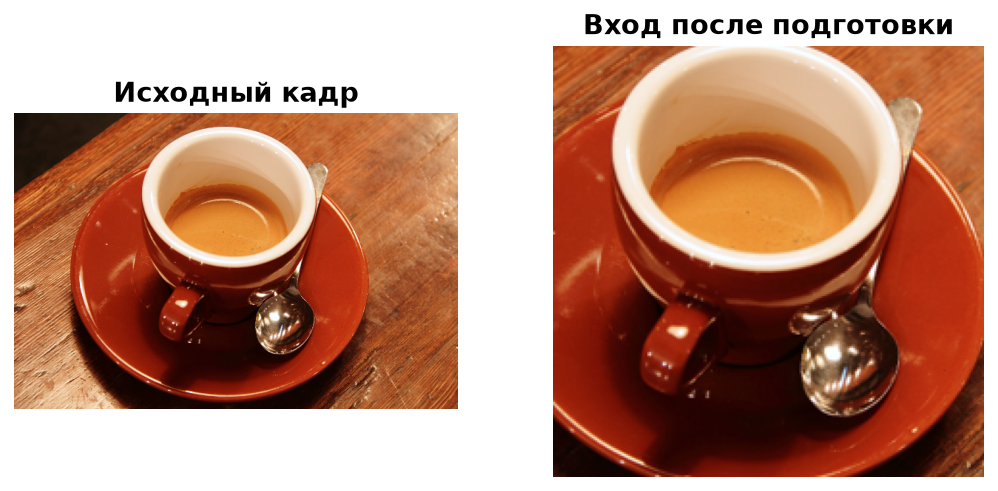

## Чему научимся

Ручные расчёты и таблица проверки пяти снимков ниже иллюстративные: их числа не получены запуском модели. Приведённые далее top-3 для `coffee.png` и `chelsea.png` — результаты реального запуска на фотографиях из набора данных.

Когда на фотографии школьного кружка лежат несколько предметов, готовый классификатор может назвать один класс для **всего изображения**. В этом параграфе вы научитесь готовить фотографию для модели, читать три самых вероятных класса и проверять, когда такой ответ вводит в заблуждение.

После занятия вы сможете:

- Запустить готовый классификатор на собственной фотографии и прочитать top-3.
- Объяснить, зачем нужны список классов и подготовка входа из комплекта весов.
- Сравнить ответы на нескольких снимках и посчитать долю верных.

**Время и подготовка:** 6–8 часов вместе с опытом на своих снимках. Нужны классы и проверка на новых данных из главы 1, Python и чтение файла с диска. Для запуска потребуются PyTorch, TorchVision, Transformers и Pillow; при первом обращении веса скачиваются из каталога модели. На слабом компьютере используйте Colab с CPU. Сначала посчитайте маленький пример вручную — он не требует установки.

Перед практикой можно повторить [формы тензоров и прямой проход](../../02-dl-basics/01-from-linear-model-to-neural-network/README.md).

## План занятия

1. Разберём, какой ответ даёт классификатор и как из чисел получается список меток.
2. Запустим ResNet-18, подготовим три фотографии предмета и сравним ответы.
3. Посчитаем результат небольшой проверки и разберём ограничения вывода.

## Один кадр — один ответ

Представим снимок фигурки, напечатанной на 3D-принтере. Классификатор получает весь кадр и возвращает по одному числу для каждого известного ему класса. Список классов был задан при обучении. Если в нём нет названия нашей фигурки, модель всё равно выберет какой-то из знакомых классов. Поэтому до запуска выясните, какие категории поддерживает выбранный набор весов.



*Рисунок 1 — Путь фотографии к проверяемому ответу*

Модель ResNet-18 с весами для ImageNet-1K различает тысячу классов. Она может назвать «принтер» на фотографии устройства, но не обязана понимать, что конкретная пластмассовая фигурка — изделие нашего кружка. Результат зависит также от фона, обрезки и освещения. Смена фотографии не означает смену весов: в этом занятии мы выполняем только инференс.

## Как читать оценки модели

До преобразования модель возвращает **логиты** — числа, которым не требуется лежать между нулём и единицей. Пусть три логита равны 2, 1 и 0. Функция softmax превращает их в доли, сумма которых равна единице:

$$p_i=\frac{e^{z_i}}{\sum_j e^{z_j}}.$$

Здесь $z_i$ — логит класса $i$, $p_i$ — соответствующая доля. Получаем приблизительно 0,665; 0,245; 0,090. Первый класс лидирует, но числа показывают распределение **внутри заданного списка классов**. Доля 0,665 не доказывает, что ответ верен в 66,5 % похожих жизненных ситуаций. Для такого вывода нужна отдельная проверка на размеченных снимках и оценка калибровки.

*Таблица 1 — Преобразование трёх логитов*

| Класс | Логит | После softmax |
| :--- | ---: | ---: |
| A | 2 | 0,665 |
| B | 1 | 0,245 |
| C | 0 | 0,090 |

**Top-3** означает три класса с наибольшими оценками. Это полезнее единственного ярлыка: если первые два класса близки, мы видим неопределённость выбора. Но три соседних ярлыка из ImageNet не заменяют объяснение изображения.

## Запустим готовую сеть

Для первого запуска скачайте [изображения главы](../images.zip) и [список библиотек](../requirements.txt), распакуйте архив рядом с ноутбуком: получится папка data/. [Происхождение файлов и инструкция для Colab](../data/SOURCES.txt) указаны отдельно. В листингах ниже рабочая папка содержит data/; собственные фотографии используем после проверки готового примера. Пример ниже устанавливает модель в режим оценки, применяет **тот же способ подготовки**, который задан её весами, и выводит три класса. Пакеты: pip install torch torchvision transformers pillow pandas.

```python
from PIL import Image
import torch
from transformers import AutoImageProcessor, AutoModelForImageClassification

model_id = "microsoft/resnet-18"
revision = "65a5785d9156231087c481e0c7dd33a5ff6f7e3e"
processor = AutoImageProcessor.from_pretrained(
    model_id, revision=revision, use_fast=False
)
model = AutoModelForImageClassification.from_pretrained(model_id, revision=revision)
model.eval()

image = Image.open("data/coffee.png").convert("RGB")
inputs = processor(images=image, return_tensors="pt")
with torch.inference_mode():
    logits = model(**inputs).logits[0]
probabilities = logits.softmax(dim=0)
values, indices = probabilities.topk(3)
for value, index in zip(values.tolist(), indices.tolist()):
    print(model.config.id2label[index], round(value, 3))
```

Подготовка включает изменение размера, обрезку и нормализацию значений согласно настройкам модели. Самостоятельно заменять её на «просто уменьшить до 224 пикселей» нельзя: это уже другой эксперимент. В коде shape выходных логитов — число классов, а topk выбирает три индекса. Метки в исходном каталоге весов могут быть английскими.

Запишите не только напечатанные ответы, но и идентификатор модели, версии библиотек, имя файла и размер исходного кадра. Храните копию исходной фотографии: после обрезки часть объекта может исчезнуть. Не публикуйте фотографии людей или личные файлы вместе с результатами опыта.

## Увидим, что получила сеть

Процессор возвращает тензор с формой $1\times3\times H\times W$: один кадр, три цветовых канала и пространственные размеры. Чтобы показать его как изображение, обратим нормализацию. Это только визуализация: в модель передаём исходный нормализованный тензор.

```python
import matplotlib.pyplot as plt

pixels = inputs["pixel_values"][0]
mean = torch.tensor(processor.image_mean)[:, None, None]
std = torch.tensor(processor.image_std)[:, None, None]
prepared = (pixels * std + mean).permute(1, 2, 0).clamp(0, 1).numpy()
fig, axes = plt.subplots(1, 2, figsize=(9, 4))
axes[0].imshow(image); axes[0].set_title("Исходный кадр")
axes[1].imshow(prepared); axes[1].set_title("Вход после подготовки")
for ax in axes: ax.axis("off")
plt.show()
```



*Рисунок 2 — Исходный кадр и вход после подготовки*

После центральной обрезки чашка занимает большую часть входа, но края блюдца и стола частично исчезли. На полном `data/coffee.png` модель поставила на первое место класс *espresso* с оценкой 0,881; дальше идут *chocolate sauce, chocolate syrup* (0,046) и *soup bowl* (0,019). На `data/coffee-crop.png` первой также оказалась метка *espresso* (0,897), затем *chocolate sauce, chocolate syrup* (0,051) и *coffee mug* (0,019). Сходство двух списков ожидаемо: файл с обрезкой получен из того же кадра, поэтому снимки не являются независимыми примерами.

На `data/chelsea.png` первые оценки для классов *Egyptian cat*, *tiger cat* и *tabby, tabby cat* равны примерно 0,398, 0,395 и 0,203. Первые две метки близки, поэтому модель предлагает близкие категории кошек; эти названия не следует трактовать как уверенное различение пород. Во всех трёх кадрах подходящая метка из заранее принятого списка оказалась среди top-3; это описание именно этих файлов и правила разметки, а не оценка качества модели.

Теперь используйте `data/coffee-crop.png` — обрезку того же исходника — и сравните ответы с полным кадром. Так мы меняем поле зрения, сохраняя предмет и освещение, хотя вместе с обрезкой меняются масштаб и доля фона.

## Сравним три снимка

Возьмите знакомый модели предмет, например кружку, и снимите его на ровном фоне, на загруженном столе и крупным планом. Перед запуском предположите, какой снимок будет проще. Для каждого случая запишите top-3, оценку первого класса и видимую причину возможной ошибки. Если модель угадала только снимок на ровном фоне, мы наблюдаем зависимость от контекста; трёх снимков недостаточно для общей оценки качества.

*Таблица 2 — План опыта с одной вещью*

| Снимок | Условие | Top-3 | Наблюдение |
| :--- | :--- | :--- | :--- |
| A | Ровный фон | заполните | заполните |
| B | Много предметов | заполните | заполните |
| C | Крупная обрезка | заполните | заполните |

## Проверим не один снимок, а серию

Допустим, мы собрали пять фотографий предметов, которые есть в списке классов модели. Человек заранее записал правильный предмет на каждой фотографии. В трёх случаях правильная метка оказалась первой, ещё в одном — второй, а в пятом её не было среди первых трёх. Тогда **top-1 accuracy** равна $3/5=0{,}6$, а **top-3 accuracy** — $4/5=0{,}8$. Это две разные меры на одних и тех же пяти снимках.

*Таблица 3 — Проверка пяти снимков*

| Снимок | Верная метка | Место | Top-1 | Top-3 |
| :--- | :--- | ---: | :---: | :---: |
| A | Кружка | 1 | Да | Да |
| B | Книга | 1 | Да | Да |
| C | Кружка | 2 | Нет | Да |
| D | Ножницы | 1 | Да | Да |
| E | Книга | Ниже 3 | Нет | Нет |

Посчитаем обе доли через библиотеку. Здесь столбцы уже содержат **проверенные человеком** результаты; код не угадывает правильную метку по имени файла.

```python
import pandas as pd

observations = pd.DataFrame({
    "file": ["A", "B", "C", "D", "E"],
    "top1_ok": [1, 1, 0, 1, 0],
    "top3_ok": [1, 1, 1, 1, 0],
})
print("top-1:", observations["top1_ok"].mean())
print("top-3:", observations["top3_ok"].mean())
```

На пяти специально выбранных фото доли не дают надёжной оценки для всех фотографий. Если предмет вообще отсутствует в словаре классов, обычная accuracy по его названию теряет смысл: сначала нужно определить, какую задачу мы решаем и какая метка считается допустимой. В собственном опыте запишите принцип отбора снимков и не удаляйте неудобные ошибки после просмотра результата.

## Что считать правильной меткой

Метки ImageNet обычно записаны по-английски и иногда называют предмет точнее, чем в нашем бытовом описании. Например, ученик может сказать «кружка», а список модели различает более конкретные виды посуды. Перед проверкой договоритесь, какие названия принимаются для выбранных снимков. Нельзя признать ответ верным лишь потому, что он оказался первым; сначала нужно сопоставить его с видимым предметом и правилом разметки.

Отдельно проверьте обрезку. Если кружка стоит у края кадра, подготовка модели может вырезать центральную часть и оставить только ручку или фон. В исходном файле предмет есть, но во входе сети он может оказаться неполным. Для первого опыта сохраните два варианта исходного снимка — с предметом в центре и у края — и сравните top-3. Если ответы различаются, это повод изучить настройки подготовки, а не доказательство того, что виновата именно обрезка: одновременно могли измениться фон и положение предмета.

Серия из пяти снимков помогает заметить ошибку, но не позволяет уверенно назвать частоту ошибок на новых заказах. Для такого вывода понадобятся заранее выбранные фотографии разных предметов и условий, а правило допустимых меток нужно зафиксировать до просмотра предсказаний.

Если на кадре два предмета, один ярлык для целой фотографии не отвечает на вопрос «где каждый из них?». Эту задачу решим в § 3.2. Для честного сравнения снимков сохраните одну модель и одинаковые настройки подготовки.

## Практика и самопроверка результата

1. Возьмите три разрешённых снимка одного предмета и повторите опыт. Проверьте, что число выводимых классов всегда равно трём и оценки упорядочены по убыванию.
2. Найдите фотографию, на которой один из классов модели явно не подходит. Объясните ошибку через область классов, ракурс, обрезку или фон, не приписывая модели человеческих намерений.
3. Сравните снимок целиком и собственную обрезку. Запишите, изменился ли лидер. Не объявляйте метод «лучше» по одному примеру.

### Предлагаемая задача для Яндекс Контеста: «Три ответа модели»

**Условие.** Даны оценки классов до softmax. Выведите индексы трёх наибольших оценок по убыванию. При равенстве раньше идёт меньший индекс. Для выбора индексов вычислять softmax не требуется: он сохраняет порядок логитов.

**Вход.** В первой строке число $n$ ($3\le n\le10^5$), во второй — $n$ вещественных чисел от $-100$ до $100$.

**Выход.** Три индекса с нуля, разделённые пробелами.

**Пример.** Для входа «5» и «0 2 2 -1 1» ответ: «1 2 4».

**Пограничные случаи.** Все оценки равны; все они отрицательные; $n=3$. На платформе задачу пока не публикуем.

## Итоги

Готовая сеть отвечает в пределах классов, известных ей при обучении. Мы научились брать подготовку из комплекта весов, читать top-3 и сравнивать несколько снимков при неизменной модели. Уверенная оценка не освобождает от проверки фотографии. В следующем параграфе перейдём от ярлыка всего кадра к рамкам отдельных объектов.

## Самопроверка

::::: {.self-check}

:::: {.question #image-1 correct="B"}

Классификатор вернул для фотографии оценки 0,62, 0,25 и 0,13. Сколько классов он оценил в этом примере?

::: {.choices}

A. Один.
B. Три.
C. Два.
D. Нельзя определить по оценкам.

:::

::: {.hint}

Посчитайте значения в списке; каждое соответствует одному классу.

:::

::: {.solution}

**B.** В списке три оценки, по одной на каждый из трёх классов.

:::

::::

:::: {.question #image-2 correct="C"}

Модель выдала логиты для классов A, B и C: 2, 1 и 0. Какой класс займёт первое место после softmax?

::: {.choices}

A. C.
B. A и B разделят первое место.
C. A.
D. По логитам нельзя определить порядок.

:::

::: {.hint}

Softmax сохраняет порядок логитов.

:::

::: {.solution}

**C.** Наибольший логит равен 2, поэтому класс A получит наибольшую оценку.

:::

::::

:::: {.question #image-3 correct="A"}

Для пяти размеченных снимков верная метка оказалась первой у трёх, второй — у одного, а на одном не попала в top-3. Чему равна top-3 accuracy?

::: {.choices}

A. $4/5=0{,}8$.
B. $3/5=0{,}6$.
C. $1/5=0{,}2$.
D. $5/5=1$.

:::

::: {.hint}

В top-3 входят верные метки на первых, вторых и третьих местах.

:::

::: {.solution}

**A.** Верная метка оказалась среди трёх первых в четырёх случаях из пяти: $4/5=0{,}8$.

:::

::::

:::: {.question #image-4 correct="D"}

В примере логиты равны 2, 1 и 0, а softmax даёт примерно 0,665, 0,245 и 0,090. Какую проверку можно выполнить по этим числам?

::: {.choices}

A. Утверждать, что модель верно ответит на 66,5 % будущих снимков.
B. Утверждать, что вероятность ошибки равна 9 %.
C. Определить, есть ли нужный предмет в кадре.
D. Проверить, что оценки складываются примерно в 1.

:::

::: {.hint}

Softmax нормирует оценки внутри списка классов.

:::

::: {.solution}

**D.** Сумма равна приблизительно 1; сами числа не дают оценку частоты верных ответов на новых данных.

:::

::::

:::: {.question #image-5 correct="B"}

Что следует проверить, если модель не выдала название изображённой на фото фигурки?

::: {.choices}

A. Цвет корпуса компьютера.
B. Есть ли подходящий класс в словаре модели.
C. Достаточно ли яркое окно ноутбука.
D. Было ли имя файла написано латиницей.

:::

::: {.hint}

Классификатор выбирает метку из заданного набора.

:::

::: {.solution}

**B.** Если словарь не содержит подходящей категории, модель выберет ближайший из доступных ей классов.

:::

::::

:::: {.question #image-6 correct="A"}

Зачем в коде используют `AutoImageProcessor` из комплекта весов?

::: {.choices}

A. Чтобы подготовить кадр способом, ожидаемым моделью.
B. Чтобы автоматически добавить новый класс.
C. Чтобы заменить веса на обучаемые.
D. Чтобы найти предмет и вырезать его из исходной фотографии.

:::

::: {.hint}

При обучении изображения преобразовали в определённый формат.

:::

::: {.solution}

**A.** Процессор задаёт нужные преобразования, включая изменение размера, обрезку и нормализацию.

:::

::::

:::: {.question #image-7 correct="D"}

Фотография содержит чашку и ложку, но классификатор вывел только три метки для всего кадра. Какого результата из этого вывода получить нельзя?

::: {.choices}

A. Три наиболее высоко оценённых класса.
B. Оценку каждого выведенного класса.
C. Индекс класса с наибольшей оценкой.
D. Координаты чашки и ложки.

:::

::: {.hint}

Классификатор описывает кадр целиком, а не отдельные места в нём.

:::

::: {.solution}

**D.** Для положения объектов нужны координаты рамок, которые выдаёт детектор.

:::

::::

:::: {.question #image-8 correct="C"}

На одном кадре класс «кружка» получил оценку 0,48, а на другом — 0,71. Что можно заключить без дополнительной проверки?

::: {.choices}

A. На втором фото кружка точно есть.
B. Модель верна ровно в 71 % подобных случаев.
C. Во втором запуске оценка этого класса выше.
D. Второй снимок обязательно легче для любого классификатора.

:::

::: {.hint}

Отделите сравнение двух чисел от вывода о правильности модели.

:::

::: {.solution}

**C.** Можно сравнить сами оценки. Чтобы судить о точности на новых снимках, нужна отдельная размеченная проверка.

:::

::::

:::: {.question #image-9 correct="A"}

В таблице для пяти снимков верные метки попали в top-1 в трёх случаях и в top-3 в четырёх. Каковы соответствующие доли?

::: {.choices}

A. top-1 — 0,6; top-3 — 0,8.
B. top-1 — 0,8; top-3 — 0,6.
C. top-1 — 0,3; top-3 — 0,4.
D. top-1 — 3; top-3 — 4.

:::

::: {.hint}

Разделите число успехов каждого вида на общее число снимков.

:::

::: {.solution}

**A.** Получаем $3/5=0{,}6$ для top-1 и $4/5=0{,}8$ для top-3.

:::

::::

:::: {.question #image-10 correct="B"}

Что записать, чтобы другой человек мог повторить опыт классификации?

::: {.choices}

A. Только самый удачный ответ модели.
B. Идентификатор весов, версии библиотек, исходный файл и подготовку входа.
C. Только имя класса, который оказался первым.
D. Только снимок экрана с выводом.

:::

::: {.hint}

Для повтора понадобятся те же данные и условия обработки.

:::

::: {.solution}

**B.** Веса модели, зависимости, файл и преобразования влияют на результат; их следует указать вместе.

:::

::::

:::::
