## Чему научимся

Когда на фотографии школьного кружка лежат несколько предметов, готовый классификатор может назвать один класс для **всего изображения**. В этом параграфе вы научитесь готовить фотографию для модели, читать три самых вероятных класса и проверять, когда такой ответ вводит в заблуждение.

После занятия вы сможете:

- Запустить готовый классификатор на собственной фотографии и прочитать top-3.
- Объяснить, зачем нужны список классов и подготовка входа из комплекта весов.
- Сравнить ответы на нескольких снимках и посчитать долю верных.

**Время и подготовка:** 6–8 часов вместе с опытом на своих снимках. Нужны классы и проверка на новых данных из главы 1, Python и чтение файла с диска. Для запуска потребуются PyTorch, TorchVision, Transformers и Pillow; при первом обращении веса скачиваются из каталога модели. На слабом компьютере используйте Colab с CPU. Сначала посчитайте маленький пример вручную — он не требует установки.

## План занятия

1. Разберём, какой ответ даёт классификатор и как из чисел получается список меток.
2. Запустим ResNet-18, подготовим три фотографии предмета и сравним ответы.
3. Посчитаем результат небольшой проверки и разберём ограничения вывода.

## Один кадр — один ответ

Представим снимок фигурки, напечатанной на 3D-принтере. Классификатор получает весь кадр и возвращает по одному числу для каждого известного ему класса. Список классов был задан при обучении. Если в нём нет названия нашей фигурки, модель всё равно выберет какой-то из знакомых классов. Поэтому до запуска выясните, какие категории поддерживает выбранный набор весов.



*Рисунок 1 — Путь фотографии к проверяемому ответу*

Модель ResNet-18 с весами для ImageNet-1K различает тысячу классов. Она может назвать «принтер» на фотографии устройства, но не обязана понимать, что конкретная пластмассовая фигурка — изделие нашего кружка. Результат зависит также от фона, обрезки и освещения. Смена фотографии не означает смену весов: в этом занятии мы выполняем только инференс.

## Как читать оценки модели

До преобразования модель возвращает **логиты** — числа, которым не требуется лежать между нулём и единицей. Для учебного примера пусть три логита равны 2, 1 и 0. Функция softmax превращает их в доли, сумма которых равна единице:

$$p_i=\frac{e^{z_i}}{\sum_j e^{z_j}}.$$

Здесь $z_i$ — логит класса $i$, $p_i$ — соответствующая доля. Получаем приблизительно 0,665; 0,245; 0,090. Первый класс лидирует, но числа показывают распределение **внутри заданного списка классов**. Доля 0,665 не доказывает, что ответ верен в 66,5 % похожих жизненных ситуаций. Для такого вывода нужна отдельная проверка на размеченных снимках и оценка калибровки.

*Таблица 1 — Учебное преобразование трёх логитов*

| Класс | Логит | После softmax |
| :--- | ---: | ---: |
| A | 2 | 0,665 |
| B | 1 | 0,245 |
| C | 0 | 0,090 |

**Top-3** означает три класса с наибольшими оценками. Это полезнее единственного ярлыка: если первые два класса близки, мы видим неопределённость выбора. Но три соседних ярлыка из ImageNet не заменяют объяснение изображения.

## Запустим готовую сеть

Сохраните свою фотографию как image.jpg рядом с ноутбуком. Не используйте чужие личные снимки без разрешения. Пример ниже устанавливает модель в режим оценки, применяет **тот же способ подготовки**, который задан её весами, и выводит три класса. Пакеты: pip install torch torchvision transformers pillow pandas.

```python
from PIL import Image
import torch
from transformers import AutoImageProcessor, AutoModelForImageClassification

model_id = "microsoft/resnet-18"
processor = AutoImageProcessor.from_pretrained(model_id)
model = AutoModelForImageClassification.from_pretrained(model_id)
model.eval()

image = Image.open("image.jpg").convert("RGB")
inputs = processor(images=image, return_tensors="pt")
with torch.inference_mode():
    logits = model(**inputs).logits[0]
probabilities = logits.softmax(dim=0)
values, indices = probabilities.topk(3)
for value, index in zip(values.tolist(), indices.tolist()):
    print(model.config.id2label[index], round(value, 3))
```

Подготовка включает изменение размера, обрезку и нормализацию значений согласно настройкам модели. Самостоятельно заменять её на «просто уменьшить до 224 пикселей» нельзя: это уже другой эксперимент. В коде shape выходных логитов — число классов, а topk выбирает три индекса. Метки в исходном каталоге весов могут быть английскими.

Запишите не только напечатанные ответы, но и идентификатор модели, версии библиотек, имя файла и размер исходного кадра. Храните копию исходной фотографии: после обрезки часть объекта может исчезнуть. Не публикуйте фотографии людей или личные файлы вместе с результатами опыта.

## Сравним три снимка

Возьмите знакомый модели предмет, например кружку, и снимите его на ровном фоне, на загруженном столе и крупным планом. Перед запуском предположите, какой снимок будет проще. Для каждого случая запишите top-3, оценку первого класса и видимую причину возможной ошибки. Если модель угадала только снимок на ровном фоне, мы наблюдаем зависимость от контекста; трёх снимков недостаточно для общей оценки качества.

*Таблица 2 — План опыта с одной вещью*

| Снимок | Условие | Top-3 | Наблюдение |
| :--- | :--- | :--- | :--- |
| A | Ровный фон | заполните | заполните |
| B | Много предметов | заполните | заполните |
| C | Крупная обрезка | заполните | заполните |

## Проверим не один снимок, а серию

Допустим, мы собрали пять учебных фотографий предметов, которые есть в списке классов модели. Человек заранее записал правильный предмет на каждой фотографии. В трёх случаях правильная метка оказалась первой, ещё в одном — второй, а в пятом её не было среди первых трёх. Тогда **top-1 accuracy** равна $3/5=0{,}6$, а **top-3 accuracy** — $4/5=0{,}8$. Это две разные меры на одних и тех же пяти снимках.

*Таблица 3 — Учебная проверка пяти снимков; ответы модели здесь придуманы для расчёта*

| Снимок | Верная метка | Место | Top-1 | Top-3 |
| :--- | :--- | ---: | :---: | :---: |
| A | Кружка | 1 | Да | Да |
| B | Книга | 1 | Да | Да |
| C | Кружка | 2 | Нет | Да |
| D | Ножницы | 1 | Да | Да |
| E | Книга | Ниже 3 | Нет | Нет |

Посчитаем обе доли через библиотеку. Здесь столбцы уже содержат **проверенные человеком** результаты; код не угадывает правильную метку по имени файла.

```python
import pandas as pd

observations = pd.DataFrame({
    "file": ["A", "B", "C", "D", "E"],
    "top1_ok": [1, 1, 0, 1, 0],
    "top3_ok": [1, 1, 1, 1, 0],
})
print("top-1:", observations["top1_ok"].mean())
print("top-3:", observations["top3_ok"].mean())
```

На пяти специально выбранных фото доли не дают надёжной оценки для всех фотографий. Если предмет вообще отсутствует в словаре классов, обычная accuracy по его названию теряет смысл: сначала нужно определить, какую задачу мы решаем и какая метка считается допустимой. В собственном опыте запишите принцип отбора снимков и не удаляйте неудобные ошибки после просмотра результата.

## Что считать правильной меткой

Метки ImageNet обычно записаны по-английски и иногда называют предмет точнее, чем в нашем бытовом описании. Например, ученик может сказать «кружка», а список модели различает более конкретные виды посуды. Перед проверкой договоритесь, какие названия принимаются для выбранных снимков. Нельзя признать ответ верным лишь потому, что он оказался первым; сначала нужно сопоставить его с видимым предметом и правилом разметки.

Отдельно проверьте обрезку. Если кружка стоит у края кадра, подготовка модели может вырезать центральную часть и оставить только ручку или фон. В исходном файле предмет есть, но во входе сети он может оказаться неполным. Для первого опыта сохраните два варианта исходного снимка — с предметом в центре и у края — и сравните top-3. Если ответы различаются, это повод изучить настройки подготовки, а не доказательство того, что виновата именно обрезка: одновременно могли измениться фон и положение предмета.

Серия из пяти снимков помогает заметить ошибку, но не позволяет уверенно назвать частоту ошибок на новых заказах. Для такого вывода понадобятся заранее выбранные фотографии разных предметов и условий, а правило допустимых меток нужно зафиксировать до просмотра предсказаний.

Если на кадре два предмета, один ярлык для целой фотографии не отвечает на вопрос «где каждый из них?». Эту задачу решим в § 3.2. Для честного сравнения снимков сохраните одну модель и одинаковые настройки подготовки.

## Практика и самопроверка результата

1. Возьмите три разрешённых снимка одного предмета и повторите опыт. Проверьте, что число выводимых классов всегда равно трём и оценки упорядочены по убыванию.
2. Найдите фотографию, на которой один из классов модели явно не подходит. Объясните ошибку через область классов, ракурс, обрезку или фон, не приписывая модели человеческих намерений.
3. Сравните снимок целиком и собственную обрезку. Запишите, изменился ли лидер. Не объявляйте метод «лучше» по одному примеру.

### Предлагаемая задача для Яндекс Контеста: «Три ответа модели»

**Условие.** Даны оценки классов до softmax. Выведите индексы трёх наибольших оценок по убыванию. При равенстве раньше идёт меньший индекс. Для выбора индексов вычислять softmax не требуется: он сохраняет порядок логитов.

**Вход.** В первой строке число $n$ ($3\le n\le10^5$), во второй — $n$ вещественных чисел от $-100$ до $100$.

**Выход.** Три индекса с нуля, разделённые пробелами.

**Пример.** Для входа «5» и «0 2 2 -1 1» ответ: «1 2 4».

**Пограничные случаи.** Все оценки равны; все они отрицательные; $n=3$. На платформе задачу пока не публикуем.

## Итоги

Готовая сеть отвечает в пределах классов, известных ей при обучении. Мы научились брать подготовку из комплекта весов, читать top-3 и сравнивать несколько снимков при неизменной модели. Уверенная оценка не освобождает от проверки фотографии. В следующем параграфе перейдём от ярлыка всего кадра к рамкам отдельных объектов.

## Самопроверка

::::: {.self-check}

:::: {.question #image-1 correct="B"}

Какой объект получает метку в обычной классификации изображения?

::: {.choices}

A. Каждый пиксель.
B. Всё изображение.
C. Только фон.
D. Каждый найденный прямоугольник.

:::

::: {.hint}

Посмотрите на число входных кадров и число выводимых классов.

:::

::: {.solution}

**B.** Классификатор выдаёт оценки классов для кадра целиком.

:::

::::

:::: {.question #image-2 correct="C"}

Что нужно проверить до применения весов ImageNet к фигуркам кружка?

::: {.choices}

A. Цвет корпуса компьютера.
B. Число фотографий в папке.
C. Список классов модели.
D. Размер монитора.

:::

::: {.hint}

Модель выбирает из заранее заданных меток.

:::

::: {.solution}

**C.** Если нужного класса нет в списке, верное название модель не выдаст.

:::

::::

:::: {.question #image-3 correct="B"}

Что такое логит?

::: {.choices}

A. Размер файла.
B. Число до softmax.
C. Порог обрезки.
D. Название класса.

:::

::: {.hint}

Это выход модели перед нормировкой оценок.

:::

::: {.solution}

**B.** Логит может быть любым вещественным числом; softmax превращает логиты в доли.

:::

::::

:::: {.question #image-4 correct="C"}

Чему равна сумма значений после softmax по всем классам?

::: {.choices}

A. 0.
B. 0,5.
C. 1.
D. Числу пикселей.

:::

::: {.hint}

Посмотрите на знаменатель формулы.

:::

::: {.solution}

**C.** Все числители вместе равны знаменателю, поэтому сумма равна единице.

:::

::::

:::: {.question #image-5 correct="C"}

Можно ли назвать первое значение softmax гарантированной вероятностью правильного ответа на новых фото?

::: {.choices}

A. Да, всегда.
B. Да, если оно больше 0,5.
C. Нет, нужна отдельная проверка.
D. Только при трёх классах.

:::

::: {.hint}

Подумайте, проверяли ли модель на похожих размеченных снимках.

:::

::: {.solution}

**C.** Оценка внутри списка классов сама по себе не подтверждает частоту верных ответов.

:::

::::

:::: {.question #image-6 correct="B"}

Зачем применять AutoImageProcessor из комплекта модели?

::: {.choices}

A. Чтобы случайно менять веса.
B. Чтобы повторить ожидаемую подготовку входа.
C. Чтобы найти людей на фото.
D. Чтобы удалить фон.

:::

::: {.hint}

Модель обучалась на входах определённого формата.

:::

::: {.solution}

**B.** Процессор задаёт размер, обрезку и нормализацию, совместимые с весами.

:::

::::

:::: {.question #image-7 correct="C"}

Что делает model.eval() в примере?

::: {.choices}

A. Обучает сеть.
B. Меняет классы.
C. Переводит модель в режим оценки.
D. Сохраняет фото.

:::

::: {.hint}

В этой главе веса не обновляются.

:::

::: {.solution}

**C.** Режим оценки отключает поведение обучающих слоёв, зависящее от режима.

:::

::::

:::: {.question #image-8 correct="B"}

Почему сравнение трёх снимков одной вещи полезно?

::: {.choices}

A. Оно доказывает качество на всех фото.
B. Оно показывает влияние условий съёмки.
C. Оно меняет веса.
D. Оно добавляет классы.

:::

::: {.hint}

Меняются фон, свет или обрезка, а модель остаётся той же.

:::

::: {.solution}

**B.** Так можно увидеть чувствительность ответа, но не измерить общее качество.

:::

::::

:::: {.question #image-9 correct="B"}

На фото два предмета. Какой вопрос обычный классификатор не решает?

::: {.choices}

A. Какая модель загружена.
B. Где расположен каждый предмет.
C. Сколько логитов выдано.
D. Какой индекс лидирует.

:::

::: {.hint}

Выход содержит оценки всего кадра.

:::

::: {.solution}

**B.** Для положения каждого объекта нужна детекция, рассмотренная дальше.

:::

::::

:::: {.question #image-10 correct="C"}

Что сохранить для воспроизводимого опыта?

::: {.choices}

A. Только лучший ответ.
B. Только название файла.
C. Модель, подготовку, вход и версии библиотек.
D. Только скриншот.

:::

::: {.hint}

Другой запуск должен получить тот же вход и настройки.

:::

::: {.solution}

**C.** Идентификатор весов, обработка и исходный файл влияют на результат.

:::

::::

:::::
