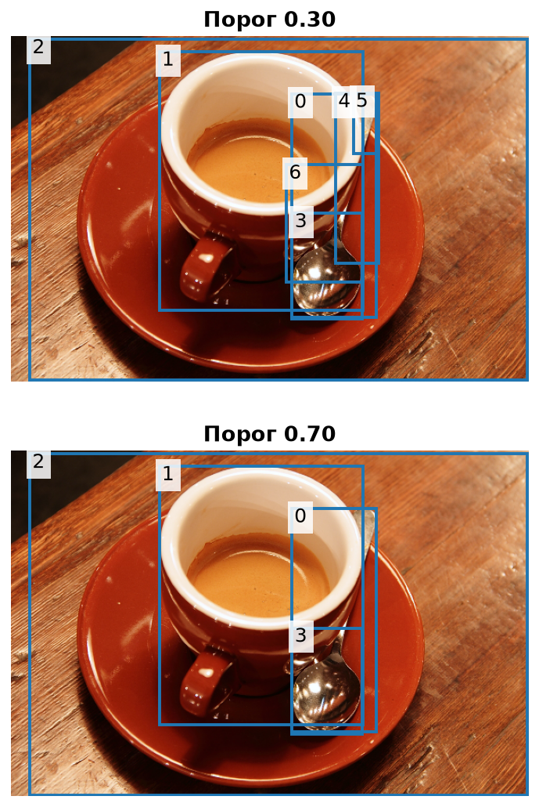
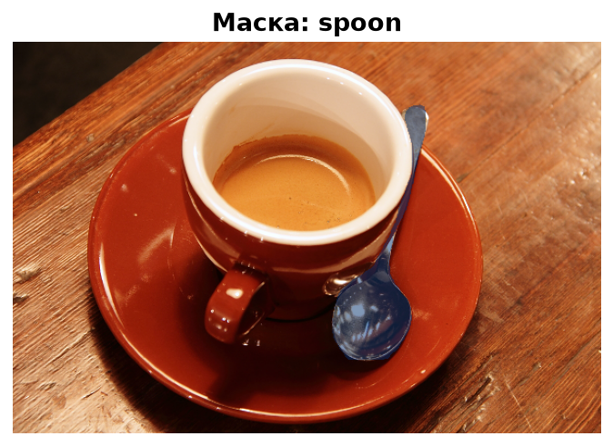

## Чему научимся

Числовые примеры с рамками и оценками ниже учебные; выводы готовой модели получаем на фотографиях из набора данных.

В § 3.1 классификатор давал один список классов для всей фотографии. Если на столе лежат две фигурки и инструменты, нам нужны отдельные ответы: **что найдено и где**. Вы научитесь читать рамки, оценки и маски готовых моделей, выбирать порог показа и проверять пропуски и лишние обнаружения.

После занятия вы сможете:

- Прочитать координаты рамки и проверить, где она находится на снимке.
- Изменить порог показа и объяснить пропуск или лишнее обнаружение.
- Отличить рамку от маски и наложить результат на исходную фотографию.

**Время и подготовка:** 6–8 часов. Нужны координаты на плоскости, списки Python и опыт запуска готовой модели из § 3.1. Для практики используем PyTorch, TorchVision, Pillow и Matplotlib. Веса для детекции и сегментации загружаются при первом запуске; на CPU выполнение может занять несколько минут.

Если свёртки и каналы изображения пока непривычны, вернитесь к [разбору свёрточной сети](../../02-dl-basics/03-cnn/README.md).

## План занятия

1. Разберём рамку на маленьком снимке и различим детекцию и сегментацию.
2. Запустим детектор, нарисуем рамки и сравним два порога показа.
3. Получим маску и проверим пропуски и лишние обнаружения.

## Рамка описывает место

**Детектор** возвращает набор предсказаний. Каждое содержит класс, оценку и **ограничивающий прямоугольник** (рамку). Рамку удобно записывать четырьмя числами $(x_1,y_1,x_2,y_2)$: координаты левого верхнего и правого нижнего углов. Начало координат находится в левом верхнем углу изображения; $x$ растёт вправо, $y$ — вниз.

Пусть на изображении шириной 240 и высотой 180 пикселей детектор предложил рамку $(40,30,180,160)$. Её ширина равна $180-40=140$, высота — $160-30=130$ пикселей. Сами числа не доказывают, что внутри нужный предмет: их нужно сопоставить с фотографией.



*Рисунок 1 — Координаты и размеры рамки*



*Рисунок 2 — От фотографии к отдельным объектам*

*Таблица 1 — Кандидаты детектора*

| Класс | Рамка $(x_1,y_1,x_2,y_2)$ | Оценка |
| :--- | :--- | ---: |
| Чашка | $(40,30,180,160)$ | 0,84 |
| Ложка | $(190,40,226,150)$ | 0,31 |

При пороге 0,50 мы показываем только чашку. Ложка не «исчезла из фотографии»: мы скрыли её предсказание. Понижение порога может вернуть пропущенный объект и добавить ложные рамки. Оценка детектора — основание для ранжирования и фильтра, но не подтверждённая вероятность правильной рамки на любом новом снимке.

## Дополнительно: почему рамки иногда спорят

Модель может выдать несколько похожих рамок вокруг одного предмета. Обычно после предсказания применяется **подавление немаксимумов** (NMS): оставляют более сильную рамку, если другая сильно перекрывается с ней и имеет тот же класс. Для оценки перекрытия используют IoU — площадь пересечения рамок, делённую на площадь их объединения:

$$\operatorname{IoU}(A,B)=\frac{|A\cap B|}{|A\cup B|}.$$

Если рамки не пересекаются, IoU равен нулю; для одинаковых рамок он равен единице. Не путайте два порога: порог оценки решает, показывать ли предсказание, а порог IoU используется для решения о дублировании рамок. Настройки обработки уже входят в готовый детектор; в первом опыте мы меняем только порог показа.

Для рамок $A=(0,0,4,3)$ и $B=(2,1,6,4)$ пересечение имеет ширину 2 и высоту 2: его площадь равна 4. Площадь каждой рамки равна 12, объединение занимает $12+12-4=20$. Поэтому $\operatorname{IoU}=4/20=0{,}2$. При пороге NMS 0,5 такое перекрытие само по себе не приводит к подавлению одной из этих рамок.

## Запустим детектор

Используем веса Faster R-CNN, обученные на COCO. Набор классов ограничен объектами этого датасета. Если на фотографии специфическая деталь 3D-принтера, модель может не иметь такой метки. Пакеты: pip install torch torchvision pillow matplotlib pandas. Для первого запуска скачайте [изображения главы](../images.zip) и [список библиотек](../requirements.txt), распакуйте архив рядом с ноутбуком: получится папка data/. [Происхождение файлов и инструкция для Colab](../data/SOURCES.txt) указаны отдельно. В листингах ниже рабочая папка содержит data/; собственные фотографии используем после проверки готового примера.

```python
from PIL import Image
import torch
from torchvision.transforms.functional import to_tensor
from torchvision.models.detection import (
    FasterRCNN_ResNet50_FPN_V2_Weights,
    fasterrcnn_resnet50_fpn_v2,
)

weights = FasterRCNN_ResNet50_FPN_V2_Weights.DEFAULT
model = fasterrcnn_resnet50_fpn_v2(weights=weights).eval()
image = Image.open("data/coffee.png").convert("RGB")
tensor = to_tensor(image)
with torch.inference_mode():
    result = model([tensor])[0]

threshold = 0.50
names = weights.meta["categories"]
for box, label, score in zip(
    result["boxes"], result["labels"], result["scores"]
):
    if float(score) >= threshold:
        print(names[int(label)], box.round().int().tolist(), round(float(score), 3))
```

Модель получает **список** изображений, поэтому в вызове стоят квадратные скобки вокруг tensor. Для одного кадра берём первый словарь результата. Его массивы boxes, labels и scores соответствуют друг другу по индексам. Если ничего не напечатано, это означает «нет предсказаний выше порога», а не «на столе пусто».

Чисел в выводе недостаточно: рамка может оказаться на фоне или охватить только часть предмета. Нарисуем предсказания поверх исходного кадра. Размеры прямоугольника вычисляем из координат, а не подставляем ширину и высоту фотографии:

```python
import matplotlib.pyplot as plt
from matplotlib.patches import Rectangle

fig, ax = plt.subplots(figsize=(8, 6))
ax.imshow(image)
for index, (box, label, score) in enumerate(zip(
    result["boxes"], result["labels"], result["scores"]
)):
    if float(score) < threshold:
        continue
    x1, y1, x2, y2 = box.tolist()
    ax.add_patch(Rectangle(
        (x1, y1), x2 - x1, y2 - y1,
        fill=False, edgecolor="tab:blue", linewidth=2,
    ))
    ax.text(x1 + 3, y1 + 16, str(index), fontsize=13,
            bbox={"facecolor": "white", "alpha": 0.85, "edgecolor": "none"})
ax.axis("off")
plt.show()
```

Числа на рамке — индексы исходных предсказаний. По тому же индексу найдите класс и оценку в `result["labels"]` и `result["scores"]`. Короткие номера помогают не перекрывать предметы длинными надписями. Не исправляйте рамки вручную перед сравнением порогов. На одном и том же снимке порог 0,30 может показать ложную рамку, а 0,70 — скрыть настоящий предмет. Мы сравниваем оба исхода, а не выбираем только красивую картинку.

*Таблица 2 — Изменение порога показа*

| Предмет на снимке | Оценка кандидата | Показан при 0,30? | Показан при 0,70? |
| :--- | ---: | :---: | :---: |
| Чашка | 0,84 | Да | Да |
| Ложка | 0,31 | Да | Нет |
| Узор на скатерти, ошибочно названный чашкой | 0,42 | Да | Нет |

Если ложка действительно есть, низкий порог уменьшает пропуск, но добавляет ошибку на узоре. Если её нет, низкий порог создаёт две лишние рамки. Для вывода нужна ручная проверка исходной фотографии. На наборе размеченных снимков пропуски и лишние обнаружения считают отдельно; одного универсального порога для всех задач нет.

### Что изменилось на готовом снимке

На `data/coffee.png` при пороге 0,30 осталось семь предсказаний, при 0,70 — четыре. Чашка сохранилась с оценкой 0,995, но у единственной ложки даже после повышения порога осталось две рамки: 0,999 и 0,888. Значит, повышение порога убрало часть кандидатов, но не устранило все дубли. Веса не менялись: сравниваем два фильтра одного результата.



*Рисунок 3 — Один результат детектора при двух порогах*

Номера сохраняются при фильтрации: 0 — ложка, 1 — чашка, 2 — стол, 3 — ещё одна рамка ложки; при низком пороге дополнительно видны 4–6. Проверьте на фотографии: разные номера ещё не означают разные физические предметы.

## Маска описывает форму

Рамка содержит фон вокруг предмета. **Сегментация экземпляров** возвращает ещё и маску: для каждого пикселя модель оценивает принадлежность конкретному объекту. Mask R-CNN использует похожий вход, но в словаре результата появляется поле masks. Одно значение masks имеет форму $1\times H\times W$ для одного объекта; $H$ и $W$ — размеры изображения. Выберем пиксели с оценкой не меньше 0,5:

```python
from torchvision.models.detection import (
    MaskRCNN_ResNet50_FPN_V2_Weights,
    maskrcnn_resnet50_fpn_v2,
)

mask_weights = MaskRCNN_ResNet50_FPN_V2_Weights.DEFAULT
segmenter = maskrcnn_resnet50_fpn_v2(weights=mask_weights).eval()
with torch.inference_mode():
    segmented = segmenter([tensor])[0]
for score, mask in zip(segmented["scores"], segmented["masks"]):
    if float(score) >= 0.50:
        binary_mask = mask[0] >= 0.50
        print("Пикселей в маске:", int(binary_mask.sum()))
```

Здесь два порога с разными смыслами: первый относится к найденному объекту, второй — к пикселям его маски. Число пикселей полезно для проверки формы, но само по себе не показывает, правильно ли обведён предмет. Наложите маску полупрозрачно на фотографию и посмотрите на границы.

```python
import numpy as np

fig, ax = plt.subplots(figsize=(6, 4))
ax.imshow(image)
selected = torch.where(segmented["scores"] >= 0.50)[0]
if len(selected):
    i = int(selected[0])
    binary_mask = (segmented["masks"][i, 0] >= 0.50).numpy()
    assert binary_mask.shape == (image.height, image.width)
    ax.imshow(np.ma.masked_where(~binary_mask, binary_mask),
              cmap="Blues", vmin=0, vmax=1, alpha=0.5)
    label = mask_weights.meta["categories"][int(segmented["labels"][i])]
    ax.set_title(f"Маска: {label}")
else:
    ax.set_title("Нет объектов выше порога 0,50")
ax.axis("off")
plt.show()
```

Проверяем границу найденного предмета: маска может захватывать фон или пропускать его части. Код показывает маску первого объекта выше порога; это не обязательно тот же объект, который был первым у другого детектора.



*Рисунок 4 — Маска ложки на исходном кадре*

В проверенном запуске первым объектом Mask R-CNN оказалась ложка. Синяя область следует её форме, тогда как рамка охватывала также чашку и стол вокруг неё. Участок на изгибе ручки и отражение в чашечке ложки удобны для проверки границ. Выделение не является ручной разметкой: это предсказание модели.

## Практика

1. Сделайте или возьмите разрешённое фото с двумя предметами. До запуска запишите, какие классы COCO могут им соответствовать. Покажите исходный кадр и рамки при порогах 0,30 и 0,70; составьте список появившихся и исчезнувших предсказаний.
2. Найдите пример пропуска и пример лишней рамки. Для каждого укажите, что видно на снимке, класс, оценку и выбранный порог. Не оценивайте качество только по одному удачному изображению.
3. Для одного объекта сравните рамку и маску. Проверьте, что маска имеет размеры исходного снимка и что бинаризация не перепутана с порогом объекта. Если модель не нашла объект, запишите это как результат, а не подставляйте выдуманную маску.

### Предлагаемая задача для Яндекс Контеста: «Покажем рамки»

**Условие.** Из списка предсказанных рамок оставьте те, чья оценка не ниже порога. Для каждой выведите площадь $(x_2-x_1)(y_2-y_1)$, сохранив входной порядок.

**Вход.** В первой строке $n$ и $t$ ($1\le n\le10^5$, $0\le t\le1000$). Затем идут $n$ строк $x_1\ y_1\ x_2\ y_2\ s$. Координаты целые, $0\le x_1<x_2\le10^4$, $0\le y_1<y_2\le10^4$; $s$ — оценка от 0 до 1000 в тысячных.

**Выход.** Число оставленных рамок, затем для каждой строка «индекс площадь». Индекс начинается с нуля.

**Пример.** При $n=2$, $t=500$, строках «0 0 2 3 700» и «1 1 4 4 300» ответ состоит из строк «1» и «0 6».

**Пограничные случаи.** Оценка ровно на пороге, ни одной подходящей рамки, большая площадь. Задачу пока не публикуем.

## Итоги

Детектор отвечает «что и где» отдельными рамками. Сегментатор уточняет форму маской. Порог меняет видимый список предсказаний, поэтому сравнивать результаты нужно при записанных настройках и на исходных снимках. Следующий параграф переносит тот же цикл проверки на текст.

## Самопроверка

::::: {.self-check}

:::: {.question #detect-1 correct="C"}

Какую информацию содержит предсказание детектора для одного объекта?

::: {.choices}

A. Только метку класса.
B. Только четыре координаты.
C. Класс, оценку и рамку.
D. Маску каждого пикселя всего изображения.

:::

::: {.hint}

Сопоставьте предсказание с тремя столбцами учебной таблицы.

:::

::: {.solution}

**C.** Детектор связывает класс и оценку с координатами рамки.

:::

::::

:::: {.question #detect-2 correct="A"}

Рамка задана координатами $(40,30,180,160)$. Каковы её ширина и площадь?

::: {.choices}

A. 140 пикселей и 18 200 квадратных пикселей.
B. 180 пикселей и 25 200 квадратных пикселей.
C. 140 пикселей и 18 060 квадратных пикселей.
D. 130 пикселей и 18 200 квадратных пикселей.

:::

::: {.hint}

Вычислите $x_2-x_1$ и $y_2-y_1$, затем перемножьте размеры.

:::

::: {.solution}

**A.** Ширина равна $180-40=140$, высота — $160-30=130$, площадь — $140\cdot130=18\,200$ квадратных пикселей.

:::

::::

:::: {.question #detect-3 correct="D"}

Для рамок $A=(0,0,4,3)$ и $B=(2,1,6,4)$ площадь пересечения равна 4, а площадь объединения — 20. Чему равен IoU?

::: {.choices}

A. 0,8.
B. 0,5.
C. 0,25.
D. 0,2.

:::

::: {.hint}

Разделите площадь пересечения на площадь объединения.

:::

::: {.solution}

**D.** $operatorname{IoU}=4/20=0{,}2$.

:::

::::

:::: {.question #detect-4 correct="B"}

Оценки трёх рамок равны 0,84, 0,42 и 0,31. Сколько рамок будет показано при пороге 0,50?

::: {.choices}

A. Три.
B. Одна.
C. Две.
D. Ни одной.

:::

::: {.hint}

Оставьте оценки, которые не меньше порога.

:::

::: {.solution}

**B.** Порог проходит только оценка 0,84.

:::

::::

:::: {.question #detect-5 correct="C"}

В выводе нет рамок при пороге оценки 0,70. Как корректно интерпретировать результат?

::: {.choices}

A. На фотографии точно нет объектов.
B. Модель не загрузилась.
C. Нет предсказаний с оценкой не ниже 0,70.
D. Все маски состоят из нулей.

:::

::: {.hint}

Порог фильтрует предсказания модели, а не сами объекты на фотографии.

:::

::: {.solution}

**C.** Пустой вывод означает, что ни одна оценка не прошла фильтр; он не подтверждает отсутствие предметов.

:::

::::

:::: {.question #detect-6 correct="A"}

При каком значении IoU рамки не имеют общей площади?

::: {.choices}

A. 0.
B. 0,5.
C. 1.
D. 2.

:::

::: {.hint}

Если площадь пересечения равна нулю, чему равно отношение пересечения к объединению?

:::

::: {.solution}

**A.** Без пересечения числитель равен нулю, поэтому IoU равен 0.

:::

::::

:::: {.question #detect-7 correct="D"}

Что лучше описывает маска объекта по сравнению с рамкой?

::: {.choices}

A. Маска задаёт только класс предмета.
B. Маска всегда покрывает весь кадр.
C. Маска заменяет оценку детектора.
D. Маска отмечает пиксели, отнесённые к объекту.

:::

::: {.hint}

Рамка охватывает объект прямоугольником; маска уточняет его форму.

:::

::: {.solution}

**D.** Маска содержит оценку принадлежности для пикселей и позволяет описать контур объекта.

:::

::::

:::: {.question #detect-8 correct="B"}

Порог показа равен 0,30. Предсказания имеют оценки 0,31, 0,42 и 0,84. Что произойдёт, если поднять порог до 0,70?

::: {.choices}

A. Добавятся рамки с оценками 0,31 и 0,42.
B. Останется одна рамка с оценкой 0,84.
C. Все три рамки останутся видимыми.
D. Изменятся координаты всех рамок.

:::

::: {.hint}

Сравните каждую оценку с новым порогом.

:::

::: {.solution}

**B.** Только 0,84 не меньше 0,70; остальные кандидаты скрываются.

:::

::::

:::: {.question #detect-9 correct="C"}

В примере маска выбранного объекта имеет форму $1\times H\times W$. Что обозначают эти размерности?

::: {.choices}

A. Один кадр, одна рамка и одна оценка.
B. Число классов, ширина и высота.
C. Один объект, высота и ширина изображения.
D. Один объект, число каналов цвета и число классов.

:::

::: {.hint}

Первое измерение соответствует одному экземпляру объекта, оставшиеся — сетке пикселей.

:::

::: {.solution}

**C.** Для одного объекта маска хранит значения на сетке размером $H\times W$.

:::

::::

:::: {.question #detect-10 correct="A"}

На одном снимке модель выдала ложную рамку. Какое действие даст более содержательную оценку качества?

::: {.choices}

A. Проверить предсказания на нескольких размеченных снимках и отдельно учесть пропуски и ложные рамки.
B. Сразу признать модель непригодной для любых задач.
C. Удалить снимок из проверки и оставить только удачные.
D. Повысить порог до тех пор, пока ложная рамка не исчезнет, и считать проверку завершённой.

:::

::: {.hint}

Один пример показывает конкретную ошибку, но не её частоту и не количество пропусков.

:::

::: {.solution}

**A.** Набор размеченных снимков позволяет последовательно оценить и ложные обнаружения, и пропуски при зафиксированном пороге.

:::

::::

:::::
