## Чему научимся

В § 3.1 классификатор давал один список классов для всей фотографии. Если на столе лежат две фигурки и инструменты, нам нужны отдельные ответы: **что найдено и где**. Вы научитесь читать рамки, оценки и маски готовых моделей, выбирать порог показа и проверять пропуски и лишние обнаружения.

После занятия вы сможете:

- Прочитать координаты рамки и проверить, где она находится на снимке.
- Изменить порог показа и объяснить пропуск или лишнее обнаружение.
- Отличить рамку от маски и наложить результат на исходную фотографию.

**Время и подготовка:** 6–8 часов. Нужны координаты на плоскости, списки Python и опыт запуска готовой модели из § 3.1. Для практики используем PyTorch, TorchVision, Pillow и Matplotlib. Веса для детекции и сегментации загружаются при первом запуске; на CPU выполнение может занять несколько минут.

## План занятия

1. Разберём рамку на маленьком снимке и различим детекцию и сегментацию.
2. Запустим детектор, нарисуем рамки и сравним два порога показа.
3. Получим маску и проверим пропуски и лишние обнаружения.

## Рамка описывает место

**Детектор** возвращает набор предсказаний. Каждое содержит класс, оценку и **ограничивающий прямоугольник** (рамку). Рамку удобно записывать четырьмя числами $(x_1,y_1,x_2,y_2)$: координаты левого верхнего и правого нижнего углов. Начало координат находится в левом верхнем углу изображения; $x$ растёт вправо, $y$ — вниз.

Пусть на учебном изображении шириной 240 и высотой 180 пикселей детектор предложил рамку $(40,30,180,160)$. Её ширина равна $180-40=140$, высота — $160-30=130$ пикселей. Сами числа не доказывают, что внутри нужный предмет: их нужно сопоставить с фотографией.



*Рисунок 1 — Координаты и размеры рамки*



*Рисунок 2 — От фотографии к отдельным объектам*

*Таблица 1 — Учебные кандидаты детектора*

| Класс | Рамка $(x_1,y_1,x_2,y_2)$ | Оценка |
| :--- | :--- | ---: |
| Чашка | $(40,30,180,160)$ | 0,84 |
| Ложка | $(190,40,226,150)$ | 0,31 |

При пороге 0,50 мы показываем только чашку. Ложка не «исчезла из фотографии»: мы скрыли её предсказание. Понижение порога может вернуть пропущенный объект и добавить ложные рамки. Оценка детектора — основание для ранжирования и фильтра, но не подтверждённая вероятность правильной рамки на любом новом снимке.

## Дополнительно: почему рамки иногда спорят

Модель может выдать несколько похожих рамок вокруг одного предмета. Обычно после предсказания применяется **подавление немаксимумов** (NMS): оставляют более сильную рамку, если другая сильно перекрывается с ней и имеет тот же класс. Для оценки перекрытия используют IoU — площадь пересечения рамок, делённую на площадь их объединения:

$$\operatorname{IoU}(A,B)=\frac{|A\cap B|}{|A\cup B|}.$$

Если рамки не пересекаются, IoU равен нулю; для одинаковых рамок он равен единице. Не путайте два порога: порог оценки решает, показывать ли предсказание, а порог IoU используется для решения о дублировании рамок. Настройки обработки уже входят в готовый детектор; в первом опыте мы меняем только порог показа.

## Запустим детектор

Используем веса Faster R-CNN, обученные на COCO. Набор классов ограничен объектами этого датасета. Если на фотографии специфическая деталь 3D-принтера, модель может не иметь такой метки. Пакеты: pip install torch torchvision pillow matplotlib pandas. Сохраните изображение как table.jpg.

```python
from PIL import Image
import torch
from torchvision.transforms.functional import to_tensor
from torchvision.models.detection import (
    FasterRCNN_ResNet50_FPN_V2_Weights,
    fasterrcnn_resnet50_fpn_v2,
)

weights = FasterRCNN_ResNet50_FPN_V2_Weights.DEFAULT
model = fasterrcnn_resnet50_fpn_v2(weights=weights).eval()
image = Image.open("table.jpg").convert("RGB")
tensor = to_tensor(image)
with torch.inference_mode():
    result = model([tensor])[0]

threshold = 0.50
names = weights.meta["categories"]
for box, label, score in zip(
    result["boxes"], result["labels"], result["scores"]
):
    if float(score) >= threshold:
        print(names[int(label)], box.round().int().tolist(), round(float(score), 3))
```

Модель получает **список** изображений, поэтому в вызове стоят квадратные скобки вокруг tensor. Для одного кадра берём первый словарь результата. Его массивы boxes, labels и scores соответствуют друг другу по индексам. Если ничего не напечатано, это означает «нет предсказаний выше порога», а не «на столе пусто».

Чисел в выводе недостаточно: рамка может оказаться на фоне или охватить только часть предмета. Нарисуем предсказания поверх исходного кадра. Размеры прямоугольника вычисляем из координат, а не подставляем ширину и высоту фотографии:

```python
import matplotlib.pyplot as plt
from matplotlib.patches import Rectangle

fig, ax = plt.subplots(figsize=(8, 6))
ax.imshow(image)
for box, label, score in zip(
    result["boxes"], result["labels"], result["scores"]
):
    if float(score) < threshold:
        continue
    x1, y1, x2, y2 = box.tolist()
    ax.add_patch(Rectangle(
        (x1, y1), x2 - x1, y2 - y1,
        fill=False, edgecolor="tab:blue", linewidth=2,
    ))
    ax.text(x1, y1, f"{names[int(label)]}: {float(score):.2f}")
ax.axis("off")
plt.show()
```

Если надписей слишком много, сначала оставьте пять кандидатов с наибольшей оценкой; исходный результат сохраните отдельно. Не исправляйте рамки вручную перед сравнением порогов. На одном и том же снимке порог 0,30 может показать ложную рамку, а 0,70 — скрыть настоящий предмет. Мы сравниваем оба исхода, а не выбираем только красивую картинку.

*Таблица 2 — Учебный пример изменения порога; кандидаты вымышлены*

| Предмет на снимке | Оценка кандидата | Показан при 0,30? | Показан при 0,70? |
| :--- | ---: | :---: | :---: |
| Чашка | 0,84 | Да | Да |
| Ложка | 0,31 | Да | Нет |
| Узор на скатерти, ошибочно названный чашкой | 0,42 | Да | Нет |

Если ложка действительно есть, низкий порог уменьшает пропуск, но добавляет ошибку на узоре. Если её нет, низкий порог создаёт две лишние рамки. Для вывода нужна ручная проверка исходной фотографии. На наборе размеченных снимков пропуски и лишние обнаружения считают отдельно; одного универсального порога для всех задач нет.

## Маска описывает форму

Рамка содержит фон вокруг предмета. **Сегментация экземпляров** возвращает ещё и маску: для каждого пикселя модель оценивает принадлежность конкретному объекту. Mask R-CNN использует похожий вход, но в словаре результата появляется поле masks. Одно значение masks имеет форму $1\times H\times W$ для одного объекта; $H$ и $W$ — размеры изображения. Выберем пиксели с оценкой не меньше 0,5:

```python
from torchvision.models.detection import (
    MaskRCNN_ResNet50_FPN_V2_Weights,
    maskrcnn_resnet50_fpn_v2,
)

mask_weights = MaskRCNN_ResNet50_FPN_V2_Weights.DEFAULT
segmenter = maskrcnn_resnet50_fpn_v2(weights=mask_weights).eval()
with torch.inference_mode():
    segmented = segmenter([tensor])[0]
for score, mask in zip(segmented["scores"], segmented["masks"]):
    if float(score) >= 0.50:
        binary_mask = mask[0] >= 0.50
        print("Пикселей в маске:", int(binary_mask.sum()))
```

Здесь два порога с разными смыслами: первый относится к найденному объекту, второй — к пикселям его маски. Число пикселей полезно для проверки формы, но само по себе не показывает, правильно ли обведён предмет. Наложите маску полупрозрачно на фотографию и посмотрите на границы.

## Практика

1. Сделайте или возьмите разрешённое фото с двумя предметами. До запуска запишите, какие классы COCO могут им соответствовать. Покажите исходный кадр и рамки при порогах 0,30 и 0,70; составьте список появившихся и исчезнувших предсказаний.
2. Найдите пример пропуска и пример лишней рамки. Для каждого укажите, что видно на снимке, класс, оценку и выбранный порог. Не оценивайте качество только по одному удачному изображению.
3. Для одного объекта сравните рамку и маску. Проверьте, что маска имеет размеры исходного снимка и что бинаризация не перепутана с порогом объекта. Если модель не нашла объект, запишите это как результат, а не подставляйте выдуманную маску.

### Предлагаемая задача для Яндекс Контеста: «Покажем рамки»

**Условие.** Из списка предсказанных рамок оставьте те, чья оценка не ниже порога. Для каждой выведите площадь $(x_2-x_1)(y_2-y_1)$, сохранив входной порядок.

**Вход.** В первой строке $n$ и $t$ ($1\le n\le10^5$, $0\le t\le1000$). Затем идут $n$ строк $x_1\ y_1\ x_2\ y_2\ s$. Координаты целые, $0\le x_1<x_2\le10^4$, $0\le y_1<y_2\le10^4$; $s$ — оценка от 0 до 1000 в тысячных.

**Выход.** Число оставленных рамок, затем для каждой строка «индекс площадь». Индекс начинается с нуля.

**Пример.** При $n=2$, $t=500$, строках «0 0 2 3 700» и «1 1 4 4 300» ответ состоит из строк «1» и «0 6».

**Пограничные случаи.** Оценка ровно на пороге, ни одной подходящей рамки, большая площадь. Задачу пока не публикуем.

## Итоги

Детектор отвечает «что и где» отдельными рамками. Сегментатор уточняет форму маской. Порог меняет видимый список предсказаний, поэтому сравнивать результаты нужно при записанных настройках и на исходных снимках. Следующий параграф переносит тот же цикл проверки на текст.

## Самопроверка

::::: {.self-check}

:::: {.question #detect-1 correct="B"}

Что возвращает детектор для одного найденного объекта?

::: {.choices}

A. Только один класс всего кадра.
B. Класс, оценку и рамку.
C. Только число пикселей.
D. Новые веса сети.

:::

::: {.hint}

Вспомните три поля учебной таблицы.

:::

::: {.solution}

**B.** Детектор сообщает категорию, оценку и положение объекта.

:::

::::

:::: {.question #detect-2 correct="C"}

Какова ширина рамки (40,30,180,160)?

::: {.choices}

A. 120.
B. 130.
C. 140.
D. 180.

:::

::: {.hint}

Вычтите левую координату из правой.

:::

::: {.solution}

**C.** 180 − 40 = 140 пикселей.

:::

::::

:::: {.question #detect-3 correct="B"}

Где находится начало координат изображения?

::: {.choices}

A. В центре.
B. В левом верхнем углу.
C. В правом нижнем углу.
D. Вне изображения.

:::

::: {.hint}

Сравните направление роста x и y.

:::

::: {.solution}

**B.** Обе координаты начинаются в левом верхнем углу.

:::

::::

:::: {.question #detect-4 correct="A"}

Что произойдёт при повышении порога оценки?

::: {.choices}

A. Обычно покажется меньше предсказаний.
B. Модель переобучится.
C. Пиксели станут ярче.
D. Увеличится набор классов.

:::

::: {.hint}

Порог фильтрует готовые кандидаты.

:::

::: {.solution}

**A.** Предсказания с оценкой ниже нового порога скрываются.

:::

::::

:::: {.question #detect-5 correct="C"}

Что означает отсутствие строк вывода при пороге 0,7?

::: {.choices}

A. На фото нет предметов.
B. Весов нет.
C. Нет предсказаний выше порога.
D. Все маски пусты.

:::

::: {.hint}

Модель могла выдать оценки 0,6 и ниже.

:::

::: {.solution}

**C.** Вывод ничего не говорит о фактическом отсутствии объектов.

:::

::::

:::: {.question #detect-6 correct="A"}

Для чего используют IoU?

::: {.choices}

A. Для измерения перекрытия рамок.
B. Для изменения цвета.
C. Для перевода меток.
D. Для сохранения весов.

:::

::: {.hint}

Это отношение площади пересечения к площади объединения.

:::

::: {.solution}

**A.** IoU равен нулю без пересечения и единице для одинаковых рамок.

:::

::::

:::: {.question #detect-7 correct="A"}

Чем маска отличается от рамки?

::: {.choices}

A. Маска даёт принадлежность по пикселям.
B. Маска всегда квадратная.
C. Маска меняет класс.
D. Маска не зависит от изображения.

:::

::: {.hint}

Рамка задаёт четыре координаты.

:::

::: {.solution}

**A.** Маска описывает форму объекта на сетке пикселей.

:::

::::

:::: {.question #detect-8 correct="A"}

Почему в model([tensor]) вход заключён в список?

::: {.choices}

A. Модель ожидает набор изображений.
B. Список обновляет веса.
C. Так создаётся маска.
D. Иначе исчезают классы.

:::

::: {.hint}

Вспомните, как обработать несколько кадров одним вызовом.

:::

::: {.solution}

**A.** Детектор принимает список тензоров изображений.

:::

::::

:::: {.question #detect-9 correct="B"}

Какие два порога используются в примере с масками?

::: {.choices}

A. Цвета и размера.
B. Оценки объекта и значения пикселя маски.
C. IoU и числа классов.
D. Ширины и высоты.

:::

::: {.hint}

Один фильтрует объекты, другой переводит маску в двоичную.

:::

::: {.solution}

**B.** У порогов разные входные числа и смысл.

:::

::::

:::: {.question #detect-10 correct="C"}

Можно ли назвать ложную рамку доказательством полной непригодности модели?

::: {.choices}

A. Да.
B. Только для COCO.
C. Нет, нужна проверка на наборе снимков.
D. Только если оценка 1.

:::

::: {.hint}

Один пример показывает ошибку, но не её частоту.

:::

::: {.solution}

**C.** Качество оценивают на нескольких размеченных примерах с понятной выборкой.

:::

::::

:::::
