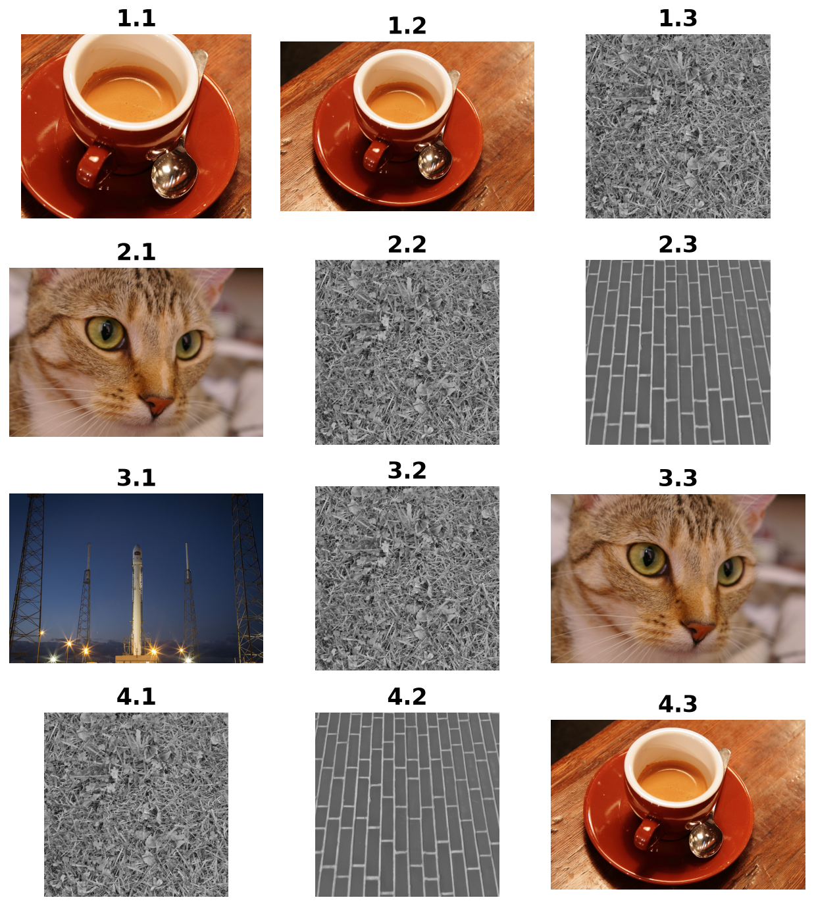

## Чему научимся

В § 3.1 мы классифицировали фотографии, а в § 3.3 сравнивали фразы. Теперь объединим изображения и текст: сначала найдём снимок по описанию в небольшой открытой коллекции, затем проверим поиск на собственных фотографиях. Вы научитесь читать оценки CLIP, сравнивать формулировки и разбирать случаи без подходящего результата.

После занятия вы сможете:

- Ранжировать несколько фотографий по текстовому запросу с помощью CLIP.
- Прочитать матрицу «изображения × описания», не перепутав её оси.
- Сравнить формулировки запроса и проверить случай без подходящего снимка.

**Время и подготовка:** 7–9 часов вместе с мини-проектом. Нужны топ-список из § 3.1, косинусное сходство из § 3.3 и умение открыть изображение в Python. Для запуска потребуются библиотеки из [списка зависимостей](../requirements.txt) и [изображения главы](../images.zip). Веса скачиваются при первом запуске. Англоязычная версия CLIP не гарантирует одинакового качества для русского и белорусского текста, поэтому основной опыт проводим с английскими описаниями, а другие языки проверяем отдельно.

Геометрическая основа поиска — [эмбеддинги и косинусное сходство из § 2.4](../../02-dl-basics/04-embeddings/README.md).

## План занятия

1. Сравним учебные векторы изображения и описания вручную.
2. Запустим CLIP, прочитаем матрицу оценок и изменим запрос.
3. Соберём маленький поиск и проверим его ошибки и ограничения.

## Два вида данных — общий список кандидатов

**CLIP** получает изображение и текст и строит для них векторы, которые можно сравнить. Модель обучалась сближать соответствующие пары «изображение — подпись». Для поиска мы вычисляем оценку совместимости описания с каждым снимком и сортируем снимки. Это не обычный классификатор с закрытым списком классов: варианты описаний задаём мы.

Для ручного примера возьмём нормированные векторы: описание красной фигурки $t=(1,0)$, снимок A $a=(0{,}8,0{,}6)$ и снимок B $b=(0,1)$. Косинус $t$ с $a$ равен 0,8, а с $b$ — 0. Значит, A будет первым в этом учебном поиске. В реальном CLIP векторы длиннее, а их значения получены обучением, не заданы человеком.

Добавим второе описание $u=(0,1)$. Теперь для каждой пары «снимок — описание» вычислим скалярное произведение. Поскольку все векторы имеют длину 1, оно равно косинусу:

*Таблица 1 — Учебная матрица сходства двух снимков и двух описаний*

| Снимок | Красная фигурка $t$ | Синяя фигурка $u$ |
| :--- | ---: | ---: |
| A: $(0{,}8,0{,}6)$ | 0,8 | 0,6 |
| B: $(0,1)$ | 0 | 1 |

По запросу $t$ первым будет A; по запросу $u$ — B. Это пример **ранжирования по столбцу**. Если же у нас уже есть снимок A и мы выбираем лучшее из двух описаний, сравниваем его строку: 0,8 больше 0,6. Позже библиотека вернёт такую же по смыслу матрицу, только с оценками готовой модели.



*Рисунок 1 — Поиск фотографии по описанию*

Оценка совместимости не сообщает, что изображение «на 80 % соответствует» запросу. Она помогает упорядочить кандидатов в выбранной коллекции. Если среди них нет подходящего снимка, модель всё равно поставит какой-то первым. Поэтому в результатах поиска полезно показывать исходные изображения и допускать ответ «подходящего нет».

## Первый поиск по трём снимкам

Для первого запуска скачайте [архив с изображениями](../images.zip) и [список библиотек](../requirements.txt), затем распакуйте архив рядом с ноутбуком: внутри появится папка `data/`. [Происхождение файлов и инструкция для Colab](../data/SOURCES.txt) приведены отдельно. Сначала проверим поиск на шести открытых изображениях, а затем заменим их собственными фотографиями. До запуска запишите, что показано на каждом кадре. В примере используется открытая модель с английским текстовым входом. Установить зависимости можно командой `pip install -r requirements.txt`.

```python
from PIL import Image
import torch
from transformers import CLIPModel, CLIPProcessor

model_id = "openai/clip-vit-base-patch32"
revision = "3d74acf9a28c67741b2f4f2ea7635f0aaf6f0268"
processor = CLIPProcessor.from_pretrained(model_id, revision=revision)
model = CLIPModel.from_pretrained(model_id, revision=revision).eval()

paths = ["data/coffee.png", "data/chelsea.png", "data/rocket.jpg"]
images = [Image.open(path).convert("RGB") for path in paths]
query = "a photo of a cup of coffee"
inputs = processor(
    text=[query], images=images, return_tensors="pt", padding=True
)
with torch.inference_mode():
    scores = model(**inputs).logits_per_image[:, 0]
for index in scores.argsort(descending=True).tolist():
    print(paths[index], round(float(scores[index]), 3))
```

Форма logits_per_image здесь $3\times1$: три снимка и одно описание. Сортируем **три оценки одного запроса**. Не сравнивайте их как вероятности: это значения модели до превращения в условные доли, и они зависят от пары входов. Не меняйте размер фотографии вручную перед процессором; он применяет подготовку, соответствующую весам.

Если первым оказался неподходящий снимок, просмотрите все три и предположите причину: модель могла сильнее учитывать цвет или фон, описание могло быть слишком общим, а нужный объект — редко встречаться в обучающих данных. Один промах не доказывает, что модель в целом не умеет искать изображения.

## Описание влияет на результат

В готовом мини-проекте ниже сравним два запроса на одной и той же открытой галерее. Более подробный текст не обязательно поможет: модель может сильнее отреагировать на фон, чем на нужный предмет. Изменим только формулировку и проследим, как изменятся места снимков.

CLIP можно использовать и для выбора класса из **своих текстовых описаний**. Для одной фотографии сравним «a photo of a cat», «a photo of a rocket» и «a photo of a cup». Модель поставит одно описание первым, даже если на фото нет ни одного из трёх предметов. Доли softmax по этим трём строкам будут зависеть от того, какие варианты мы включили. Поэтому это **относительный выбор между кандидатами**, а не доказанная вероятность класса.

```python
descriptions = [
    "a photo of a cat",
    "a photo of a rocket",
    "a photo of a cup",
]
single = processor(
    text=descriptions, images=images[0], return_tensors="pt", padding=True
)
with torch.inference_mode():
    relative_scores = model(**single).logits_per_image[0]
for index in relative_scores.argsort(descending=True).tolist():
    print(descriptions[index], round(float(relative_scores[index]), 3))
```

Здесь форма выхода $1\times3$: один снимок и три описания. Ранее было $3\times1$. Эти формы помогают проверить, по какой оси сортируем. Если написать три описания и три изображения одновременно, получится матрица $3\times3$, а не три «готовые пары по порядку».

## Прочитаем всю матрицу

Вместо одного запроса передадим сразу три описания для тех же трёх фотографий. Строка матрицы относится к фотографии, столбец — к описанию. Для поиска по одному тексту нужно сортировать **строки выбранного столбца**; для выбора описания одной фотографии — **столбцы выбранной строки**. Перепутать эти оси легко, если выводить только максимальное число.

```python
import pandas as pd

queries = [
    "a cup of coffee",
    "a cat",
    "a rocket launch",
]
batch = processor(
    text=queries, images=images, return_tensors="pt", padding=True
)
with torch.inference_mode():
    matrix = model(**batch).logits_per_image
table = pd.DataFrame(
    matrix.numpy(), index=paths, columns=queries
)
print(table.round(2).to_string())
print("Фото для первого запроса:",
      table.iloc[:, 0].sort_values(ascending=False).index.tolist())
```

Матрица должна иметь форму $3\times3$. Если вместо трёх строк получилось другое число, проверьте список файлов. Не сравнивайте сырые оценки разных запросов как «уверенность» без учёта текста: полезен прежде всего **порядок фотографий для одного запроса**. Посмотрите глазами на все девять сочетаний, даже если программа напечатала только первый столбец.

Представим теперь шесть фотографий и три запроса с заранее отмеченными подходящими снимками. Для первого нужный снимок занял место 1, для второго — место 4, для третьего — место 2. Попадание в top-3 есть в двух случаях из трёх, то есть $2/3$. Такая доля понятнее, чем впечатление от одного удачного результата, но всё ещё слишком малая проверка для вывода о качестве сервиса. Если для запроса нет ни одного подходящего фото, его нельзя записывать как обычное «непопадание»: отдельно проверяем способность системы сказать «ничего не найдено».

## Готовый мини-проект: открытая галерея

В архиве находятся чашка, её обрезка, кошка, ракета, кирпичная стена и трава. Для запросов о чашке, кошке и ракете заранее отмечены подходящие файлы. Четвёртый запрос — велосипед — совпадений не имеет. Обрезку чашки считаем отдельным кандидатом в поиске, но не независимым примером при оценке качества.

```python
paths = ["data/coffee.png", "data/coffee-crop.png", "data/chelsea.png",
         "data/rocket.jpg", "data/brick.png", "data/grass.png"]
queries = ["a photo of a cup of coffee", "a photo of a cat",
           "a photo of a rocket launch", "a photo of a bicycle"]
# До запуска отмечаем подходящие файлы; у велосипеда совпадений нет.
relevant = [{paths[0], paths[1]}, {paths[2]}, {paths[3]}, set()]
images = [Image.open(path).convert("RGB") for path in paths]
def search(texts):
    inputs = processor(text=texts, images=images, return_tensors="pt", padding=True)
    with torch.inference_mode():
        matrix = model(**inputs).logits_per_image
    return pd.DataFrame(matrix.numpy(), index=paths, columns=texts)
table = search(queries)
assert table.shape == (6, 4)
print(table.round(2).to_string())
fig, axes = plt.subplots(len(queries), 3, figsize=(9, 10))
hits = []
for row, (query, allowed) in enumerate(zip(queries, relevant)):
    top = table[query].sort_values(ascending=False).head(3).index.tolist()
    if allowed: hits.append(bool(set(top) & allowed))
    print(query, top, "попадание:" if allowed else "нет подходящего фото:",
          bool(set(top) & allowed) if allowed else "ранжирование не умеет отказываться")
    for rank, (ax, path) in enumerate(zip(axes[row], top), start=1):
        ax.imshow(images[paths.index(path)])
        ax.set_title(f"{row+1}.{rank}", fontsize=18)
        ax.axis("off")
plt.tight_layout(); plt.show()
print("Попадание в top-3 (только запросы с совпадениями):", sum(hits)/len(hits))
changed = search(["a close-up photo of a white coffee cup on a wooden table"])
print("Новая формулировка:", changed.iloc[:, 0].sort_values(ascending=False).index.tolist())
```

В напечатанной таблице строки соответствуют файлам изображений, столбцы — запросам. Список top-3 печатается отдельно для каждого запроса: первый файл в списке занимает первое место. Сопоставьте его с ручной разметкой. Долю попаданий считаем только по трём запросам, у которых есть подходящие фотографии. Запрос про велосипед проверяет другое свойство: даже без совпадений ранжирование возвращает лидера. В этом примере порог отказа не подбирается.

### Прочитаем полученную выдачу

В таблице сокращены заголовки английских запросов: «Кофе» — `a photo of a cup of coffee`, «Кошка» — `a photo of a cat`, «Запуск» — `a photo of a rocket launch`, «Велосипед» — `a photo of a bicycle`. Это сырые оценки CLIP: ранжируем изображения внутри одного столбца.

*Таблица 2 — Реальная матрица «изображения × запросы»*

| Файл | Кофе | Кошка | Запуск | Велосипед |
| :--- | ---: | ---: | ---: | ---: |
| coffee.png | 30,20 | 20,13 | 14,32 | 20,41 |
| coffee-crop.png | 30,21 | 19,73 | 14,20 | 19,83 |
| chelsea.png | 20,42 | 28,27 | 17,00 | 19,48 |
| rocket.jpg | 14,88 | 16,96 | 26,95 | 17,87 |
| brick.png | 21,99 | 20,29 | 16,03 | 21,44 |
| grass.png | 22,76 | 22,46 | 19,90 | 23,09 |



*Рисунок 2 — Три первых изображения для каждого запроса*

Подпись каждой фотографии имеет вид «запрос.место»; имена файлов и оценки приведены в таблице 2. Первым трём запросам соответствуют подходящие изображения, поэтому попадание в top-3 равно $3/3=1$. Но уже на третьем месте запроса про кофе находится трава: заполненные три места не означают три подходящих результата. Для велосипеда лидирует трава, хотя велосипеда нет ни на одном снимке. Четвёртая строка особенно наглядно показывает различие между ранжированием и обнаружением подходящего ответа.

Обрезка чашки и её исходный кадр занимают два места в выдаче: если нужно разнообразие, такие дубли придётся учитывать отдельно. Сырые оценки, параметры и ревизия модели доступны в [записи опытов](../experiment-results.json). Оценка $3/3$ относится только к трём выбранным запросам и не показывает качество поиска по другим коллекциям.

## Мини-проект: поиск в коллекции

Затем соберите 6–10 фотографий собственных 3D-проектов без личных данных. Для трёх запросов заранее отметьте, какие снимки подходят и допускается ли ответ «ни один». Запустите поиск, сохраните полный порядок и покажите три лучших изображения для каждого запроса. Сравните, например, запросы «a red figurine» и «a photo of a red 3D printed figurine on a table» на одних снимках. Измените только формулировку и сравните положение подходящего кадра.

Для простой оценки используйте **попадание в top-3**: есть ли хотя бы один заранее подходящий снимок среди трёх первых. Если подходящих снимков нет, отдельно проверьте, что система не должна уверенно обещать совпадение; эту проблему нельзя решить одним лишь ранжированием. Не делайте вывод о качестве поиска в целом по шести изображениям — это учебный мини-проект.

Попробуйте русский и белорусский запросы как отдельный опыт. Англоязычная версия модели не гарантирует поддержку этих языков. Сравните порядок результатов на тех же снимках и запишите наблюдения; небольшой опыт не заменяет отдельной оценки качества языка.

## Практика

1. Вычислите вручную два косинуса из учебного примера и объясните, почему снимок A оказался первым. Проверьте, что оба вектора единичной длины.
2. Проведите мини-проект. Для каждого запроса сохраните текст, список файлов, топ-3 и ручную проверку совпадений. Измените одно описание и объясните, что произошло.
3. Для фотографии, которой не соответствует ни одно предложенное описание, покажите, что CLIP всё равно ранжирует варианты. Сформулируйте, чего не хватает, чтобы система могла отказаться от ответа.

### Предлагаемая задача для Яндекс Контеста: «Сортировка снимков»

**Условие.** Найдите индексы трёх изображений с наибольшим косинусным сходством с вектором запроса. Для каждого косинуса $s$ вычислите целый ключ $K=\lfloor 10^6s+0{,}5\rfloor$. Сортируйте по убыванию ключа, при равных ключах — по возрастанию индекса. Все векторы ненулевые.

**Вход.** В первой строке $n,d$ ($3\le n\le10^4$, $1\le d\le20$), затем вектор запроса и $n$ векторов изображений. Координаты — целые числа от $-100$ до $100$.

**Выход.** Три индекса с нуля, разделённые пробелами.

**Пример.** Для запроса $(1,0)$ и снимков $(0,1)$, $(2,0)$, $(1,1)$ ответ: «1 2 0».

**Пограничные случаи.** Равные оценки, отрицательное сходство, разные длины векторов. На платформе задачу пока не создаём.

## Итоги

В этой главе мы применяли готовые модели к изображениям и текстам. Классификатор выбирал класс фотографии, детектор находил объекты, а языковые модели определяли метки и продолжали текст. В § 3.5 CLIP сопоставлял изображения с описаниями и ранжировал снимки по запросу.

Во всех задачах повторялся один рабочий цикл: проверить область применения модели, подготовить вход, выполнить инференс, прочитать результат и разобрать ошибки. Для воспроизведения опыта нужно сохранить модель и её ревизию, версии библиотек, входные файлы, подготовку и параметры. Высокая оценка или первое место в выдаче сами по себе не подтверждают правильность ответа; модель следует проверять на нескольких размеченных примерах.

Проверьте себя: чем метка фотографии отличается от рамки объекта? Почему первое место CLIP не гарантирует совпадение? Что нужно записать, чтобы повторить ответ генератора? Если вы можете объяснить эти различия и воспроизвести опыт с новым входом, переходите к главе 4. Там мы разберём, как устроены модели и как их обучают, чтобы они решали такие задачи.

## Самопроверка

::::: {.self-check}

:::: {.question #clip-1 correct="B"}

Как CLIP оценивает сочетание фотографии и описания?

::: {.choices}

A. Сравнивает число пикселей с числом слов.
B. Сопоставляет векторы изображения и текста.
C. Выбирает класс только из заранее заданных меток.
D. Сравнивает размеры файлов.

:::

::: {.hint}

Модель переводит оба вида входа в представления, которые можно сравнить.

:::

::: {.solution}

**B.** CLIP строит векторы изображения и текста, затем вычисляет оценку их совместимости.

:::

::::

:::: {.question #clip-2 correct="C"}

Вектор запроса равен $(1,0)$, а вектор снимка — $(0{,}8,0{,}6)$. Оба вектора нормированы. Какова их косинусная близость?

::: {.choices}

A. $0$.
B. $0{,}6$.
C. $0{,}8$.
D. $1$.

:::

::: {.hint}

Для единичных векторов косинус равен скалярному произведению.

:::

::: {.solution}

**C.** $(1,0)\cdot(0{,}8,0{,}6)=0{,}8$. Вторые координаты не дают вклада, поскольку у запроса там ноль.

:::

::::

:::: {.question #clip-3 correct="A"}

В столбце оценок для запроса $t$ стоят значения: снимок A — $0{,}8$, снимок B — $0$. Какой снимок займёт первое место?

::: {.choices}

A. Снимок A.
B. Снимок B.
C. Оба снимка, поскольку оценки надо сложить.
D. Нельзя определить без вероятностей классов.

:::

::: {.hint}

Для одного запроса сравните оценки кандидатов в его столбце.

:::

::: {.solution}

**A.** $0{,}8>0$, поэтому снимок A будет выше снимка B в ранжированном списке. Это не доказывает, что A подходит.

:::

::::

:::: {.question #clip-4 correct="A"}

Какую форму имеет матрица оценок для трёх изображений и одного описания?

::: {.choices}

A. $3	imes1$.
B. $1	imes3$.
C. $3	imes3$.
D. $1	imes1$.

:::

::: {.hint}

В `logits_per_image` строка относится к изображению, столбец — к тексту.

:::

::: {.solution}

**A.** Каждому из трёх изображений соответствует одна оценка, поэтому матрица имеет три строки и один столбец.

:::

::::

:::: {.question #clip-5 correct="B"}

Есть одно изображение и три описания. Как найти описание с наибольшей оценкой?

::: {.choices}

A. Матрица имеет форму $3	imes1$; выбрать строку с максимумом.
B. Матрица имеет форму $1	imes3$; выбрать столбец с максимумом в единственной строке.
C. Матрица имеет форму $3	imes3$; выбрать диагональ.
D. Матрица имеет форму $1	imes1$; три оценки объединяются в одну.

:::

::: {.hint}

Число строк задаёт число изображений, число столбцов — число текстов.

:::

::: {.solution}

**B.** Единственная строка содержит три оценки, по одной на описание. Выберите наибольшую из них.

:::

::::

:::: {.question #clip-6 correct="A"}

Вы сравниваете два текста запроса. Как провести сравнение, чтобы изменение ранга можно было связать с формулировкой?

::: {.choices}

A. Оставить изображения и модель прежними, изменить только текст.
B. Одновременно заменить текст, изображения и модель.
C. Добавить новые снимки только для второго текста.
D. Изменить порядок изображений и сравнить сырые оценки разных запросов.

:::

::: {.hint}

В опыте меняют одно условие за раз.

:::

::: {.solution}

**A.** При одинаковых снимках и модели сравнение показывает, как новая формулировка изменила ранжирование.

:::

::::

:::: {.question #clip-7 correct="C"}

Для одной фотографии вычислили softmax по трём собственным описаниям. Что можно заключить из полученных долей?

::: {.choices}

A. Это вероятности истинных классов, не зависящие от списка описаний.
B. Наибольшая доля доказывает, что соответствующий предмет есть на фотографии.
C. Это относительные доли среди данных описаний; замена списка может изменить их.
D. Их можно сравнивать как вероятности между разными фотографиями без дополнительных условий.

:::

::: {.hint}

В знаменатель softmax входят оценки всех предложенных вариантов.

:::

::: {.solution}

**C.** Softmax распределяет доли внутри выбранного списка. Эти доли сами по себе не доказывают наличие объекта и не являются безусловными вероятностями.

:::

::::

:::: {.question #clip-8 correct="B"}

Запрос «a photo of a bicycle» не соответствует ни одному изображению в галерее, но поиск всё равно выдал лидера. Какой вывод и действие уместны?

::: {.choices}

A. Считать лидера подходящим, потому что он первый.
B. Проверить изображения и предусмотреть отказ; для автоматического порога нужны размеченные примеры с совпадениями и без них.
C. Принять максимальную оценку за вероятность и отказаться только при значении меньше нуля.
D. Повторить запрос без изменений, пока лидер не сменится.

:::

::: {.hint}

Ранжирование всегда упорядочивает кандидатов, даже если все они неподходящие.

:::

::: {.solution}

**B.** Первое место означает только лидерство среди кандидатов. Чтобы система могла отказываться, правило отказа следует проверить на примерах с подходящими и неподходящими изображениями.

:::

::::

:::: {.question #clip-9 correct="B"}

Как проверить, подходит ли англоязычная версия CLIP для запросов на русском или белорусском?

::: {.choices}

A. Перевести один запрос и считать совпадение поддержки языка доказанным.
B. На тех же изображениях сравнить запросы на каждом языке и вручную оценить результаты на нескольких примерах.
C. Проверить только форму матрицы: если она не изменилась, языки поддерживаются одинаково.
D. Сравнить максимальные сырые оценки между языками как вероятности.

:::

::: {.hint}

Нужны одинаковые кандидаты и проверка того, какие снимки действительно подходят.

:::

::: {.solution}

**B.** Такой опыт позволяет сравнить результаты на выбранных примерах. Для вывода о качестве языка понадобится больше размеченных запросов и изображений.

:::

::::

:::: {.question #clip-10 correct="C"}

Для трёх запросов с подходящими изображениями правильный снимок занял места 1, 4 и 2. Какова доля попаданий в top-3?

::: {.choices}

A. $1/3$.
B. $3/3$.
C. $2/3$.
D. $2/4$.

:::

::: {.hint}

Попаданием считается место 1, 2 или 3. Сначала посчитайте такие случаи, затем разделите на число запросов.

:::

::: {.solution}

**C.** В top-3 попали первый и третий результаты, поэтому доля равна $2/3$. Это небольшая учебная проверка, а не общая оценка качества поиска.

:::

::::

:::::
