## Чему научимся

Мы умеем получать класс фотографии (§ 3.1) и находить близкие фразы (§ 3.3). Теперь объединим изображения и текст: по описанию «красная фигурка на столе» найдём подходящий снимок в небольшой коллекции кружка. Вы научитесь читать оценки CLIP, составлять честное сравнение описаний и проверять результат на собственных изображениях.

После занятия вы сможете:

- Ранжировать несколько фотографий по текстовому запросу с помощью CLIP.
- Прочитать матрицу «изображения × описания», не перепутав её оси.
- Сравнить формулировки запроса и проверить случай без подходящего снимка.

**Время и подготовка:** 7–9 часов вместе с мини-проектом. Нужны топ-список из § 3.1, косинусное сходство из § 3.3 и умение открыть изображение в Python. Для запуска потребуются PyTorch, TorchVision, Transformers и Pillow. Веса скачиваются при первом запуске. Англоязычная версия CLIP не обещает равного качества для русского и белорусского текста, поэтому основной опыт проводим с английскими описаниями, а перенос языков проверяем отдельно.

## План занятия

1. Сравним учебные векторы изображения и описания вручную.
2. Запустим CLIP, прочитаем матрицу оценок и изменим запрос.
3. Соберём маленький поиск и проверим его ошибки и ограничения.

## Два вида данных — общий список кандидатов

**CLIP** получает изображение и текст и строит для них векторы, которые можно сравнить. Модель обучалась сближать соответствующие пары «изображение — подпись». Для поиска мы вычисляем оценку совместимости описания с каждым снимком и сортируем снимки. Это не обычный классификатор с закрытым списком классов: описания задаём мы.

Для ручного примера возьмём нормированные векторы: описание красной фигурки $t=(1,0)$, снимок A $a=(0{,}8,0{,}6)$ и снимок B $b=(0,1)$. Косинус $t$ с $a$ равен 0,8, а с $b$ — 0. Значит, A будет первым в этом учебном поиске. В реальном CLIP векторы длиннее, а их значения получены обучением, не заданы человеком.

Добавим второе описание $u=(0,1)$. Теперь для каждой пары «снимок — описание» вычислим скалярное произведение. Поскольку все векторы имеют длину 1, оно равно косинусу:

*Таблица 1 — Учебная матрица сходства двух снимков и двух описаний*

| Снимок | Красная фигурка $t$ | Синяя фигурка $u$ |
| :--- | ---: | ---: |
| A: $(0{,}8,0{,}6)$ | 0,8 | 0,6 |
| B: $(0,1)$ | 0 | 1 |

По запросу $t$ первым будет A; по запросу $u$ — B. Это пример **ранжирования по столбцу**. Если же у нас уже есть снимок A и мы выбираем лучшее из двух описаний, сравниваем его строку: 0,8 больше 0,6. Позже библиотека вернёт такую же по смыслу матрицу, только с оценками готовой модели.



*Рисунок 1 — Поиск фотографии по описанию*

Оценка совместимости не сообщает, что изображение «на 80 % соответствует» запросу. Она помогает упорядочить кандидатов в выбранной коллекции. Если среди них нет подходящего снимка, модель всё равно поставит какой-то первым. Поэтому в результатах поиска полезно показывать исходные изображения и допускать ответ «подходящего нет».

## Запустим поиск по трём снимкам

Сохраните свои разрешённые фотографии как red_figure.jpg, blue_figure.jpg и printer.jpg. Чтобы опыт был проверяемым, запишите словами, что действительно показано на каждом снимке. В примере используется открытая модель с английским текстовым входом. Пакеты: pip install torch torchvision transformers pillow pandas.

```python
from PIL import Image
import torch
from transformers import CLIPModel, CLIPProcessor

model_id = "openai/clip-vit-base-patch32"
processor = CLIPProcessor.from_pretrained(model_id)
model = CLIPModel.from_pretrained(model_id).eval()

paths = ["red_figure.jpg", "blue_figure.jpg", "printer.jpg"]
images = [Image.open(path).convert("RGB") for path in paths]
query = "a photo of a red 3D printed figurine"
inputs = processor(
    text=[query], images=images, return_tensors="pt", padding=True
)
with torch.inference_mode():
    scores = model(**inputs).logits_per_image[:, 0]
for index in scores.argsort(descending=True).tolist():
    print(paths[index], round(float(scores[index]), 3))
```

Форма logits_per_image здесь $3\times1$: три снимка и одно описание. Сортируем **три оценки одного запроса**. Не сравнивайте их как вероятности: это значения модели до превращения в условные доли, и они зависят от пары входов. Не меняйте размер фотографии вручную перед процессором; он применяет подготовку, соответствующую весам.

Если первый снимок оказался неверным, посмотрите все три и опишите возможную причину: цвет, фон, композиция, слишком общее описание или класс объектов, редкий в обучении. Не объявляйте модель неспособной к поиску по одному промаху.

## Описание влияет на результат

Сравним «a red figurine» и «a photo of a red 3D printed figurine on a table» на **одной и той же коллекции**. Второй текст содержит больше деталей, но может помочь или помешать: модель может сильнее отреагировать на стол, чем на фигурку. Для проверки измените только текст, сохранив порядок файлов и веса. Запишите место верного снимка до и после.

CLIP можно использовать и для выбора класса из **своих текстовых описаний**. Для одной фотографии сравним «a photo of a figurine», «a photo of a printer» и «a photo of a cup». Модель поставит одно описание первым, даже если на фото нет ни одного из трёх предметов. Доли softmax по этим трём строкам будут зависеть от того, какие варианты мы включили. Поэтому это **относительный выбор между кандидатами**, а не доказанная вероятность класса.

```python
descriptions = [
    "a photo of a figurine",
    "a photo of a printer",
    "a photo of a cup",
]
single = processor(
    text=descriptions, images=images[0], return_tensors="pt", padding=True
)
with torch.inference_mode():
    relative_scores = model(**single).logits_per_image[0]
for index in relative_scores.argsort(descending=True).tolist():
    print(descriptions[index], round(float(relative_scores[index]), 3))
```

Здесь форма выхода $1\times3$: один снимок и три описания. Ранее было $3\times1$. Эти формы помогают проверить, по какой оси сортируем. Если написать три описания и три изображения одновременно, получится матрица $3\times3$, а не три «готовые пары по порядку».

## Прочитаем всю матрицу

Вместо одного запроса передадим сразу три описания для тех же трёх фотографий. Строка матрицы относится к фотографии, столбец — к описанию. Для поиска по одному тексту нужно сортировать **строки выбранного столбца**; для выбора описания одной фотографии — **столбцы выбранной строки**. Перепутать эти оси легко, если выводить только максимальное число.

```python
import pandas as pd

queries = [
    "a red 3D printed figurine",
    "a blue 3D printed figurine",
    "a 3D printer",
]
batch = processor(
    text=queries, images=images, return_tensors="pt", padding=True
)
with torch.inference_mode():
    matrix = model(**batch).logits_per_image
table = pd.DataFrame(
    matrix.numpy(), index=paths, columns=queries
)
print(table.round(2).to_string())
print("Фото для первого запроса:",
      table.iloc[:, 0].sort_values(ascending=False).index.tolist())
```

Матрица должна иметь форму $3\times3$. Если вместо трёх строк получилось другое число, проверьте список файлов. Не сравнивайте сырые оценки разных запросов как «уверенность» без учёта текста: полезен прежде всего **порядок фотографий для одного запроса**. Посмотрите глазами на все девять сочетаний, даже если программа напечатала только первый столбец.

Представим теперь шесть фотографий и три запроса с заранее отмеченными подходящими снимками. Для первого нужный снимок занял место 1, для второго — место 4, для третьего — место 2. Попадание в top-3 есть в двух случаях из трёх, то есть $2/3$. Такая доля понятнее, чем впечатление от одного удачного результата, но всё ещё слишком малая проверка для вывода о качестве сервиса. Если для запроса нет ни одного подходящего фото, его нельзя записывать как обычное «непопадание»: отдельно проверяем способность системы сказать «ничего не найдено».

## Мини-проект: поиск в коллекции

Соберите 6–10 фотографий предметов без личных данных. Для трёх запросов заранее отметьте, какие снимки подходят и допускается ли ответ «ни один». Запустите поиск, сохраните полный порядок и покажите три лучших изображения для каждого запроса. Затем измените одну формулировку на более точную и сравните положение подходящего снимка.

Для простой оценки используйте **попадание в top-3**: есть ли хотя бы один заранее подходящий снимок среди трёх первых. Если подходящих снимков нет, отдельно проверьте, что система не должна уверенно обещать совпадение; эту проблему нельзя решить одним лишь ранжированием. Не делайте вывод о качестве поиска в целом по шести изображениям — это учебный мини-проект.

Попробуйте русский и белорусский запросы как отдельный опыт. Название модели и её карточка относятся к англоязычному обучению; перевод запроса может изменить результат. Сравните порядок и запишите наблюдения, не выдавая их за оценку поддержки языка.

## Практика

1. Вычислите вручную два косинуса из учебного примера и объясните, почему снимок A оказался первым. Проверьте, что оба вектора единичной длины.
2. Проведите мини-проект. Для каждого запроса сохраните текст, список файлов, топ-3 и ручную проверку совпадений. Измените одно описание и объясните, что произошло.
3. Для фотографии, которой не соответствует ни одно предложенное описание, покажите, что CLIP всё равно ранжирует варианты. Сформулируйте, чего не хватает, чтобы система могла отказаться от ответа.

### Предлагаемая задача для Яндекс Контеста: «Сортировка снимков»

**Условие.** Найдите индексы трёх изображений с наибольшим косинусным сходством с вектором запроса. При равенстве с точностью $10^{-9}$ раньше идёт меньший индекс. Все векторы ненулевые.

**Вход.** В первой строке $n,d$ ($3\le n\le10^4$, $1\le d\le20$), затем вектор запроса и $n$ векторов изображений. Координаты — целые числа от $-100$ до $100$.

**Выход.** Три индекса с нуля, разделённые пробелами.

**Пример.** Для запроса $(1,0)$ и снимков $(0,1)$, $(2,0)$, $(1,1)$ ответ: «1 2 0».

**Пограничные случаи.** Равные оценки, отрицательное сходство, разные длины векторов. На платформе задачу пока не создаём.

## Итоги

CLIP сравнивает изображения с описаниями и помогает ранжировать снимки или выбирать из своих текстовых вариантов. Результат зависит от формулировки и набора кандидатов; лидер не обязательно подходит. Мы завершили маршрут главы: от подготовки входа до проверки ответа готовой модели. Дальше разберём, как устроены модели, которые дали эти результаты.

## Самопроверка

::::: {.self-check}

:::: {.question #clip-1 correct="B"}

Что сравнивает CLIP в учебном поиске?

::: {.choices}

A. Два класса дерева.
B. Векторы изображения и текста.
C. Только размеры файлов.
D. Только цвета пикселей.

:::

::: {.hint}

Обе модальности получают представления.

:::

::: {.solution}

**B.** Оценка получается из сопоставления изображения и описания.

:::

::::

:::: {.question #clip-2 correct="C"}

Чему равно сходство (1,0) и (0,8;0,6)?

::: {.choices}

A. 0.
B. 0,6.
C. 0,8.
D. 1.

:::

::: {.hint}

Оба вектора имеют длину 1.

:::

::: {.solution}

**C.** Скалярное произведение равно 0,8.

:::

::::

:::: {.question #clip-3 correct="B"}

Что означает первый результат среди трёх снимков?

::: {.choices}

A. Он обязательно подходит.
B. Он лидирует среди выбранных кандидатов.
C. Модель обучилась заново.
D. Остальные удалены.

:::

::: {.hint}

В коллекции может не быть подходящего кадра.

:::

::: {.solution}

**B.** Ранжирование относительное и требует проверки.

:::

::::

:::: {.question #clip-4 correct="A"}

Какова форма выхода при трёх изображениях и одном тексте?

::: {.choices}

A. 3×1.
B. 1×3.
C. 3×3.
D. 1×1.

:::

::: {.hint}

Строки соответствуют изображениям, столбцы — текстам.

:::

::: {.solution}

**A.** Для каждой из трёх фотографий есть одна оценка запроса.

:::

::::

:::: {.question #clip-5 correct="B"}

Какова форма выхода при одном изображении и трёх описаниях?

::: {.choices}

A. 3×1.
B. 1×3.
C. 3×3.
D. 1×1.

:::

::: {.hint}

Теперь меняется число текстов.

:::

::: {.solution}

**B.** Одна строка содержит оценки трёх описаний.

:::

::::

:::: {.question #clip-6 correct="A"}

Почему при изменении формулировки нужно оставить те же фотографии?

::: {.choices}

A. Чтобы связать изменение ранга с запросом.
B. Чтобы уменьшить число классов.
C. Чтобы обучить сеть.
D. Чтобы скрыть ошибки.

:::

::: {.hint}

Меняйте одно условие за раз.

:::

::: {.solution}

**A.** Иначе причина изменения порядка будет неясна.

:::

::::

:::: {.question #clip-7 correct="C"}

Можно ли назвать softmax по трём своим описаниям вероятностью истинного класса?

::: {.choices}

A. Да, всегда.
B. Только для красного.
C. Нет, доли зависят от списка вариантов.
D. Только на CPU.

:::

::: {.hint}

Добавление другого описания меняет знаменатель.

:::

::: {.solution}

**C.** Это относительные доли внутри предложенного списка.

:::

::::

:::: {.question #clip-8 correct="B"}

Что делать, если подходящего снимка нет?

::: {.choices}

A. Объявить первый верным.
B. Допустить отказ и показать отсутствие подходящего.
C. Изменить веса без данных.
D. Удалить запрос.

:::

::: {.hint}

Модель всё равно построит порядок.

:::

::: {.solution}

**B.** Система должна учитывать возможность отсутствия совпадения.

:::

::::

:::: {.question #clip-9 correct="B"}

Почему англоязычный CLIP нужно отдельно проверять на белорусских запросах?

::: {.choices}

A. Потому что оценки всегда нули.
B. Поддержка языка не следует из работы на английском.
C. Потому что нет букв.
D. Проверка запрещена.

:::

::: {.hint}

Область обучения влияет на применение.

:::

::: {.solution}

**B.** Нужны отдельные примеры и оценка для другого языка.

:::

::::

:::: {.question #clip-10 correct="A"}

Что такое попадание в top-3 в мини-проекте?

::: {.choices}

A. Хотя бы один подходящий снимок среди первых трёх.
B. Ровно три верных снимка.
C. Три новых веса.
D. Совпадение всех оценок.

:::

::: {.hint}

Сравните ручную разметку с первыми тремя позициями.

:::

::: {.solution}

**A.** Это простая проверка, но малая коллекция не даёт общей оценки качества.

:::

::::

:::::
