## Чему научимся

В § 3.1 готовая ResNet-18 назвала классы фотографии. Теперь выясним, как сеть превращает пиксели в признаки и почему в ней есть связи, которые обходят несколько слоёв. После занятия вы сможете проследить формы данных внутри ResNet, вычислить ответ простого остаточного блока и объяснить, какие веса меняются при переносе готовых признаков на новую задачу.

**Время и подготовка:** ориентир 7–9 часов с практикой. Нужны свёртка из [§ 2.3](../../02-dl-basics/03-cnn/content.md), классификация и честная проверка из главы 1, опыт с фотографией из [§ 3.1](../../03-nn-in-practice/01-image-classification/content.md). В основном маршруте достаточно матриц небольшого размера; опыт с готовой ResNet требует PyTorch и TorchVision.

## План занятия

1. Проследим путь изображения от пикселей к списку классов.
2. Вычислим остаточную связь и разберём, зачем она помогает обучению.
3. Используем готовые признаки, обучив только новый классификатор.

## Как фотография становится признаками

В § 3.1 мы передавали сети фотографию целиком. После подготовки вход имел форму `(1, 3, 224, 224)`: один снимок, три цветовых канала, высота и ширина по 224 пикселя. Числа `224` относятся к выбранной подготовке готовых весов, а не к универсальному требованию всех CNN.

Обычный свёрточный фильтр ищет локальную закономерность, например границу светлой и тёмной области. Его веса одинаковы в разных частях изображения. Один фильтр создаёт **карту признака**; много фильтров дают много карт. Следующий слой получает эти карты, а не исходные цвета. На ранних слоях удобно говорить о границах и простых рисунках. Утверждать, будто определённый поздний нейрон всегда «видит ухо кошки», без отдельной проверки нельзя: он реагирует на комбинацию чисел, а её смысл зависит от данных.

В ResNet-18 после начальной свёртки и уменьшения размера идут четыре группы остаточных блоков. Для входа `224 × 224` типичный путь имеет формы, показанные в таблице 1. Первая координата после пакета — число каналов, две последние — размер каждой карты. Сеть постепенно уменьшает пространственный размер и увеличивает число карт.

*Таблица 1 — Формы данных при прямом проходе ResNet-18*

| Этап | Форма после пакета | Что изменилось |
| :--- | ---: | :--- |
| Вход | `3 × 224 × 224` | Цветовые каналы |
| Начало сети | `64 × 56 × 56` | Найдены локальные признаки |
| Группа 2 | `128 × 28 × 28` | Участок обзора вырос |
| Группа 3 | `256 × 14 × 14` | Признаки объединяются |
| Группа 4 | `512 × 7 × 7` | Компактные карты |
| Усреднение карт | `512` | Один вектор для снимка |
| Последний слой | `1000` | Оценки классов ImageNet |

Последний слой не «обнаруживает истину» о предмете. Он превращает 512 признаков в оценки тех классов, на которых сеть обучалась. Если нашего предмета в списке нет, сеть всё равно выдаст ведущие оценки среди известных классов.



*Рисунок 1 — Путь изображения через ResNet-18*

## Зачем нужна остаточная связь

Представим блок, который получает вектор `x` и вычисляет поправку `F(x)`. Вместо ответа только `F(x)` блок складывает её с прежним сигналом:

$$h=\operatorname{ReLU}(F(x)+x).$$

Это **остаточная связь** (skip connection): сигнал может пройти через блок по короткому пути. Возьмём `x=(1;-2)` и `F(x)=(-0{,}4;0{,}5)`. До ReLU сумма равна `(0{,}6;-1{,}5)`, после — `h=(0{,}6;0)`. Значит, связь не обещает буквального копирования каждого числа на выход: сложение и активация могут его изменить.

Почему это помогает? Когда слоёв много, изменение весов ранних слоёв должно влиять на итоговую ошибку через длинную цепочку операций. Короткий путь даёт ещё один маршрут для сигнала и его градиента. Это облегчает обучение глубоких сетей, но не гарантирует хорошее качество само по себе. Для сложения формы `F(x)` и `x` должны совпадать. Если число каналов или размеры карт различаются, короткий путь тоже преобразуют, например свёрткой `1 × 1`.

В ResNet-18 основная ветвь блока состоит не из одного действия: в ней есть свёртки, нормализация и нелинейность. Числовой пример выше показывает только правило сложения. Он не изображает настоящие обученные веса модели из § 3.1.

## Откуда взялись веса

Для классификации ImageNet исходная обучающая строка содержит изображение и метку одного из заранее выбранных классов. Сеть делает прямой проход и выдаёт логиты. Ошибка кросс-энтропии становится меньше, когда логит правильного класса растёт относительно остальных. Во время обучения вычисляют градиенты и меняют веса свёрток и последнего слоя. Затем качество проверяют на изображениях, не использованных для подбора этих весов.

Мы в § 3.1 **не проводили** такое обучение: загрузили уже полученные веса и вычисляли ответы. Из этого различия следует практический вопрос. У школьного кружка могут быть собственные классы — «фигурка», «деталь», «инструмент». Их нет среди ровно таких меток ImageNet. Обучать всю глубокую сеть на нескольких десятках снимков рискованно: ей легко запомнить фон и освещение.

Более осторожный первый опыт — **перенос обучения**. Оставим свёрточную часть как извлекатель 512 признаков и заменим последний слой новым классификатором на три класса. Если свёрточные веса заморожены, обновляются только веса этой новой «головки». Это не делает задачу решённой автоматически: признаки, полезные для ImageNet, могут плохо различать наши детали.

Пусть для трёх учебных снимков извлекатель выдал по два признака вместо 512: `(2;0)`, `(1{,}8;0{,}2)` и `(0;2)`. Первые два похожи между собой, третий отличается. Новый линейный классификатор учится связывать эти векторы с метками кружка. Числа здесь придуманы, чтобы увидеть принцип; реальная ResNet выдаёт другие признаки.

## Проверим формы библиотекой

Следующий листинг создаёт ResNet-18 **без скачивания весов**. Он показывает устройство и формы, но случайные веса не умеют распознавать фотографии. Методы `eval` и `inference_mode` оставляют сеть в режиме вычисления ответа.

```python
import torch
from torchvision.models import resnet18

model = resnet18(weights=None).eval()
shapes = {}

for name in ("layer1", "layer2", "layer3", "layer4"):
    layer = getattr(model, name)
    layer.register_forward_hook(
        lambda module, inputs, output, key=name:
        shapes.__setitem__(key, tuple(output.shape))
    )

with torch.inference_mode():
    logits = model(torch.zeros(1, 3, 224, 224))

print(shapes)
print("Признаков перед последним слоем:", model.fc.in_features)
print("Логитов:", tuple(logits.shape))
```

Получим карты `(1,64,56,56)`, `(1,128,28,28)`, `(1,256,14,14)`, `(1,512,7,7)`, затем 512 признаков и 1000 логитов. Значения логитов здесь бессмысленны: сеть не обучена.

Для настоящего переноса берут `ResNet18_Weights.DEFAULT` и соответствующую подготовку изображения. Сначала фиксируют набор снимков, разделение на обучение и итоговую проверку, правило меток. Далее замораживают параметры сети и заменяют `model.fc` на `torch.nn.Linear(512, 3)`. Оптимизатору передают **только** `model.fc.parameters()`. На занятии достаточно обучить эту головку на небольшой собственной коллекции и указать, какие снимки были в каждой части. Если сеть видела фотографии одной и той же фигурки и в обучении, и в тесте, оценка может быть завышена — вспомните связанные объекты из § 1.8.

## Практика

1. По таблице 1 найдите число значений после четвёртой группы блоков: `512 · 7 · 7`. Объясните, почему после усреднения остаётся 512 чисел. Самопроверка: 25 088 значений до усреднения и по одному числу на каждый канал после него.
2. Для `x=(2;-1)` и `F(x)=(-0{,}5;2)` вычислите сумму и ReLU. Самопроверка: `(1{,}5;1)`.
3. Запустите листинг. Замените размер пакета с 1 на 2 и объясните, какая координата формы изменится. Затем в [ноутбуке](notebook.ipynb) исследуйте замороженный извлекатель и новую головку.
4. Составьте план сбора снимков трёх классов кружка. Предложите разделение, при котором снимки одного физического предмета остаются в одной части. Скажите, какую ошибку вы сможете измерить, а какую — нет, если пока собрали по одному предмету каждого класса.

### Предлагаемая задача для Яндекс Контеста: «Размер карты»

**Условие.** Последовательно примените к квадратному изображению `m` слоёв. Для слоя известны размер фильтра `k`, дополнение нулями `p`, шаг `s` и число выходных каналов `c`. Размер одной стороны после слоя равен `⌊(n+2p-k)/s⌋+1`. Выведите после каждого слоя размер стороны и число всех значений в картах.

**Вход.** Первая строка: `n` и `m`, `1 ≤ n ≤ 10^4`, `1 ≤ m ≤ 100`. Далее `m` строк `k p s c`, все числа целые от 1 до `10^4`, кроме `p`, которое может быть нулём. Гарантируется положительный размер каждого выхода.

**Выход.** Для каждого слоя строка «размер число_значений». Используйте целые числа.

**Пример.** Для входа `8 2`, затем `3 1 1 4` и `3 0 2 8` вывод: `8 256` и `3 72`.

**Пограничные случаи.** Дополнение сохраняет размер; шаг не делит числитель нацело; число значений велико. Задачу на платформе пока не создаём.

## Итоги

Свёртки постепенно превращают изображение в карты признаков. В ResNet остаточная связь складывает вычисленную поправку с коротким путём сигнала и помогает обучать глубокие сети. При переносе можно сохранить готовые свёрточные веса и обучить только новый классификатор для своих меток. Проверьте себя: что означает форма `512 × 7 × 7`, когда нужна проекция короткого пути и какие данные нельзя смешивать при итоговой проверке? Подсказки и решения — в опросе.

## Самопроверка

::::: {.self-check}

:::: {.question #resnet-1 correct="B"}

Что означает число 512 в форме последней карты ResNet-18?

::: {.choices}

A. Число классов
B. Число каналов признаков
C. Число фотографий
D. Размер стороны карты

:::

::: {.hint}

Сравните форму карты и форму вектора после усреднения.

:::

::: {.solution}

**B.** 512 отдельных карт превращаются в 512 чисел.

:::

::::

:::: {.question #resnet-2 correct="A"}

Зачем свёрточный фильтр применяет одинаковые веса в разных местах?

::: {.choices}

A. Чтобы искать один тип локальной закономерности в разных участках
B. Чтобы скрыть правильную метку
C. Чтобы увеличить число классов
D. Чтобы не обучать модель

:::

::: {.hint}

Что остаётся одинаковым при перемещении окна?

:::

::: {.solution}

**A.** Один набор весов ищет похожую деталь в разных позициях.

:::

::::

:::: {.question #resnet-3 correct="C"}

Чему равно ReLU от суммы (−2; 3)?

::: {.choices}

A. (−2; 3)
B. (2; 3)
C. (0; 3)
D. (0; 0)

:::

::: {.hint}

ReLU заменяет отрицательные координаты нулями.

:::

::: {.solution}

**C.** Получится (0; 3).

:::

::::

:::: {.question #resnet-4 correct="B"}

Что происходит в остаточном блоке при совпадающих формах?

::: {.choices}

A. Ответ заменяется меткой
B. Вход складывается с поправкой F(x)
C. Число классов удваивается
D. Изображение сортируется

:::

::: {.hint}

Вспомните формулу для h.

:::

::: {.solution}

**B.** Перед активацией складываются F(x) и x.

:::

::::

:::: {.question #resnet-5 correct="A"}

Почему при разных размерах F(x) и x нельзя просто сложить их?

::: {.choices}

A. Нужны совпадающие формы соответствующих координат
B. Слишком много фотографий
C. Веса уже обучены
D. Классы могут повторяться

:::

::: {.hint}

Сколько чисел должно быть в каждой суммируемой позиции?

:::

::: {.solution}

**A.** Для поэлементного сложения размеры должны совпасть; короткий путь преобразуют.

:::

::::

:::: {.question #resnet-6 correct="C"}

Что меняется при инференсе с готовыми весами?

::: {.choices}

A. Все свёрточные фильтры
B. Только последний слой
C. Ни один вес
D. Правильные ответы

:::

::: {.hint}

Отличите вычисление ответа от шага оптимизатора.

:::

::: {.solution}

**C.** В режиме инференса веса не обновляются.

:::

::::

:::: {.question #resnet-7 correct="B"}

Какие параметры обновляют при замороженном извлекателе и новой головке?

::: {.choices}

A. Все параметры сети
B. Только параметры новой головки
C. Только входные пиксели
D. Ни одного параметра

:::

::: {.hint}

Какой части оптимизатор получает parameters()?

:::

::: {.solution}

**B.** Оптимизатор получает веса и смещения нового классификатора.

:::

::::

:::: {.question #resnet-8 correct="A"}

Почему случайная ResNet из листинга не подходит для проверки качества классификации?

::: {.choices}

A. Её веса не обучены на размеченных изображениях
B. Она принимает только чёрно-белые фото
C. Она не содержит свёрток
D. Она выдаёт один логит

:::

::: {.hint}

Что означает weights=None?

:::

::: {.solution}

**A.** Формы можно проверить, но логиты случайной сети не описывают освоенную задачу.

:::

::::

:::: {.question #resnet-9 correct="B"}

Что опасно при проверке на фотографиях кружка?

::: {.choices}

A. Разные классы в наборе
B. Фотографии одного физического предмета в обучении и тесте
C. Три цветовых канала
D. Заморозка извлекателя

:::

::: {.hint}

Что является действительно новым объектом при применении?

:::

::: {.solution}

**B.** Похожие снимки того же предмета могут дать завышенную оценку; делите по предметам.

:::

::::

:::: {.question #resnet-10 correct="C"}

Какой вывод следует из высокой точности новой головки на нескольких снимках?

::: {.choices}

A. Модель всегда узнает класс
B. ImageNet содержит все классы кружка
C. Нужно проверить на независимых предметах и условиях
D. Можно не записывать метки

:::

::: {.hint}

Достаточно ли нескольких знакомых кадров?

:::

::: {.solution}

**C.** Нужна проверка на новых предметах и условиях съёмки.

:::

::::

:::::
