## Чему научимся

В § 3.2 модель находила предметы на снимке стола и возвращала рамки и маски. Теперь выясним, какие правильные ответы нужны для такого обучения и почему две формы результата решают разные вопросы. После занятия вы сможете вычислить пересечение рамок, проследить путь кандидата через детектор и отличить маску отдельного предмета от карты классов всех пикселей.

**Время и подготовка:** ориентир 7–9 часов. Нужны координаты прямоугольника из [§ 3.2](../../03-nn-in-practice/02-object-detection/content.md), карты признаков из [§ 2.3](../../02-dl-basics/03-cnn/content.md), смысл обучающей и проверочной части. Устройство Faster R-CNN и U-Net рассмотрим на схемах; выводить градиенты не потребуется.

## План занятия

1. Сопоставим рамку с её правильным ответом и измерим совпадение.
2. Проследим, как детектор предлагает область и уточняет её.
3. Разделим маску экземпляра и семантическую карту U-Net.

## Как учить сеть отвечать «где»

Для классификации всего кадра обучающая строка содержала изображение и **одну** метку. Для детекции этого недостаточно. На одном снимке могут находиться чашка и книга, поэтому разметка включает для каждого предмета класс и прямоугольник `(x_1,y_1,x_2,y_2)`. Координаты задают левый верхний и правый нижний углы, а ширина и высота равны `x_2-x_1` и `y_2-y_1`.

Возьмём снимок `10 × 8` пикселей. Правильная рамка чашки — `(1,1,5,5)`, предсказанная — `(3,1,7,5)`. Площадь каждой равна `4·4=16` пикселям. Общая часть имеет ширину `5-3=2` и высоту `5-1=4`, то есть площадь 8. Объединение занимает `16+16-8=24`. **Пересечение над объединением** (IoU, intersection over union) равно

$$\operatorname{IoU}=\frac{8}{24}=\frac13.$$

IoU равен 1 для одинаковых прямоугольников и 0, когда они не пересекаются. Он помогает сопоставить предсказание с разметкой, но сам по себе не проверяет класс: рамка вокруг книги с меткой «чашка» остаётся ошибкой. При оценке детектора заранее задают порог IoU и способ обработки нескольких рамок у одного предмета; разные пороги дают разные числа качества.

*Таблица 1 — Что должно быть в обучающей разметке*

| Задача | Правильный ответ для снимка | Выход сети |
| :--- | :--- | :--- |
| Классификация | Один класс всего кадра | Оценки классов |
| Детекция | Класс и рамка каждого объекта | Список классов, рамок и оценок |
| Сегментация экземпляров | Класс, рамка и пиксели каждого объекта | Отдельная маска каждого объекта |
| Семантическая сегментация | Класс каждого пикселя | Карта классов пикселей |

У семантической сегментации два отдельных одинаковых предмета могут получить **один класс** на общей карте. У сегментации экземпляров для них нужны две маски. Рамка не содержит точной формы: в её углах остаётся фон.



*Рисунок 1 — Четыре разных вида ответа на изображение*

## Как детектор получает рамки

В § 3.2 мы запускали Faster R-CNN с готовыми весами. Его можно представить как последовательность понятных действий. Свёрточная часть строит карты признаков всего снимка. Сеть предложений областей отмечает места, где **может** находиться объект. Для каждого кандидата детектор собирает признаки соответствующего участка, выбирает класс и поправляет координаты рамки. После этого удаляют лишние сильно перекрывающиеся ответы об одном предмете.

Это схема работы, а не инструкция считать каждую внутреннюю операцию вручную. Предложения областей не являются готовыми правильными рамками. Во время обучения их сопоставляют с размеченными объектами: сеть учится отличать перспективные области от фона, выбирать класс и уменьшать ошибку координат. Общая функция потерь складывает части, относящиеся к классам и координатам. Их коэффициенты и точное правило сопоставления зависят от реализации.

Представьте два предсказания «чашка» для одной чашки: рамки `A=(1,1,5,5)` и `B=(1,1,6,5)` с оценками `0{,}9` и `0{,}7`. Их пересечение равно 16, объединение — 20, IoU — `0{,}8`. При пороге перекрытия `0{,}5` можно оставить более высоко оценённую A и убрать B. Так работает идея **подавления немаксимумов** (NMS). Если рядом действительно стоят две чашки, слишком сильное подавление способно удалить одну из них. Поэтому результат всегда проверяют по исходному снимку.

Код ниже воспроизводит геометрию нашего первого примера без загрузки модели. Координаты считаются непрерывными границами прямоугольников; площадь не включает «плюс один пиксель».

```python
def area(box):
    x1, y1, x2, y2 = box
    return max(0, x2 - x1) * max(0, y2 - y1)

def iou(first, second):
    left = max(first[0], second[0])
    top = max(first[1], second[1])
    right = min(first[2], second[2])
    bottom = min(first[3], second[3])
    intersection = area((left, top, right, bottom))
    union = area(first) + area(second) - intersection
    return intersection / union if union else 0.0

truth = (1, 1, 5, 5)
predicted = (3, 1, 7, 5)
print(area(truth), area(predicted), round(iou(truth, predicted), 3))
assert iou(truth, truth) == 1
```

Получим площади 16 и 16, IoU около `0{,}333`. Функция принимает любые две корректные рамки и возвращает число от 0 до 1.

## Что добавляет Mask R-CNN

Mask R-CNN из § 3.2 использует детекцию области, а затем для каждого найденного экземпляра предсказывает **маску его пикселей**. Для обучения нужна разметка формы предмета. Если известны только прямоугольники, правильную маску восстановить нельзя: чашка и её фон внутри рамки могли бы быть закрашены одинаково.

Для маски тоже можно считать IoU, но теперь пересечение и объединение относятся к **множествам пикселей**. Пусть правильная маска содержит пиксели `{1,2,3,4}`, а прогноз — `{2,3,4,5,6}`. Пересечение — три пикселя, объединение — шесть, поэтому `IoU=3/6=0{,}5`. Этот расчёт не заменяет осмотр границы: маленькая узкая деталь может быть важной, хотя её площадь невелика.

Бинаризация маски и отбор объекта — разные пороги. Оценка объекта отвечает, показывать ли найденный предмет. Порог маски отвечает, какие пиксели включить в форму **уже найденного** предмета. При обучении сеть получает сигнал об ошибке по пикселям размеченного объекта.

## Почему U-Net — другая модель

В программе главы есть U-Net. Она не является внутренним объяснением Mask R-CNN и не обязана выдавать отдельные экземпляры. Классическая U-Net решает **семантическую сегментацию**: для каждого пикселя строит оценки классов, например «фон», «пластик», «рабочая поверхность».

Её левая часть последовательно уменьшает карты и собирает более крупный контекст. Правая часть увеличивает размер карт, возвращая ответ к разрешению исходного изображения. Связи между соответствующими уровнями передают подробности границ из ранних карт. Эти связи **соединяют карты по каналам**; в остаточном блоке ResNet из § 4.1 сигнал обычно **складывали** с поправкой. Оба приёма сокращают путь информации, но операции и цели различаются.

Например, вход `(1,3,64,64)` после двух уменьшений может стать `(1,32,16,16)`, а на выходе опять иметь пространственный размер `64 × 64` с каналом для каждого класса. Если классов три, выходные логиты имеют форму `(1,3,64,64)`. Правильная разметка обычно хранит одно целое число класса для каждого пикселя, то есть форму `(1,64,64)`. Ошибка сравнивает ответ сети с разметкой по пикселям.

Проверьте это простым исполняемым примером формы, не утверждая, что случайные веса создают верную маску:

```python
import torch
from torch import nn

small_net = nn.Sequential(
    nn.Conv2d(3, 8, kernel_size=3, padding=1),
    nn.ReLU(),
    nn.Conv2d(8, 3, kernel_size=1),
)
image = torch.zeros(1, 3, 64, 64)
with torch.inference_mode():
    pixel_logits = small_net(image)
print(tuple(pixel_logits.shape))  # (1, 3, 64, 64)
```

Это **не U-Net**: код лишь проверяет смысл каналов и пространственных размеров. У настоящей U-Net будут уменьшающий и увеличивающий пути со связями между уровнями. В ноутбуке вы нарисуете формы этих путей и сравните их с выходом детектора.

## Практика

1. Пересчитайте IoU для рамок `(0,0,4,4)` и `(2,0,6,4)`. Самопроверка: пересечение 8, объединение 24, IoU `1/3`.
2. Нарисуйте разметку для снимка с двумя отдельными чашками. Сколько рамок и масок экземпляров понадобится? Что будет в семантической карте? Самопроверка: две рамки и две маски экземпляров; обе области могут иметь один пиксельный класс «чашка».
3. В [ноутбуке](notebook.ipynb) измените порог NMS и найдите случай, когда одно из двух настоящих обнаружений могло бы исчезнуть. Объясните, почему сравнение только по оценкам не заменяет исходную фотографию.
4. Выпишите формы после уменьшения `64→32→16` и обратного увеличения `16→32→64`. Укажите, какую раннюю карту удобно передать на этапе `32`, чтобы сохранить подробности границы.

### Предлагаемая задача для Яндекс Контеста: «Совпадение рамок»

**Условие.** Для одной правильной рамки вычислите IoU с каждым из `n` предсказаний. Выведите индекс рамки с наибольшим IoU и это значение. При равенстве выберите меньший индекс.

**Вход.** В первой строке `n`, `1 ≤ n ≤ 10^5`. Затем правильная рамка и `n` предсказанных рамок, каждая как четыре целых координаты `x1 y1 x2 y2`. Координаты от 0 до `10^6`; гарантируется `x1<x2` и `y1<y2`.

**Выход.** Индекс с нуля и IoU с точностью не хуже `10^{-6}`.

**Пример.** Для правильной рамки `0 0 4 4` и предсказаний `2 0 6 4`, `0 0 4 4` ответ: `1 1.000000`.

**Пограничные случаи.** Нет пересечения, одинаковые рамки, несколько равных лучших ответов, большие площади. Задачу пока не публикуем.

## Итоги

Детектору нужны правильные классы и рамки каждого объекта. Mask R-CNN дополнительно учится форме отдельных объектов, а U-Net — классу каждого пикселя. Один и тот же снимок может быть размечен для разных задач по-разному. Проверьте себя: почему хороший IoU не гарантирует верный класс, чем маска отличается от рамки и как различаются связи ResNet и U-Net?

## Самопроверка

::::: {.self-check}

:::: {.question #detect-1 correct="B"}

Какой правильный ответ нужен для обучения детектора на двух предметах?

::: {.choices}

A. Одна метка всего кадра
B. Класс и рамка каждого предмета
C. Только размер файла
D. Только цвет фона

:::

::: {.hint}

Сколько предметов надо указать?

:::

::: {.solution}

**B.** Размечают каждый объект отдельно.

:::

::::

:::: {.question #detect-2 correct="C"}

Какова площадь рамки (2,1,6,4)?

::: {.choices}

A. 7
B. 10
C. 12
D. 24

:::

::: {.hint}

Умножьте ширину на высоту.

:::

::: {.solution}

**C.** Ширина 4, высота 3, площадь 12.

:::

::::

:::: {.question #detect-3 correct="C"}

Чему равен IoU двух одинаковых непустых рамок?

::: {.choices}

A. 0
B. 0,5
C. 1
D. Зависит от класса

:::

::: {.hint}

Сравните пересечение и объединение.

:::

::: {.solution}

**C.** Они совпадают, поэтому отношение равно 1.

:::

::::

:::: {.question #detect-4 correct="C"}

Что не проверяет IoU рамок?

::: {.choices}

A. Совпадение площади
B. Положение области
C. Класс объекта
D. Степень перекрытия

:::

::: {.hint}

IoU использует только координаты.

:::

::: {.solution}

**C.** Рамка может хорошо совпасть и при неверном классе.

:::

::::

:::: {.question #detect-5 correct="A"}

Зачем применяют NMS?

::: {.choices}

A. Удалить похожие дубли одного обнаружения
B. Нарисовать маску пикселей
C. Обучить веса с нуля
D. Поменять размер исходного фото

:::

::: {.hint}

Что делать с несколькими сильно перекрывающимися рамками?

:::

::: {.solution}

**A.** NMS оставляет наиболее оценённые кандидаты и убирает дубли.

:::

::::

:::: {.question #detect-6 correct="C"}

Какая разметка нужна для обучения маске экземпляра?

::: {.choices}

A. Только класс кадра
B. Только рамка
C. Пиксели каждого отдельного объекта
D. Только имя файла

:::

::: {.hint}

Можно ли узнать форму из прямоугольника?

:::

::: {.solution}

**C.** Нужна пиксельная форма каждого экземпляра.

:::

::::

:::: {.question #detect-7 correct="B"}

Какую задачу в основном примере решает U-Net?

::: {.choices}

A. Генерацию подписи
B. Семантическую сегментацию
C. Поиск ближайшего текста
D. Оценку времени печати

:::

::: {.hint}

Что выдаётся для каждого пикселя?

:::

::: {.solution}

**B.** U-Net строит карту классов пикселей.

:::

::::

:::: {.question #detect-8 correct="B"}

Чем типичная связь U-Net отличается от остаточной связи ResNet?

::: {.choices}

A. Всегда удаляет карту
B. Соединяет ранние и поздние карты по каналам вместо сложения поправки
C. Меняет правильные метки
D. Не передаёт данные

:::

::: {.hint}

Вспомните операции со связанными картами.

:::

::: {.solution}

**B.** U-Net передаёт ранние карты на путь восстановления и обычно конкатенирует их.

:::

::::

:::: {.question #detect-9 correct="B"}

Что означает выход (1,3,64,64) в примере пиксельной классификации?

::: {.choices}

A. Три снимка 64 классов
B. Один снимок, три оценки классов на каждом из 64×64 пикселей
C. Одна рамка
D. 64 маски экземпляров

:::

::: {.hint}

Расшифруйте оси пакета, каналов и сторон.

:::

::: {.solution}

**B.** Для каждого пикселя есть три логита классов.

:::

::::

:::: {.question #detect-10 correct="A"}

Почему случайная сеть из листинга не показывает качество сегментации?

::: {.choices}

A. У неё нет правильной разметки и обученных весов
B. Она содержит свёртку 1×1
C. Её вход цветной
D. Она считает логиты

:::

::: {.hint}

Что именно проверяет этот код?

:::

::: {.solution}

**A.** Он проверяет формы данных, а не точность не обученной сети.

:::

::::

:::::
