## Чему научимся

В § 3.4 готовая модель продолжала начало фразы. Но как получены веса, которые позволяют выбирать следующий токен? Проследим обучение **модели-декодера**: из известной фразы сделаем пары «уже написано → следующий токен», закроем доступ к будущему и выполним один маленький шаг обновления весов. После занятия вы сможете составить такую таблицу пар и объяснить различие обучения и генерации.

**Время и подготовка:** ориентир 7–9 часов. Нужны токены и эмбеддинги из [§ 2.4](../../02-dl-basics/04-embeddings/content.md), внимание из [§ 4.3](../03-text-encoder/content.md), опыт генерации из [§ 3.4](../../03-nn-in-practice/04-text-generation/content.md). Логарифм в формуле потерь можно воспринимать как способ сильнее наказать модель за низкую оценку правильного ответа; вывод производной не требуется.

## План занятия

1. Получим несколько обучающих пар из одной короткой фразы.
2. Нарисуем причинную маску и вычислим потерю для двух шагов.
3. Сравним маленькое обучение с запуском готового генератора.

## Откуда берутся обучающие ответы

Пусть учебная запись состоит из токенов «[НАЧАЛО] В кружке печатают фигурку [КОНЕЦ]». В реальной модели токены могут быть частями слов, а специальные обозначения зависят от токенизатора. Мы используем целые слова, чтобы было легче проследить последовательность.

*Таблица 1 — Один текст даёт несколько заданий на следующий токен*

| Уже написано | Правильный следующий токен |
| :--- | :--- |
| [НАЧАЛО] | В |
| [НАЧАЛО] В | кружке |
| [НАЧАЛО] В кружке | печатают |
| [НАЧАЛО] В кружке печатают | фигурку |
| [НАЧАЛО] В кружке печатают фигурку | [КОНЕЦ] |

Для этой задачи не нужен человек, который вручную подпишет каждую строку: следующий токен уже находится в исходном тексте. Но качество и происхождение исходных текстов всё равно важны. Если модель училась на ошибках, личных сведениях или однообразных текстах, это может отразиться на ответах.

Во время обучения сеть обычно получает целый отрезок последовательности **сразу**. В позиции `i` она должна предсказать токен `i+1`. Это возможно параллельно только при условии, что вычисление в позиции `i` не видит будущие токены. Иначе модель просто прочитала бы правильный ответ и обучение потеряло бы смысл.



*Рисунок 1 — Причинная маска внимания для последовательности*

## Что скрывает причинная маска

В энкодере BERT из § 4.3 слово внутри готовой фразы могло учитывать и левый, и правый контекст. Генератор работает иначе: после «В кружке» он ещё не знает, будет ли дальше «печатают» или «играют». **Причинная маска** разрешает позиции смотреть на себя и на более ранние позиции, но закрывает более поздние.

Для четырёх позиций правило можно записать таблицей. Строка — позиция, для которой вычисляем представление; столбец — позиция, на которую она может обратить внимание.

*Таблица 2 — Доступ к токенам при причинном внимании*

| Строка → столбец | 1 | 2 | 3 | 4 |
| :--- | :---: | :---: | :---: | :---: |
| 1 | да | нет | нет | нет |
| 2 | да | да | нет | нет |
| 3 | да | да | да | нет |
| 4 | да | да | да | да |

При обучении правильный токен позиции 4 может находиться в той же вычислительной таблице, но строка позиции 2 его не читает. При генерации будущих токенов вообще ещё нет. В обоих случаях правило доступа к прошлому совпадает.

Числовой пример: для третьей позиции оценки внимания к первым четырём позициям равны `(0,1,2,5)`. Без маски четвёртая, будущая позиция получила бы наибольший вес. С маской её оценку исключаем, нормируем только `(0,1,2)`. Результат для трёх допустимых позиций после softmax — примерно `(0{,}090;0{,}245;0{,}665)`. Нельзя сначала нормировать все четыре, а потом просто забыть последний вес: сумма оставшихся перестанет равняться единице.

```python
import numpy as np

scores = np.array([0.0, 1.0, 2.0, 5.0])
position = 2  # третья позиция, индексы начинаются с нуля
allowed = scores[:position + 1]
weights = np.exp(allowed - allowed.max())
weights /= weights.sum()
print(weights.round(3))
assert np.isclose(weights.sum(), 1)
```

В настоящем трансформере оценки получают из запросов и ключей, а значения суммируют с этими весами. Несколько слоёв повторяют процесс. Маска — ограничение доступа, а не отдельный «детектор правды»: она не проверяет факты в результате.

## Что именно уменьшают при обучении

На каждом шаге модель выдаёт распределение оценок по словарю возможных следующих токенов. Если правильному токену она дала долю `p`, вклад в ошибку кросс-энтропии равен `-\ln p`. Для двух учебных шагов с долями правильного ответа `0{,}5` и `0{,}25` средняя потеря равна

$$L=\frac{-\ln0{,}5-\ln0{,}25}{2}\approx\frac{0{,}693+1{,}386}{2}=1{,}040.$$

Малая доля правильного токена даёт большую ошибку. При `p=1` вклад равен нулю. Эти числа относятся к **учебному примеру**, а не к модели из § 3.4. Градиенты показывают, как изменить веса эмбеддингов, внимания и выходного слоя, чтобы уменьшить ошибку на обучающих фразах. Оптимизатор делает небольшой шаг. После многих шагов модель оценивает продолжения на новых текстах; низкая ошибка на прочитанных фразах ещё не гарантирует удачного продолжения незнакомой темы.

В библиотеке подготовка меток часто устроена удобно: передают одну последовательность как вход и как `labels`, а модель сама сдвигает сравнение на один токен внутри функции потерь. Это нужно проверить для выбранного API — иначе легко сравнить токен с самим собой или сделать сдвиг дважды.

## Миниатюрный шаг обучения на PyTorch

Следующий опыт создаёт **крошечный декодер со случайными весами**, а не скачивает готовую русскоязычную модель. Числа `1,2,3,4,5` служат номерами учебных токенов; они не означают настоящих слов. Цель — увидеть, что `loss.backward()` находит градиенты, а `optimizer.step()` меняет веса.

```python
import torch
from transformers import GPT2Config, GPT2LMHeadModel

torch.manual_seed(7)
config = GPT2Config(
    vocab_size=32, n_positions=16, n_ctx=16,
    n_embd=32, n_layer=1, n_head=4,
    resid_pdrop=0.0, embd_pdrop=0.0, attn_pdrop=0.0,
)
model = GPT2LMHeadModel(config)
optimizer = torch.optim.AdamW(model.parameters(), lr=0.001)
tokens = torch.tensor([[1, 2, 3, 4, 5]])

model.train()
loss = model(input_ids=tokens, labels=tokens).loss
optimizer.zero_grad()
loss.backward()
optimizer.step()
print("Потеря до шага:", round(float(loss), 3))
```

Передача одинакового массива как `input_ids` и `labels` здесь **не** разрешает подсматривать правильный следующий токен: модель применяет причинную маску, а функция потерь сдвигает сравниваемые позиции. Конкретная начальная потеря зависит от версии библиотеки; важны порядок действий и изменение параметров. Один шаг по одной строке не создаёт полезную языковую модель.

Если модель используют только для продолжения текста, вызывают `eval()`, отключают вычисление градиентов и выбирают новый токен из последней позиции. Затем добавляют его к последовательности и повторяют. В § 3.4 мы делали именно это с **уже обученными весами**. В отличие от обучения, правильного следующего токена для нового ответа у нас нет.

## Практика

1. Допишите две строки таблицы 1 для фразы «Кружок печатает деталь». Отметьте, на каком шаге правильный ответ — конец текста.
2. Нарисуйте маску для пяти позиций и проверьте число разрешённых клеток. Самопроверка: `1+2+3+4+5=15`.
3. Для долей правильного токена `0{,}8` и `0{,}1` скажите, какой шаг получит больший штраф `-\ln p`. Проверьте кодом. Самопроверка: второй, потому что модель дала правильному ответу меньшую долю.
4. В [ноутбуке](notebook.ipynb) исключите будущую позицию из числового внимания. Сравните результат с ошибочным опытом, где будущий токен открыт. Объясните, почему обучение по второму правилу нельзя переносить на генерацию.
5. Дополнительно запустите маленький декодер дважды: перед вторым запуском сохраните копию параметров выходного слоя и найдите хотя бы одно изменившееся число. Не оценивайте качество модели по одному обучающему примеру.

### Предлагаемая задача для Яндекс Контеста: «Не заглядывай вперёд»

**Условие.** Для последовательности из `n` чисел вычислите для каждой позиции среднее всех чисел от первой до текущей включительно. Это учебная модель причинного доступа: ответ позиции `i` не использует более поздние значения.

**Вход.** `n`, `1 ≤ n ≤ 10^5`, затем `n` целых чисел от `−10^6` до `10^6`.

**Выход.** `n` вещественных средних в порядке позиций, каждое с точностью не хуже `10^{-6}`.

**Пример.** Для `4` и `2 4 9 1` ответ `2.000000 3.000000 5.000000 4.000000`.

**Пограничные случаи.** Первый токен, отрицательные числа, большие промежуточные суммы. Пересчитывать каждый префикс с начала при `n=10^5` слишком долго; обновляйте текущую сумму. Задачу пока не публикуем.

## Итоги

Языковую модель обучают предсказывать следующий токен по уже известным. Причинная маска закрывает будущие позиции даже тогда, когда при обучении вся фраза находится в памяти. При генерации модель добавляет выбранный токен и снова вычисляет ответ; веса при этом не меняются. Проверьте себя: где появляется правильный ответ при обучении, почему его нельзя видеть в текущей строке внимания и чем `backward` отличается от `generate`?

## Самопроверка

::::: {.self-check}

:::: {.question #decoder-1 correct="B"}

Что служит правильным ответом при обучении продолжению текста?

::: {.choices}

A. Предыдущий токен
B. Следующий токен исходной фразы
C. Название файла
D. Метка фотографии

:::

::: {.hint}

Посмотрите на таблицу обучающих пар.

:::

::: {.solution}

**B.** Ответом позиции служит следующий исходный токен.

:::

::::

:::: {.question #decoder-2 correct="C"}

Что разрешает причинная маска для позиции i?

::: {.choices}

A. Все будущие позиции
B. Только последнюю позицию
C. Текущую и прежние позиции
D. Ни одной позиции

:::

::: {.hint}

Какой текст уже известен генератору?

:::

::: {.solution}

**C.** Доступны только уже написанные токены.

:::

::::

:::: {.question #decoder-3 correct="C"}

Сколько разрешённых клеток у маски длины 4?

::: {.choices}

A. 4
B. 6
C. 10
D. 16

:::

::: {.hint}

Сложите длины доступных префиксов.

:::

::: {.solution}

**C.** 1+2+3+4=10.

:::

::::

:::: {.question #decoder-4 correct="A"}

Почему нельзя сначала нормировать оценки всех позиций, а затем удалить будущие веса?

::: {.choices}

A. Оставшиеся веса не будут суммироваться в 1
B. Нельзя вычислить экспоненту
C. Удалится правильный класс
D. Сеть станет свёрточной

:::

::: {.hint}

Что делает знаменатель softmax?

:::

::: {.solution}

**A.** Будущие позиции надо исключить до нормировки.

:::

::::

:::: {.question #decoder-5 correct="B"}

Какой вклад в −ln p больше?

::: {.choices}

A. При p=0,9
B. При p=0,1
C. Оба равны
D. Зависит от длины файла

:::

::: {.hint}

Как ведёт себя −ln p при уменьшении p?

:::

::: {.solution}

**B.** Малая доля правильного токена сильнее штрафуется.

:::

::::

:::: {.question #decoder-6 correct="B"}

Что делает loss.backward()?

::: {.choices}

A. Добавляет токен к фразе
B. Вычисляет градиенты параметров
C. Сохраняет модель
D. Сортирует словарь

:::

::: {.hint}

Когда именно меняются веса?

:::

::: {.solution}

**B.** backward вычисляет градиенты; параметры меняет шаг оптимизатора.

:::

::::

:::: {.question #decoder-7 correct="A"}

Что делает optimizer.step()?

::: {.choices}

A. Меняет параметры по градиентам
B. Выбирает следующий токен
C. Создаёт правильную метку
D. Закрывает файл

:::

::: {.hint}

Вспомните цикл обучения.

:::

::: {.solution}

**A.** Шаг оптимизатора обновляет веса.

:::

::::

:::: {.question #decoder-8 correct="A"}

Почему при обучении в один проход можно обработать всю фразу?

::: {.choices}

A. Все ответы уже известны и маска закрывает будущий контекст каждой позиции
B. Сеть видит будущие ответы
C. Не нужны токены
D. Нет функции потерь

:::

::: {.hint}

Совместите параллельный расчёт и ограничение доступа.

:::

::: {.solution}

**A.** Исходная фраза известна, но причинная маска сохраняет правило предсказания.

:::

::::

:::: {.question #decoder-9 correct="B"}

Что происходит с весами при обычной генерации готовой моделью?

::: {.choices}

A. Обновляются после каждого токена
B. Остаются фиксированными
C. Удаляются
D. Заменяются правильными ответами

:::

::: {.hint}

Есть ли оптимизатор при инференсе?

:::

::: {.solution}

**B.** Генерация вычисляет ответы с уже обученными весами.

:::

::::

:::: {.question #decoder-10 correct="B"}

Почему маленький случайный декодер из листинга не умеет писать осмысленные рассказы?

::: {.choices}

A. Слишком длинная маска
B. Его не обучали на достаточном тексте
C. У него четыре головы
D. Используется AdamW

:::

::: {.hint}

Один учебный шаг и реальные знания — разные вещи.

:::

::: {.solution}

**B.** Один шаг на одной строке лишь показывает механизм.

:::

::::

:::::
