## Чему научимся

В § 3.5 мы вводили описание и получали список похожих изображений. Почему модель вообще умеет сравнивать фотографию со словами, хотя это разные виды данных? Разберём два энкодера CLIP и обучающую задачу на парах «изображение — подпись». После занятия вы сможете прочитать матрицу сходства, вычислить простой шаг сопоставления и объяснить, что происходит, когда правильные подписи перепутаны.

**Время и подготовка:** ориентир 7–9 часов. Нужны признаки изображения из [§ 4.1](../01-cnn-resnet/content.md), текстовые векторы из [§ 4.3](../03-text-encoder/content.md), косинус из § 2.4 и опыт поиска из [§ 3.5](../../03-nn-in-practice/05-image-text-search/content.md). Для ручного расчёта достаточно двумерных векторов и долей.

## План занятия

1. Сопоставим два снимка и две подписи с помощью векторов.
2. Посмотрим, как правильные пары становятся обучающим сигналом.
3. Вернёмся к поиску и обсудим ошибки, языки и отсутствие подходящего снимка.

## Два пути к сравнимым векторам

Классификатор изображений из § 3.1 выбирал класс из фиксированного списка. CLIP решает другую задачу: **энкодер изображения** превращает снимок в вектор, а **энкодер текста** превращает описание в вектор той же длины. После нормировки их можно сравнить скалярным произведением, равным косинусному сходству. Высокое значение означает близость **по представлению этой модели**, а не вероятность истинности подписи.

В главе 3 мы использовали готовые веса. При их прежнем обучении сеть видела множество пар: фотографию и подпись, относящуюся к ней. Она должна была отличать соответствующую подпись от других подписей в том же пакете. В отличие от классификатора, здесь список возможных текстов не был навсегда закреплён тысячу именами классов. Но произвольная новая формулировка всё равно может не соответствовать области обучения модели.

Для прозрачного примера возьмём нормированные векторы двух снимков и двух подписей. Снимок A изображает красную фигурку, снимок B — синюю. Подпись `t_A` относится к A, `t_B` — к B. Придумаем векторы

$$a=(0{,}8;0{,}6),\quad b=(0;1),\quad t_A=(1;0),\quad t_B=(0;1).$$

Их длины равны 1. Скалярные произведения составляют матрицу:

*Таблица 1 — Учебные сходства изображений и подписей*

| Снимок | Подпись A, `t_A` | Подпись B, `t_B` |
| :--- | ---: | ---: |
| A, `a` | **0,8** | 0,6 |
| B, `b` | 0 | **1,0** |

Числа на диагонали относятся к правильным парам. Для поиска по подписи A читаем **столбец A**: 0,8 больше 0, значит снимок A идёт первым. Если к снимку A выбираем подпись, читаем **строку A**: 0,8 больше 0,6. Эти операции похожи, но направление вопроса различается. Вектор из двух чисел здесь лишь учебный: настоящие представления CLIP многомерны и зависят от обученных весов.



*Рисунок 1 — Обучающие пары и матрица сходства CLIP*

## Как пара становится правильным ответом

Пусть в пакете `N` фотографий и `N` соответствующих подписей. Для каждого снимка его собственная подпись — правильный ответ среди `N` вариантов. Одновременно для каждой подписи правильным ответом служит её фотография. Так получаются **два направления** обучения: изображение → текст и текст → изображение.

Превратим строку A таблицы 1 в доли с помощью softmax без дополнительного масштабирования. Для правильной подписи A получим

$$p(t_A\mid A)=\frac{e^{0{,}8}}{e^{0{,}8}+e^{0{,}6}}\approx0{,}550.$$

Для строки B правильная подпись B получает `e^1/(e^0+e^1)\approx0{,}731`. Модель уменьшает ошибку, когда правильные пары получают более высокие оценки относительно альтернатив. В настоящем CLIP оценки дополнительно масштабируются обучаемым коэффициентом; числа нашего примера не следует сравнивать с баллами готовой модели из § 3.5.

Возьмём и столбцы. Для подписи A правильный снимок A конкурирует с B, для подписи B правильный снимок B конкурирует с A. Ошибка одного пакета учитывает оба направления. Её называют **контрастивной**: соответствующие пары сближают, а несоответствующие пары из пакета разделяют. Это не означает, что всякая пара из разных строк действительно семантически чужая. Если в пакете две фотографии одной и той же красной фигурки с одинаковыми подписями, «чужие» кандидаты будут на деле очень похожими. Подбор данных становится частью качества обучения.

Проверим всю матрицу библиотекой NumPy. Вычитание максимума в каждой строке и столбце сохраняет результат softmax и защищает вычисление экспоненты от переполнения.

```python
import numpy as np

images = np.array([[0.8, 0.6], [0.0, 1.0]])
texts = np.array([[1.0, 0.0], [0.0, 1.0]])
scores = images @ texts.T

def softmax_rows(matrix):
    shifted = matrix - matrix.max(axis=1, keepdims=True)
    values = np.exp(shifted)
    return values / values.sum(axis=1, keepdims=True)

image_to_text = softmax_rows(scores)
text_to_image = softmax_rows(scores.T)
row_loss = -np.log(np.diag(image_to_text)).mean()
column_loss = -np.log(np.diag(text_to_image)).mean()
print(scores)
print("Доли правильных пар:", np.diag(image_to_text).round(3))
print("Средняя ошибка двух направлений:",
      round(float((row_loss + column_loss) / 2), 3))
```

Первая напечатанная таблица совпадёт с таблицей 1. Вектор `np.diag(image_to_text)` показывает доли правильных подписей для строк. Печатать одну ошибку полезно для проверки кода, но сама по себе она не оценивает качество поиска на новых снимках.

## Что делает неверная подпись

Поменяем подписи A и B местами **в разметке**, оставив изображения и векторы прежними. Теперь обучающий алгоритм будет считать правильными клетки вне исходной диагонали: снимок красной фигурки попытаются сблизить с подписью синей. Для нашей таблицы сумма оценок ошибочных пар `0{,}6+0=0{,}6` меньше суммы правильных `0{,}8+1=1{,}8`. Ошибка для перепутанной разметки возрастёт.

Отдельная ошибка не обязана испортить всю большую модель, но систематически неверные пары создают противоречивый сигнал. Проверка качества подписей важна не меньше выбора архитектуры. Подпись «фигурка» к десятку разных фигурок сообщает меньше различий, чем точные описания, но чрезмерно подробный текст может содержать сведения, которых на изображении вообще нет. В такой ситуации модель не сможет честно восстановить их по пикселям.

## От обучения к поиску

После обучения веса обоих энкодеров фиксируют. Для коллекции снимков один раз вычисляют векторы изображений; для нового запроса — вектор текста. Затем сравнивают запрос с кандидатами и сортируют их по сходству, как в § 3.5. При поиске по снимку действия меняются местами: сравниваем его вектор с подписями. Обучающая матрица содержала известные пары; в настоящем поиске правильный ответ заранее может отсутствовать.

Это важное ограничение. Если в коллекции нет синей фигурки, модель всё равно выдаст первый снимок. Чтобы разрешить ответ «ничего подходящего», нужно отдельное правило отказа и данные для его настройки. Нельзя просто назвать любое низкое значение косинуса универсальным порогом: распределение оценок зависит от модели, запросов и коллекции. Оценку такого правила проводят на запросах с подходящими и неподходящими снимками, отделяя выбор порога от итоговой проверки.

Модель из § 3.5 обучалась преимущественно на английском тексте. Русский или белорусский запрос может изменить результат; успешный пример не доказывает равного качества на всех языках. Для сравнения сохраните снимки и меняйте только текст запроса. Если перевод добавил или убрал смысловую деталь, это уже не опыт с единственным изменённым фактором.

## Практика

1. По таблице 1 выберите лучший снимок для каждой подписи и лучшую подпись для каждого снимка. Назовите строки и столбцы, которые сравнивали.
2. Запустите листинг, затем поменяйте местами две строки `texts`. Что произошло с диагональю и ошибкой? Объясните это как изменение разметки, а не изменение фотографий.
3. В [ноутбуке](notebook.ipynb) добавьте третий снимок, которому не соответствует ни одна из двух подписей. Проверьте, что ранжирование всё равно выдаёт лидера. Сформулируйте, какие данные понадобятся для обучения правила отказа.
4. Составьте три пары «изображение — описание» для школьного кружка. Найдите одну слишком общую подпись и одну, которая утверждает не видимое на кадре. Объясните, почему обе затрудняют обучение или проверку.

### Предлагаемая задача для Яндекс Контеста: «Верные пары»

**Условие.** Дана квадратная матрица оценок `n × n`. Строки соответствуют изображениям, столбцы — подписям; правильная пара находится на диагонали. Для каждой строки и каждого столбца найдите индекс максимальной оценки, при равенстве выбирая меньший индекс. Посчитайте, для скольких правильных пар оба направления выбрали друг друга.

**Вход.** `n`, `1 ≤ n ≤ 500`, затем `n` строк по `n` целых оценок от `−10^6` до `10^6`.

**Выход.** Одно целое число — число взаимно выбранных правильных пар.

**Пример.** Для `n=2` и матрицы `[ [8,6], [0,10] ]` ответ `2`.

**Пограничные случаи.** Одна пара, равные оценки, высокий результат только в одном направлении. Задачу пока не создаём на платформе.

## Итоги

CLIP учится на соответствующих изображениях и подписях: два энкодера строят сравнимые векторы, а контрастивная ошибка помогает правильным парам выигрывать у альтернатив в обоих направлениях. Поиск после обучения лишь ранжирует кандидатов; первый результат может не подходить. Проверьте себя: где в учебной матрице находятся правильные пары, что меняется при перестановке подписей и почему для отказа от ответа нужна отдельная проверка?

## Самопроверка

::::: {.self-check}

:::: {.question #clip-train-1 correct="B"}

Что выдают два энкодера CLIP?

::: {.choices}

A. Два списка файлов
B. Сравнимые векторы изображения и текста
C. Рамку и маску
D. Следующий токен и метку

:::

::: {.hint}

Что сравнивают скалярным произведением?

:::

::: {.solution}

**B.** Оба входа превращаются в векторы общего пространства.

:::

::::

:::: {.question #clip-train-2 correct="B"}

Что означает диагональ обучающей матрицы при правильном порядке данных?

::: {.choices}

A. Случайные ответы
B. Соответствующие пары изображения и подписи
C. Только отрицательные пары
D. Площади изображений

:::

::: {.hint}

Как упорядочены строки и столбцы?

:::

::: {.solution}

**B.** Пара с одним индексом относится к исходному соответствию.

:::

::::

:::: {.question #clip-train-3 correct="A"}

Для поиска снимка по одной подписи что сравнивают?

::: {.choices}

A. Строки одного столбца
B. Столбцы одной строки
C. Только диагональ
D. Длины имён файлов

:::

::: {.hint}

Фиксируйте текстовый запрос.

:::

::: {.solution}

**A.** При фиксированной подписи сравнивают оценки всех изображений в её столбце.

:::

::::

:::: {.question #clip-train-4 correct="B"}

Для выбора подписи к одному снимку что сравнивают?

::: {.choices}

A. Строки одного столбца
B. Столбцы одной строки
C. Только минимум
D. Число пикселей

:::

::: {.hint}

Фиксируйте изображение.

:::

::: {.solution}

**B.** В строке одного изображения сравнивают все подписи.

:::

::::

:::: {.question #clip-train-5 correct="A"}

Почему косинус 0,8 не означает «80 % вероятности правды»?

::: {.choices}

A. Он служит мерой близости векторов, а не калиброванной вероятностью истины
B. Он всегда отрицателен
C. Он получен из размера файла
D. Он равен числу классов

:::

::: {.hint}

Что именно вычисляет скалярное произведение?

:::

::: {.solution}

**A.** Сходство векторов не является проверкой истинности.

:::

::::

:::: {.question #clip-train-6 correct="B"}

Какие два направления использует контрастивная обучающая задача?

::: {.choices}

A. Класс→пиксель и пиксель→класс
B. Изображение→текст и текст→изображение
C. Вчера→сегодня и сегодня→завтра
D. Обучение→тест и тест→обучение

:::

::: {.hint}

Прочитайте строки и столбцы матрицы.

:::

::: {.solution}

**B.** Правильную пару выделяют и по строке, и по столбцу.

:::

::::

:::: {.question #clip-train-7 correct="A"}

Что происходит при перепутанных подписях в обучающей таблице?

::: {.choices}

A. Сеть получает неверный сигнал о том, какие пары надо сближать
B. Все оценки обнуляются автоматически
C. Снимки исчезают
D. Матрица перестаёт быть квадратной

:::

::: {.hint}

Что считается правильной парой после перестановки?

:::

::: {.solution}

**A.** Ошибочная разметка сближает несоответствующие входы.

:::

::::

:::: {.question #clip-train-8 correct="B"}

Что выдаст поиск, если подходящего снимка нет в коллекции и правила отказа нет?

::: {.choices}

A. Ничего
B. Кандидата с наибольшей оценкой среди неподходящих
C. Новое изображение
D. Правильный ответ из интернета

:::

::: {.hint}

Может ли сортировка оставить список пустым сама?

:::

::: {.solution}

**B.** Ранжирование всё равно имеет первый элемент.

:::

::::

:::: {.question #clip-train-9 correct="A"}

Почему одинаковая подпись для многих разных изображений осложняет обучение?

::: {.choices}

A. Она сообщает мало различий между ними
B. Слишком короткий файл нельзя открыть
C. У каждого изображения должна быть отдельная модель
D. Косинус нельзя вычислить

:::

::: {.hint}

Какие альтернативы в пакете становятся похожими?

:::

::: {.solution}

**A.** Общие подписи затрудняют различение пар.

:::

::::

:::: {.question #clip-train-10 correct="B"}

Что нужно для проверки правила «ничего не найдено»?

::: {.choices}

A. Только один удачный запрос
B. Запросы с подходящими и неподходящими снимками и отдельная итоговая проверка
C. Только английские слова
D. Одна диагональная матрица

:::

::: {.hint}

Как увидеть ложный отказ и ложное совпадение?

:::

::: {.solution}

**B.** Нужны оба вида запросов и проверка вне данных подбора.

:::

::::

:::::
