## Чему научимся

В [§ 1.1](../../01-classic-ml/01-first-experiment/content.md) мы оценивали время печати фигурки, а в [§ 4.5](../../04-how-nns-learn/05-clip/content.md) учили модель связывать изображение с подписью. В обоих случаях модель делает ошибку, но считать её одним и тем же способом нельзя. Здесь вы научитесь выбирать функцию потерь по виду ответа, вручную сравнивать несколько потерь и объяснять, почему малое значение на обучающих данных ещё не является оценкой работы на новых данных.

**Время и подготовка:** 7–9 часов с практикой. Понадобятся среднее, квадрат числа, доли и смысл логарифма. Вывод производных оставим следующему занятию.

## План занятия

1. Проверим две ошибки для прогноза времени печати.
2. Посмотрим, как штрафуется уверенный неверный класс.
3. Свяжем обучение пар CLIP с проверкой поиска.

## Какая ошибка нужна для числа

Пусть для трёх новых заданий 3D-принтера правильное время равно `(20, 30, 40)` минутам. Две учебные модели дают прогнозы A: `(18, 30, 50)` и B: `(16, 34, 44)`. Ошибки A по модулю равны `(2, 0, 10)`, а B — `(4, 4, 4)`. **Средняя абсолютная ошибка** (MAE) — среднее этих трёх чисел: у A она равна `12/3=4`, у B тоже `12/3=4` минуты. Для пользователя, которому важно обычное отклонение, модели пока неразличимы по этому показателю.

Но ошибка в десять минут может сорвать очередь печати. **Средняя квадратичная ошибка** (MSE) усредняет квадраты отклонений:

$$\operatorname{MSE}=\frac1n\sum_{i=1}^{n}(\hat y_i-y_i)^2.$$

Здесь `y_i` — правильное время, `\hat y_i` — прогноз, `n` — число заданий. У A получим `(4+0+100)/3=34{,}67` квадратной минуты, у B — `(16+16+16)/3=16`. При выборе MSE модель сильнее штрафуется за одну крупную ошибку. Единица измерения MSE — минуты **в квадрате**; нельзя говорить, что модель ошибается «на 16 минут». Если нужен показатель в минутах, можно взять корень из MSE, но и он отвечает на другой вопрос, чем MAE.

Эти модели и времена придуманы для расчёта. Реальный выбор функции потерь зависит от стоимости разных промахов: для школьного кружка опоздание на десять минут может быть неприятнее нескольких промахов на четыре. Однако и MSE не содержит автоматически стоимость сорванного заказа: её нужно сформулировать отдельно.



*Рисунок 1 — Как способ измерения ошибки меняет сравнение моделей*

## Какая ошибка нужна для класса

Теперь сеть выбирает, есть ли на фотографии фигурка. На трёх снимках правильные метки — `(1, 0, 1)`. Пусть обе модели верно отвечают на два снимка из трёх. У одной вероятность правильного класса для ошибочного снимка `0{,}49`, у другой `0{,}01`. **Доля верных ответов** у них одинакова: `2/3`. Но вторая модель была гораздо увереннее в ошибке.

Для классификации с известным правильным классом часто используют **кросс-энтропию**. Вклад одного примера равен `-\ln p`, где `p` — доля, которую модель назначила правильному классу. При `p=0{,}49` получаем около `0{,}713`, при `p=0{,}01` — около `4{,}605`. Чем ближе доля правильного класса к нулю, тем сильнее штраф. Если `p=1`, вклад равен нулю. Функция потерь использует всю таблицу оценок, а решение «фигурка/не фигурка» получают отдельным правилом выбора класса или порога.

Кросс-энтропия полезна для изменения весов: она различает два случая с одинаковой долей верных ответов. Но обучать по ней и сообщать только её значение — недостаточно. Для задачи, где пропущенная фигурка особенно нежелательна, отдельно считают пропуски и ложные тревоги на новых снимках. Порог выбирают по проверочной части, итоговое качество измеряют на другой части, как в [§ 1.8](../../01-classic-ml/08-honest-evaluation/content.md).

*Таблица 1 — Цель обучения и вопрос проверки*

| Задача | Возможная потеря при обучении | Что проверить отдельно |
| :--- | :--- | :--- |
| Время печати | MAE или MSE | Ошибка в минутах, частота крупных опозданий |
| Класс фотографии | Кросс-энтропия | Пропуски, ложные тревоги, качество на новых предметах |
| Поиск снимка по тексту | Контрастивная ошибка | Позиция подходящего снимка, запросы без ответа |

## Почему для поиска считают пары

В CLIP правильный ответ одного снимка — его подпись среди нескольких подписей пакета. После вычисления сходств модель получает долю правильной подписи через softmax. Сначала ошибку считают по строкам матрицы «снимок → подпись», затем по столбцам «подпись → снимок» и усредняют. Так один и тот же пакет даёт два учебных вопроса. В [§ 4.5](../../04-how-nns-learn/05-clip/content.md) мы уже вычисляли матрицу из двух пар.

Этот способ зависит от состава пакета. Две похожие фигурки с одинаковым общим описанием могут оказаться «отрицательными» альтернативами друг для друга, хотя на самом деле обе подходят тексту. Меньшая контрастивная ошибка на учебных пакетах сама по себе не доказывает, что поиск стал лучше для новых русских запросов. Для этого нужны отложенные снимки, заранее определённые подходящие результаты и отдельная проверка случаев без подходящего результата.

Посмотрим, как разметка меняет потерю без изменения оценок сети. Пусть матрица двух пар равна `[[2,0],[0,2]]`: для каждой строки правильная подпись на диагонали. Тогда доля правильной подписи в каждой строке равна `e^2/(e^2+e^0)≈0{,}881`, а потеря строки — около `0{,}127`. Если подписи **в разметке** поменять местами, правильными станут клетки с оценкой 0. Их доля около `0{,}119`, потеря — около `2{,}127`. Сами логиты прежние; изменилось утверждение о том, какие пары надо сближать. Это объясняет, почему качество подписей является частью учебной задачи, а не косметикой набора данных.

Сравнивать голые значения потерь из разных задач тоже нельзя. Число MSE зависит от единицы измерения времени: перевод минут в секунды умножает квадрат ошибки на `60^2`. Контрастивная потеря зависит, в частности, от числа кандидатов в пакете. Поэтому при отчёте о результате указывают формулу, данные и условия расчёта. При выборе между моделями для одной задачи сохраняют одинаковые условия проверки.

## Проверим расчёт библиотекой

Следующий код использует учебные времена. `scikit-learn` считает те же показатели, что мы получили вручную; `pandas` помогает увидеть вклад каждого заказа.

```python
import pandas as pd
from sklearn.metrics import mean_absolute_error, mean_squared_error

truth = [20, 30, 40]
predictions = {"A": [18, 30, 50], "B": [16, 34, 44]}
table = pd.DataFrame({"время": truth, **predictions})
for name in predictions:
    table[f"|ошибка {name}|"] = (table[name] - table["время"]).abs()
    print(name, "MAE", mean_absolute_error(truth, predictions[name]),
          "MSE", round(mean_squared_error(truth, predictions[name]), 2))
print(table)
```

В консоли обе MAE равны `4`, MSE равны приблизительно `34{,}67` и `16`. При другом наборе заказов сравнение может измениться: функция потерь описывает предпочтение **при данной задаче и данных**, а не вечный рейтинг моделей.

## Практика

1. Пересчитайте MAE и MSE для прогнозов `(21,29,41)`. Самопроверка: обе величины равны `1`, но единицы измерения у них разные.
2. Для одного правильного класса сравните `-\ln 0{,}5` и `-\ln 0{,}1`. Объясните, какая ошибка сильнее штрафуется. Самопроверка: около `0{,}693` и `2{,}303`.
3. В [ноутбуке](notebook.ipynb) измените один прогноз A так, чтобы MAE изменилась слабо, а MSE — заметно. Объясните, почему.
4. Сформулируйте отдельную проверку для поиска фигурок по описанию. Какие запросы нужно добавить, чтобы измерить частоту выдачи неподходящего снимка?

### Предлагаемая задача для Яндекс Контеста: «Две ошибки»

**Условие.** Для `n` заказов даны правильные времена и прогнозы. Вычислите среднюю абсолютную и среднюю квадратичную ошибки.

**Вход.** `n`, `1 ≤ n ≤ 10^5`, затем `n` целых правильных значений и `n` целых прогнозов от `0` до `10^6` минут.

**Выход.** Два вещественных числа: MAE и MSE с абсолютной или относительной погрешностью не более `10^{-6}`.

**Пример.** Для `3`, ответов `20 30 40` и прогнозов `18 30 50` результат `4.000000 34.666667`.

**Пограничные случаи.** Полное совпадение, один заказ, большое отклонение. Пользуйтесь типом, который выдерживает сумму квадратов. Задачу пока не публикуем.

## Итоги

Функция потерь превращает ошибки в сигнал для изменения весов. MAE и MSE по-разному относятся к крупному промаху; кросс-энтропия учитывает долю правильного класса; контрастивная ошибка сравнивает пары в пакете. Выбор потери нужно связывать с целью задачи, а проверку качества проводить отдельно на новых данных. В [§ 5.2](../02-gradients/content.md) посмотрим, как этот числовой сигнал доходит до весов.

## Самопроверка

::::: {.self-check}

:::: {.question #math-01-1 correct="A"}

Что измеряет MAE?

::: {.choices}

A. Средний модуль отклонения
B. Средний квадрат отклонения
C. Долю верных классов
D. Число параметров

:::

::: {.hint}

Сначала берут модуль каждой разности.

:::

::: {.solution}

**A.** MAE усредняет абсолютные ошибки в единицах ответа.

:::

::::

:::: {.question #math-01-2 correct="B"}

Какая модель сильнее штрафуется MSE за один крупный промах?

::: {.choices}

A. Никакая: MSE не зависит от ошибки
B. Модель с крупным промахом
C. Только модель с большим числом параметров
D. Модель с меньшим пакетом

:::

::: {.hint}

Сравните квадраты 10 и 4.

:::

::: {.solution}

**B.** Квадрат крупного отклонения растёт быстрее, поэтому MSE выделяет его.

:::

::::

:::: {.question #math-01-3 correct="C"}

В каких единицах измеряется MSE времени в минутах?

::: {.choices}

A. В минутах
B. В секундах
C. В квадратных минутах
D. Без единиц

:::

::: {.hint}

Посмотрите на квадрат разности в формуле.

:::

::: {.solution}

**C.** Разность минут возводится в квадрат, значит единица — минута в квадрате.

:::

::::

:::: {.question #math-01-4 correct="A"}

Чему равна MAE для ошибок 2, 0 и 10 минут?

::: {.choices}

A. 4 минуты
B. 12 минут
C. 34,67 минуты
D. 2 минуты

:::

::: {.hint}

Сложите модули и разделите на три.

:::

::: {.solution}

**A.** (2+0+10)/3=4 минуты.

:::

::::

:::: {.question #math-01-5 correct="C"}

Какой вклад кросс-энтропии больше?

::: {.choices}

A. При p=0,49
B. Они равны
C. При p=0,01
D. Нельзя сравнить

:::

::: {.hint}

Сравните, как близко p к нулю.

:::

::: {.solution}

**C.** -ln(0,01) больше -ln(0,49): уверенная ошибка сильнее штрафуется.

:::

::::

:::: {.question #math-01-6 correct="A"}

Может ли одинаковая доля верных ответов скрывать разную кросс-энтропию?

::: {.choices}

A. Да, доли правильного класса различаются
B. Нет, показатели всегда равны
C. Только при одинаковом числе весов
D. Только для регрессии

:::

::: {.hint}

Подумайте об уверенности неверного ответа.

:::

::: {.solution}

**A.** Доля верных учитывает выбранный класс, а кросс-энтропия — назначенную ему долю.

:::

::::

:::: {.question #math-01-7 correct="B"}

Где в учебной матрице CLIP находятся правильные пары?

::: {.choices}

A. В первой строке
B. На диагонали при согласованном порядке
C. В последнем столбце
D. Во всех клетках

:::

::: {.hint}

Сопоставьте одинаковые индексы снимка и подписи.

:::

::: {.solution}

**B.** При согласованной разметке правильные пары стоят на диагонали.

:::

::::

:::: {.question #math-01-8 correct="C"}

Что нужно для итоговой оценки поиска?

::: {.choices}

A. Только обучающая потеря
B. Только самый удачный запрос
C. Новые запросы с известными подходящими результатами
D. Число эпох

:::

::: {.hint}

Качество проверяют вне данных подбора.

:::

::: {.solution}

**C.** Нужны новые запросы и разметка подходящих результатов, включая случаи без ответа.

:::

::::

:::: {.question #math-01-9 correct="B"}

Почему нельзя сообщить MSE=16 как ошибку на 16 минут?

::: {.choices}

A. Такое число слишком мало
B. MSE измеряется в минутах в квадрате
C. MSE бывает только у классов
D. Число всегда округляется

:::

::: {.hint}

Проверьте единицы после возведения в квадрат.

:::

::: {.solution}

**B.** 16 здесь — квадратные минуты; корень даёт число в минутах.

:::

::::

:::: {.question #math-01-10 correct="A"}

Что задаёт функция потерь?

::: {.choices}

A. Правило штрафа за прогноз при обучении
B. Гарантию качества на новых данных
C. Объём видеопамяти
D. Число классов

:::

::: {.hint}

Какие ошибки дают большой или малый учебный сигнал?

:::

::: {.solution}

**A.** Потеря задаёт учебный штраф; итоговое качество измеряют отдельно.

:::

::::

:::::
